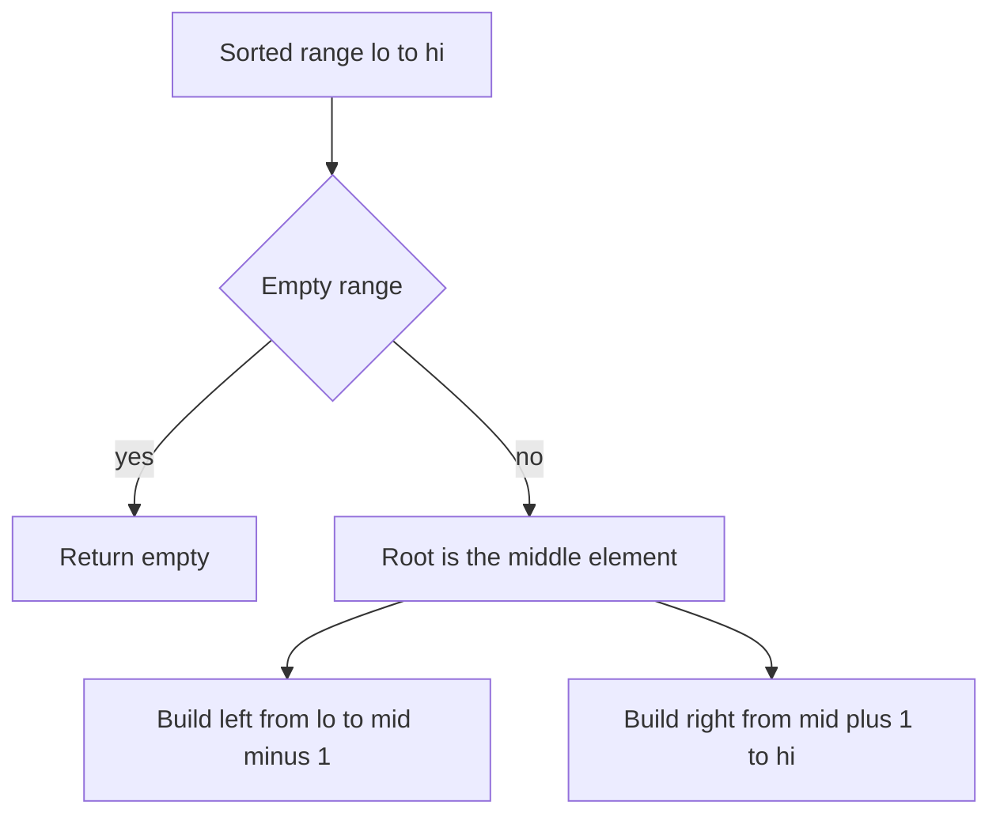

## The hook

A librarian has a long row of books sorted by number and wants to label a tree of signposts so anyone can find a book in as few turns as possible. If she puts the first book at the top, every search goes right, right, right: a chain. If she puts the middle book at the top, half the books go left and half go right, and doing the same at every signpost gives the shortest possible signpost tree.

That is how you build a [[height-balanced]] binary search tree from sorted data. It is divide and conquer in its simplest form, and it is also the cleanest way to repair a BST that has become a long chain.

## The problem

Given sorted values, build a BST whose heights are balanced: at every node, the two subtree heights differ by at most one.

| Input | Problem |
|---|---|
| a sorted array, such as [1, 3, 5, 7, 9, 11] | *Convert Sorted Array to Binary Search Tree* |
| a sorted singly linked list | *Convert Sorted List to Binary Search Tree* |
| an existing, possibly lopsided BST | *Balance a Binary Search Tree* |

## The obvious approach

Insert the values one by one into an empty BST. With sorted input, every new value goes to the far right, and the result is a chain of height n, the worst possible tree. Inserting into a self-balancing tree would work, but it is O(n log n) and needs rotations, as described in [Rebalancing a Mobile Hanging From the Ceiling](article:dsa-balanced-trees-intuition). Knowing the values are sorted lets you do better.

## The key insight

:::analogy
Picture the sorted row of books. Pick the middle book and make it the first signpost: everything to its left will be found by turning left, everything to its right by turning right. Then do the same with the left half of the row and with the right half, each time choosing its middle book as the next signpost. Because every split cuts a row in half, no path from the top is longer than about log₂ n signposts.
:::

So the algorithm is:

- build(lo, hi): if lo > hi, return an empty tree;
- mid = (lo + hi) / 2, the [[middle element]];
- the root holds a[mid], its left subtree is build(lo, mid − 1), its right subtree is build(mid + 1, hi).

Every split produces halves whose sizes differ by at most one, so the heights of every node's subtrees differ by at most one, and the whole tree has height ⌈log₂(n + 1)⌉. Each element becomes exactly one node, so the build is O(n).

### Linked lists: build in inorder

A linked list cannot jump to its middle. Finding the middle with slow and fast pointers at every level costs O(n) per level, O(n log n) in total. There is a neat O(n) alternative, [[inorder simulation]]: build the tree in the order an inorder traversal would visit it.

- build(size): if size is 0, return empty;
- build the left subtree from the first size / 2 list nodes, by recursing first;
- the current list node is now the root; take it and advance the list pointer;
- build the right subtree from the remaining size − size / 2 − 1 nodes.

Because the recursion consumes list nodes in inorder order, which is sorted order, the next list node is always exactly the one the tree needs.

### Rebalancing any BST

To balance an existing BST, list its keys with an inorder traversal, which gives them sorted, then build a new tree from the middle out. Both steps are O(n). That is [[rebalancing]] without any rotations.



:::insight
In sorted data the middle element splits the rest into two halves of nearly equal size, so making it the root and recursing on both halves produces a tree whose height is as small as possible.
:::

## Walk through an example

Build from [1, 3, 5, 7, 9, 11], indices 0 to 5.

| Call (lo, hi) | mid | Root | Left call | Right call |
|---|---|---|---|---|
| 0, 5 | 2 | 5 | 0, 1 | 3, 5 |
| 0, 1 | 0 | 1 | empty | 1, 1 |
| 1, 1 | 1 | 3 | empty | empty |
| 3, 5 | 4 | 9 | 3, 3 | 5, 5 |
| 3, 3 | 3 | 7 | empty | empty |
| 5, 5 | 5 | 11 | empty | empty |

```text
        5
      /   \
     1     9
      \   / \
       3 7   11
```

Height 3 for 6 keys, and at every node the subtree heights differ by at most one: at 1 they are 0 and 1. On the shelf, every signpost sits in the middle of its section of books.

### The list version on 1 → 3 → 5 → 7 → 9 → 11

build(6) first builds the left subtree of size 3 from 1, 3 and 5. Inside it, build(3) builds a left subtree of size 1, consuming 1; takes 3 as its root; builds a right subtree of size 1, consuming 5. Back at the top, the list pointer is at 7, which becomes the root. Then the right subtree of size 2 consumes 9 and 11. The tree differs from the array version, root 7 instead of 5, because the left half gets the larger share here, but it is just as balanced.

### Rebalancing a chain

A BST built by inserting 1, 2, 3, 4, 5, 6, 7 in order is a chain of height 7. Its inorder traversal is 1 to 7; building from the middle gives root 4, with 2 and 6 below it and 1, 3, 5, 7 as leaves: height 3.

:::try-this
Build a balanced BST from [2, 4, 6, 8, 10] with mid = (lo + hi) / 2. What is the root, and what are its children? (lo = 0 and hi = 4 give mid = 2, so the root is 6. The left half [2, 4] gives root 2 with right child 4; the right half [8, 10] gives root 8 with right child 10.)
:::

:::warning
Common misconception: "Building the tree is O(n log n) because it is divide and conquer." It is divide and conquer, but each call does O(1) work apart from its recursive calls, and there is one call per element plus one per empty range. The [[recurrence]] is T(n) = 2T(n/2) + O(1), which is O(n), unlike merge sort's 2T(n/2) + O(n).
:::

## The code

```pseudo
from_array(a, lo, hi):
    if lo > hi: return empty
    mid = (lo + hi) / 2
    node = new node(a[mid])
    node.left = from_array(a, lo, mid - 1)
    node.right = from_array(a, mid + 1, hi)
    return node

from_list(size):                    # list pointer advances in inorder order
    if size == 0: return empty
    left = from_list(size / 2)
    node = new node(current list value); advance the list
    node.left = left
    node.right = from_list(size - size / 2 - 1)
    return node
```

```cpp
#include <bits/stdc++.h>
using namespace std;

struct Node {
    int val;
    Node *left = nullptr, *right = nullptr;
    Node(int v) : val(v) {}
};
struct ListNode {
    int val;
    ListNode* next;
    ListNode(int v, ListNode* n = nullptr) : val(v), next(n) {}
};

Node* fromArray(const vector<int>& a, int lo, int hi) {
    if (lo > hi) return nullptr;
    int mid = lo + (hi - lo) / 2;                     // the middle book
    Node* n = new Node(a[mid]);
    n->left = fromArray(a, lo, mid - 1);
    n->right = fromArray(a, mid + 1, hi);
    return n;
}

Node* fromList(ListNode*& cur, int size) {           // O(n): consume the list in inorder order
    if (size == 0) return nullptr;
    Node* left = fromList(cur, size / 2);
    Node* n = new Node(cur->val);
    cur = cur->next;
    n->left = left;
    n->right = fromList(cur, size - size / 2 - 1);
    return n;
}

void inorder(Node* n, vector<int>& out) { if (n) inorder(n->left, out), out.push_back(n->val), inorder(n->right, out); }
int height(Node* n) { return n ? 1 + max(height(n->left), height(n->right)) : 0; }
bool balanced(Node* n) {
    return !n || (abs(height(n->left) - height(n->right)) <= 1 && balanced(n->left) && balanced(n->right));
}

Node* rebalance(Node* root) {
    vector<int> keys;
    inorder(root, keys);                              // sorted keys
    return fromArray(keys, 0, (int)keys.size() - 1);
}

int main() {
    vector<int> a = {1, 3, 5, 7, 9, 11};
    Node* t = fromArray(a, 0, 5);
    cout << t->val << ' ' << t->left->val << ' ' << t->right->val << ' ' << height(t) << ' ' << balanced(t) << '\n';   // 5 1 9 3 1

    ListNode* head = nullptr;
    for (int i = 5; i >= 0; i--) head = new ListNode(a[i], head);
    ListNode* cur = head;
    Node* u = fromList(cur, 6);
    vector<int> in;
    inorder(u, in);
    cout << u->val << ' ' << height(u) << ' ' << balanced(u) << " | ";
    for (int x : in) cout << x << ' ';
    cout << '\n';                                     // 7 3 1 | 1 3 5 7 9 11

    Node* chain = nullptr;                            // 1..7 inserted in order: a chain
    Node** slot = &chain;
    for (int v = 1; v <= 7; v++) { *slot = new Node(v); slot = &(*slot)->right; }
    Node* fixed = rebalance(chain);
    cout << height(chain) << ' ' << fixed->val << ' ' << height(fixed) << '\n';   // 7 4 3

    Node* s = fromArray({2, 4, 6, 8, 10}, 0, 4);
    cout << s->val << ' ' << s->left->val << ' ' << s->left->right->val << ' ' << s->right->val << '\n';   // 6 2 4 8
}
```

`mid = lo + (hi − lo) / 2` is the overflow-safe way to write (lo + hi) / 2, the same as in [Binary Search Without the Off-by-One Fear](article:dsa-binary-search). The `balanced` check here recomputes heights and is only for testing; the linear version is in [Managers Summarising Their Teams' Reports](article:dsa-tree-recursion).

## Complexity

- **From an array: O(n) time,** one node per element and O(1) work per call; O(log n) recursion depth.
- **From a linked list, inorder simulation: O(n) time,** O(log n) recursion. Finding the middle with slow and fast pointers at each level instead costs O(n log n).
- **Rebalancing: O(n) time and O(n) space** for the list of keys.
- **The resulting tree has height ⌈log₂(n + 1)⌉,** the smallest possible.

## Common mistakes

- **Off-by-one in the halves,** such as recursing on (lo, mid) and (mid, hi), which repeats the middle element or loops forever.
- **Overflow in (lo + hi) / 2** for very large index ranges; use lo + (hi − lo) / 2.
- **Inserting sorted values one by one** into a plain BST, which builds a chain.
- **Finding the list's middle at every level** when an O(n) answer is expected.
- **Forgetting to advance the list pointer** in the inorder simulation, or passing it by value so the advance is lost.
- **Expecting one exact tree:** choosing the left or right middle gives different but equally valid balanced trees, and judges usually accept any.

## Practice problems

*Convert Sorted Array to Binary Search Tree* is the walkthrough. *Convert Sorted List to Binary Search Tree* adds the linked-list constraint; solve it once with slow and fast pointers and once with the O(n) inorder simulation. *Balance a Binary Search Tree* combines an inorder traversal with the same middle-out build.

## Key takeaways

- A height-balanced BST is built from sorted data by making the middle element the root and building both halves the same way.
- Every split leaves halves whose sizes differ by at most one, so the tree's height is the minimum possible, about log₂ n.
- The build is O(n), because each element becomes one node with O(1) work, giving the recurrence T(n) = 2T(n/2) + O(1).
- A sorted linked list can be converted in O(n) by building the tree in inorder order and consuming the list one node at a time.
- Any BST can be rebalanced by reading its keys in inorder, which sorts them, and building a new tree from the middle out.
