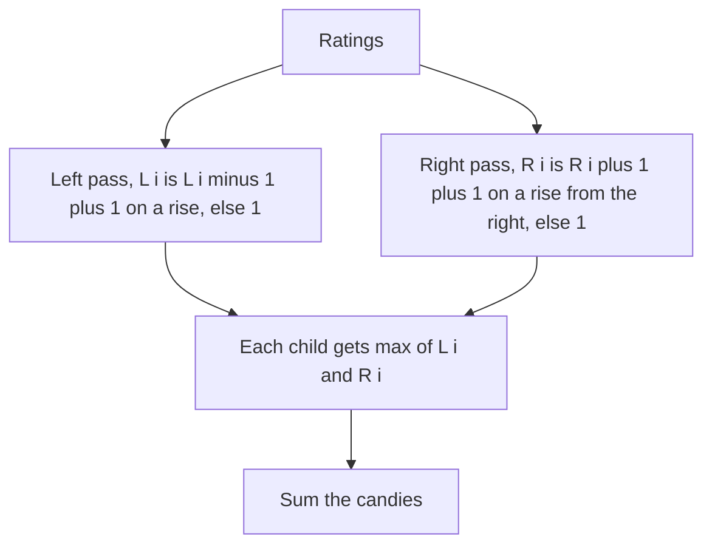

## The hook

Children stand in a line, each with a rating. Every child gets at least one candy, and any child rated higher than a neighbour must get more candies than that neighbour. What is the fewest candies in total?

People usually try one clever pass, patch it with special cases, and end up with a tangle that fails on a dip in the middle. The clean answer uses two simple passes and one max, and the same shape solves several problems that look unrelated.

## The problem

Given ratings for n children in a row, hand out candies so that:

- each child gets at least one;
- a child with a strictly higher rating than an adjacent child gets strictly more candies than that child.

Return the fewest candies needed. Equal ratings impose no rule between those two children.

For ratings [1, 3, 4, 4, 2, 1, 2, 5, 3], the answer is 18.

## The obvious approach

Start everyone at 1 candy and repeatedly scan the line, giving one more candy to any child who breaks a rule, until nothing changes. Each scan fixes something, but a long decreasing run fixes only one more child per scan, so it can take n scans: O(n²).

A single pass is the next idea. Going left to right, give a child one more than the left neighbour whenever their rating is higher. That handles every left-neighbour rule and ignores every right-neighbour rule:

| Ratings | 5 | 3 | 1 |
|---|---|---|---|
| One forward pass | 1 | 1 | 1 |
| Rules broken | 5 > 3 but 1 = 1 | 3 > 1 but 1 = 1 | |

## The key insight

:::analogy
Hire two teachers. The first walks the line from left to right and checks only one rule: "if you are rated higher than the child on your left, you have more candies than them." The second walks from right to left and checks only "more than the child on your right." Each teacher writes the fewest candies their own rule demands. Then every child takes the larger of the two numbers. Both teachers are satisfied, and nobody got a candy that either teacher did not insist on.
:::

That is a [[two-pass greedy]]. The first teacher's number is the [[left requirement]], L[i]: 1, or L[i - 1] + 1 if the rating rises from the left. The second teacher's number is the [[right requirement]], R[i], computed the same way from the right. The answer gives child i max(L[i], R[i]).

**Why it is enough.** If child i is rated higher than the left neighbour, then L[i] = L[i - 1] + 1. That neighbour is rated lower than child i, its right neighbour, so the second teacher's rule never fires for it and R[i - 1] = 1. So the neighbour gets max(L[i - 1], 1) = L[i - 1], which is less than L[i], which is at most child i's candies. The right side is symmetric.

**Why it is the fewest.** A child at the top of an increasing run of length k from the left needs at least k candies, so L[i] is a [[lower bound]], and so is R[i]. The larger of two lower bounds is still a lower bound, and we just showed it is achievable, so it is optimal.

### The same shape, elsewhere

Whenever each position depends on "the best thing to my left" and "the best thing to my right", compute each side in its own pass and combine:

| Problem | Forward pass | Backward pass | Combine |
|---|---|---|---|
| Candy | Increasing run length from the left | Increasing run length from the right | max |
| Trapping Rain Water | Tallest bar so far from the left | Tallest bar so far from the right | min, minus own height |
| Shortest Distance to a Character | Distance to the last occurrence on the left | Distance to the next occurrence on the right | min |
| Product of Array Except Self | Product of everything to the left | Product of everything to the right | multiply |

Trapping Rain Water gets its own full treatment in [Filling the Potholes Between Buildings](article:dsa-trapping-rain-water), including a two-pointer version with O(1) space, and the product version is in [Everyone's Product but Your Own, Without Dividing](article:dsa-product-except-self).

### A one-pass relative: forming a target with increments

*Minimum Number of Increments on Subarrays to Form a Target Array* starts from zeros, and one operation adds 1 to any contiguous subarray. Read the target from left to right:

- the first value needs target[0] operations;
- at each [[rise]] from target[i - 1] to a larger target[i], the operations already running stretch one more step, but the extra target[i] - target[i - 1] must be new;
- at a drop, some running operations simply stop, which costs nothing.

So the answer is target[0] plus the sum of all rises.



:::insight
When each position must satisfy a rule about its left side and a rule about its right side, satisfy each side in its own pass. Combining the two answers with max, or min, or a product, handles both at once, and it is easy to prove because each pass is simple on its own.
:::

## Walk through an example

### Candy on [1, 3, 4, 4, 2, 1, 2, 5, 3]

| Index | 0 | 1 | 2 | 3 | 4 | 5 | 6 | 7 | 8 |
|---|---|---|---|---|---|---|---|---|---|
| Rating | 1 | 3 | 4 | 4 | 2 | 1 | 2 | 5 | 3 |
| L, first teacher | 1 | 2 | 3 | 1 | 1 | 1 | 2 | 3 | 1 |
| R, second teacher | 1 | 1 | 1 | 3 | 2 | 1 | 1 | 2 | 1 |
| Candies, max | 1 | 2 | 3 | 3 | 2 | 1 | 2 | 3 | 1 |

Total 18. Look at index 3, the second 4. The first teacher gives it 1, because the equal 4 on its left imposes no rule. The second teacher sees the run 1, 2, 4 coming from the right and gives 3. The max, 3, beats the child rated 2 on the right, who has 2.

At index 2, the first teacher's 3 wins; at index 3, the second teacher's 3 wins. Neither pass alone gets both right.

### Trapping Rain Water on heights [3, 0, 2, 0, 4, 1, 2]

| Index | 0 | 1 | 2 | 3 | 4 | 5 | 6 |
|---|---|---|---|---|---|---|---|
| Height | 3 | 0 | 2 | 0 | 4 | 1 | 2 |
| Tallest from left | 3 | 3 | 3 | 3 | 4 | 4 | 4 |
| Tallest from right | 4 | 4 | 4 | 4 | 4 | 2 | 2 |
| Water: min - height | 0 | 3 | 1 | 3 | 0 | 1 | 0 |

Total water 8. Same two teachers, different rule: each looks for the tallest wall on their side, and the water level is the shorter of the two walls.

### Distance to the nearest "c" in "abacbbc"

| Index | 0 | 1 | 2 | 3 | 4 | 5 | 6 |
|---|---|---|---|---|---|---|---|
| Character | a | b | a | c | b | b | c |
| From the last c on the left | none | none | none | 0 | 1 | 2 | 0 |
| To the next c on the right | 3 | 2 | 1 | 0 | 2 | 1 | 0 |
| Answer, min | 3 | 2 | 1 | 0 | 1 | 1 | 0 |

### Increments to form [3, 1, 4, 4, 2, 5, 1]

| Step | 3 | 3 → 1 | 1 → 4 | 4 → 4 | 4 → 2 | 2 → 5 | 5 → 1 |
|---|---|---|---|---|---|---|---|
| New operations | 3 | 0, a drop | 3, a rise | 0 | 0 | 3 | 0 |

Total 9.

:::try-this
Find the candies for ratings [5, 3, 1, 2]. (Left pass: 1, 1, 1, 2, since only 1 → 2 rises. Right pass: 3, 2, 1, 1, since from the right the run 1, 3, 5 rises. Max: 3, 2, 1, 2, total 8.)
:::

:::warning
Common misconception: "Equal neighbours must get equal candies." The rule only constrains strictly higher ratings. In [1, 2, 2], the answer is 1, 2, 1 for a total of 4; forcing the two 2s to match would give 5. Each pass should reset to 1 when the ratings are equal.
:::

## The code

```pseudo
candy(r):
    L = [1] * n; R = [1] * n
    for i in 1 .. n-1:    if r[i] > r[i-1]: L[i] = L[i-1] + 1
    for i in n-2 .. 0:    if r[i] > r[i+1]: R[i] = R[i+1] + 1
    return sum(max(L[i], R[i]) for i in 0 .. n-1)

min_increments(target):
    ops = target[0]
    for i in 1 .. n-1: ops += max(0, target[i] - target[i-1])
    return ops
```

```cpp
#include <bits/stdc++.h>
using namespace std;

long long candy(const vector<int>& r) {
    int n = r.size();
    vector<int> L(n, 1), R(n, 1);
    for (int i = 1; i < n; i++) if (r[i] > r[i - 1]) L[i] = L[i - 1] + 1;       // first teacher
    for (int i = n - 2; i >= 0; i--) if (r[i] > r[i + 1]) R[i] = R[i + 1] + 1;  // second teacher
    long long total = 0;
    for (int i = 0; i < n; i++) total += max(L[i], R[i]);
    return total;
}

int trap(const vector<int>& h) {
    int n = h.size(), water = 0;
    vector<int> left(n), right(n);
    for (int i = 0; i < n; i++) left[i] = max(i ? left[i - 1] : 0, h[i]);
    for (int i = n - 1; i >= 0; i--) right[i] = max(i + 1 < n ? right[i + 1] : 0, h[i]);
    for (int i = 0; i < n; i++) water += min(left[i], right[i]) - h[i];
    return water;
}

vector<int> shortestToChar(const string& s, char c) {
    int n = s.size();
    vector<int> d(n, INT_MAX);
    for (int i = 0, last = -1; i < n; i++) {
        if (s[i] == c) last = i;
        if (last >= 0) d[i] = i - last;
    }
    for (int i = n - 1, next = -1; i >= 0; i--) {
        if (s[i] == c) next = i;
        if (next >= 0) d[i] = min(d[i], next - i);
    }
    return d;
}

long long minIncrements(const vector<int>& t) {
    long long ops = t[0];
    for (size_t i = 1; i < t.size(); i++) ops += max(0, t[i] - t[i - 1]);       // pay only for rises
    return ops;
}

int main() {
    cout << candy({1, 3, 4, 4, 2, 1, 2, 5, 3}) << ' ' << candy({5, 3, 1, 2}) << ' '
         << candy({1, 2, 2}) << '\n';                                            // 18 8 4
    cout << trap({3, 0, 2, 0, 4, 1, 2}) << '\n';                                 // 8
    for (int x : shortestToChar("abacbbc", 'c')) cout << x << ' ';
    cout << '\n';                                                                // 3 2 1 0 1 1 0
    cout << minIncrements({3, 1, 4, 4, 2, 5, 1}) << '\n';                        // 9
}
```

## Complexity

- **Candy: O(n) time, O(n) space** for the two arrays. One of them can be dropped by folding the backward pass into the sum, and an O(1)-space version counts the lengths of rising and falling slopes, at the cost of trickier code.
- **Trapping Rain Water: O(n) time, O(n) space** here, or O(1) space with two pointers.
- **Shortest Distance to a Character: O(n) time,** O(n) for the output.
- **Increments: O(n) time, O(1) space.**

## Common mistakes

- **Trying to fix both sides in one pass,** which needs look-ahead and special cases for falling runs.
- **Treating equal ratings as a constraint,** which overcounts.
- **Taking the sum of L and R instead of the max,** which double-counts the shared candy.
- **In Trapping Rain Water, using the max of the two walls** instead of the min; water spills over the shorter wall.
- **In the increments problem, paying for drops,** which is free because running operations can just stop.

## Practice problems

*Candy* is the pattern in its purest form. *Trapping Rain Water* is the same two teachers with prefix maximums, and *Shortest Distance to a Character* with "last seen" positions. *Minimum Number of Increments on Subarrays to Form a Target Array* is a one-pass greedy that pays only for rises, a useful contrast that shows when one direction is enough. The general greedy proof habits are in [A Bus Conductor Who Never Reseats Anyone](article:dsa-greedy-exchange).

## Key takeaways

- Candy is solved by a left pass enforcing the left-neighbour rule, a right pass enforcing the right-neighbour rule, and giving each child the larger of the two.
- Each pass computes a lower bound, and the max of the two bounds is both necessary and achievable, which proves the answer is optimal.
- Equal neighbours impose no rule, so each pass resets to 1 when ratings are equal.
- The same two-pass shape solves Trapping Rain Water with min of prefix maximums, nearest-character distances with min, and product except self with multiplication.
- Forming a target with subarray increments needs only one pass: the first value plus the sum of every rise.
