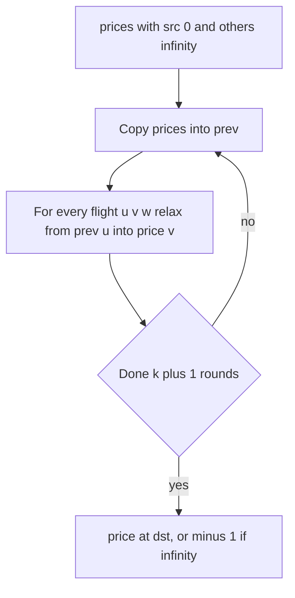

## The hook

You are booking a trip, and the cheapest itinerary has four layovers. You refuse to spend a day in airports, so you set a rule: at most one stop. Suddenly the cheapest fare is useless, and the best allowed fare may go through a city that looked like a bad idea.

This is the classic example of a shortest-path problem where the usual tools give wrong answers. The fix is a small change to Bellman-Ford, and the lesson, "put the constraint into the state", reaches far beyond flights.

## The problem

There are n cities and directed flights (from, to, price). Find the cheapest price from src to dst using at most k [[stop]]s, meaning at most k + 1 flights, or return -1 if no such route exists.

Example: cities 0 to 4, flights 0 → 1 (50), 1 → 2 (50), 2 → 4 (50), 0 → 3 (120), 3 → 4 (60), 0 → 4 (300), 1 → 4 (220), from 0 to 4.

| Stops allowed | Cheapest allowed route | Price |
|---|---|---|
| 0 | 0 → 4 | 300 |
| 1 | 0 → 3 → 4 | 180 |
| 2 | 0 → 1 → 2 → 4 | 150 |

## The obvious approach

Run Dijkstra by price, track how many flights each route used, and refuse to extend a route beyond k + 1 flights. Settle each city the first time it is popped, as usual.

It fails. Take flights 0 → 1 (10), 1 → 2 (10), 0 → 2 (100), 2 → 3 (10), with at most 1 stop from 0 to 3. Dijkstra pops city 2 first at price 20, via 0 → 1 → 2, which already uses 2 flights; extending it to 3 would need a third, so it is refused. City 2 is now settled, and the later entry, 0 → 2 at price 100 with only 1 flight, is thrown away. City 3 is never reached, so the answer comes out as -1, while the true answer is 0 → 2 → 3 for 110.

The trouble is that "cheapest so far" is no longer the only thing that matters about an arrival. A pricier arrival with fewer flights used can be the one that still has room to finish.

## The key insight

:::analogy
A travel agent plans in rounds. In round 1, they write down the best price to every city using exactly one flight from home. In round 2, they look only at the list from round 1 and ask, for each city, "can one more flight from a city on that list make it cheaper?". They never use a price they wrote down in the same round, because that price already includes this round's flight. After k + 1 rounds, the list holds the best price to every city using at most k + 1 flights.
:::

This is Bellman-Ford from [A Rumour Spreading Round by Round](article:dsa-bellman-ford-floyd), limited to k + 1 rounds, with one essential detail: the [[round snapshot]]. Copy the prices at the start of each round, and relax every flight from the copy into the live array. Then after round r, the array holds exactly the cheapest [[edge-limited shortest path]] with at most r flights.

Without the snapshot, relaxing flights in an unlucky order lets one round chain several flights together, and the stop limit silently breaks.

### Two other correct approaches

- **BFS by levels.** Process the queue one level at a time, each level being one more flight, and allow a city to be re-entered when its price improves. It is Bellman-Ford with a queue.
- **Dijkstra over [[layered state]]s.** Make the vertex (city, flights used). Pop by price; a state's flight count is part of its identity, so 0 → 2 with 1 flight and 0 → 1 → 2 with 2 flights are different vertices and neither discards the other. It works, with V × (k + 2) states.

### The same idea with a coupon: Flight Discount

CSES *Flight Discount* lets you halve the price of one flight, rounding down, and asks for the cheapest route from city 1 to city n. Use two layers: (city, coupon unused) and (city, coupon used). Every flight gives a full-price edge within each layer and a half-price edge from the unused layer to the used layer. All prices are non-negative, so plain Dijkstra on the doubled graph is exact. The answer is the better of the two layers at city n.

| Constraint | Extra state | Algorithm |
|---|---|---|
| At most k + 1 flights | flights used, 0 to k + 1 | Bellman-Ford with snapshots, or Dijkstra on (city, flights) |
| One discount coupon | coupon used, 0 or 1 | Dijkstra on (city, used) |
| A time limit with separate fees | time spent | Dijkstra on (city, time) or DP over time |



:::insight
When a path constraint such as a stop limit matters, the cheapest arrival at a city is not automatically the best one. Either count rounds explicitly, as Bellman-Ford with snapshots does, or make the constraint part of each vertex, so different arrivals stop competing with each other.
:::

## Walk through an example

The five-city example, from 0 to 4, with snapshot rounds. Prices are listed for cities 0 to 4.

| After round (flights) | Prices | What changed |
|---|---|---|
| start | 0, ∞, ∞, ∞, ∞ | |
| 1 | 0, 50, ∞, 120, 300 | the three flights out of 0 |
| 2 | 0, 50, 100, 120, 180 | city 2 via 1; city 4 via 3 beats 300 and 1 → 4's 270 |
| 3 | 0, 50, 100, 120, 150 | city 4 via 2 |

With k = 1 stop, run 2 rounds and read 180. With k = 2, run 3 rounds and read 150.

Now drop the snapshot and relax in the listed flight order for one round (k = 0). Flight 0 → 1 sets city 1 to 50; flight 1 → 2, in the same round, sets city 2 to 100; flight 2 → 4 sets city 4 to 150. The answer for "no stops" comes out as 150, the price of a three-flight route. The snapshot is what stops this.

### Flight Discount

Cities 1 to 4, flights 1 → 2 (8), 2 → 4 (6), 1 → 3 (2), 3 → 4 (10).

| Route | Without coupon | Best with coupon |
|---|---|---|
| 1 → 2 → 4 | 14 | halve 8: 4 + 6 = 10 |
| 1 → 3 → 4 | 12 | halve 10: 2 + 5 = 7 |

The best is 7, with the coupon on the most expensive flight of its route. Here the full-price winner also wins with the coupon, but that is not guaranteed: a route with one very expensive flight can overtake once that flight is halved, which is why the coupon must be part of the search rather than applied afterwards.

:::try-this
In the five-city example, add a flight 3 → 2 costing 5. What is the cheapest price from 0 to 4 with at most 2 stops? (0 → 3 → 2 → 4 costs 120 + 5 + 50 = 175, worse than 0 → 1 → 2 → 4 at 150. The new flight does not help, and the answer stays 150. With at most 1 stop it is still 180.)
:::

:::warning
Common misconception: "Stops are the number of cities on the route." A stop is an intermediate city only; the start and destination do not count. At most k stops means at most k + 1 flights, so Bellman-Ford runs k + 1 rounds. Running k rounds is the most common off-by-one in this problem.
:::

## The code

```pseudo
cheapest_with_stops(n, flights, src, dst, k):
    price = [inf] * n; price[src] = 0
    repeat k + 1 times:                       # one flight per round
        prev = copy of price
        for (u, v, w) in flights:
            if prev[u] != inf and prev[u] + w < price[v]: price[v] = prev[u] + w
    return price[dst] if price[dst] != inf else -1

flight_discount(n, flights):                  # states (city, used)
    dist[1][0] = 0; heap = [(0, 1, 0)]
    pop (d, u, c); skip stale
    for (v, w) in adj[u]:
        relax (v, c) with d + w
        if c == 0: relax (v, 1) with d + w / 2
    return min(dist[n][0], dist[n][1])
```

```cpp
#include <bits/stdc++.h>
using namespace std;
using ll = long long;
const ll INF = LLONG_MAX / 4;

int findCheapestPrice(int n, const vector<array<int, 3>>& flights, int src, int dst, int k) {
    vector<ll> price(n, INF);
    price[src] = 0;
    for (int round = 0; round <= k; round++) {           // k stops = k + 1 flights
        vector<ll> prev = price;                         // snapshot
        for (auto& [u, v, w] : flights)
            if (prev[u] != INF && prev[u] + w < price[v]) price[v] = prev[u] + w;
    }
    return price[dst] == INF ? -1 : (int)price[dst];
}

int settleOnceDijkstra(int n, const vector<array<int, 3>>& flights, int src, int dst, int k) {   // WRONG on purpose
    vector<vector<pair<int, int>>> adj(n);
    for (auto& [u, v, w] : flights) adj[u].push_back({v, w});
    vector<bool> settled(n, false);
    priority_queue<array<ll, 3>, vector<array<ll, 3>>, greater<>> pq;   // price, city, flights
    pq.push({0, src, 0});
    while (!pq.empty()) {
        auto [p, u, f] = pq.top(); pq.pop();
        if (settled[u]) continue;
        settled[u] = true;
        if (u == dst) return p;
        if (f == k + 1) continue;                        // no flights left
        for (auto [v, w] : adj[u]) pq.push({p + w, v, f + 1});
    }
    return -1;
}

ll flightDiscount(int n, const vector<array<int, 3>>& flights) {        // cities 1..n
    vector<vector<pair<int, int>>> adj(n + 1);
    for (auto& [u, v, w] : flights) adj[u].push_back({v, w});
    vector<array<ll, 2>> dist(n + 1, {INF, INF});
    priority_queue<array<ll, 3>, vector<array<ll, 3>>, greater<>> pq;   // dist, city, used
    dist[1][0] = 0, pq.push({0, 1, 0});
    while (!pq.empty()) {
        auto [d, u, c] = pq.top(); pq.pop();
        if (d > dist[u][c]) continue;
        for (auto [v, w] : adj[u]) {
            if (d + w < dist[v][c]) dist[v][c] = d + w, pq.push({dist[v][c], v, c});
            if (c == 0 && d + w / 2 < dist[v][1]) dist[v][1] = d + w / 2, pq.push({dist[v][1], v, 1});
        }
    }
    return min(dist[n][0], dist[n][1]);
}

int main() {
    vector<array<int, 3>> f = {{0, 1, 50}, {1, 2, 50}, {2, 4, 50}, {0, 3, 120}, {3, 4, 60}, {0, 4, 300}, {1, 4, 220}};
    for (int k = 0; k <= 2; k++) cout << findCheapestPrice(5, f, 0, 4, k) << ' ';
    cout << '\n';                                                       // 300 180 150
    vector<array<int, 3>> trap = {{0, 1, 10}, {1, 2, 10}, {0, 2, 100}, {2, 3, 10}};
    cout << settleOnceDijkstra(4, trap, 0, 3, 1) << ' ' << findCheapestPrice(4, trap, 0, 3, 1) << '\n';   // -1 110
    cout << flightDiscount(4, {{1, 2, 8}, {2, 4, 6}, {1, 3, 2}, {3, 4, 10}}) << '\n';                    // 7
}
```

`settleOnceDijkstra` is included only to show the failure from the obvious approach: on the trap input it returns -1, while the snapshot Bellman-Ford finds 110.

## Complexity

- **Bellman-Ford with snapshots: O(k × E) time,** O(V) space for the two price arrays.
- **Dijkstra on (city, flights used): O(V k + E k) states and edges,** times a log factor for the heap.
- **Flight Discount: O((V + E) log V)** on a graph with 2V vertices and up to 3E edges.

## Common mistakes

- **Running k rounds instead of k + 1;** k stops allow k + 1 flights.
- **Relaxing in place** without a snapshot, which lets one round use several flights.
- **Settling each city once** by price while also limiting flights, which discards arrivals that used fewer flights.
- **Relaxing from an infinite price,** which can create fake prices when combined with overflow.
- **In Flight Discount, using the coupon edge from the used layer,** which allows two coupons, or forgetting 64-bit prices.

## Practice problems

*Cheapest Flights Within K Stops* is this walkthrough. *Flight Discount* is the two-layer Dijkstra. *Minimum Cost to Reach Destination in Time* puts time into the state alongside the city, with fees as the cost, the same "constraint as state" idea at a larger scale. The general machinery is in [Water Racing Through a Network of Pipes](article:dsa-dijkstra) and [A Rumour Spreading Round by Round](article:dsa-bellman-ford-floyd).

## Key takeaways

- With a limit of k stops, the cheapest route may differ from the overall cheapest route, so ordinary shortest-path algorithms give wrong answers.
- Bellman-Ford run for k + 1 rounds finds the cheapest route with at most k + 1 flights, provided each round relaxes only from a snapshot of the previous round.
- Dijkstra that settles each city once by price fails here, because a pricier arrival with fewer flights may be the only one that can still finish.
- Adding the constraint to the state, such as (city, flights used) or (city, coupon used), makes Dijkstra correct again on the layered graph.
- At most k stops means at most k + 1 flights, which is where most off-by-one errors in this problem come from.
