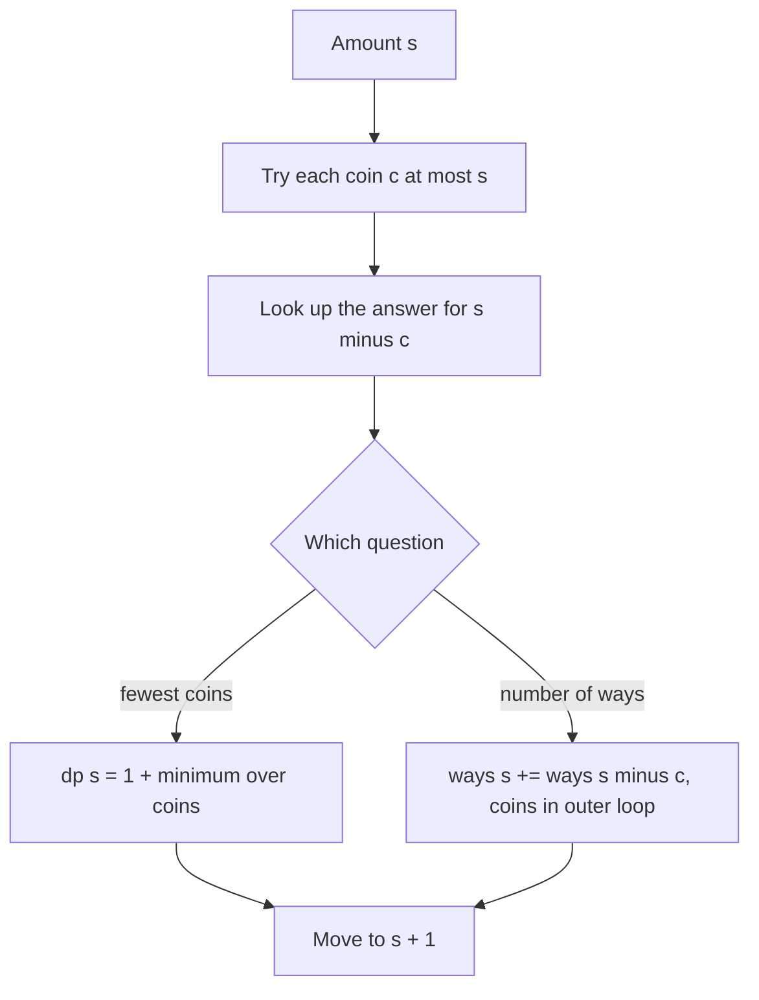

## The hook

A shopkeeper has to give ₹6 in change using coins worth ₹1, ₹3 and ₹4, and wants to hand over as few coins as possible. The instinct is to grab the biggest coin first: a ₹4, then ₹1 and ₹1, three coins. But two ₹3 coins would have done it.

That tiny counterexample is why Coin Change is one of the most frequently asked DP problems. It tests whether you can spot that a greedy rule is unsafe, set up a DP with the right "impossible" value, and then handle the follow-up, "how many ways can you make the amount?", without double counting.

## The problem

You are given a list of coin [[denomination]]s, each available in unlimited supply, and an amount A.

1. **Minimum coins:** return the fewest coins that add up to exactly A, or −1 if it cannot be done.
2. **Number of ways (follow-up):** return how many different combinations of coins add up to A, where the order of coins does not matter.

## The obvious approach

The [[greedy algorithm]] takes the largest coin that fits, repeatedly. It works for many real currencies: with 1, 2, 5 and 10, greedy is always optimal, because that is a [[canonical coin system]]. But nothing in the problem promises a canonical system, and {1, 3, 4} at amount 6 breaks greedy, as the hook showed.

The safe alternative, trying every combination by recursion, branches on every coin at every step and grows exponentially. The repeated work is obvious once you notice that "best way to make ₹2" gets recomputed inside many different branches.

## The key insight

:::analogy
Picture the shopkeeper at the counter thinking backwards. "Whatever I hand over, one coin goes last. If that last coin is ₹3, then before it I must have made ₹3 as cheaply as possible. If it is ₹4, I must have made ₹2 cheaply before it." So the best way to make ₹6 is one coin plus the best of: best for ₹5, best for ₹3, best for ₹2. And the counter can keep a little cheat sheet: best answer for ₹0, ₹1, ₹2 and so on, filled in from small amounts upwards.
:::

The cheat sheet is the DP table. This is exactly the unbounded knapsack from [A Vending Machine With Endless Stock](article:dsa-unbounded-knapsack), with "value" replaced by "one coin" and max replaced by min.

**Minimum coins:**

| Part | Definition |
|---|---|
| State | dp[s] = fewest coins that make exactly s |
| Transition | dp[s] = 1 + min(dp[s − c]) over coins c ≤ s |
| Base case | dp[0] = 0; every other dp[s] starts at the [[infinity sentinel]] |
| Answer | dp[A] if it is finite, else −1 |

**Number of combinations:**

| Part | Definition |
|---|---|
| State | ways[s] = number of coin combinations that make exactly s |
| Transition | for each coin c (outer loop), for s from c to A: ways[s] += ways[s − c] |
| Base case | ways[0] = 1: one way to make nothing, choose no coins |
| Answer | ways[A] |

:::insight
Every way of making s ends with some last coin c, and what comes before it is a way of making s − c. Minimum coins takes the best over those choices; counting adds them up. Only the combining rule and the starting values change.
:::



## Walk through an example

Coins {1, 3, 4}, amount 6.

**Minimum coins** (∞ means not reachable yet):

| s | 0 | 1 | 2 | 3 | 4 | 5 | 6 |
|---|---|---|---|---|---|---|---|
| dp[s] | 0 | 1 | 2 | 1 | 1 | 2 | 2 |
| last coin | – | 1 | 1 | 3 | 4 | 1 | 3 |

For s = 6: dp[5] + 1 = 3 (coin 1), dp[3] + 1 = 2 (coin 3), dp[2] + 1 = 3 (coin 4), so dp[6] = **2**. Following "last coin" back from 6 gives 3, then 3: the answer is 3 + 3.

**Number of combinations**, coins in the outer loop:

| After coin | 0 | 1 | 2 | 3 | 4 | 5 | 6 |
|---|---|---|---|---|---|---|---|
| start | 1 | 0 | 0 | 0 | 0 | 0 | 0 |
| 1 | 1 | 1 | 1 | 1 | 1 | 1 | 1 |
| 3 | 1 | 1 | 1 | 2 | 2 | 2 | 3 |
| 4 | 1 | 1 | 1 | 2 | 3 | 3 | 4 |

**4 ways**: 1+1+1+1+1+1, 1+1+1+3, 3+3 and 1+1+4.

**Unreachable amounts:** with coins {5, 7}, the amounts 1 to 4, 6, 8, 9, 11 and 13 stay at ∞. For amount 11 the answer is −1, while 12 = 5 + 7 needs 2 coins.

:::try-this
Coins {1, 5, 6, 9}, amount 11. What does greedy give, and what is the true minimum? (Greedy: 9 + 1 + 1, three coins. Optimal: 5 + 6, two coins.)
:::

## The code

```pseudo
min_coins(coins, A):
    dp = [0] + [INF] * A
    for s in 1 .. A:
        for c in coins:
            if c <= s and dp[s - c] + 1 < dp[s]:
                dp[s] = dp[s - c] + 1; last[s] = c
    return dp[A] if dp[A] < INF else -1

count_ways(coins, A):
    ways = [1] + [0] * A
    for c in coins:                  // coins outside: combinations
        for s in c .. A:
            ways[s] += ways[s - c]
    return ways[A]
```

```cpp
#include <bits/stdc++.h>
using namespace std;

int minCoins(const vector<int>& coins, int A) {
    const int INF = INT_MAX / 2;                  // safe to add 1 without overflow
    vector<int> dp(A + 1, INF);
    dp[0] = 0;
    for (int s = 1; s <= A; s++)
        for (int c : coins)
            if (c <= s) dp[s] = min(dp[s], dp[s - c] + 1);
    return dp[A] >= INF ? -1 : dp[A];
}

long long countWays(const vector<int>& coins, int A) {
    vector<long long> ways(A + 1, 0);
    ways[0] = 1;
    for (int c : coins)
        for (int s = c; s <= A; s++) ways[s] += ways[s - c];
    return ways[A];
}

int main() {
    cout << minCoins({1, 3, 4}, 6) << ' ' << countWays({1, 3, 4}, 6) << '\n';  // 2 4
    cout << minCoins({5, 7}, 11) << ' ' << minCoins({5, 7}, 12) << '\n';       // -1 2
}
```

## Complexity

- **Time:** O(n × A) for n denominations and amount A: every amount tries every coin.
- **Space:** O(A) for the table, plus O(A) for "last coin" if you want the actual coins.
- This is pseudo-polynomial: fine for A up to about 10⁶ or 10⁷, not for A around 10¹⁸.

## Common mistakes

:::warning
Common misconception: "taking the largest coin first always gives the fewest coins." It does for canonical systems like 1, 2, 5, 10, which is why it feels natural, but it fails for coin sets like {1, 3, 4} or {1, 5, 6, 9}. In an interview, give a counterexample before switching to DP; it shows you know why the DP is needed.
:::

- **Initialising with 0 or using INT_MAX directly**: 0 makes unreachable amounts look free, and INT_MAX + 1 overflows. Use a large value like INT_MAX / 2 or A + 1.
- **Returning infinity instead of −1** when the amount cannot be made.
- **Wrong loop order for counting**: amounts outside counts ordered sequences, which is CSES *Coin Combinations I*, not *Coin Combinations II*.
- **Forgetting ways[0] = 1**: without it, every count stays 0.
- **Overflow in counting**: apply the problem's modulus at each addition.

## Practice problems

*Coin Change* and *Minimizing Coins* (CSES) are the minimum-coins version. *Coin Change II* and *Coin Combinations II* count combinations with coins outside. *Coin Combinations I* counts ordered sequences with amounts outside; solving both CSES versions back to back is the best way to remember the loop order rule. The underlying pattern is in [A Vending Machine With Endless Stock](article:dsa-unbounded-knapsack).

## Key takeaways

- Greedy coin selection is only correct for canonical coin systems, so give a counterexample such as {1, 3, 4} at amount 6 and switch to DP.
- The minimum-coins DP sets dp[s] to one plus the smallest dp[s − c] over coins c, with dp[0] = 0 and everything else starting at infinity.
- Amounts still at infinity at the end cannot be made, and the answer for them is −1.
- Counting combinations uses ways[0] = 1 and puts the coin loop outside so each multiset is counted once.
- Recording the last coin used at each amount lets you rebuild the actual coins by walking back from A.
