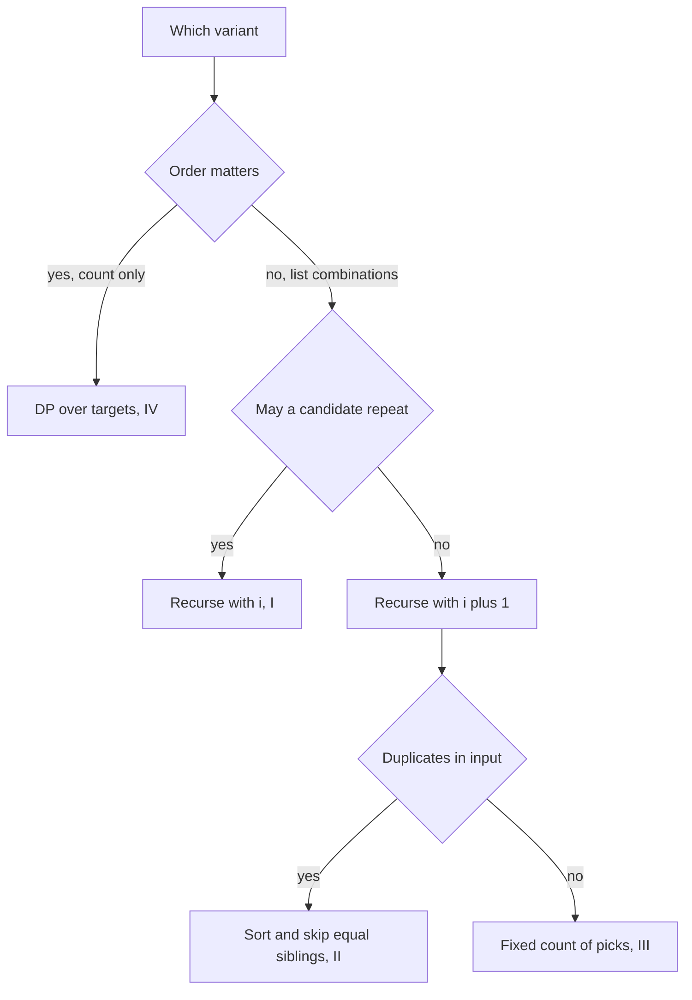

## The hook

A shopkeeper needs to make 8 rupees from coins of 2, 3 and 5 and wants every different way to do it. If she is not careful, she lists 2 + 3 + 3, then 3 + 2 + 3, then 3 + 3 + 2, three times the same handful of coins. The trick that stops this is the same trick behind four interview problems with almost the same name.

*Combination Sum* I, II and III differ in small rules: whether a number may be reused, whether the input has duplicates, whether the count of numbers is fixed. One backtracking loop handles all three by changing one or two lines. *Combination Sum IV* looks like a fourth sibling but is really a different problem, and recognising that is part of the interview.

## The problem

| Problem | Candidates | Rule | Target | Answers |
|---|---|---|---|---|
| I | [2, 3, 5], distinct | each may be reused | 8 | [2, 2, 2, 2], [2, 3, 3], [3, 5] |
| II | [3, 1, 3, 5, 1, 1], with duplicates | each element used at most once, no duplicate combinations | 8 | [1, 1, 1, 5], [1, 1, 3, 3], [3, 5] |
| III | the digits 1 to 9 | exactly k numbers, each used once | k = 3, sum 10 | [1, 2, 7], [1, 3, 6], [1, 4, 5], [2, 3, 5] |
| IV | [1, 3, 4] | reuse allowed, order matters, count only | 5 | 6 sequences |

## The obvious approach

Generate every sequence of candidates that adds up to the target, then sort each one and put it in a set to remove reorderings and duplicates. It works, but it builds many permutations of every [[combination]] and throws them away. With duplicates in the input it builds even more.

## The key insight

:::analogy
Picture the shopkeeper laying coins on the counter strictly from smallest to largest: once she puts down a 3, she never goes back to a 2. Then every handful of coins can be laid down in exactly one way, and 2 + 3 + 3 can never reappear as 3 + 2 + 3. If she has two identical 3-rupee coins in the till, she only tries "a 3 next" once at each step, because picking one identical coin or the other gives the same handful.
:::

Three small rules implement the shopkeeper:

- **[[Start index]].** The loop at each level starts at the index of the last candidate chosen. Never picking an earlier index means each combination is built in one order only.
- **[[Reuse]].** Recurse with i to allow choosing the same candidate again, as in I; recurse with i + 1 to forbid it, as in II and III.
- **Sort, then skip and break.** Sorting lets the loop `break` as soon as a candidate exceeds the remaining target, because every later one is bigger. In II, it also groups equal values, so the [[sibling skip]] `i > start && c[i] == c[i − 1]` stops equal values from starting the same subtree twice.

III fixes the number of picks: the base case is "k numbers chosen", and it records the combination only if the sum is exactly n.

IV is different. It asks for an [[ordered count]], so 1 + 3 + 1 and 3 + 1 + 1 are different. Listing every sequence would be wasteful, and the count for target t is simply the sum, over each candidate x, of the count for t − x. That is a one-dimensional DP, the same shape as climbing stairs in [Stairs, Robbers and Secret Codes](article:dsa-dp-1d).



:::insight
A start index turns ordered sequences into unordered combinations: each combination is built only in non-decreasing index order. Recursing with i or i + 1 then decides reuse, and sorting enables both the early break and the duplicate skip.
:::

## Walk through an example

### Combination Sum II: [3, 1, 3, 5, 1, 1], target 8

Sorted: [1, 1, 1, 3, 3, 5]. Each element may be used once, so recurse with i + 1.

| Level choices | Path | Remaining | What happens |
|---|---|---|---|
| 1, 1, 1 | 1, 1, 1 | 5 | next 3 then 3 is too much; 5 fits: record [1, 1, 1, 5] |
| 1, 1, then the third 1 is skipped at that level | 1, 1, 3 | 3 | the next 3 fits: record [1, 1, 3, 3] |
| first level: the second and third 1 are skipped | | | they would repeat the subtree that started with the first 1 |
| 3 | 3 | 5 | the second 3 is skipped at the first level; 5 fits: record [3, 5] |
| 5 | 5 | 3 | nothing after 5: dead end |

The answers are [1, 1, 1, 5], [1, 1, 3, 3] and [3, 5]. Without the sibling skip, the search would report [1, 1, 3, 3] three times (once for each pair of 1s it could use) and [3, 5] twice (once for each 3). On the counter, the shopkeeper only ever considers "a 1 next" once per step, however many 1-rupee coins are in the till.

### Combination Sum III: k = 3, sum 10

Choose increasing digits from 1 to 9, exactly three of them.

| First digit | Possible completions |
|---|---|
| 1 | 2 + 7, 3 + 6, 4 + 5 |
| 2 | 3 + 5 |
| 3 | none, because 3 + 4 + 5 = 12 already exceeds 10 |

Four combinations. The break fires early: once the smallest possible completion is too big, the loop stops.

### Combination Sum IV: [1, 3, 4], target 5, as a DP

| Target t | Ways = sum of ways(t − x) for x in 1, 3, 4 | Ways |
|---|---|---|
| 0 | the empty sequence | 1 |
| 1 | ways(0) | 1 |
| 2 | ways(1) | 1 |
| 3 | ways(2) + ways(0) | 2 |
| 4 | ways(3) + ways(1) + ways(0) | 4 |
| 5 | ways(4) + ways(2) + ways(1) | 6 |

The six sequences are 1+1+1+1+1, 1+1+3, 1+3+1, 3+1+1, 1+4 and 4+1.

:::try-this
Using Combination Sum I's rules with candidates [2, 3] and target 7, what combinations exist? (Laying coins smallest first: 2 + 2 + 3 = 7 works; 2 + 2 + 2 leaves 1, a dead end; 3 + 3 leaves 1, a dead end. The only answer is [2, 2, 3].)
:::

:::warning
Common misconception: "Combination Sum IV is the same as I, just count the answers." I counts unordered combinations; IV counts ordered sequences. For [1, 3, 4] and target 5, I has 3 answers ([1, 1, 1, 1, 1], [1, 1, 3], [1, 4]) while IV has 6. Read whether order matters before choosing between backtracking and DP.
:::

## The code

```pseudo
combo(candidates sorted, start, remaining, path, reuse, skipDuplicates):
    if remaining == 0: record a copy of path; return
    for i from start to n - 1:
        if skipDuplicates and i > start and c[i] == c[i - 1]: continue
        if c[i] > remaining: break
        path.push(c[i])
        combo(..., i if reuse else i + 1, remaining - c[i], ...)
        path.pop()

count_ordered(candidates, target):          # IV
    ways[0] = 1
    for t from 1 to target: ways[t] = sum of ways[t - x] for x <= t
```

```cpp
#include <bits/stdc++.h>
using namespace std;

void combo(const vector<int>& c, int start, int remaining, bool reuse, vector<int>& path, vector<vector<int>>& res) {
    if (remaining == 0) { res.push_back(path); return; }
    for (int i = start; i < (int)c.size(); i++) {
        if (!reuse && i > start && c[i] == c[i - 1]) continue;   // sibling skip for duplicates
        if (c[i] > remaining) break;                            // sorted: the rest are bigger
        path.push_back(c[i]);
        combo(c, reuse ? i : i + 1, remaining - c[i], reuse, path, res);
        path.pop_back();
    }
}

vector<vector<int>> combinationSum(vector<int> c, int target, bool reuse) {
    sort(c.begin(), c.end());
    vector<vector<int>> res;
    vector<int> path;
    combo(c, 0, target, reuse, path, res);
    return res;
}

vector<vector<int>> combinationSum3(int k, int n) {
    vector<vector<int>> res;
    vector<int> path;
    function<void(int, int)> go = [&](int start, int remaining) {
        if ((int)path.size() == k) { if (remaining == 0) res.push_back(path); return; }
        for (int x = start; x <= 9 && x <= remaining; x++) {   // increasing digits, break when too big
            path.push_back(x);
            go(x + 1, remaining - x);
            path.pop_back();
        }
    };
    go(1, n);
    return res;
}

long long combinationSum4(const vector<int>& c, int target) {   // ordered: a DP, not a search
    vector<long long> ways(target + 1, 0);
    ways[0] = 1;
    for (int t = 1; t <= target; t++)
        for (int x : c) if (x <= t) ways[t] += ways[t - x];
    return ways[target];
}

void print(const vector<vector<int>>& v) {
    for (auto& r : v) {
        cout << '[';
        for (size_t i = 0; i < r.size(); i++) cout << r[i] << (i + 1 < r.size() ? "," : "");
        cout << "] ";
    }
    cout << '\n';
}

int main() {
    print(combinationSum({2, 3, 5}, 8, true));              // [2,2,2,2] [2,3,3] [3,5]
    print(combinationSum({3, 1, 3, 5, 1, 1}, 8, false));    // [1,1,1,5] [1,1,3,3] [3,5]
    print(combinationSum3(3, 10));                          // [1,2,7] [1,3,6] [1,4,5] [2,3,5]
    print(combinationSum({2, 3}, 7, true));                 // [2,2,3]
    cout << combinationSum4({1, 3, 4}, 5) << '\n';          // 6
}
```

The `reuse` flag switches between I and II: reuse recurses with i and needs no sibling skip, because I's candidates are distinct; no reuse recurses with i + 1 and skips equal siblings. Real Combination Sum IV tests can have counts that overflow 32 bits in intermediate steps, which is why `ways` is 64-bit.

## Complexity

- **I, II and III: exponential in the worst case,** bounded by the number of nodes in the search tree. Sorting costs O(n log n) once; the break and the sibling skip cut the tree hard.
- **Recursion depth:** at most target / smallest candidate for I, at most n for II, exactly k for III.
- **IV: O(target × number of candidates) time, O(target) space,** because it counts instead of listing.

## Common mistakes

- **Starting the loop at 0,** which lists every reordering of each combination.
- **Using i + 1 in I or i in II,** mixing up reuse and no reuse.
- **Skipping duplicates with i > 0 instead of i > start,** which wrongly forbids using two equal values in one combination.
- **Forgetting to sort** before the break or the sibling skip.
- **Solving IV by backtracking,** which times out because the number of ordered sequences explodes.
- **Overflow in IV's DP,** even when the final answer fits; use 64-bit counts.

## Practice problems

Solve *Combination Sum* first, then change one line for *Combination Sum II* and add the sibling skip. *Combination Sum III* adds a fixed number of picks. *Combination Sum IV* is the reminder to read the question: ordered counting is a DP. All of them build on [Take It or Leave It: Generating Every Subset](article:dsa-subsets-permutations) and [Chalk Marks You Rub Out on the Way Back](article:dsa-backtracking-template).

## Key takeaways

- Starting each level's loop at the last chosen index builds every combination in exactly one order, so reorderings never appear.
- Recursing with i allows a candidate to be reused, and recursing with i + 1 forbids it.
- Sorting the candidates lets the loop break as soon as one is too big, and groups equal values so the sibling skip removes duplicate combinations.
- A fixed number of picks, as in Combination Sum III, only changes the base case to check both the count and the sum.
- When order matters and only a count is asked for, as in Combination Sum IV, use dynamic programming over targets instead of backtracking.
