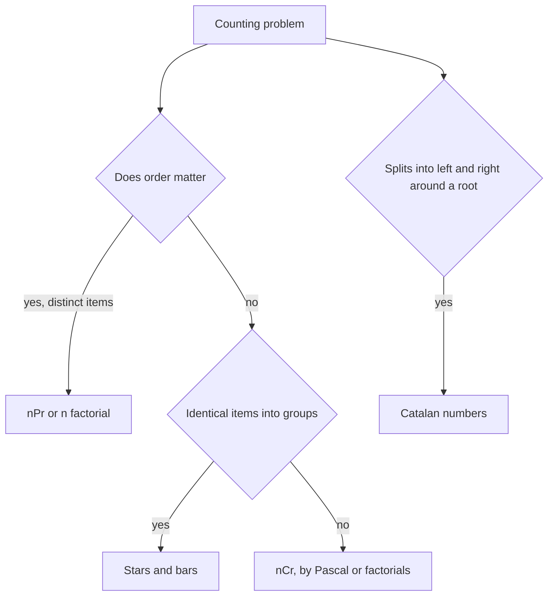

## The hook

A robot sits in the top-left corner of a grid and may only move right or down. How many different routes reach the bottom-right corner? You could write a recursion, or a DP table, or you could notice that every route is just a choice of which moves go down, and write the answer in one line.

Counting questions hide inside many interview problems: unique paths, ways to climb stairs, how many binary search trees have n nodes, how many sorted strings of length n exist. The tools are few, permutations, combinations, Pascal's triangle and a couple of famous sequences, and knowing them turns a slow DP into a formula, or at least tells you what the DP is really counting.

## The intuition

:::analogy
Picture a cricket captain with a squad of 11 players who needs 3 for a special drill. First she just picks the three: who is in, who is out. Then, separately, she decides their order, who goes first, second and third. The same three players can be ordered in six ways, so "pick and order" has six times as many outcomes as "pick".
:::

That is the difference between a [[permutation]] and a [[combination]]:

- **Ordered picks (permutations):** 11 choices for the first spot, 10 for the second, 9 for the third: 11 × 10 × 9 = 990. In general nPr = n × (n − 1) × ... × (n − r + 1) = n! / (n − r)!.
- **Unordered picks (combinations):** each group of 3 was counted once per order, and 3 players have 3! = 6 orders. So there are 990 / 6 = 165 groups. In general C(n, r) = n! / (r! (n − r)!).

Here n! is the [[factorial]], the number of ways to order n distinct items. Every counting problem starts with one question: does order matter?

## How it works

### Pascal's rule: in or out

There is a second way to count teams. Fix one particular player, say the vice-captain. Either she is in the team, and you choose the remaining r − 1 from the other n − 1 players, or she is out, and you choose all r from the other n − 1. That gives [[Pascal's rule]]:

$$C(n, r) = C(n-1, r-1) + C(n-1, r)$$

with C(n, 0) = C(n, n) = 1. Each row of Pascal's triangle is built from the row above, with every entry the sum of the two entries above it:

| n | C(n, 0) ... C(n, n) |
|---|---|
| 0 | 1 |
| 1 | 1 1 |
| 2 | 1 2 1 |
| 3 | 1 3 3 1 |
| 4 | 1 4 6 4 1 |
| 5 | 1 5 10 10 5 1 |

Building the triangle up to n costs O(n²) and needs only additions, so it is safe without modular inverses. It is the right tool when n is at most a few thousand, or when the modulus is not prime.

### Computing one nCr exactly

For a single value that fits in 64 bits, build it incrementally: start at 1 and, for i = 0 to r − 1, multiply by (n − i) and divide by (i + 1). After step i the value is C(n, i + 1), always an integer, so the division is exact. For C(10, 3) the running values are 10, 45 and 120. Use the smaller of r and n − r, since C(n, r) = C(n, n − r).

### nCr modulo a prime, for many queries

With n up to 10⁶ and answers mod 10⁹ + 7, precompute fact[i] = i! mod p and invFact[i] = (i!)⁻¹ mod p. The inverse of n! comes from Fermat's little theorem with fast power, as in [Arithmetic on a Clock That Never Overflows](article:dsa-modular-fast-power), and the rest follow downwards because (i − 1)!⁻¹ = i!⁻¹ × i. Then every query is

$$C(n, r) = \text{fact}[n] \times \text{invFact}[r] \times \text{invFact}[n - r] \bmod p$$

two multiplications after O(n) setup.

### Stars and bars

How many ways can n identical sweets be shared among k children, where a child may get none? Line up the n sweets (stars) and place k − 1 dividers (bars) among them; every arrangement of stars and bars is one sharing. That is choosing which of the n + k − 1 positions hold bars: C(n + k − 1, k − 1). This [[stars and bars]] count shows up whenever you choose "how many of each kind" without caring about order.

### Catalan numbers

Some structures split into a left part and a right part around a root. The number of binary search tree shapes with n keys is one: choose which key is the root, then the keys smaller than it form a left subtree and the larger ones a right subtree. So

$$G(n) = \sum_{i=1}^{n} G(i - 1) \times G(n - i), \qquad G(0) = 1$$

where i is the root, G(i − 1) counts left shapes and G(n − i) counts right shapes. These are the [[Catalan number|Catalan numbers]], 1, 1, 2, 5, 14, 42, 132, ..., with the closed form C(2n, n) / (n + 1). They also count balanced bracket strings with n pairs, ways to triangulate a polygon and many more.



:::insight
Most counting problems reduce to one question asked carefully: are we choosing which items, or arranging them? Unordered choices are combinations, Pascal's rule says "the item is in or out", and structures that split around a root are counted by Catalan numbers.
:::

## Walk through an example

### Unique Paths on a 3 by 7 grid

Every route from the top-left to the bottom-right makes 2 moves down and 6 moves right, 8 moves in total, in some order. A route is fixed once you choose which 2 of the 8 moves are down. So the count is C(8, 2) = 28. It is the captain's squad problem in disguise: the 8 moves are the squad, and she picks which 2 of them are "down" players, with no batting order to decide.

The DP gives the same answer through Pascal's rule: the number of ways to reach a cell is the sum of the ways to reach the cell above and the cell to the left. Filling the grid row by row reproduces a slice of Pascal's triangle, and the bottom-right cell holds 28. The formula takes O(min(m, n)) time; the DP takes O(m · n) but also handles obstacles, which the formula cannot.

### Count Sorted Vowel Strings

Count strings of length n over a, e, i, o, u whose letters are in sorted order. A sorted string is fully described by how many of each vowel it uses, so it is n identical slots shared among 5 vowels: stars and bars with k = 5.

| n | C(n + 4, 4) | Count |
|---|---|---|
| 1 | C(5, 4) | 5 |
| 2 | C(6, 4) | 15 |
| 33 | C(37, 4) | 66045 |

For n = 2, the 15 strings are aa, ae, ai, ao, au, ee, ei, eo, eu, ii, io, iu, oo, ou and uu.

### Unique Binary Search Trees with 3 keys

| Root | Left keys | Right keys | Shapes |
|---|---|---|---|
| 1 | none, G(0) = 1 | 2 and 3, G(2) = 2 | 2 |
| 2 | 1, G(1) = 1 | 3, G(1) = 1 | 1 |
| 3 | 1 and 2, G(2) = 2 | none, G(0) = 1 | 2 |

G(3) = 2 + 1 + 2 = 5, and the closed form agrees: C(6, 3) / 4 = 20 / 4 = 5.

:::try-this
How many ways can 4 identical balls go into 3 boxes, and how many 2-player teams can be chosen from 6 players? (Stars and bars: C(4 + 2, 2) = C(6, 2) = 15. Teams: C(6, 2) = 15 as well, a coincidence of the numbers, not of the reasoning.)
:::

:::warning
Common misconception: "Compute n! and divide, it is just a formula." 21! already overflows a 64-bit integer, so n! / (r! (n − r)!) fails for quite small n even when the answer is tiny. Build nCr incrementally, use Pascal's triangle, or work modulo a prime with inverse factorials.
:::

## The code

```pseudo
pascal(rows):
    triangle[0] = [1]
    for n from 1 to rows - 1:
        row = [1] + [prev[r - 1] + prev[r] for r in 1 .. n - 1] + [1]

ncr_exact(n, r):                 # fits in 64 bits
    r = min(r, n - r); c = 1
    for i in 0 .. r - 1: c = c * (n - i) / (i + 1)
    return c

precompute(N, p):                # factorials and inverse factorials mod prime p
    fact[0] = 1; fact[i] = fact[i - 1] * i mod p
    invFact[N] = fact[N]^(p - 2) mod p
    invFact[i - 1] = invFact[i] * i mod p
ncr_mod(n, r) = fact[n] * invFact[r] * invFact[n - r] mod p

catalan(n):
    G[0] = 1
    G[m] = sum over root i of G[i - 1] * G[m - i]
```

```cpp
#include <bits/stdc++.h>
using namespace std;

const long long MOD = 1'000'000'007;

long long powMod(long long x, long long e) {
    long long r = 1;
    for (x %= MOD; e; e >>= 1, x = x * x % MOD) if (e & 1) r = r * x % MOD;
    return r;
}

vector<vector<long long>> pascal(int rows) {
    vector<vector<long long>> t(rows);
    for (int n = 0; n < rows; n++) {
        t[n].assign(n + 1, 1);
        for (int r = 1; r < n; r++) t[n][r] = t[n - 1][r - 1] + t[n - 1][r];   // in or out
    }
    return t;
}

long long ncrExact(long long n, long long r) {     // exact, while the answer fits in 64 bits
    r = min(r, n - r);
    long long c = 1;
    for (long long i = 0; i < r; i++) c = c * (n - i) / (i + 1);   // always an integer
    return c;
}

struct Binomial {                                   // nCr mod p after O(N) setup
    vector<long long> fact, invFact;
    Binomial(int N) : fact(N + 1, 1), invFact(N + 1, 1) {
        for (int i = 1; i <= N; i++) fact[i] = fact[i - 1] * i % MOD;
        invFact[N] = powMod(fact[N], MOD - 2);      // Fermat's little theorem
        for (int i = N; i > 0; i--) invFact[i - 1] = invFact[i] * i % MOD;
    }
    long long ncr(int n, int r) const {
        if (r < 0 || r > n) return 0;
        return fact[n] * invFact[r] % MOD * invFact[n - r] % MOD;
    }
};

long long catalan(int n) {                          // number of BST shapes with n keys
    vector<long long> G(n + 1, 0);
    G[0] = 1;
    for (int m = 1; m <= n; m++)
        for (int root = 1; root <= m; root++) G[m] += G[root - 1] * G[m - root];
    return G[n];
}

int main() {
    auto tri = pascal(6);                                       // keep it alive while we read a row
    for (long long x : tri[5]) cout << x << ' ';
    cout << '\n';                                               // 1 5 10 10 5 1
    cout << ncrExact(11, 3) << ' ' << ncrExact(8, 2) << ' ' << ncrExact(37, 4) << '\n';   // 165 28 66045
    Binomial B(200000);
    cout << B.ncr(10, 3) << ' ' << B.ncr(100000, 50000) << '\n';  // 120 149033233
    for (int n = 0; n <= 6; n++) cout << catalan(n) << ' ';
    cout << '\n';                                               // 1 1 2 5 14 42 132
}
```

For a deeper treatment, including Lucas's theorem for small prime moduli and counting with inclusion-exclusion, see [How Many Ways to Pick the Team?](article:cp-binomial-coefficients) in the competitive programming subject.

## Complexity

- **Pascal's triangle: O(n²) time and space** for all C(i, r) with i ≤ n.
- **One exact nCr: O(min(r, n − r)).**
- **nCr mod p: O(N) setup** (plus one O(log p) inverse), then **O(1) per query.**
- **Catalan by the recurrence: O(n²);** by the closed form with factorials mod p, O(n) setup and O(1) per value.

## Common mistakes

- **Overflowing factorials.** 21! exceeds 64 bits; never compute n! exactly for large n.
- **Dividing remainders.** Modulo p, multiply by inverse factorials instead.
- **Inverse factorials mod a non-prime.** Fermat's theorem needs a prime modulus; for other moduli, Pascal's triangle is the safe fallback.
- **Mixing up order.** Using nCr where order matters, or nPr where it does not, gives answers off by a factor of r!.
- **Wrong stars-and-bars form.** n identical items into k groups is C(n + k − 1, k − 1); requiring every group to be non-empty changes it to C(n − 1, k − 1).
- **Using the formula when obstacles exist,** as in Unique Paths II; then only the DP works.

## Practice problems

*Pascal's Triangle* builds the rows with Pascal's rule. *Unique Paths* is C(m + n − 2, m − 1) or the equivalent grid DP. *Count Sorted Vowel Strings* is stars and bars. *Unique Binary Search Trees* is the Catalan recurrence. *Binomial Coefficients* on CSES asks many nCr queries mod 10⁹ + 7 and needs the factorial and inverse-factorial tables.

## Key takeaways

- Permutations count ordered selections, n! / (n − r)!, and combinations count unordered ones, dividing again by r! because each group appears in r! orders.
- Pascal's rule, C(n, r) = C(n − 1, r − 1) + C(n − 1, r), comes from asking whether one particular item is chosen, and builds every binomial coefficient with additions only.
- For many nCr queries modulo a prime, precompute factorials and inverse factorials so each query is two multiplications.
- Sharing n identical items among k groups is C(n + k − 1, k − 1) by stars and bars.
- Structures that split into left and right parts around a root, such as binary search trees or balanced brackets, are counted by the Catalan numbers 1, 1, 2, 5, 14, 42.
