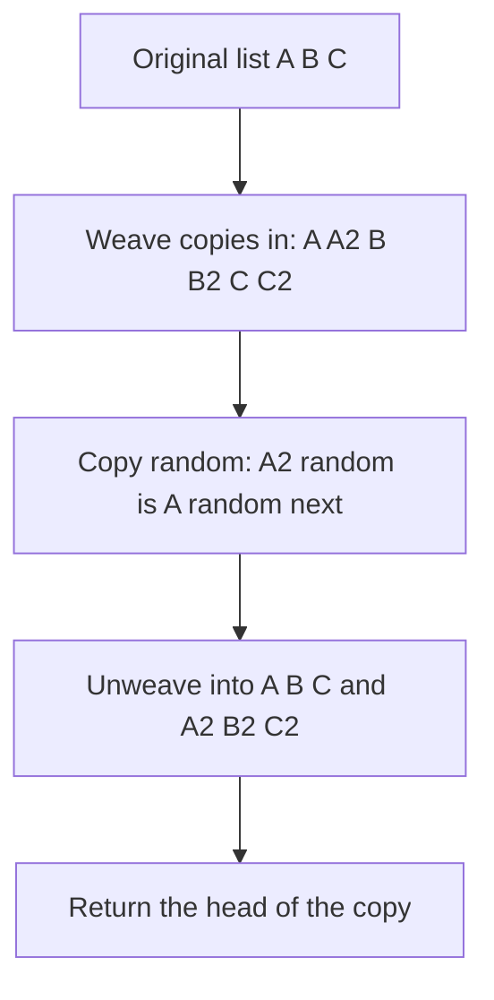

## The hook

Copying a normal linked list is easy: walk it and create a new node for each old one. Now give every node a second pointer that can point anywhere: forwards, backwards, to itself or to nothing. Copy that list, and the copy's extra pointers must point into the **copy**, never back into the original.

That small twist makes *Copy List with Random Pointer* a favourite interview question. It tests whether you understand the difference between copying values and copying structure, and it has a beautiful follow-up that does the job with no extra memory at all.

## The problem

Each node has a value, a next pointer and a [[random pointer]]. Return a [[deep copy]]: n brand-new nodes with the same values, where every next and random pointer of the copy points to the corresponding copy node. A [[shallow copy]], whose random pointers still lead into the original list, is wrong, and so is modifying the original.

Example, with nodes written by value:

| Node | next | random |
|---|---|---|
| 5 | 6 | 7 |
| 6 | 7 | 5 |
| 7 | 8 | null |
| 8 | null | 6 |

The copy must have the same table, but every entry must name a copy node.

## The obvious approach

Copy the next chain first, then fix random pointers. For each original node, to find which copy its random pointer should target, you could walk the original list from the head to find the position of the target, then walk the copy the same number of steps. That is O(n) per node, O(n²) in total.

The slow part is answering "which copy belongs to this original node?". A hash map answers it in O(1).

## The key insight

:::analogy
Picture photocopying a treasure map drawn on several pages, where page 2 says "see the cave on page 4" and page 4 says "go back to page 1". If you copy page 2 first, its cross-reference to page 4 is meaningless until page 4's copy exists. So first copy every page, and keep a list that says which copy goes with which original. Then go through the copies and rewrite every cross-reference to point at the copied page, using the list.
:::

That list is the [[old-to-new map]]:

- **Pass 1:** walk the original; for each node X, create a copy X' with the same value and store map[X] = X'.
- **Pass 2:** walk again; set X'.next = map[X.next] and X'.random = map[X.random], with null mapping to null.

The map is keyed by node identity, the pointer, not by value; values may repeat.

### Doing it without the map: interleaving

The map costs O(n) extra space. The follow-up asks for O(1). The trick is [[interleaving]]: put each copy right after its original, so "the copy of X" is simply X.next.

- **Weave:** turn A → B → C into A → A' → B → B' → C → C'.
- **Random pointers:** for each original X, set X'.random = X.random ? X.random.next : null. The copy of any node is the node right after it.
- **Unweave:** separate the two lists, restoring every original next pointer and linking the copies to each other.



:::insight
Copying structure means translating every pointer from "an original node" to "that node's copy". A hash map does the translation in O(1); interleaving does it with no memory at all, because it places each copy exactly one step after its original.
:::

## Walk through an example

The list 5 → 6 → 7 → 8 with randoms 5 → 7, 6 → 5, 7 → null and 8 → 6.

### With the map

| Pass | Node | Action |
|---|---|---|
| 1 | 5, 6, 7, 8 | create 5', 6', 7', 8' and store each in the map |
| 2 | 5 | 5'.next = map[6] = 6', 5'.random = map[7] = 7' |
| 2 | 6 | 6'.next = 7', 6'.random = map[5] = 5' |
| 2 | 7 | 7'.next = 8', 7'.random = null |
| 2 | 8 | 8'.next = null, 8'.random = map[6] = 6' |

Every pointer in the copy now names a copy node. On the treasure map, every cross-reference has been rewritten to a copied page.

### With interleaving

| Step | List or pointers |
|---|---|
| Weave | 5 → 5' → 6 → 6' → 7 → 7' → 8 → 8' |
| Randoms | 5'.random = 5.random.next = 7', 6'.random = 5', 7'.random = null, 8'.random = 6' |
| Unweave | original 5 → 6 → 7 → 8 restored; copy 5' → 6' → 7' → 8' |

The random pointers come out the same as with the map, with no map at all.

### Cloning a graph

*Clone Graph* is the same idea on a graph. Each node lists its neighbours, and there can be cycles. Walk the graph with depth-first or breadth-first search; the first time you reach a node, create its copy and store it in the map, then copy its neighbour list by looking up or creating each neighbour's copy. The map also serves as the "visited" set, so cycles do not loop forever. For the square 1 – 2 – 3 – 4 – 1, the clone has four new nodes with the same four edges.

:::try-this
A list has two nodes, A → B, with A.random = B and B.random = B. After weaving, the list is A → A' → B → B'. What are A'.random and B'.random? (A'.random = A.random.next = B.next = B'. B'.random = B.random.next = B'. Each copy's random points into the copy, including B' pointing at itself.)
:::

:::warning
Common misconception: "Key the map by node value." Values can repeat: two nodes with value 7 are different nodes with different neighbours. Key the map by the node pointer itself, its identity. The same rule applies to *Intersection of Two Linked Lists*, where two nodes count as the same only if they are literally the same object.
:::

## The code

```pseudo
copy_with_map(head):
    map = {null: null}
    for X in list: map[X] = new node(X.val)
    for X in list: map[X].next = map[X.next]; map[X].random = map[X.random]
    return map[head]

copy_interleaved(head):
    for X in list: insert new node(X.val) right after X
    for X in originals: X.next.random = X.random ? X.random.next : null
    separate: restore X.next = X.next.next, and link each copy to the next copy
```

```cpp
#include <bits/stdc++.h>
using namespace std;

struct Node {
    int val;
    Node *next = nullptr, *random = nullptr;
    Node(int v) : val(v) {}
};

Node* copyWithMap(Node* head) {
    unordered_map<Node*, Node*> m{{nullptr, nullptr}};      // keyed by identity, not value
    for (Node* x = head; x; x = x->next) m[x] = new Node(x->val);
    for (Node* x = head; x; x = x->next) {
        m[x]->next = m[x->next];
        m[x]->random = m[x->random];
    }
    return m[head];
}

Node* copyInterleaved(Node* head) {
    for (Node* x = head; x; x = x->next->next) {            // weave: x, x', next original
        Node* c = new Node(x->val);
        c->next = x->next, x->next = c;
    }
    for (Node* x = head; x; x = x->next->next)              // copy of anything is right after it
        x->next->random = x->random ? x->random->next : nullptr;
    Node dummy(0);
    Node* tail = &dummy;
    for (Node* x = head; x; x = x->next) {                  // unweave and restore the original
        Node* c = x->next;
        x->next = c->next;
        tail->next = c, tail = c;
    }
    return dummy.next;
}

struct GNode {
    int val;
    vector<GNode*> nbrs;
    GNode(int v) : val(v) {}
};

GNode* cloneGraph(GNode* node, unordered_map<GNode*, GNode*>& m) {
    if (!node) return nullptr;
    if (m.count(node)) return m[node];                      // already copied: also stops cycles
    GNode* c = m[node] = new GNode(node->val);
    for (GNode* nb : node->nbrs) c->nbrs.push_back(cloneGraph(nb, m));
    return c;
}

void show(Node* h, Node* original) {
    bool shared = false;
    for (Node *x = h, *o = original; x; x = x->next, o = o->next) {
        cout << x->val << ':' << (x->random ? to_string(x->random->val) : "null") << ' ';
        if (x == o || (x->random && x->random == o->random)) shared = true;   // points into the original?
    }
    cout << (shared ? "shared" : "independent") << '\n';
}

int main() {
    vector<Node*> v;
    for (int x : {5, 6, 7, 8}) v.push_back(new Node(x));
    for (int i = 0; i + 1 < 4; i++) v[i]->next = v[i + 1];
    v[0]->random = v[2], v[1]->random = v[0], v[3]->random = v[1];
    show(copyWithMap(v[0]), v[0]);                          // 5:7 6:5 7:null 8:6 independent
    show(copyInterleaved(v[0]), v[0]);                      // 5:7 6:5 7:null 8:6 independent
    show(v[0], v[0] /* compare the original with itself */);   // 5:7 6:5 7:null 8:6 shared

    vector<GNode*> g;
    for (int i = 1; i <= 4; i++) g.push_back(new GNode(i));
    for (int i = 0; i < 4; i++) g[i]->nbrs = {g[(i + 1) % 4], g[(i + 3) % 4]};   // a 4-cycle
    unordered_map<GNode*, GNode*> m;
    GNode* c = cloneGraph(g[0], m);
    cout << m.size() << ' ' << c->val << ' ' << c->nbrs[0]->val << ' ' << c->nbrs[1]->val << ' '
         << (c != g[0]) << '\n';                            // 4 1 2 4 1
}
```

`show` prints each node's value and its random target's value, and checks that no copy node or copy random pointer is shared with the original; the third call compares the original with itself to show what "shared" looks like. The second line also proves the interleaving version restored the original list, because the comparison walks the original's next pointers.

## Complexity

- **With a map: O(n) time, O(n) extra space** for the map.
- **Interleaving: O(n) time, O(1) extra space** beyond the copy itself, which the problem requires anyway. Three passes over a list of 2n nodes.
- **Clone Graph: O(V + E),** each node copied once and each edge followed once, with O(V) for the map and recursion.

## Common mistakes

- **Returning a shallow copy,** whose random pointers still point into the original.
- **Keying the map by value,** which merges different nodes that happen to share a value.
- **Forgetting the null case** for random pointers, either in the map (map null to null) or in interleaving (check before reading .next).
- **Not restoring the original** after interleaving, which leaves the caller's list corrupted.
- **Setting random pointers while weaving,** before all the copies exist; the target's copy might not be there yet.
- **Infinite recursion in Clone Graph** from checking the map after recursing instead of before.

## Practice problems

Warm up with *Intersection of Two Linked Lists*, solved once with a hash set of node pointers to practise identity-based keys. Then solve *Copy List with Random Pointer* with the map, and again with interleaving for O(1) extra space. *Clone Graph* moves the same old-to-new map to a structure with cycles. For the hash map techniques themselves, see [The Notebook That Turns O(n²) Into O(n)](article:dsa-hashing-patterns).

## Key takeaways

- A deep copy must create new nodes and translate every pointer so it targets the matching copy, never the original.
- An old-to-new map keyed by node identity does that translation in O(1): create all copies first, then set next and random pointers.
- Interleaving each copy right after its original means the copy of X is X.next, which sets random pointers with O(1) extra space.
- The interleaving method must separate the lists at the end and restore the original's next pointers.
- Cloning a graph uses the same map, which also acts as the visited set so cycles are copied once.
