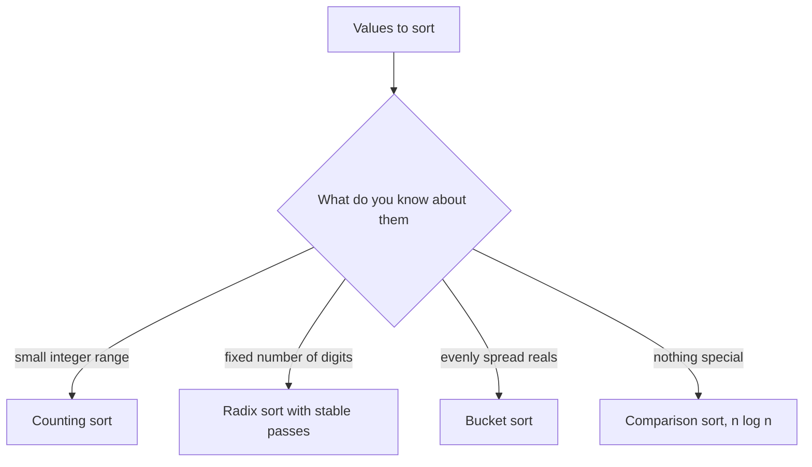

## The hook

A post office sorts letters by PIN code all day. Nobody there compares two envelopes and asks which comes first. Each letter goes straight into the pigeonhole for its code, and at the end the pigeonholes are emptied in order. Thousands of letters, no comparisons, and the result is sorted.

Every sort you have learned so far, merge sort, quicksort, heap sort, compares pairs, and comparison sorts can never beat about n log n comparisons in the worst case. Pigeonholes sidestep that limit by using the values themselves as addresses. When the values allow it, sorting becomes linear.

## The intuition

:::analogy
Picture the wall of pigeonholes, one per PIN code. A clerk takes each letter, reads its code and drops it into that hole. Then she walks the wall from left to right and pulls out each hole's letters in the order they went in. If the codes are long, she can sort by the last digit first, then the second-last, and so on, using only ten pigeonholes, as long as she never shuffles letters within a hole.
:::

Three techniques grow out of that wall:

- [[Counting sort]]: one pigeonhole per possible value. It works when values are integers from a small range.
- [[Radix sort]]: ten pigeonholes, one pass per digit, from the last digit to the first. It works for fixed-width integers or strings.
- [[Bucket sort]]: a few pigeonholes, each covering a slice of the range, followed by a small sort inside each. It works best when values are spread evenly.

All three beat the [[comparison sort]] bound because they never compare two elements. They read a value and compute where it goes.

## How it works

### Counting sort

Suppose all values are integers from 0 to k − 1.

- **Count:** `cnt[v]` = how many times v appears.
- **Positions:** a running total turns counts into starting positions, `pos[v] = cnt[0] + ... + cnt[v − 1]`. This is a [prefix sum](article:dsa-prefix-sums) over the counts.
- **Place:** walk the input left to right and put each value at `pos[v]`, then increase `pos[v]`.

Walking the input in order and filling each pigeonhole from its start makes the sort [[stable]]: equal values come out in the order they went in. That matters when the values are keys attached to records. For plain numbers you can skip the positions and just write each value `cnt[v]` times.

### Radix sort

Counting sort needs a pigeonhole per value, which is hopeless for values up to 10⁹. Radix sort uses ten pigeonholes and makes one stable counting pass per decimal digit, starting from the least significant. After the pass on digit d, the numbers are sorted by their last d digits. Stability is what keeps that true: when two numbers tie on the current digit, the earlier passes have already put them in the right order, and a stable pass leaves them that way.

### Bucket sort and the pigeonhole principle

Bucket sort divides the range [min, max] into equal slices. If values are spread evenly, each bucket gets a handful of values, sorting them is cheap, and the total is close to linear. With skewed data, one bucket can get almost everything, and you are back to an ordinary sort.

Buckets have a second, more surprising use. The [[pigeonhole principle]] says that n numbers between min and max create n − 1 gaps whose total is max − min, so the largest gap is at least the average gap, (max − min) / (n − 1). Make buckets no wider than that average, and two numbers inside one bucket can never form a gap larger than the largest one. The maximum gap can therefore always be found between neighbouring non-empty buckets, using only each bucket's minimum and maximum. That solves *Maximum Gap* in O(n).



:::insight
Comparison sorts are limited to about n log n because each comparison reveals one bit of order. Counting, radix and bucket sorts read the value itself and use it as an address, so when the value range or the number of digits is small, they sort in linear time.
:::

## Walk through an example

### Counting sort of [4, 1, 3, 1, 0, 4, 2] with values 0 to 4

| Value | 0 | 1 | 2 | 3 | 4 |
|---|---|---|---|---|---|
| Count | 1 | 2 | 1 | 1 | 2 |
| Start position | 0 | 1 | 3 | 4 | 5 |

Placing each input value at its start position, then moving that start along by one, gives [0, 1, 1, 2, 3, 4, 4]. The two 1s keep their input order, first the 1 from index 1, then the one from index 3.

### Radix sort of [170, 45, 75, 90, 802, 24, 2, 66]

| Pass | Sorted by | Result after the pass |
|---|---|---|
| 1 | ones digit | 170 90 802 2 24 45 75 66 |
| 2 | tens digit | 802 2 24 45 66 170 75 90 |
| 3 | hundreds digit | 2 24 45 66 75 90 170 802 |

Look at pass 2. 802 and 2 both have tens digit 0, and they stay in the order pass 1 left them, 802 before 2. In pass 3, 2 has hundreds digit 0 and 802 has 8, so 2 finally moves ahead. Each pass uses ten pigeonholes and never compares two numbers.

### Maximum Gap of [1, 10, 5, 3, 20]

Here n = 5, min = 1 and max = 20, so the average gap is (20 − 1) / 4, rounded down to 4. Use buckets of width 4: bucket i covers values from 1 + 4i to 4 + 4i.

| Bucket | Covers | Values | Min | Max |
|---|---|---|---|---|
| 0 | 1 to 4 | 1, 3 | 1 | 3 |
| 1 | 5 to 8 | 5 | 5 | 5 |
| 2 | 9 to 12 | 10 | 10 | 10 |
| 3 | 13 to 16 | none | | |
| 4 | 17 to 20 | 20 | 20 | 20 |

Gaps between neighbouring non-empty buckets: 5 − 3 = 2, 10 − 5 = 5, 20 − 10 = 10 (the empty bucket is skipped). The maximum is 10, matching the sorted order 1, 3, 5, 10, 20. The gap inside bucket 0, from 1 to 3, never needed checking.

:::try-this
Use the same method on [3, 6, 9, 1]. What bucket width do you use, and what is the maximum gap? (min = 1, max = 9, n = 4, so the width is (9 − 1) / 3 rounded down, 2. The buckets hold 1, 3, 6 and 9 in separate buckets with one empty bucket. Neighbouring gaps are 2, 3 and 3, so the answer is 3.)
:::

:::warning
Common misconception: "Counting sort is always faster because it is linear." It is O(n + k), and k is the size of the value range. Sorting 10 numbers that range up to 10⁹ would need a billion counters. Use counting sort only when k is comparable to n, and radix sort when values are large but have few digits.
:::

## The code

```pseudo
counting_sort(a, k):                 # values in 0 .. k-1, stable
    cnt = zeros(k); for x in a: cnt[x] += 1
    pos[0] = 0; for v in 1 .. k-1: pos[v] = pos[v-1] + cnt[v-1]
    for x in a in order: out[pos[x]] = x; pos[x] += 1

radix_sort(a):                       # non-negative integers
    for e = 1, 10, 100, ... while max(a) / e > 0:
        stable counting sort of a by digit (x / e) mod 10

maximum_gap(a):
    w = max(1, (max - min) / (n - 1)); buckets of width w
    keep only the min and max of each bucket
    answer = largest (next non-empty bucket's min - previous non-empty bucket's max)
```

```cpp
#include <bits/stdc++.h>
using namespace std;

vector<int> countingSort(const vector<int>& a, int k) {     // values in [0, k), stable
    vector<int> cnt(k, 0), out(a.size());
    for (int x : a) cnt[x]++;
    vector<int> pos(k, 0);
    for (int v = 1; v < k; v++) pos[v] = pos[v - 1] + cnt[v - 1];   // start of each pigeonhole
    for (int x : a) out[pos[x]++] = x;
    return out;
}

void radixSort(vector<int>& a) {                             // non-negative integers
    int mx = *max_element(a.begin(), a.end());
    vector<int> out(a.size());
    for (long long e = 1; mx / e > 0; e *= 10) {
        int cnt[10] = {0};
        for (int x : a) cnt[x / e % 10]++;
        for (int d = 1; d < 10; d++) cnt[d] += cnt[d - 1];   // end positions
        for (int i = (int)a.size() - 1; i >= 0; i--)          // backwards keeps it stable
            out[--cnt[a[i] / e % 10]] = a[i];
        a = out;
    }
}

int maximumGap(const vector<int>& a) {
    int n = a.size();
    if (n < 2) return 0;
    int lo = *min_element(a.begin(), a.end()), hi = *max_element(a.begin(), a.end());
    if (lo == hi) return 0;
    int w = max(1, (hi - lo) / (n - 1)), k = (hi - lo) / w + 1;
    vector<int> bmin(k, INT_MAX), bmax(k, INT_MIN);
    for (int x : a) {
        int i = (x - lo) / w;
        bmin[i] = min(bmin[i], x), bmax[i] = max(bmax[i], x);
    }
    int best = 0, prev = INT_MIN;
    for (int i = 0; i < k; i++) {
        if (bmin[i] == INT_MAX) continue;                     // empty bucket
        if (prev != INT_MIN) best = max(best, bmin[i] - prev);
        prev = bmax[i];
    }
    return best;
}

int hIndex(const vector<int>& citations) {                   // counting with a capped range
    int n = citations.size();
    vector<int> cnt(n + 1, 0);
    for (int c : citations) cnt[min(c, n)]++;                 // anything above n acts like n
    for (int h = n, atLeast = 0; h >= 0; h--) {
        atLeast += cnt[h];
        if (atLeast >= h) return h;
    }
    return 0;
}

int main() {
    for (int x : countingSort({4, 1, 3, 1, 0, 4, 2}, 5)) cout << x << ' ';
    cout << '\n';                                            // 0 1 1 2 3 4 4
    vector<int> r = {170, 45, 75, 90, 802, 24, 2, 66};
    radixSort(r);
    for (int x : r) cout << x << ' ';
    cout << '\n';                                            // 2 24 45 66 75 90 170 802
    cout << maximumGap({1, 10, 5, 3, 20}) << ' ' << maximumGap({3, 6, 9, 1}) << '\n';   // 10 3
    cout << hIndex({3, 0, 6, 1, 5}) << '\n';                 // 3
}
```

The radix pass walks backwards and fills each pigeonhole from its end, which is the stable way to place values when you have end positions instead of start positions.

`hIndex` shows a common trick: when only "how many are at least h" matters and h can be at most n, cap every value at n. The range becomes n + 1, so counting sort applies even though citation counts can be huge. For citations [3, 0, 6, 1, 5], three papers have at least 3 citations, so the h-index is 3.

## Complexity

- **Counting sort: O(n + k) time, O(n + k) space,** where k is the size of the value range.
- **Radix sort: O(d · (n + b)) time,** with d digits and base b, here b = 10. For 32-bit integers in base 10, d is at most 10, so it is linear in n with a moderate constant. O(n + b) extra space.
- **Bucket sort: O(n) expected** for evenly spread data, but O(n log n) or worse if most values land in one bucket.
- **Maximum Gap with buckets: O(n) time and O(n) space,** because there are about n buckets and each keeps only its minimum and maximum.

## Common mistakes

- **Huge value ranges.** Allocating a count array for values up to 10⁹ runs out of memory; use radix sort or a comparison sort.
- **Negative numbers.** Counting and radix sort assume non-negative keys. Shift by the minimum first, or sort negatives and non-negatives separately.
- **An unstable digit pass** in radix sort, which destroys the work of earlier passes.
- **Most significant digit first by accident.** LSD radix sort must go from the last digit to the first.
- **Bucket width zero** in Maximum Gap when all values are close; use at least 1, and handle min = max separately.
- **Forgetting to cap values** in problems like H-Index, which makes the count array as large as the biggest citation count.

## Practice problems

*Sort Colors* is counting sort with three values, or the one-pass version from [Sorting Three Colours in a Single Sweep](article:dsa-dutch-national-flag). *Relative Sort Array* is counting sort with a custom order for the values. *H-Index* is counting with values capped at n. *Sort Characters By Frequency* and *Top K Frequent Elements* use bucket sort on frequencies, since a frequency can never exceed n. *Maximum Gap* is the pigeonhole bucket trick, and the hardest of the set.

## Key takeaways

- Comparison sorts cannot beat about n log n, but counting, radix and bucket sorts avoid comparisons by using values as addresses.
- Counting sort runs in O(n + k) for integers in a range of size k, and computing start positions with a prefix sum makes it stable.
- Radix sort applies a stable counting sort to one digit at a time from the least significant, sorting large fixed-width integers in linear time.
- Bucket sort is near linear when values are spread evenly, and buckets no wider than the average gap solve Maximum Gap in O(n) by the pigeonhole principle.
- These sorts pay in memory and assumptions, so check the value range, the sign of the values and the need for stability before choosing one.
