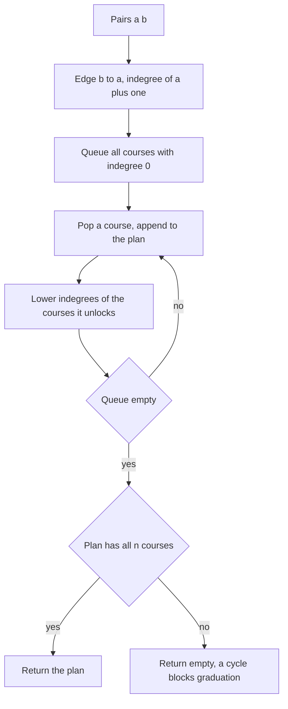

## The hook

A university hands you its course catalogue. Algorithms needs Discrete Maths and Data Structures; Compilers needs Theory of Computation and Data Structures; and so on, down to Programming 1, which needs nothing. Can you take every course? If so, in what order?

This is the single most asked topological sort question in interviews, in two flavours: "is it possible?" and "give me an order". The algorithm is the one from [Socks Before Shoes](article:dsa-topological-sort). What trips people up is everything around it: the direction of the pairs, the empty-answer case, and explaining why it is impossible.

## The problem

There are n courses numbered 0 to n - 1. You are given prerequisite pairs [a, b], meaning course b must be taken before course a. *Course Schedule* asks whether all courses can be finished. *Course Schedule II* asks for one valid order, or an empty array if none exists. The CSES *Course Schedule* is the same as part II, printing IMPOSSIBLE instead of an empty array.

Example with 6 courses: 0 Programming 1, 1 Discrete Maths, 2 Data Structures, 3 Algorithms, 4 Theory of Computation, 5 Compilers. Pairs: [1, 0], [2, 0], [3, 1], [3, 2], [4, 3], [5, 4], [5, 2]. One valid order is 0, 1, 2, 3, 4, 5.

## The obvious approach

Repeatedly scan all courses, pick any course whose prerequisites are all done, take it, and scan again. Each scan is O(V + E) and there can be V scans, so O(V × (V + E)).

The other obvious approach is to try every ordering and check it, which is O(V!) and hopeless beyond ten courses.

## The key insight

:::analogy
Pin the prerequisite chart on the wall: every course a box, every prerequisite an arrow from the earlier course to the later one. Each box carries a counter of arrows still pointing into it. Courses whose counter is zero can be taken this term. Taking a course rubs out its outgoing arrows, which lowers other counters and unlocks new courses. If you run out of zero-counter boxes before the wall is empty, some boxes are waiting on each other in a loop, and no student can ever graduate.
:::

The wall chart is the [[prerequisite chart]], and the counters are indegrees. The loop is Kahn's algorithm, run in O(V + E). The only real decisions are:

- **Direction.** A [[prerequisite pair]] [a, b] becomes the edge b → a. Get this wrong and you return a valid order of the reversed graph, which is the answer backwards.
- **Impossible means empty.** If the output has fewer than n courses, return false for part I and an empty array for part II, never the partial list.
- **Isolated courses count.** A course in no pair has indegree zero and must appear in the order.

### Explaining why it is impossible

Interviewers sometimes follow up with "which courses are the problem?". Kahn's algorithm leaves the stuck courses behind but does not single out the loop. Three-colour DFS does: colour a course grey when its call starts and black when it finishes. Meeting a [[grey vertex]] means the current path has come back to a course it is still inside, and following parent links from the current course back to that grey course spells out the cycle. The technique is the one in [When the Rumour Comes Back to You](article:dsa-cycle-detection).

### Prerequisite queries: Course Schedule IV

*Course Schedule IV* asks many queries of the form "must u come before v?", where the answer is yes for a [[transitive prerequisite]], through any chain. Process courses in topological order and give each course the set of all its ancestors: the union of each direct prerequisite and that prerequisite's own ancestors. With up to 100 courses, a `bitset<100>` per course makes each union one machine-level operation, and each query is a single bit check.



:::insight
Every course plan is a topological order of the prerequisite chart, so "can I graduate?" is the same question as "does the chart have a directed cycle?". Kahn's algorithm answers both at once, as long as the pairs are turned into edges pointing from earlier to later.
:::

## Walk through an example

Pairs [1, 0], [2, 0], [3, 1], [3, 2], [4, 3], [5, 4], [5, 2] give the edges 0 → 1, 0 → 2, 1 → 3, 2 → 3, 3 → 4, 4 → 5, 2 → 5. Indegrees: course 0 has 0, courses 1, 2 and 4 have 1, courses 3 and 5 have 2.

| Take | Counters lowered | Newly available | Queue after |
|---|---|---|---|
| 0 Programming 1 | 1: 1 → 0, 2: 1 → 0 | 1, 2 | 1, 2 |
| 1 Discrete Maths | 3: 2 → 1 | | 2 |
| 2 Data Structures | 3: 1 → 0, 5: 2 → 1 | 3 | 3 |
| 3 Algorithms | 4: 1 → 0 | 4 | 4 |
| 4 Theory of Computation | 5: 1 → 0 | 5 | 5 |
| 5 Compilers | | | empty |

All 6 courses are placed, so the plan is 0, 1, 2, 3, 4, 5.

### Prerequisite sets for Course Schedule IV

| Course | All courses that must come before it |
|---|---|
| 0 | none |
| 1 | 0 |
| 2 | 0 |
| 3 | 0, 1, 2 |
| 4 | 0, 1, 2, 3 |
| 5 | 0, 1, 2, 3, 4 |

So "is 1 a prerequisite of 5?" is yes, through 1 → 3 → 4 → 5, even though no pair mentions 1 and 5 together. "Is 1 a prerequisite of 2?" is no.

### Making it impossible

Add the pair [1, 4]: Discrete Maths now requires Theory of Computation. The edge 4 → 1 closes the loop 1 → 3 → 4 → 1. Kahn's algorithm takes 0 and 2, then stops: course 1 waits for 4, 4 waits for 3, and 3 waits for 1. Three-colour DFS from 0 goes 0 → 1 → 3 → 4, sees the edge 4 → 1 to a grey course, and reports the cycle 1 → 3 → 4 → 1.

:::try-this
In the original six-course chart, which courses could you take in the same term if terms have no limit on the number of courses? (Take courses in layers of Kahn's algorithm: term 1 is {0}; term 2 is {1, 2}; term 3 is {3}; term 4 is {4}; term 5 is {5}. Five terms, because the longest chain, 0 → 1 → 3 → 4 → 5, has five courses.)
:::

:::warning
Common misconception: "If every course has at least one prerequisite that can be taken, the schedule is possible." Every course in the loop 1 → 3 → 4 → 1 has a prerequisite, and each prerequisite looks reachable on its own, yet none can ever be started. Possibility depends on the whole chart having no directed cycle, which only a full topological sort or cycle check can confirm.
:::

## The code

```pseudo
find_order(n, pairs):
    for (a, b) in pairs: adj[b].add(a); indeg[a] += 1      # b before a
    queue = all c with indeg[c] == 0; order = []
    while queue:
        c = queue.pop_front(); order.append(c)
        for d in adj[c]:
            indeg[d] -= 1
            if indeg[d] == 0: queue.push(d)
    return order if len(order) == n else []

find_cycle(u):                                # colour: 0 white, 1 grey, 2 black
    colour[u] = 1
    for v in adj[u]:
        if colour[v] == 1: return path from v to u via parents, then v
        if colour[v] == 0: parent[v] = u; result = find_cycle(v); if result: return result
    colour[u] = 2
```

```cpp
#include <bits/stdc++.h>
using namespace std;

vector<int> findOrder(int n, const vector<array<int, 2>>& pairs) {
    vector<vector<int>> adj(n);
    vector<int> indeg(n, 0), order;
    for (auto& [a, b] : pairs) adj[b].push_back(a), indeg[a]++;   // b must come before a
    queue<int> q;
    for (int c = 0; c < n; c++) if (indeg[c] == 0) q.push(c);
    while (!q.empty()) {
        int c = q.front(); q.pop();
        order.push_back(c);
        for (int d : adj[c]) if (--indeg[d] == 0) q.push(d);
    }
    if ((int)order.size() < n) order.clear();                     // impossible: empty answer
    return order;
}

struct CycleFinder {
    vector<vector<int>> adj;
    vector<int> colour, parent, cycle;
    CycleFinder(int n, const vector<array<int, 2>>& pairs) : adj(n), colour(n, 0), parent(n, -1) {
        for (auto& [a, b] : pairs) adj[b].push_back(a);
        for (int s = 0; s < n && cycle.empty(); s++) if (!colour[s]) dfs(s);
    }
    bool dfs(int u) {
        colour[u] = 1;                                            // grey: on the current path
        for (int v : adj[u]) {
            if (colour[v] == 1) {                                 // back edge u -> v closes a loop
                for (int x = u; x != v; x = parent[x]) cycle.push_back(x);
                cycle.push_back(v);
                reverse(cycle.begin(), cycle.end());
                cycle.push_back(v);
                return true;
            }
            if (colour[v] == 0) { parent[v] = u; if (dfs(v)) return true; }
        }
        colour[u] = 2;
        return false;
    }
};

vector<bool> prerequisiteQueries(int n, const vector<array<int, 2>>& pairs, const vector<array<int, 2>>& queries) {
    vector<vector<int>> adj(n);
    for (auto& [a, b] : pairs) adj[b].push_back(a);
    vector<bitset<100>> before(n);                                // before[c][x]: x must precede c
    for (int c : findOrder(n, pairs))
        for (int d : adj[c]) before[d] |= before[c], before[d][c] = 1;
    vector<bool> ans;
    for (auto& [u, v] : queries) ans.push_back(before[v][u]);     // is u a prerequisite of v?
    return ans;
}

int main() {
    vector<array<int, 2>> pairs = {{1, 0}, {2, 0}, {3, 1}, {3, 2}, {4, 3}, {5, 4}, {5, 2}};
    for (int c : findOrder(6, pairs)) cout << c << ' ';
    cout << '\n';                                                 // 0 1 2 3 4 5
    for (bool b : prerequisiteQueries(6, pairs, {{1, 5}, {1, 2}, {0, 4}})) cout << b << ' ';
    cout << '\n';                                                 // 1 0 1
    pairs.push_back({1, 4});                                      // Discrete Maths now needs Theory
    cout << findOrder(6, pairs).size() << '\n';                   // 0
    for (int c : CycleFinder(6, pairs).cycle) cout << c << ' ';
    cout << '\n';                                                 // 1 3 4 1
}
```

`prerequisiteQueries` assumes the chart has no cycle, which Course Schedule IV guarantees. `bitset<100>` matches its limit of 100 courses; for larger inputs, use `vector<bitset<N>>` with a bigger compile-time N, or answer each query with a DFS.

## Complexity

- **Course Schedule I and II: O(V + E) time and space,** with V courses and E pairs.
- **Cycle printing with DFS: O(V + E)** time, O(V) recursion depth.
- **Course Schedule IV: O(E × V / 64)** for the bitset unions plus O(1) per query; O(V² / 64) space.

## Common mistakes

- **Reversing the pair,** adding a → b for [a, b], which returns a reversed plan.
- **Returning a partial order** when some courses are stuck behind a cycle.
- **Forgetting courses that appear in no pair;** they belong in the order too.
- **Using visited plus parent (undirected) logic,** which reports false cycles such as 0 → 1, 0 → 2, 1 → 3, 2 → 3.
- **Answering Course Schedule IV with direct edges only,** missing prerequisites through chains.

## Practice problems

*Course Schedule* is the yes or no version, and *Course Schedule II* returns the plan; the CSES *Course Schedule* is the same with large inputs and IMPOSSIBLE. *Course Schedule IV* moves from ordering to reachability. The general tool is in [Socks Before Shoes](article:dsa-topological-sort), and the grey-vertex test in [When the Rumour Comes Back to You](article:dsa-cycle-detection).

## Key takeaways

- A prerequisite pair [a, b] means b comes before a, so it becomes the directed edge b → a.
- A valid study plan is a topological order of the prerequisite chart, and it exists exactly when the chart has no directed cycle.
- Kahn's algorithm returns the plan, and an output with fewer than n courses means the answer is impossible, an empty array.
- Three-colour DFS can name the offending courses by following parent links from the course that meets a grey vertex.
- Transitive prerequisite queries become reachability, answered by passing ancestor sets along the topological order.
