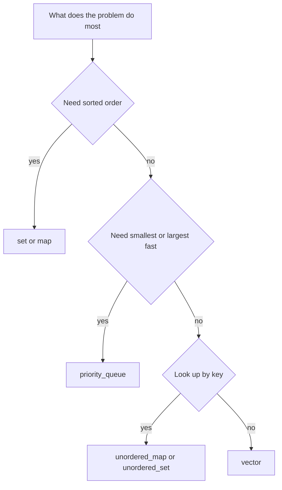

## The hook

A carpenter does not build a chair by forging their own hammer first. They open a well-organised toolbox, pick the right tool without thinking, and spend their energy on the chair.

In interviews and contests, the C++ Standard Template Library is that toolbox. Candidates who know it cold write a working solution in fifteen lines. Candidates who do not are still writing their own linked list when time runs out.

## The intuition

:::analogy
Think of the STL as a toolbox with labelled drawers. Each drawer holds one kind of [[container]], and each tool has a price tag: how many steps it costs to use. Your job is not to build tools. It is to know which drawer to open, and what each tool costs, so the total fits your time budget.
:::

Every problem asks for a few operations over and over: add an item, find an item, get the smallest, keep things sorted. Pick the container whose cheap operations match what your problem does most. That one decision often decides whether your solution is O(n log n) or O(n²).

## Let's build it up

### The everyday drawer: vector and string

`vector` is a growable array. Reading `v[i]` is O(1). `push_back` is [[amortised]] O(1): occasionally it copies everything into a bigger block, but it doubles the size each time, so those copies are rare. Inserting in the middle is O(n), because everything after it shifts.

`string` behaves like a vector of characters. Watch out for `s = s + c` inside a loop: it builds a new string every time. Use `s += c` or `s.push_back(c)` instead.

### The price list

Here is the table worth memorising. "n" is the number of elements stored.

| Container | Good at | Cost |
|---|---|---|
| `vector` | index, push or pop at the back | O(1), amortised for push |
| `deque` | push or pop at both ends | O(1) |
| `stack`, `queue` | last-in-first-out, first-in-first-out | O(1) |
| `priority_queue` | get the largest, push, pop | O(1) top, O(log n) push and pop |
| `set`, `map` | sorted keys, find, insert, erase, lower_bound | O(log n) |
| `unordered_set`, `unordered_map` | find, insert, erase by key | O(1) average, O(n) worst |
| `sort` | sorting a range | O(n log n) |

`set` and `map` are usually implemented as a [[balanced binary search tree]] (a red-black tree in common implementations). `unordered_set` and `unordered_map` are a [[hash table]].

:::insight
Sorted or not is the first fork in the road. If you ever need "the next bigger value", "the smallest key", or to walk keys in order, you need `set` or `map`. If you only need "have I seen this?" or "how many times?", the unordered versions are faster.
:::

### Walking through containers with iterators

An [[iterator]] is a bookmark into a container. `begin()` points at the first element and `end()` points just past the last one. Two of the most useful functions in the library return iterators:

- `lower_bound(x)`: the first element that is **not less than** x.
- `upper_bound(x)`: the first element that is **greater than** x.

On a sorted `vector` you call `lower_bound(v.begin(), v.end(), x)`. On a `set` or `map`, call the member version `s.lower_bound(x)`. The free function on a set is O(n), because set iterators cannot jump around.



### Sorting your own way

`sort` takes an optional [[comparator]]: a function that returns true when its first argument should come before its second. To sort intervals by end time:

```pseudo
sort intervals so that a comes before b when a.end < b.end
```

```cpp
#include <bits/stdc++.h>
using namespace std;

int main() {
    vector<pair<int, int>> iv = {{1, 4}, {2, 3}, {0, 6}};
    sort(iv.begin(), iv.end(), [](const pair<int, int>& a, const pair<int, int>& b) {
        return a.second < b.second;  // strict: never true for equal ends
    });
    for (auto [s, e] : iv) cout << s << '-' << e << ' ';  // 2-3 1-4 0-6
}
```

:::warning
Common misconception: "a comparator can return `a <= b`." It must be a strict ordering, so it must return false when two values are equal. Returning true for equal values breaks `sort` and can crash it.
:::

### Heaps the right way round

`priority_queue<int>` is a max-heap: `top()` is the largest. For a min-heap, write `priority_queue<int, vector<int>, greater<int>>`. With pairs, the heap compares the first member, then the second, which is handy for "smallest distance, then smallest id".

## A tiny example

Problem: a stream of exam scores arrives. After each one, print how many distinct scores you have seen and the smallest score that is at least 50.

Two questions, two tools. "How many distinct" wants a set. "Smallest score at least 50" wants sorted order and `lower_bound`. A single `set<int>` answers both.

| Score arrives | Set contents | Distinct | lower_bound(50) |
|---|---|---|---|
| 72 | {72} | 1 | 72 |
| 45 | {45, 72} | 2 | 72 |
| 72 | {45, 72} | 2 | 72 |
| 55 | {45, 55, 72} | 3 | 55 |

Each step costs O(log n), so a million scores take about twenty million steps. Comfortable.

:::try-this
Change the question to "how many times has each score appeared?" Which container now? You need a count per key, and no ordering is asked for, so an `unordered_map<int, int>` with `cnt[score]++` does it in O(1) average per score. If the question then asks for scores in increasing order, switch to `map<int, int>`.
:::

### When the hash table bites back

`unordered_map` is O(1) on average, not always. If many keys land in the same bucket, each lookup walks a long chain. Some contest problems include tests built to do exactly this. When in doubt in a contest, a `map` at O(log n) is predictable, or you can use a custom hash. In interviews, `unordered_map` is the expected default.

## Where you'll see this again

Almost every article in this subject uses these tools. The hash map powers [hashing patterns](article:dsa-hashing-patterns), sorted containers power interval and sweep-line problems, and `priority_queue` is the engine behind Dijkstra and every top-k problem. Keep the price list handy, and combine it with your [Big-O budget](article:dsa-big-o) to check an idea before you write it.

## Key takeaways

- Choose a container by the operations your problem repeats most, then check the total cost against the input size.
- `set` and `map` keep keys sorted at O(log n) per operation, while the unordered versions are O(1) on average with no order.
- Use member `lower_bound` on sets and maps; the free function is only fast on random-access ranges like vectors.
- A sort comparator must be strict and return false for equal values.
- `priority_queue` is a max-heap by default; pass `greater` to get a min-heap.
