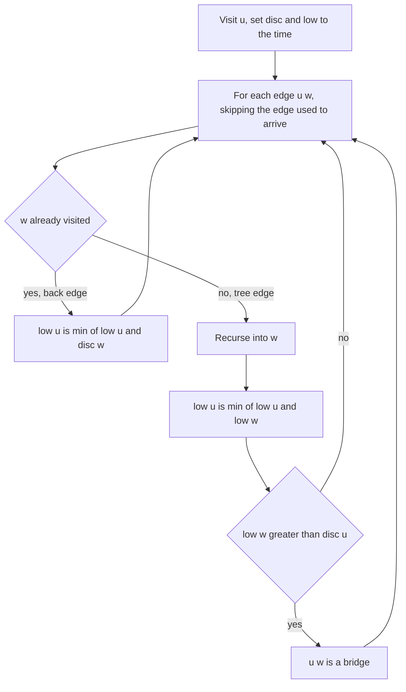

## The hook

A city council plans roadworks and wants to know which roads it must never close at the same time as anything else, because closing even one of them on its own would cut part of the city off. Most roads are safe: there is always a way around. A few are the only link to a neighbourhood.

Checking each road by removing it and running a search is O(E × (V + E)). A single DFS can find every such road at once, using two numbers per intersection. Robert Tarjan described this approach in 1974, and it remains the standard answer.

## The problem

You are given an undirected connected network of n servers and a list of connections. A critical connection is one whose removal makes some server unable to reach some other. Return all critical connections in any order.

In graph terms, these edges are [[bridge]]s. For the network with edges 0–1, 1–2, 2–0, 1–3, 3–4, 4–5, 5–3, 4–6, the bridges are 1–3 and 4–6.

## The obvious approach

For each edge, remove it, run BFS or DFS from any vertex, and check whether every vertex is still reached.

```pseudo
for each edge e:
    remove e
    if bfs(0) does not reach all n vertices: e is a bridge
    put e back
```

That is O(E × (V + E)). For 10⁵ vertices and edges, it is about 10¹⁰ steps, far too slow.

## The key insight

:::analogy
Explore the city with a ball of string, never crossing your own string, and number each intersection the moment you first reach it. Behind you, every road you used to arrive somewhere is a string road. Now stand at any intersection v you reached along the string road from u, and ask: "from v's part of the map, without walking back along that same string road, how early-numbered an intersection can I get to?". If the answer is still after u, then v's whole part of the map hangs off the city by that one string road, and closing it cuts them off.
:::

The intersection numbers are [[discovery time]]s, disc[u]. The answer to "how early can v's part of the map reach?" is the [[low-link]], low[v]: the smallest discovery time reachable from v's DFS subtree using tree edges down and at most one [[back edge]] up. In an undirected DFS, every non-tree edge is a back edge to an ancestor, so "reaching earlier" always means "climbing back above".

The rule falls out directly:

- **Tree edge u → v is a bridge exactly when low[v] > disc[u].** Nothing below v can reach u or anything above u except through the edge u–v.
- **low is computed in the same DFS.** Start with low[u] = disc[u]. For a back edge u–w, set low[u] = min(low[u], disc[w]). After returning from a child v, set low[u] = min(low[u], low[v]).

### The parent edge trap

When v looks at its neighbours, one of them is its parent u, reached along the very edge it came down. That edge must not count as a back edge, or every low[v] would be at most disc[u] and no bridge would ever be found. Skip it by **edge id**, not by vertex: if there are two parallel roads between u and v, the second one is a real second way up, and the pair is not a bridge.

### Articulation points

An [[articulation point]] is a vertex whose removal disconnects the graph. The test is almost the same:

- a non-root vertex u is an articulation point if some child v has low[v] ≥ disc[u], since v's subtree cannot climb above u without u itself;
- the root is an articulation point if it has two or more DFS children, because those subtrees can only connect through the root.

CSES *Necessary Cities* asks for exactly these vertices.

| Question | Condition on a tree edge u → v | Note |
|---|---|---|
| Is u–v a bridge? | low[v] > disc[u] | strict |
| Is u (not the root) a cut vertex? | low[v] ≥ disc[u] for some child v | not strict |
| Is the root a cut vertex? | it has at least two DFS children | low is irrelevant |



:::insight
A tree edge is a bridge when the subtree below it has no back edge climbing to the edge's upper end or higher. Discovery times measure "higher", and low-links summarise, in one number per vertex, the highest point each subtree can reach.
:::

## Walk through an example

Edges, with ids: e0 0–1, e1 1–2, e2 2–0, e3 1–3, e4 3–4, e5 4–5, e6 5–3, e7 4–6. DFS starts at 0.

| Step | Event | disc | low updates |
|---|---|---|---|
| 1 | visit 0 | 0: 0 | |
| 2 | tree edge 0 → 1 | 1: 1 | |
| 3 | tree edge 1 → 2 | 2: 2 | |
| 4 | at 2, edge e2 to 0 is a back edge | | low[2] = 0 |
| 5 | back at 1 from 2 | | low[1] = min(1, 0) = 0; is 1–2 a bridge? low[2] = 0 > 1? no |
| 6 | tree edge 1 → 3 | 3: 3 | |
| 7 | tree edge 3 → 4, then 4 → 5 | 4: 4, 5: 5 | |
| 8 | at 5, edge e6 to 3 is a back edge | | low[5] = 3 |
| 9 | back at 4 from 5 | | low[4] = 3; 4–5 bridge? 3 > 4? no |
| 10 | tree edge 4 → 6, a leaf | 6: 6 | low[6] = 6 |
| 11 | back at 4 from 6 | | 4–6 bridge? 6 > 4? **yes** |
| 12 | back at 3 from 4 | | low[3] = 3; 3–4 bridge? 3 > 3? no |
| 13 | back at 1 from 3 | | 1–3 bridge? low[3] = 3 > disc[1] = 1? **yes** |
| 14 | back at 0 from 1 | | 0–1 bridge? 0 > 0? no |

Final values:

| Vertex | 0 | 1 | 2 | 3 | 4 | 5 | 6 |
|---|---|---|---|---|---|---|---|
| disc | 0 | 1 | 2 | 3 | 4 | 5 | 6 |
| low | 0 | 0 | 0 | 3 | 3 | 3 | 6 |

Bridges: 1–3 and 4–6. The two triangles, 0–1–2 and 3–4–5, are safe: every edge in a cycle has a way around.

Articulation points: 1 (child 3 has low 3 ≥ disc 1), 3 (child 4 has low 3 ≥ disc 3) and 4 (child 6 has low 6 ≥ disc 4). The root 0 has a single DFS child, so it is not one.

:::try-this
Add a second road between 4 and 6, so there are two parallel edges. Which bridges remain, and why does skipping by edge id matter here? (Only 1–3 remains. At 6, the edge you arrived on is skipped by id, but the second 4–6 road is a back edge to 4, so low[6] = 4, and 6 > 4 fails. Skipping by vertex would skip both roads and wrongly keep 4–6 as a bridge.)
:::

:::warning
Common misconception: "An edge between two articulation points must be a bridge." In the example, 3 and 4 are both articulation points, yet the edge 3–4 is not a bridge: it lies on the triangle 3–4–5, so traffic can go round through 5. Bridges and articulation points are related but separate questions, with the strict and non-strict versions of the low-link test.
:::

## The code

```pseudo
dfs(u, parent_edge):
    disc[u] = low[u] = timer; timer += 1
    for (v, id) in adj[u]:
        if id == parent_edge: continue
        if disc[v] == -1:
            dfs(v, id)
            low[u] = min(low[u], low[v])
            if low[v] > disc[u]: report bridge (u, v)
        else:
            low[u] = min(low[u], disc[v])     # back edge
```

```cpp
#include <bits/stdc++.h>
using namespace std;

struct Bridges {
    int n, timer = 0;
    vector<vector<pair<int, int>>> adj;              // (neighbour, edge id)
    vector<int> disc, low;
    vector<array<int, 2>> bridges;
    set<int> cutVertices;

    Bridges(int n, const vector<array<int, 2>>& edges) : n(n), adj(n), disc(n, -1), low(n, 0) {
        for (int i = 0; i < (int)edges.size(); i++) {
            auto [a, b] = edges[i];
            adj[a].push_back({b, i}), adj[b].push_back({a, i});
        }
        for (int s = 0; s < n; s++) if (disc[s] == -1) dfs(s, -1);
    }
    void dfs(int u, int parentEdge) {
        disc[u] = low[u] = timer++;
        int children = 0;
        for (auto [v, id] : adj[u]) {
            if (id == parentEdge) continue;          // skip only the edge we came down
            if (disc[v] == -1) {
                children++;
                dfs(v, id);
                low[u] = min(low[u], low[v]);
                if (low[v] > disc[u]) bridges.push_back({u, v});
                if (parentEdge != -1 && low[v] >= disc[u]) cutVertices.insert(u);
            } else {
                low[u] = min(low[u], disc[v]);       // back edge to an ancestor
            }
        }
        if (parentEdge == -1 && children >= 2) cutVertices.insert(u);
    }
};

int main() {
    vector<array<int, 2>> e = {{0, 1}, {1, 2}, {2, 0}, {1, 3}, {3, 4}, {4, 5}, {5, 3}, {4, 6}};
    Bridges b(7, e);
    for (auto [u, v] : b.bridges) cout << u << '-' << v << ' ';
    cout << '\n';                                    // 4-6 1-3
    for (int c : b.cutVertices) cout << c << ' ';
    cout << '\n';                                    // 1 3 4
    e.push_back({4, 6});                             // a second road between 4 and 6
    Bridges b2(7, e);
    for (auto [u, v] : b2.bridges) cout << u << '-' << v << ' ';
    cout << '\n';                                    // 1-3
}
```

Bridges are reported as their DFS finishes, deepest first, which is why 4–6 is printed before 1–3. On CSES-sized inputs, a path of 10⁵ vertices makes the recursion that deep; raise the stack limit or rewrite the DFS with an explicit stack.

## Complexity

- **Time: O(V + E),** one DFS visiting every vertex once and every edge twice.
- **Space: O(V + E)** for the adjacency list, plus O(V) for disc, low and the recursion stack.
- **Compared with the obvious approach,** O(E × (V + E)), this is the difference between instant and hours on large inputs.

## Common mistakes

- **Not skipping the parent edge,** which makes every low[v] at most disc[u] and hides every bridge.
- **Skipping the parent by vertex,** which wrongly reports doubled edges as bridges.
- **Using low[w] instead of disc[w] for a back edge.** For bridges both happen to work, but disc[w] is the standard rule and the one that stays correct when the same code is reused for articulation points.
- **Using ≥ for bridges or > for cut vertices,** mixing up the strict and non-strict tests.
- **Forgetting the root rule** for articulation points, where low is meaningless.
- **Starting DFS from vertex 0 only** when the graph may be disconnected; loop over all vertices.

## Practice problems

*Critical Connections in a Network* is exactly the bridge-finding DFS. *Necessary Roads* is the same at CSES scale, where the recursion depth matters. *Necessary Cities* asks for articulation points instead. The DFS foundations are in [Going Deep With a Ball of String](article:dsa-dfs), and the cycle reasoning in [When the Rumour Comes Back to You](article:dsa-cycle-detection).

## Key takeaways

- A bridge is an edge whose removal disconnects the graph, and one DFS can find every bridge in O(V + E).
- Discovery times number vertices in DFS order, and low[u] is the smallest discovery time reachable from u's subtree using one back edge.
- A tree edge u → v is a bridge exactly when low[v] > disc[u], meaning v's subtree has no other way up.
- The edge used to arrive at a vertex must be skipped by its id, so that parallel edges count as a second way up.
- Articulation points use low[v] ≥ disc[u] for non-root vertices and "two or more DFS children" for the root.
