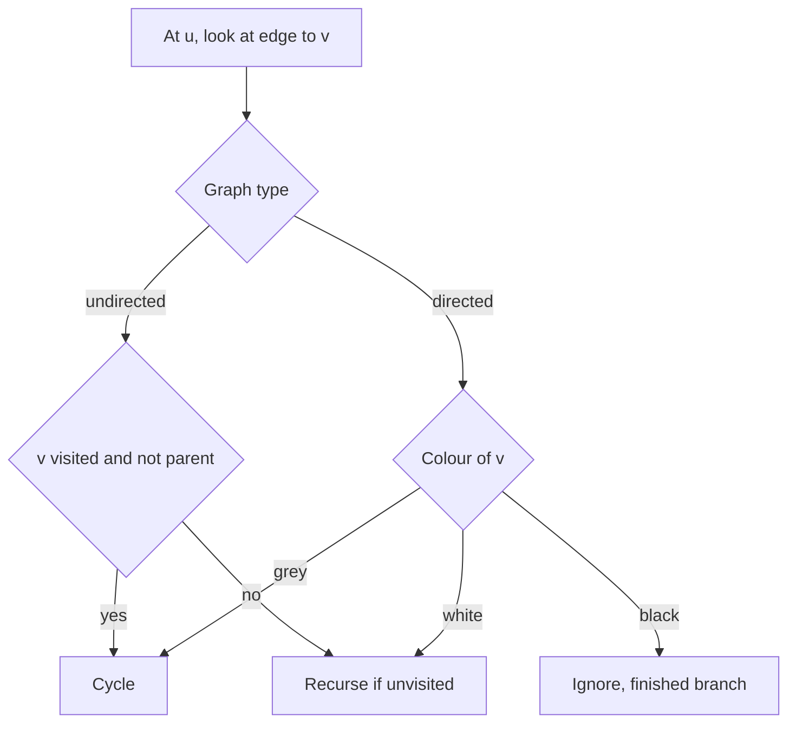
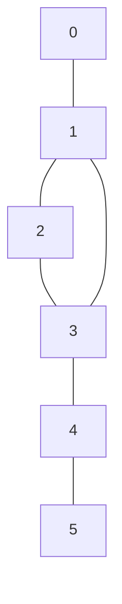

## The hook

A course catalogue says Algorithms needs Data Structures, Data Structures needs Discrete Maths, and Discrete Maths needs Algorithms. Nobody can ever start. A build tool finds that module A imports B, B imports C and C imports A, and refuses to compile. A spreadsheet shows a "circular reference" error.

Each of these is the same question: does following the connections ever bring you back to where you started? DFS from [Going Deep With a Ball of String](article:dsa-dfs) answers it in linear time. But there is a trap. The check that works for two-way roads gives wrong answers on one-way streets. Why?

## The intuition

:::analogy
Think of a rumour. You tell your friend, and your friend passes it on, and so on. If the rumour ever comes back to you through *someone else*, the gossip network has a loop. Two details matter. First, if your friend simply repeats it straight back to you, that is not a loop, just the same conversation in reverse. Second, if the rumour reaches someone who already heard it in an earlier, finished chain of gossip, that is not a loop either. It only loops when it reaches someone in the chain that is still being passed along right now.
:::

The first detail is the [[parent check]] for undirected graphs. The second is the reason directed graphs need [[three colours]]. A [[cycle]] exists exactly when DFS finds a [[back edge]]: an edge to a vertex that is still on the current path.

## How it works

### Undirected graphs: visited plus parent

Run DFS and remember which vertex you came from. At vertex u, for each neighbour v:

- If v is the parent, skip it. That is the road you arrived on, stored a second time in adj[v].
- If v is unvisited, recurse with u as v's parent.
- If v is visited and is not the parent, you found a cycle.

Why is "visited" enough here? In an undirected DFS, every edge that does not lead to a new vertex leads to an ancestor on the current path. There are no "sideways" edges into a finished branch, because if such an edge existed, DFS would have crossed it while that branch was still open. So any visited non-parent neighbour is an ancestor, and the edge closes a loop.

### Directed graphs: three colours

Directed graphs do have sideways edges. Two paths can meet at the same vertex, as in 0→1→2 and 0→2, without any loop. "Visited" cannot tell those apart from a real loop, so split visited into two states:

- **White:** not visited yet.
- **Grey:** entered but not finished. The grey vertices are exactly the current [[recursion stack]].
- **Black:** finished. Everything reachable from it has been explored, and no cycle was found through it.

At u (grey), for each edge u→v:

- v white: recurse.
- v grey: v is an ancestor on the current path, so u→v closes a cycle.
- v black: a finished branch. Not a cycle; ignore it.

When all of u's edges are done, colour u black.

| Edge leads to | Undirected meaning | Directed meaning |
|---|---|---|
| unvisited vertex | go deeper | go deeper (white) |
| the vertex you came from | same road, skip | a real edge back: if it is grey, a 2-cycle |
| visited ancestor | cycle | cycle (grey) |
| finished vertex elsewhere | cannot happen | not a cycle (black) |



:::insight
A cycle is an edge back into the path you are still walking. In an undirected graph, every visited vertex you can see is on that path, except your parent. In a directed graph, it might be in a finished branch instead, so you need grey to mean "on the path right now".
:::

## Walk through an example

**Undirected.** Edges 0–1, 1–2, 2–3, 3–1, 3–4, 4–5, neighbours sorted.



| At | Neighbour | Parent of current | Decision | DFS path |
|---|---|---|---|---|
| 0 | 1 | none | unvisited, go | 0, 1 |
| 1 | 0 | 0 | parent, skip | 0, 1 |
| 1 | 2 | 0 | unvisited, go | 0, 1, 2 |
| 2 | 1 | 1 | parent, skip | 0, 1, 2 |
| 2 | 3 | 1 | unvisited, go | 0, 1, 2, 3 |
| 3 | 1 | 2 | visited, not parent: **cycle** | 0, 1, 2, 3 |

To print the cycle, walk the parent pointers from 3 back until you reach 1: 3, 2, then 1. The cycle is **1 → 2 → 3 → 1**. That reconstruction is exactly what CSES *Round Trip* asks for.

**Directed, no cycle.** Prerequisite edges 0→1, 0→2, 1→2, 2→3.

| Step | Event | Colours after (0, 1, 2, 3) | Note |
|---|---|---|---|
| 1 | enter 0 | G W W W | |
| 2 | 0→1, enter 1 | G G W W | |
| 3 | 1→2, enter 2 | G G G W | |
| 4 | 2→3, enter 3 | G G G G | |
| 5 | finish 3 | G G G B | no out-edges |
| 6 | finish 2 | G G B B | |
| 7 | finish 1 | G B B B | |
| 8 | 0→2: 2 is black | G B B B | **not** a cycle |
| 9 | finish 0 | B B B B | no cycle |

At step 8, undirected logic would see "2 is visited and is not my parent" and wrongly report a cycle. The colours know that 2's branch is finished.

**Directed, with a cycle.** Add the edge 3→1. Steps 1 to 4 are the same, so 0, 1, 2 and 3 are all grey. Now 3→1 points to a grey vertex: **cycle 1 → 2 → 3 → 1**. In Course Schedule terms, those three courses wait on each other and none can be taken first.

:::try-this
Undirected graph with edges 0–1, 1–2, 1–3 (a small tree). Run the parent-check DFS from 0. Does any visited non-parent neighbour appear? (No. 1 sees 0 as its parent, and 2 and 3 each see only 1, their parent. No cycle, which is right, since a connected graph with 4 vertices and 3 edges is a tree.)
:::

## The code

```pseudo
has_cycle_undirected(u, parent):
    visited[u] = true
    for v in adj[u]:
        if v == parent: continue
        if visited[v]: return true                 // back edge
        if has_cycle_undirected(v, u): return true
    return false

has_cycle_directed(u):                           // colour: 0 white, 1 grey, 2 black
    colour[u] = grey
    for v in adj[u]:
        if colour[v] == grey: return true
        if colour[v] == white and has_cycle_directed(v): return true
    colour[u] = black
    return false
```

The iterative directed version keeps (vertex, next edge index) pairs on its own stack, so a vertex turns black only after its last edge, exactly as in recursion.

```cpp
#include <bits/stdc++.h>
using namespace std;

// Undirected: returns a cycle as a list of vertices, or empty if none.
vector<int> findCycleUndirected(int n, const vector<vector<int>>& adj) {
    vector<int> par(n, -1);
    vector<bool> vis(n, false);
    vector<int> cycle;
    function<bool(int, int)> dfs = [&](int u, int p) {
        vis[u] = true; par[u] = p;
        for (int v : adj[u]) {
            if (v == p) continue;
            if (vis[v]) {                                    // back edge u - v
                for (int x = u; x != v; x = par[x]) cycle.push_back(x);
                cycle.push_back(v);
                reverse(cycle.begin(), cycle.end());
                cycle.push_back(v);
                return true;
            }
            if (dfs(v, u)) return true;
        }
        return false;
    };
    for (int s = 0; s < n; s++) if (!vis[s] && dfs(s, -1)) break;
    return cycle;
}

// Directed, recursive three colours.
bool dfsColour(int u, const vector<vector<int>>& adj, vector<int>& col) {
    col[u] = 1;                                              // grey
    for (int v : adj[u]) {
        if (col[v] == 1) return true;
        if (col[v] == 0 && dfsColour(v, adj, col)) return true;
    }
    col[u] = 2;                                              // black
    return false;
}

bool hasCycleDirected(int n, const vector<vector<int>>& adj) {
    vector<int> col(n, 0);
    for (int s = 0; s < n; s++) if (col[s] == 0 && dfsColour(s, adj, col)) return true;
    return false;
}

// Directed, iterative: explicit stack of (vertex, next edge index).
bool hasCycleDirectedIter(int n, const vector<vector<int>>& adj) {
    vector<int> col(n, 0);
    for (int s = 0; s < n; s++) {
        if (col[s]) continue;
        vector<pair<int,int>> st = {{s, 0}};
        col[s] = 1;
        while (!st.empty()) {
            auto& [u, i] = st.back();
            if (i == (int)adj[u].size()) { col[u] = 2; st.pop_back(); continue; }
            int v = adj[u][i++];
            if (col[v] == 1) return true;
            if (col[v] == 0) { col[v] = 1; st.push_back({v, 0}); }
        }
    }
    return false;
}

int main() {
    vector<vector<int>> ug(6);
    for (auto [a, b] : vector<pair<int,int>>{{0,1}, {1,2}, {2,3}, {3,1}, {3,4}, {4,5}}) {
        ug[a].push_back(b); ug[b].push_back(a);
    }
    for (auto& l : ug) sort(l.begin(), l.end());
    for (int x : findCycleUndirected(6, ug)) cout << x << ' ';
    cout << '\n';                                                       // 1 2 3 1

    vector<vector<int>> dg = {{1, 2}, {2}, {3}, {}};                   // 0->1, 0->2, 1->2, 2->3
    cout << hasCycleDirected(4, dg) << hasCycleDirectedIter(4, dg) << '\n';   // 00
    dg[3].push_back(1);                                                 // add 3->1
    cout << hasCycleDirected(4, dg) << hasCycleDirectedIter(4, dg) << '\n';   // 11
}
```

## Complexity

- **Time:** O(V + E). Each vertex changes colour at most twice and each edge is examined a constant number of times, once per direction in an undirected graph.
- **Space:** O(V) for colours or visited marks and parents, plus the stack, which can be V deep.

## Common mistakes

:::warning
Common misconception: "a cycle is any edge to an already visited vertex." That is only true in undirected graphs, and only after excluding the parent. In a directed graph, an edge to a finished (black) vertex just means two paths meet, as in 0→1→2 plus 0→2. Using the undirected rule on Course Schedule rejects valid course plans.
:::

- **Applying the parent check to directed graphs.** In a directed graph, 1→2 and 2→1 together *are* a cycle of length two. Skipping the "parent" would hide it.
- **Parallel edges in undirected multigraphs.** If the same pair is joined twice, that is a cycle of length two, but skipping the parent *vertex* hides it. Skip the parent *edge* instead, by storing edge ids.
- **Forgetting black.** Marking vertices grey but never black turns every revisit into a false cycle. Leaving them grey also makes "safe state" problems wrong.
- **Only starting DFS from vertex 0.** A cycle can sit in a part of the graph that 0 cannot reach. Loop over all vertices.
- **Deep recursion.** With up to 10⁵ vertices in a chain, recursive DFS may overflow; use the iterative version above.

There are two non-DFS alternatives worth knowing. For directed graphs, Kahn's algorithm repeatedly removes vertices with no incoming edges: if some vertices are never removed, they sit on or behind a cycle. For undirected graphs, [Friend Groups That Merge at a Party](article:dsa-union-find) reports a cycle the moment an edge joins two vertices that are already connected.

## Practice problems

Start with *Course Schedule*, the three-colour template on a prerequisite graph. *Round Trip* (CSES) is the undirected version and asks you to print the loop using parent pointers. *Redundant Connection* finds the edge that closes the loop in an undirected graph; DFS works, and union-find is shorter. *Course Schedule II* returns a valid order, which you can collect as vertices turn black. *Find Eventual Safe States* asks which vertices can never reach a cycle, which is exactly "turned black". *Round Trip II* prints a directed loop. The often-cited *Graph Valid Tree* is premium-only on LeetCode, so practise its idea, "connected and acyclic", with *Round Trip* and *Redundant Connection* instead.

## Key takeaways

- A graph has a cycle exactly when DFS finds an edge back into the path it is still walking.
- In undirected graphs, any visited neighbour other than the parent closes a cycle, because undirected DFS has no edges into finished branches.
- In directed graphs, use three colours: an edge to a grey vertex is a cycle, and an edge to a black vertex is just two paths meeting.
- Parent pointers let you print the actual cycle by walking back from the current vertex to the one the back edge reached.
- Course prerequisites, build dependencies and deadlocks are all directed cycle checks, so the three-colour rule is the one interviewers probe most.
