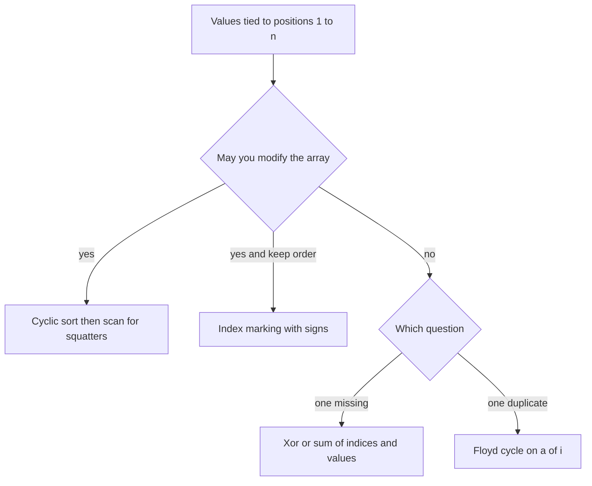

## The hook

You are given n numbers, each between 1 and n, and asked which ones are missing. A hash set solves it in O(n) time, but the interviewer adds: "Now do it with O(1) extra space." Sorting takes O(n log n) time. Is there a way to get both?

There is, and it rests on one fact that most problems never give you: the values themselves say exactly where they belong. When every value lies in 1 to n, value v has a natural seat, index v − 1. Put every value in its seat, and anything missing or repeated is visible at a glance.

## The intuition

:::analogy
Picture a classroom with n numbered seats and n students, each holding a card with a seat number. They walk in and sit anywhere. The teacher stands at seat 1 and asks the student there: "Is this your seat?" If not, that student walks to their own seat and swaps with whoever is sitting there. The teacher asks the newcomer the same question, and keeps going until seat 1 holds its owner. Then she moves to seat 2.
:::

That is [[cyclic sort]]. Each value has a [[home index]], v − 1. Standing at index i, you look at the value v there.

If v is not home yet, swap it home. The value that comes back is a new student to ask about. Only when index i holds the right value, or a value that cannot go anywhere, do you move on.

Why does this finish quickly? Every swap seats one student permanently: once a value is in its home, nobody ever asks it to move again. So there are at most n swaps in the whole run, however the while loop looks.

The name comes from [[cycle|cycles]]. If seat 1's student belongs in seat 4, and seat 4's in seat 7, and seat 7's in seat 1, those three seats form a loop. Following the swaps around that loop seats all three, and the loop is done.

## How it works

Walk i from 0 to n − 1. At each step, let v = a[i].

- If v is in range 1 to n and its home a[v − 1] does not already hold v, swap a[i] with a[v − 1]. Do **not** advance i: a new value has arrived at index i.
- Otherwise advance i. Either index i already holds its own value, or v is out of range, or v is a repeat whose home is already taken.

After the loop, every value that could be seated is seated. Any index i where a[i] != i + 1 holds a [[squatter]]: a value that is a duplicate or out of range. That one fact answers a whole family of questions:

| Question | Read it off the sorted array |
|---|---|
| Which numbers in 1 to n are missing? | every i + 1 where a[i] != i + 1 |
| Which numbers appear twice? | every a[i] where a[i] != i + 1 |
| First missing positive, for any integers | the first i + 1 where a[i] != i + 1, or n + 1 if none |
| One missing and one duplicated (*Set Mismatch*) | the single bad index i gives duplicate a[i] and missing i + 1 |

### Why the guard is a[v − 1] != v

With duplicates, two students may hold the same card. Suppose index 0 holds 3 and index 2 already holds 3. If the rule were "swap when i is not v − 1", you would swap the 3 at index 0 with the 3 at index 2 forever. Checking the content of the home, `a[v - 1] != v`, notices that seat 3 is already properly taken, so this 3 is a squatter and you move on.

### Values outside 1 to n

*First Missing Positive* allows any integers, including zero, negatives and huge values. They simply have no seat: the range check fails and they are left where they are. Wherever they end up, they occupy a seat whose rightful owner never showed up, so they mark a gap.

### When you cannot modify the array

Cyclic sort rearranges the input. Two classic problems forbid that:

- **Missing Number** (values 0 to n, one missing): xor all indices 0 to n with all values. Every present number cancels with its index, and the missing one survives. A sum formula works too, with care for overflow.
- **Find the Duplicate Number** (n + 1 values in 1 to n, read-only, O(1) space): treat a[i] as a pointer from i to a[i]. The duplicate value is where two pointers enter the same node, which is the entry point of a cycle, found with Floyd's tortoise and hare from [The Tortoise and the Hare on a Circular Track](article:dsa-fast-slow-pointers).

A middle ground is [[index marking]]: when you see value v, make a[v − 1] negative. Afterwards, positive entries mark missing values. It modifies the array too, but it does not move anything, so it is easy to undo by taking absolute values.



:::insight
When values are tied to positions, the array can be its own hash table. Each value's home index is its bucket, and cyclic sort fills the buckets in place with at most n swaps.
:::

## Walk through an example

Take a = [4, 3, 2, 7, 8, 2, 3, 1], so n = 8 and values lie in 1 to 8. The 2 and the 3 appear twice; 5 and 6 are missing.

| Step | i | v = a[i] | Home v − 1 holds | Action | Array after |
|---|---|---|---|---|---|
| 1 | 0 | 4 | 7 | swap with index 3 | 7 3 2 4 8 2 3 1 |
| 2 | 0 | 7 | 3 | swap with index 6 | 3 3 2 4 8 2 7 1 |
| 3 | 0 | 3 | 2 | swap with index 2 | 2 3 3 4 8 2 7 1 |
| 4 | 0 | 2 | 3 | swap with index 1 | 3 2 3 4 8 2 7 1 |
| 5 | 0 | 3 | 3, already home | advance | same |
| 6 | 1 to 3 | 2, 3, 4 | themselves | advance three times | same |
| 7 | 4 | 8 | 1 | swap with index 7 | 3 2 3 4 1 2 7 8 |
| 8 | 4 | 1 | 3 | swap with index 0 | 1 2 3 4 3 2 7 8 |
| 9 | 4 | 3 | 3, already home | advance | same |
| 10 | 5 | 2 | 2, already home | advance | same |
| 11 | 6, 7 | 7, 8 | themselves | advance twice | same |

Six swaps in total for eight elements, and the final array is [1, 2, 3, 4, 3, 2, 7, 8]. Now scan:

| Index | 0 | 1 | 2 | 3 | 4 | 5 | 6 | 7 |
|---|---|---|---|---|---|---|---|---|
| Should hold | 1 | 2 | 3 | 4 | 5 | 6 | 7 | 8 |
| Holds | 1 | 2 | 3 | 4 | 3 | 2 | 7 | 8 |
| Squatter? | | | | | yes | yes | | |

The squatters at indices 4 and 5 are the duplicates, 3 and 2, and their seat numbers, 5 and 6, are the missing values. In the classroom, the two students who could not find a free seat are sitting in the two seats whose owners never came.

Notice step 5: the 3 at index 0 found its home already holding a 3. Without the `a[v - 1] != v` guard, this is the moment the loop would spin forever.

:::try-this
Run cyclic sort on [3, 4, −1, 1] and find the first missing positive. (Index 0: 3 goes to index 2, giving [−1, 4, 3, 1]. −1 has no seat, advance. Index 1: 4 goes to index 3, giving [−1, 1, 3, 4]. Then 1 goes to index 0, giving [1, −1, 3, 4]. The rest are home. The first bad index is 1, so the answer is 2.)
:::

:::warning
Common misconception: "Cyclic sort is a general sorting algorithm." It only works when values map directly to indices, as with 1 to n or 0 to n − 1. For arbitrary values there is no home index, and you are back to comparison sorting or a hash set. It also destroys the original order, so check that the problem allows rearranging the input.
:::

## The code

```pseudo
cyclic_sort(a):
    i = 0
    while i < n:
        v = a[i]
        if 1 <= v <= n and a[v - 1] != v:
            swap a[i], a[v - 1]          # send v home, look at the newcomer
        else:
            i += 1

first_missing_positive(a):
    cyclic_sort(a)
    for i in 0 .. n - 1: if a[i] != i + 1: return i + 1
    return n + 1

all_duplicates(a):
    cyclic_sort(a)
    return every a[i] with a[i] != i + 1

find_duplicate_read_only(a):     # Floyd on i -> a[i]
    slow = fast = a[0]
    repeat: slow = a[slow]; fast = a[a[fast]] until slow == fast
    slow = a[0]
    while slow != fast: slow = a[slow]; fast = a[fast]
    return slow
```

```cpp
#include <bits/stdc++.h>
using namespace std;

// Put every value v in 1..n at index v - 1. Values outside 1..n, and repeats, stay where they are.
void cyclicSort(vector<int>& a) {
    int n = a.size(), i = 0;
    while (i < n) {
        int v = a[i];
        if (v >= 1 && v <= n && a[v - 1] != v) swap(a[i], a[v - 1]);   // send v home
        else i++;                                                        // home is taken or v has none
    }
}

int firstMissingPositive(vector<int> a) {
    cyclicSort(a);
    for (int i = 0; i < (int)a.size(); i++)
        if (a[i] != i + 1) return i + 1;
    return a.size() + 1;
}

vector<int> allDuplicates(vector<int> a) {         // values in 1..n, each appears once or twice
    cyclicSort(a);
    vector<int> dup;
    for (int i = 0; i < (int)a.size(); i++)
        if (a[i] != i + 1) dup.push_back(a[i]);     // a squatter: its real home holds the original
    return dup;
}

int missingNumber(const vector<int>& a) {           // values 0..n, one missing: xor trick
    int x = a.size();
    for (int i = 0; i < (int)a.size(); i++) x ^= i ^ a[i];
    return x;
}

int findDuplicate(const vector<int>& a) {           // n + 1 values in 1..n, read-only: Floyd
    int slow = a[0], fast = a[0];
    do { slow = a[slow]; fast = a[a[fast]]; } while (slow != fast);
    slow = a[0];
    while (slow != fast) { slow = a[slow]; fast = a[fast]; }
    return slow;
}

int main() {
    vector<int> a = {4, 3, 2, 7, 8, 2, 3, 1};
    vector<int> s = a;
    cyclicSort(s);
    for (int x : s) cout << x << ' ';
    cout << '\n';                                   // 1 2 3 4 3 2 7 8
    for (int x : allDuplicates(a)) cout << x << ' ';
    cout << '\n';                                   // 3 2
    cout << firstMissingPositive({3, 4, -1, 1}) << ' '
         << firstMissingPositive({7, 8, 9}) << ' '
         << firstMissingPositive({1, 2, 3}) << '\n';   // 2 1 4
    cout << missingNumber({3, 0, 1}) << '\n';          // 2
    cout << findDuplicate({1, 3, 4, 2, 2}) << '\n';    // 2
}
```

For values 0 to n − 1 instead of 1 to n, the home of v is index v, and the guard becomes `a[v] != v`. Everything else is the same.

## Complexity

- **Time: O(n).** Each swap puts one value into its home for good, so there are at most n swaps. The index i advances n times. The final scan is another n steps.
- **Space: O(1) extra.** Only a few integers besides the input, which is rearranged in place.
- **The xor and Floyd variants** are also O(n) time and O(1) space, and they leave the array untouched.
- **Compare:** a hash set gives O(n) time but O(n) space; sorting gives O(1) extra space but O(n log n) time. Cyclic sort gets the best of both, at the price of needing values tied to indices.

## Common mistakes

- **Guarding with i != v − 1.** With duplicates this swaps two equal values forever. Check what is at the home: `a[v - 1] != v`.
- **Advancing i after a swap.** The value that just arrived at index i has not been checked yet. Advance only when no swap happens.
- **Forgetting the range check.** Zero, negatives or values above n make `a[v - 1]` read out of bounds.
- **Off-by-one between 1 to n and 0 to n − 1.** Decide once whether the home of v is v − 1 or v, and use it everywhere, including the final scan.
- **Returning n instead of n + 1** in *First Missing Positive* when every seat is correctly filled.
- **Modifying a read-only input.** *Find the Duplicate Number* forbids changes; use Floyd's cycle detection there, not cyclic sort.

## Practice problems

Start with *Missing Number*, which you can solve with xor or a sum and then again with cyclic sort on 0 to n. *Find All Numbers Disappeared in an Array* and *Find All Duplicates in an Array* are the two halves of the squatter scan from the walkthrough. *Set Mismatch* combines them: one value is doubled and one is missing.

*First Missing Positive* is the hard classic, where out-of-range values are the twist; it is a common interview question precisely because the O(1)-space answer needs this pattern. Finish with *Find the Duplicate Number*, where you may not modify the array, to practise recognising when to switch to Floyd's cycle detection instead.

## Key takeaways

- When every value lies in 1 to n, value v has a home at index v − 1, and the array can act as its own hash table.
- Cyclic sort stays at index i and swaps the current value home until the slot holds its own value or a value with no free home, then moves on.
- Every swap seats one value permanently, so the whole sort makes at most n swaps and runs in O(n) time with O(1) extra space.
- After sorting, each index whose value does not match is a squatter: its value is a duplicate or out of range, and its index plus one is a missing number.
- Guard the swap with a[v − 1] != v to avoid looping forever on duplicates, and use xor or Floyd's cycle detection when the array must stay unchanged.
