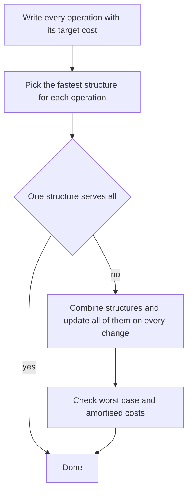

## The hook

A plumber arrives at a job with a bag of standard tools: a wrench, a pipe cutter, a torch. None of them fits this particular awkward pipe behind the boiler on its own. So the plumber clamps two together, a mirror on a stick plus a short wrench, and suddenly the job takes a minute.

"Design a data structure that supports these operations in O(1)" is that job. Interviewers are not testing whether you know an exotic structure. They are testing whether you can combine ordinary ones, an array, a hash map, a list, a queue, so that every operation gets the tool it needs, and whether you can prove the costs.

## The intuition

:::analogy
Before picking any tools, the plumber writes the job down: these three joints, each must be done in a minute. Then for each joint they pick the tool that does that joint fastest. If two tools are needed, they clamp them together, and the only extra work is making sure the clamp holds: whenever one tool moves, the other moves with it. A design that skips the job list ends up with a beautiful toolbox that cannot do one of the joints.
:::

The job list is an [[operation contract]]: every operation with its target cost. The clamped tools are a [[composite structure]]. The discipline has four steps:

- **Write the contract:** operations, their arguments, and the required time for each.
- **Match each operation to a structure:** hash map for lookup by key, array for random index access, linked list for O(1) removal anywhere, heap for the minimum, queue for oldest-first, sorted array plus binary search for "latest at or before".
- **Combine and keep in sync:** every mutation updates every structure, so they never disagree.
- **Check the costs, including amortised ones,** and say them out loud.

LRU cache, a hash map plus a doubly linked list, is the classic example, in [The Desk That Keeps Your Latest Books on Top](article:dsa-lru-cache).

## How it works

### Insert Delete GetRandom O(1)

Contract: insert(x), remove(x), getRandom(), all O(1) average, getRandom uniform.

| Operation | Needs | Structure |
|---|---|---|
| getRandom | pick a uniform index | array of values |
| insert | append | array, plus record its index |
| remove | find x's position, delete without shifting | map value → index, [[swap-with-last deletion]] |

To remove x: look up its index i, move the last array element into slot i, update that element's index in the map, pop the last slot, and erase x from the map. Nothing shifts, so it is O(1).

### Hit counter and recent calls

Contract: hit(t) records an event at time t; count(t) returns events in the last 300 seconds (or 3,000 ms in *Number of Recent Calls*). Times never decrease.

A queue of timestamps does it: push on hit, and before counting, pop from the front while the front is too old. A single count can pop many hits, but each hit is popped at most once, so the [[amortised cost]] is O(1). If hits can arrive many per second and memory matters, use 300 buckets indexed by t mod 300, each storing (time, count). LeetCode's *Design Hit Counter* is premium; *Number of Recent Calls* is the free version of the same idea.

### Time Based Key-Value Store

Contract: set(key, value, t) with t increasing across calls; get(key, t) returns the value set at the largest time ≤ t, or "" if none.

Give each key a [[version list]] of (t, value) pairs. Because times increase, appending keeps each list sorted, and get is a binary search: find the first time greater than t, then step back one. O(1) set, O(log n) get, using the binary search from [Binary Search Without the Off-by-One Fear](article:dsa-binary-search).

### Snapshot Array

Contract: an array of length n with set(index, val), snap() returning a snapshot id, and get(index, snap_id).

Copying the array on every snap is O(n) per snap, far too slow for 5 × 10⁴ snaps of a 5 × 10⁴ array. Instead give each index its own version list of (snap_id, value), recording only real changes; if an index is set twice before the next snap, overwrite the last entry. get(index, s) binary searches for the last version with snap id ≤ s. Memory is proportional to the number of set calls, not n × snaps.

| Design | Structures | Costs |
|---|---|---|
| LRU cache | hash map + doubly linked list | O(1) get and put |
| RandomizedSet | array + hash map of indices | O(1) average for all three |
| Hit counter | queue, or 300 circular buckets | O(1) amortised, or O(300) per count |
| Time-based store | hash map of sorted version lists | O(1) set, O(log n) get |
| Snapshot array | per-index version lists | O(1) set and snap, O(log s) get |



:::insight
A design question is a list of operations with deadlines. Give each operation the structure that meets its deadline, then pay for the combination by updating every structure on every change. Most O(1) designs are an array or list for order plus a hash map for finding things.
:::

## Walk through an example

### RandomizedSet

| Call | Array | Map (value → index) | Result |
|---|---|---|---|
| insert(10) | [10] | 10→0 | true |
| insert(20) | [10, 20] | 10→0, 20→1 | true |
| insert(30) | [10, 20, 30] | 10→0, 20→1, 30→2 | true |
| insert(20) | unchanged | unchanged | false, already present |
| remove(10) | move 30 into slot 0: [30, 20] | 30→0, 20→1 | true |
| getRandom | | | 30 or 20, each with probability 1/2 |

The removal touched three things: the array slot, the moved element's index, and the map entry for 10. Forgetting the middle one is the classic bug.

### Recent calls in a 3,000 ms window

| ping(t) | Queue after removing times < t - 3000 | Count |
|---|---|---|
| 1 | [1] | 1 |
| 100 | [1, 100] | 2 |
| 3001 | [1, 100, 3001] | 3 |
| 3002 | [100, 3001, 3002] | 3 |
| 7000 | [7000] | 1 |

The call at 7000 popped three old pings at once; across all five calls, three pops in total.

### Time-based store

set("door", "closed", 1), set("door", "open", 4), set("door", "locked", 9).

| get("door", t) | Last time ≤ t | Value |
|---|---|---|
| 0 | none | "" |
| 3 | 1 | closed |
| 4 | 4 | open |
| 8 | 4 | open |
| 100 | 9 | locked |

### Snapshot array of length 3

| Call | Version lists |
|---|---|
| set(0, 5) | index 0: (snap 0, 5) |
| snap() → 0 | |
| set(0, 6), set(1, 2) | index 0: (0, 5), (1, 6); index 1: (1, 2) |
| snap() → 1 | |
| get(0, 0) | last version with snap ≤ 0: 5 |
| get(0, 1) | 6 |
| get(1, 0) | no version ≤ 0: the initial 0 |
| get(2, 1) | never set: 0 |

:::try-this
In RandomizedSet, what goes wrong if remove(x) deletes x's array slot with an erase instead of swapping with the last element? (Erasing from the middle shifts every later element one slot left, which is O(n), and every shifted element's stored index in the map becomes wrong, so later removals delete the wrong values. The swap keeps the operation O(1) and changes only one stored index.)
:::

:::warning
Common misconception: "A hash set alone gives O(1) getRandom." Hash sets do not support picking a uniformly random element in O(1): iterating to a random position is O(n), and picking a random bucket is biased towards elements in sparse buckets. A random array index is the only simple uniform O(1) pick, which is why the array is part of the design.
:::

## The code

```pseudo
RandomizedSet:
    insert(x): if x in pos: false; pos[x] = len(arr); arr.push(x); true
    remove(x): if x not in pos: false
        i = pos[x]; last = arr.back(); arr[i] = last; pos[last] = i
        arr.pop(); erase pos[x]; true
    getRandom(): arr[random index]

TimeMap.get(key, t):
    list = versions[key]; i = first index with time > t
    return list[i-1].value if i > 0 else ""
```

```cpp
#include <bits/stdc++.h>
using namespace std;

class RandomizedSet {
    vector<int> arr;
    unordered_map<int, int> pos;                         // value -> index in arr
    mt19937 rng{12345};
public:
    bool insert(int x) {
        if (pos.count(x)) return false;
        pos[x] = arr.size(), arr.push_back(x);
        return true;
    }
    bool remove(int x) {
        auto it = pos.find(x);
        if (it == pos.end()) return false;
        int i = it->second, last = arr.back();
        arr[i] = last, pos[last] = i;                     // move the last element into the hole
        arr.pop_back(), pos.erase(x);
        return true;
    }
    int getRandom() { return arr[rng() % arr.size()]; }
    size_t size() const { return arr.size(); }
};

class RecentCounter {
    queue<int> q;
public:
    int ping(int t) {
        q.push(t);
        while (q.front() < t - 3000) q.pop();             // each ping popped at most once
        return q.size();
    }
};

class TimeMap {
    unordered_map<string, vector<pair<int, string>>> versions;
public:
    void set(const string& key, const string& value, int t) { versions[key].push_back({t, value}); }
    string get(const string& key, int t) {
        auto it = versions.find(key);
        if (it == versions.end()) return "";
        auto& v = it->second;
        auto up = upper_bound(v.begin(), v.end(), t, [](int x, const pair<int, string>& p) { return x < p.first; });
        return up == v.begin() ? "" : prev(up)->second;
    }
};

class SnapshotArray {
    vector<vector<pair<int, int>>> hist;                 // per index: (snap id, value)
    int snapId = 0;
public:
    explicit SnapshotArray(int n) : hist(n, {{0, 0}}) {}
    void set(int i, int val) {
        if (hist[i].back().first == snapId) hist[i].back().second = val;   // overwrite within a snap
        else hist[i].push_back({snapId, val});
    }
    int snap() { return snapId++; }
    int get(int i, int s) {
        auto& v = hist[i];
        auto up = upper_bound(v.begin(), v.end(), make_pair(s, INT_MAX));
        return prev(up)->second;
    }
};

int main() {
    RandomizedSet rs;
    cout << rs.insert(10) << rs.insert(20) << rs.insert(30) << rs.insert(20) << rs.remove(10) << rs.remove(99) << ' ';
    int r = rs.getRandom();
    cout << rs.size() << ' ' << (r == 20 || r == 30) << '\n';          // 111010 2 1
    RecentCounter rc;
    for (int t : {1, 100, 3001, 3002, 7000}) cout << rc.ping(t) << ' ';
    cout << '\n';                                                     // 1 2 3 3 1
    TimeMap tm;
    tm.set("door", "closed", 1), tm.set("door", "open", 4), tm.set("door", "locked", 9);
    for (int t : {0, 3, 4, 8, 100}) cout << '[' << tm.get("door", t) << ']';
    cout << '\n';                                                     // [][closed][open][open][locked]
    SnapshotArray sa(3);
    sa.set(0, 5), sa.snap(), sa.set(0, 6), sa.set(1, 2), sa.snap();
    cout << sa.get(0, 0) << sa.get(0, 1) << sa.get(1, 0) << sa.get(2, 1) << '\n';   // 5600
}
```

## Complexity

- **RandomizedSet: O(1) average** for insert, remove and getRandom; O(n) space.
- **RecentCounter: O(1) amortised** per ping; O(w) space for the pings inside the window.
- **TimeMap: O(1) set and O(log k) get** for k versions of a key; O(total sets) space.
- **SnapshotArray: O(1) set and snap, O(log k) get;** O(n + total sets) space instead of O(n × snaps).

## Common mistakes

- **Choosing structures before writing the operation contract,** and then discovering one operation is O(n).
- **Forgetting to update the moved element's index** in swap-with-last deletion.
- **Copying the whole array on snap,** which is O(n) per snapshot.
- **Binary searching for the wrong boundary** in version lists: you need the last time ≤ t, which is one before the first time > t.
- **Claiming O(1) worst case** for designs that are only O(1) amortised or average; say which one you mean.
- **Ignoring the order guarantee:** TimeMap relies on increasing timestamps; without it, each list needs sorted insertion or a balanced tree.

## Practice problems

*Insert Delete GetRandom O(1)* is the array plus index map. *Number of Recent Calls* is the queue with amortised pops, the free version of the premium Design Hit Counter. *Time Based Key-Value Store* and *Snapshot Array* are version lists with binary search. The same composite style powers [The Desk That Keeps Your Latest Books on Top](article:dsa-lru-cache), and the hash map basics are in [The Notebook That Turns O(n²) Into O(n)](article:dsa-hashing-patterns).

## Key takeaways

- Start every design by listing each operation with its required cost, then choose structures to meet those costs.
- Combining an array with a hash map of indices gives O(1) insert, delete and uniform random pick, as long as deletion swaps with the last element.
- A queue whose old entries are popped lazily answers sliding time-window counts in O(1) amortised, because each entry is popped at most once.
- Version lists of (time, value) per key or index, searched with binary search, answer "value as of time t" without copying data.
- Every structure in a composite must be updated on every change, and amortised costs should be stated as amortised.
