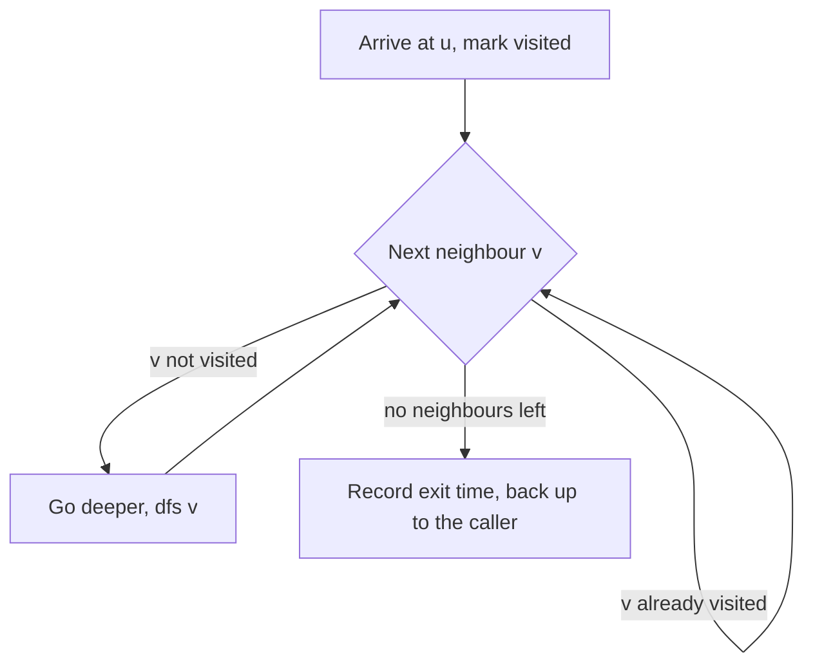
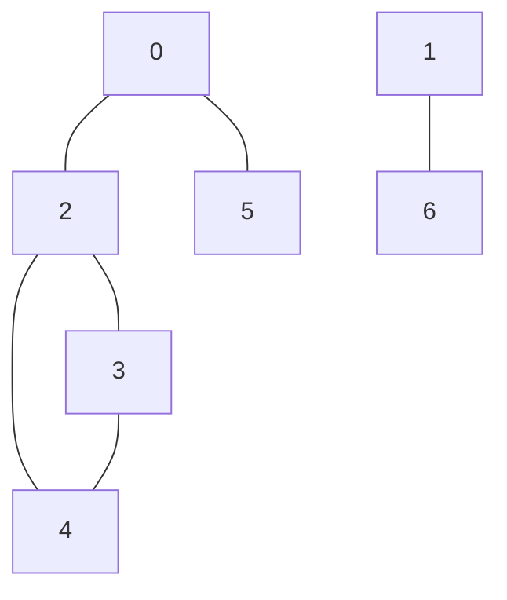

## The hook

Give someone a satellite picture of an archipelago and ask how many islands there are. They will put a finger on some land, trace around everything connected to it, mark it as counted, and move on to the next unmarked patch. Nobody teaches them that. It is just how you explore.

That instinct is depth-first search, and it quietly sits behind a long list of interview problems: counting islands, copying a graph, finding which cells can drain to both oceans, checking whether two computers share a network. Why does such a simple rule, "go deep, then back up", solve all of them in linear time?

## The intuition

:::analogy
Imagine exploring a cave with a ball of string. You tie one end at the entrance and unroll it as you walk. At every chamber you chalk a mark on the wall. When a passage leads to a chamber that already has chalk, you skip it. When a chamber has no unmarked passages left, you follow the string back to the previous chamber, rolling it up, and try that chamber's next passage. When the string is fully rolled up at the entrance, you have seen every chamber you could reach.
:::

That is [[depth-first search]]. The chalk marks are the [[visited set]]: they make sure no chamber is explored twice and that a loop of passages cannot trap you. The string is a stack: the path from the entrance to where you stand. Rolling it up is [[backtracking]].

## How it works

Call dfs(u):

1. Mark u visited, and do whatever "arriving at u" means for the problem (count it, colour it, copy it).
2. For each neighbour v of u: if v is not visited, call dfs(v).
3. Return. You are rolling the string back to the chamber you came from.

In recursive code, the call stack *is* the string. Each active call is one chamber on the current path.

### Connected components

One call to dfs(s) visits exactly the vertices reachable from s. In an undirected graph, that is s's [[connected component]]. To count components, loop over every vertex and start a new DFS from each one that is still unvisited. Each new start is one new component.

### Flood fill on a grid

On a grid, the vertices are cells and the neighbours are up, down, left and right, as in [Every Problem Is a Map of Roads](article:dsa-graph-representation). [[Flood fill]] is DFS restricted to cells of one kind: land, the same colour, or open floor. Number of Islands and Counting Rooms are "count the components of the land cells".

### Entry and exit times

Keep a timer. Record tin[u] when you enter u and tout[u] when you leave. Because DFS finishes everything below u before leaving u, u's descendants are exactly the vertices whose interval sits inside [tin[u], tout[u]]. These [[entry and exit times]] answer "is u an ancestor of v?" in O(1), and on directed graphs they underpin cycle detection and topological order.



### The iterative version

Recursion can be too deep for the call stack, so you also need DFS with your own stack. The simplest correct form:

1. Push the start.
2. Pop u. If u is already visited, skip it. Otherwise mark it, process it, and push its unvisited neighbours **in reverse order**.

Marking on *pop* and pushing in reverse gives exactly the same visit order as the recursive version. A vertex may sit on the stack more than once, which is harmless because the visited check skips it, and the stack holds at most O(E) entries.

:::insight
DFS is "remember the path, never revisit a vertex". The visited marks make every vertex enter once and every edge get looked at once from each end, so the whole search is O(V + E) no matter what shape the graph has.
:::

## Walk through an example

Seven vertices, edges 0–2, 0–5, 2–3, 2–4, 3–4 and 1–6, neighbours sorted in increasing order.



The adjacency lists are 0: 2, 5 · 1: 6 · 2: 0, 3, 4 · 3: 2, 4 · 4: 2, 3 · 5: 0 · 6: 1. Counting components, the outer loop starts DFS at 0:

| Timer | Event | Why | Call stack (the string) |
|---|---|---|---|
| 0 | enter 0 | new component | 0 |
| 1 | enter 2 | first neighbour of 0 | 0, 2 |
| 2 | enter 3 | 0 is visited, 3 is not | 0, 2, 3 |
| 3 | enter 4 | 2 is visited, 4 is not | 0, 2, 3, 4 |
| 4 | exit 4 | neighbours 2 and 3 both visited | 0, 2, 3 |
| 5 | exit 3 | nothing left | 0, 2 |
| 6 | exit 2 | 4 was reached through 3 | 0 |
| 7 | enter 5 | next neighbour of 0 | 0, 5 |
| 8 | exit 5 | 0 is visited | 0 |
| 9 | exit 0 | component 1 done | empty |
| 10 | enter 1 | outer loop: 1 unvisited, new component | 1 |
| 11 | enter 6 | | 1, 6 |
| 12 | exit 6 | | 1 |
| 13 | exit 1 | component 2 done | empty |

Visit order **0, 2, 3, 4, 5, 1, 6**, and **2 components**. Check the ancestor rule: 2 has interval [1, 6] and 4 has [3, 4], which sits inside, so 2 is an ancestor of 4. Vertex 5 has [7, 8], outside [1, 6], so 2 is not its ancestor.

The iterative version from 0, marking on pop:

| Pop | Action | Stack after (top on the right) |
|---|---|---|
| 0 | visit, push 5 then 2 | 5, 2 |
| 2 | visit, push 4 then 3 | 5, 4, 3 |
| 3 | visit, push 4 | 5, 4, 4 |
| 4 | visit, nothing new | 5, 4 |
| 4 | already visited, skip | 5 |
| 5 | visit | empty |

Same order: 0, 2, 3, 4, 5. Vertex 4 was on the stack twice, and the second copy was skipped.

**Flood fill.** In the grid below (1 is land), scanning row by row and flood-filling each new land cell finds **4 islands** of sizes 3, 3, 1 and 2.

```
1 1 0 0 1
0 1 0 1 1
0 0 0 0 0
1 0 1 1 0
```

:::try-this
If you mark vertices when you *push* them instead of when you pop them, and push neighbours in normal order, what order do you get from 0 on the graph above? (0, 5, 2, 4, 3. It still reaches every vertex, but it is not the recursive DFS order, and it cannot give correct exit times.)
:::

## The code

```pseudo
dfs(u):                                  // recursive
    visited[u] = true; tin[u] = timer++
    for v in adj[u]:
        if not visited[v]: dfs(v)
    tout[u] = timer++

count_components():
    count = 0
    for s in 0 .. n-1:
        if not visited[s]: count += 1; dfs(s)
    return count

dfs_iterative(start):
    stack = [start]
    while stack not empty:
        u = stack.pop()
        if visited[u]: continue
        visited[u] = true; visit(u)
        for v in reversed(adj[u]):
            if not visited[v]: stack.push(v)
```

```cpp
#include <bits/stdc++.h>
using namespace std;

vector<vector<int>> adj;
vector<int> tin, tout, order;
int timer_ = 0;

void dfs(int u) {
    tin[u] = timer_++;
    order.push_back(u);
    for (int v : adj[u]) if (tin[v] == -1) dfs(v);
    tout[u] = timer_++;
}

vector<int> dfsIterative(int start, int n) {
    vector<bool> seen(n, false);
    vector<int> st = {start}, out;
    while (!st.empty()) {
        int u = st.back(); st.pop_back();
        if (seen[u]) continue;
        seen[u] = true; out.push_back(u);
        for (int i = (int)adj[u].size() - 1; i >= 0; i--)
            if (!seen[adj[u][i]]) st.push_back(adj[u][i]);
    }
    return out;
}

int countIslands(vector<string> g) {                // iterative: safe on huge grids
    int R = g.size(), C = g[0].size(), islands = 0;
    int dr[] = {-1, 1, 0, 0}, dc[] = {0, 0, -1, 1};
    for (int r = 0; r < R; r++)
        for (int c = 0; c < C; c++) {
            if (g[r][c] != '1') continue;
            islands++;
            vector<pair<int,int>> st = {{r, c}};
            g[r][c] = '0';                          // sink land as you visit it
            while (!st.empty()) {
                auto [x, y] = st.back(); st.pop_back();
                for (int k = 0; k < 4; k++) {
                    int nx = x + dr[k], ny = y + dc[k];
                    if (nx >= 0 && nx < R && ny >= 0 && ny < C && g[nx][ny] == '1') {
                        g[nx][ny] = '0';
                        st.push_back({nx, ny});
                    }
                }
            }
        }
    return islands;
}

int main() {
    int n = 7;
    adj.assign(n, {});
    for (auto [u, v] : vector<pair<int,int>>{{0,2}, {0,5}, {2,3}, {2,4}, {3,4}, {1,6}}) {
        adj[u].push_back(v); adj[v].push_back(u);
    }
    for (auto& a : adj) sort(a.begin(), a.end());
    tin.assign(n, -1); tout.assign(n, -1);
    int components = 0;
    for (int s = 0; s < n; s++) if (tin[s] == -1) { components++; dfs(s); }
    for (int u : order) cout << u << ' ';
    cout << "| components " << components << '\n';                 // 0 2 3 4 5 1 6 | components 2
    cout << tin[2] << ' ' << tout[2] << ' ' << tin[4] << ' ' << tout[4] << '\n';  // 1 6 3 4
    for (int u : dfsIterative(0, n)) cout << u << ' ';
    cout << '\n';                                                    // 0 2 3 4 5
    cout << countIslands({"11001", "01011", "00000", "10110"}) << '\n';  // 4
}
```

The island counter marks a cell when it is *pushed*. That is fine for flood fill, where only the set of cells matters, not the order, and it keeps each cell on the stack at most once.

## Complexity

- **Time:** O(V + E). Every vertex is entered once, and every adjacency list is scanned once, so each undirected edge is examined twice. On a grid that is O(R × C).
- **Space:** O(V) for the visited marks, plus the stack: up to O(V) deep for recursion, and up to O(E) entries for the mark-on-pop iterative version.

## Common mistakes

:::warning
Common misconception: "recursive DFS is always fine because it is O(V + E)." The time is fine, but the depth is not. A long path, such as a 1000 × 1000 grid of land that snakes back and forth, can make the recursion about a million calls deep and overflow the call stack. When V can be large, use an explicit stack, or at least know that this is the risk if a recursive solution crashes only on big tests.
:::

- **Marking too late.** In recursive DFS, mark u as soon as you enter it, before looping over neighbours. Marking after the loop lets a cycle bring you back into u forever.
- **Forgetting the outer loop.** One DFS covers one component. Counting components, or visiting a disconnected graph fully, needs the loop over all start vertices.
- **Bounds before indexing.** On grids, check 0 ≤ r < R and 0 ≤ c < C before reading the cell.
- **Clone Graph without a map.** Create a node's copy and store it in an original-to-copy hash map *before* recursing into its neighbours. Otherwise a cycle makes you copy the same node again and again.
- **Pacific Atlantic in the wrong direction.** Starting a DFS from every cell is slow. Start from the ocean borders and walk *uphill* (to neighbours at least as high), then return the cells reached from both oceans.

## Practice problems

*Flood Fill* is DFS on a grid in its plainest form. *Number of Islands* and *Counting Rooms* (CSES) add the outer loop that counts components. *Max Area of Island* makes each DFS return a size. *Clone Graph* needs the visited map to double as the copy table. *Pacific Atlantic Water Flow* is the hardest here: two multi-source searches from the borders, walking uphill, then an intersection.

## Key takeaways

- DFS follows one path as deep as it can, marks every vertex it reaches, and backs up to the last vertex with an unexplored edge.
- Each vertex is entered once and each edge examined a constant number of times, so DFS runs in O(V + E) time.
- Running DFS from every unvisited vertex counts connected components, and flood fill is the same idea on grid cells.
- The iterative version with an explicit stack, marking on pop and pushing neighbours in reverse, reproduces the recursive order without risking a stack overflow.
- Entry and exit times nest, so u is an ancestor of v exactly when v's interval lies inside u's.
