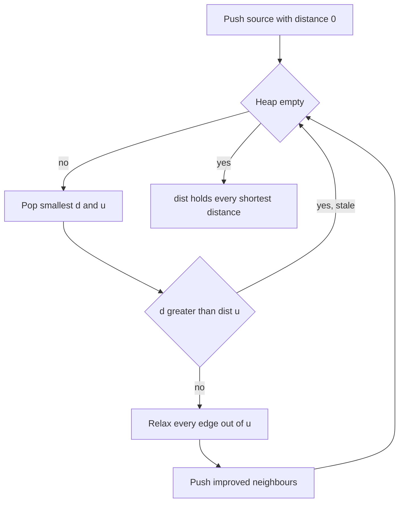

## The hook

Pour water into one end of a network of pipes. Each pipe takes a different time to fill, depending on its length. The water spreads out, and at every junction, the first water to arrive came along the fastest route. Nobody had to compare routes: the water simply got there first.

Breadth-first search finds shortest paths when every edge costs the same. Real maps have roads of different lengths, and BFS's "rings of equal distance" break down. Edsger Dijkstra published the fix in 1959, and it is still the default shortest-path algorithm for graphs with non-negative weights.

## The intuition

:::analogy
Water poured at the source moves through the pipes at a steady speed. A junction becomes wet at exactly the moment the fastest route reaches it, and once wet, it stays wet: no later water can arrive "earlier". So the junctions get wet in order of their true distance. If you could watch the network, you would see them light up one by one, always the closest dry junction next.
:::

Dijkstra's algorithm simulates that water without a clock. It keeps a [[tentative distance]] for each vertex, the best known so far, and repeatedly does two things:

- pick the dry vertex with the smallest tentative distance and mark it wet; it is now a [[settled vertex]], and its distance is final;
- from it, check each outgoing pipe: can water reach the neighbour sooner through here? That check-and-update is called [[relaxation]].

A min-heap finds "the closest dry vertex" quickly. The algorithm is greedy in the sense of [A Bus Conductor Who Never Reseats Anyone](article:dsa-greedy-exchange): it commits to one vertex at a time and never revisits it.

## How it works

### The loop

- Set dist[source] = 0 and every other distance to infinity. Push (0, source).
- Pop the smallest (d, u). If d > dist[u], it is a [[stale entry]]; skip it.
- For each edge u → v with weight w, if dist[u] + w < dist[v], set dist[v] = dist[u] + w, record parent[v] = u, and push (dist[v], v).
- Repeat until the heap is empty.

### Why a vertex is final when popped

Suppose u is popped with distance d, the smallest in the heap. Consider any other path to u:

- it starts at the source, which is settled, and at some point first steps onto an unsettled vertex x;
- its cost up to x is at least dist[x], which is at least d because u had the smallest tentative distance;
- the rest of the path, from x to u, has non-negative weight.

So the whole path costs at least d. Nothing beats d, and u is settled correctly.

The argument needs exactly one assumption: **no negative edges**. A negative edge after x could pull the total below d.

### Lazy deletion instead of decrease-key

Textbook Dijkstra lowers a vertex's key inside the heap. C++'s `priority_queue` cannot do that, so we push a new entry instead and let the old one become stale. When a stale entry surfaces, `d > dist[u]` catches it. The heap can hold up to E entries, so the running time is O(E log E), which is the same as O(E log V) because E is at most V².

### Rebuilding the path

Each successful relaxation records a [[parent pointer]]. To print the route to t, walk from t through parents back to the source and reverse.

### Variations on the same loop

| Problem | What "distance" means | Change to the loop |
|---|---|---|
| Shortest Routes I | Sum of weights | None; use 64-bit distances |
| Path With Minimum Effort | Largest single step on the path | New distance is max(d, w) instead of d + w |
| Number of Ways to Arrive | Count of shortest paths | When dist[u] + w equals dist[v], add ways[u] to ways[v] |
| Multiple sources | Distance to the nearest source | Push every source with distance 0 at the start |
| Dense graph, V up to a few thousand | Sum of weights | Skip the heap; scan for the closest dry vertex in O(V), total O(V²) |

The max-version works because the cost of a path never decreases as it grows, which is the property the proof really used. Products of probabilities at most 1, as in "most probable path", also work for the same reason.



:::insight
With non-negative edges, the closest unsettled vertex can never be reached more cheaply by a detour, because every detour passes through something at least as far away. That single fact lets Dijkstra finalise one vertex per step, like water reaching junctions in order.
:::

## Walk through an example

An undirected graph with vertices A to F and edges A–B 4, A–C 1, C–B 2, B–D 1, C–D 5, D–E 3, C–E 8, E–F 1, D–F 6. Source A.

| Pop | Status | Relaxations | Heap after (distance, vertex) |
|---|---|---|---|
| (0, A) | settle A = 0 | B = 4, C = 1 | (1, C), (4, B) |
| (1, C) | settle C = 1 | B = 3, D = 6, E = 9 | (3, B), (4, B), (6, D), (9, E) |
| (3, B) | settle B = 3 | D = 4 | (4, B), (4, D), (6, D), (9, E) |
| (4, B) | stale, dist[B] is 3 | | (4, D), (6, D), (9, E) |
| (4, D) | settle D = 4 | E = 7, F = 10 | (6, D), (7, E), (9, E), (10, F) |
| (6, D) | stale | | (7, E), (9, E), (10, F) |
| (7, E) | settle E = 7 | F = 8 | (8, F), (9, E), (10, F) |
| (8, F) | settle F = 8 | | (9, E), (10, F) |
| (9, E), (10, F) | both stale | | empty |

Final distances: A 0, B 3, C 1, D 4, E 7, F 8. The shortest path to F, following parents back from F, is A → C → B → D → E → F: 1 + 2 + 1 + 3 + 1 = 8.

Notice how B's first estimate, 4 by the direct pipe, was beaten by going through C. The direct edge looked natural, but the water found the faster route. Four of the ten pops were stale, which is normal with lazy deletion.

### Watching a negative edge break it

Directed edges A → B 2, A → C 3, C → B -2, source A.

| Pop | Settles | What happens |
|---|---|---|
| (0, A) | A = 0 | B = 2, C = 3 |
| (2, B) | B = 2 | B is final, says Dijkstra |
| (3, C) | C = 3 | C → B gives 3 - 2 = 1 < 2, but B was already settled |

The true distance to B is 1. Dijkstra's "once wet, stays wet" promise was false because water could flow back in time along the negative pipe.

The textbook version, which never reopens a settled vertex, reports 2. The lazy-deletion code below happens to reopen B when the improved entry (1, B) is pushed, so on this tiny graph it recovers. Do not rely on that: with negative edges, reopening can cascade through the graph many times over, and the running-time guarantee is gone.

:::try-this
In the main example, change the weight of C–B from 2 to 4. What are the new distances to B and F? (From A, B is now 4 directly or 1 + 4 = 5 via C, so B = 4. D = 5 via B. E = 8 via D. F = 9 via E. The shortest path to F becomes A → B → D → E → F.)
:::

:::warning
Common misconception: "Dijkstra works with negative edges as long as there is no negative cycle." The version that settles each vertex once gives wrong answers, as the three-edge example shows. A version that keeps reopening vertices can end with correct distances, but it may process vertices an exponential number of times on bad inputs. Negative edges need Bellman-Ford; Dijkstra needs every weight to be zero or more.
:::

## The code

```pseudo
dijkstra(adj, source):
    dist = [infinity] * n; dist[source] = 0; parent = [-1] * n
    heap = min-heap with (0, source)
    while heap:
        (d, u) = heap.pop()
        if d > dist[u]: continue              # stale entry
        for (v, w) in adj[u]:
            if d + w < dist[v]:
                dist[v] = d + w; parent[v] = u
                heap.push((dist[v], v))
    return dist, parent
```

```cpp
#include <bits/stdc++.h>
using namespace std;
using ll = long long;
const ll INF = LLONG_MAX / 4;

pair<vector<ll>, vector<int>> dijkstra(const vector<vector<pair<int, int>>>& adj, int src) {
    int n = adj.size();
    vector<ll> dist(n, INF);
    vector<int> parent(n, -1);
    priority_queue<pair<ll, int>, vector<pair<ll, int>>, greater<>> pq;
    dist[src] = 0;
    pq.push({0, src});
    while (!pq.empty()) {
        auto [d, u] = pq.top();
        pq.pop();
        if (d > dist[u]) continue;                         // stale entry, skip
        for (auto [v, w] : adj[u])
            if (d + w < dist[v]) {
                dist[v] = d + w, parent[v] = u;
                pq.push({dist[v], v});
            }
    }
    return {dist, parent};
}

int minimumEffort(const vector<vector<int>>& h) {        // minimax path on a grid
    int R = h.size(), C = h[0].size();
    vector<vector<int>> best(R, vector<int>(C, INT_MAX));
    priority_queue<tuple<int, int, int>, vector<tuple<int, int, int>>, greater<>> pq;
    best[0][0] = 0;
    pq.push({0, 0, 0});
    int dr[] = {1, -1, 0, 0}, dc[] = {0, 0, 1, -1};
    while (!pq.empty()) {
        auto [e, r, c] = pq.top();
        pq.pop();
        if (e > best[r][c]) continue;
        if (r == R - 1 && c == C - 1) return e;
        for (int k = 0; k < 4; k++) {
            int nr = r + dr[k], nc = c + dc[k];
            if (nr < 0 || nc < 0 || nr >= R || nc >= C) continue;
            int ne = max(e, abs(h[nr][nc] - h[r][c]));     // cost is the largest step so far
            if (ne < best[nr][nc]) best[nr][nc] = ne, pq.push({ne, nr, nc});
        }
    }
    return best[R - 1][C - 1];
}

int main() {
    int n = 6;                                             // A..F = 0..5
    vector<vector<pair<int, int>>> adj(n);
    auto add = [&](int a, int b, int w) { adj[a].push_back({b, w}), adj[b].push_back({a, w}); };
    add(0, 1, 4), add(0, 2, 1), add(2, 1, 2), add(1, 3, 1), add(2, 3, 5);
    add(3, 4, 3), add(2, 4, 8), add(4, 5, 1), add(3, 5, 6);
    auto [dist, parent] = dijkstra(adj, 0);
    for (ll d : dist) cout << d << ' ';
    cout << '\n';                                          // 0 3 1 4 7 8
    vector<int> path;
    for (int v = 5; v != -1; v = parent[v]) path.push_back(v);
    reverse(path.begin(), path.end());
    for (int v : path) cout << char('A' + v);
    cout << '\n';                                          // ACBDEF
    cout << minimumEffort({{1, 4, 2}, {6, 5, 3}, {7, 8, 4}}) << '\n';   // 3
}
```

`minimumEffort` returns as soon as it pops the target: that is safe in any Dijkstra, because a popped vertex is settled. It is the main shortcut when you need one target rather than all distances.

## Complexity

- **Binary heap with lazy deletion: O((V + E) log V) time,** since at most E + 1 entries are pushed and each push or pop costs O(log E) = O(log V).
- **Space: O(V + E)** for the adjacency list and the heap.
- **Array version for dense graphs: O(V²) time,** better than the heap when E is close to V².
- **Path rebuilding: O(path length).**

## Common mistakes

- **Not skipping stale entries,** which re-relaxes edges from out-of-date distances and can blow up the running time.
- **Running Dijkstra with negative edges.** Check the constraints; use Bellman-Ford if any weight can be negative.
- **Using a max-heap.** C++'s default `priority_queue` pops the largest; use `greater<>` or push negated distances.
- **Overflow:** distances on CSES-sized inputs exceed 32 bits; use `long long` and a safe infinity such as `LLONG_MAX / 4`, so adding a weight cannot overflow.
- **Marking vertices visited when pushed** instead of when popped, which settles a vertex before its best distance is known.
- **Using Dijkstra for unweighted graphs** when BFS is simpler and O(V + E).

## Practice problems

*Shortest Routes I* is the plain algorithm at CSES scale, which tests the 64-bit distances and the stale check. *Network Delay Time* asks for the largest of all shortest distances. *Path With Minimum Effort* swaps the sum for a maximum. *Number of Ways to Arrive at Destination* counts shortest paths alongside the distances. When every edge weight is equal, go back to [Ripples on a Pond: Breadth-First Search](article:dsa-bfs), and for the heap itself see [The Triage Nurse Who Always Knows Who Is Next](article:dsa-heap-basics).

## Key takeaways

- Dijkstra's algorithm repeatedly settles the unsettled vertex with the smallest tentative distance and relaxes its outgoing edges.
- A popped vertex's distance is final because every other route passes through a vertex at least as far away and then adds non-negative weight.
- With C++'s priority_queue, push a new entry on every improvement and skip popped entries whose distance is larger than the stored one.
- A single negative edge can make Dijkstra settle a vertex too early, so negative weights need Bellman-Ford instead.
- The same loop handles minimax paths, counting shortest paths and multiple sources by changing how a new distance is formed or how the heap starts.
