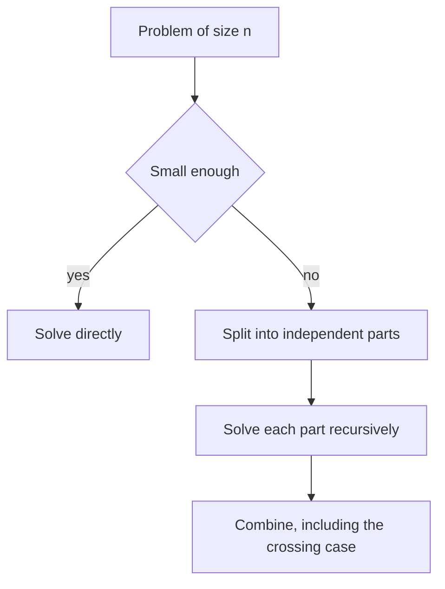

## The hook

A manager has a stack of ten thousand forms to check and two assistants. She splits the stack in half, gives each assistant one half and tells them to do the same with their own assistants. When the halves come back checked, she only has to combine the two reports into one.

Merge sort, binary search, fast power and many interview problems are this one idea: [[divide and conquer]]. Splitting and recursing are easy. The question that separates a correct solution from a broken one is: what does the combine step have to do, and what answers can only it see?

## The intuition

:::analogy
Picture the manager and her two teams. Each team handles its half of the job independently, without talking to the other team. When the two reports come back, the manager's job is to stitch them together, and to deal with anything that sits on the boundary between the halves, which neither team could see alone. If the teams kept redoing each other's work, splitting would not help at all.
:::

Every divide-and-conquer algorithm has three parts:

- **Divide:** split the input into smaller pieces of the same kind, usually halves.
- **Conquer:** solve each piece recursively; tiny pieces are base cases.
- **Combine:** build the answer for the whole from the sub-answers. This [[combine step]] is where the real thinking goes.

Two things decide whether the approach works. The pieces must be independent, so the two teams never need each other's results. And the combine step must account for the [[crossing case]]: answers that straddle the split and so belong to neither half.

## How it works

### Reading the running time from the recurrence

Write the cost as a [[recurrence]]: T(n) = a × T(n / b) + f(n), with a subproblems of size n / b and f(n) work to divide and combine. The [[master theorem]] compares f(n) with the number of leaves of the recursion tree, n^(log_b a). Rather than memorising it, think in levels:

| Recurrence | Example | Work per level | Levels | Total |
|---|---|---|---|---|
| T(n) = T(n/2) + O(1) | binary search, fast power | constant | log n | O(log n) |
| T(n) = 2T(n/2) + O(1) | tree height, max of an array | doubles each level | log n | O(n), dominated by the leaves |
| T(n) = 2T(n/2) + O(n) | merge sort, max subarray | n at every level | log n | O(n log n) |
| T(n) = T(n − 1) + O(n) | quicksort's worst case | n, n − 1, ... | n | O(n²) |

The pattern: if every level costs the same, multiply by the number of levels; if the cost grows towards the leaves, the leaves dominate; if it shrinks towards the leaves, the top level dominates.

### When it is not divide and conquer

If the subproblems are not independent, splitting does not help. Naive recursive Fibonacci computes fib(n − 1) and fib(n − 2), but fib(n − 1) computes fib(n − 2) again, and the repetition explodes into exponential time. Those are [[overlapping subproblems]], the signal to memoise or to use dynamic programming, as in [Dynamic Programming Is Just Careful Recursion](article:dsa-dp-intro).



:::insight
In divide and conquer, the recursion handles everything inside each half. Your job is the combine step: merge the halves' answers and handle the answers that cross the split, which neither half can see.
:::

## Walk through an example

### Maximum Subarray by divide and conquer

For [3, −7, 4, 2, −1, 5], split into [3, −7, 4] and [2, −1, 5]. The best subarray is in the left half, in the right half or crosses the middle.

| Part | How it is found | Best sum |
|---|---|---|
| left half [3, −7, 4] | recursively | 4, the subarray [4] |
| right half [2, −1, 5] | recursively | 6, the subarray [2, −1, 5] |
| crossing the middle | best suffix of the left, 4, plus best prefix of the right, 6 | 10 |

The answer is max(4, 6, 10) = 10, the subarray [4, 2, −1, 5]. The crossing case is exactly what the manager had to handle herself: neither team could see a subarray that ran across both halves. Computing the best suffix and prefix is a linear scan, so T(n) = 2T(n/2) + O(n) = O(n log n). Kadane's algorithm in [The Gambler Who Knows When to Walk Away](article:dsa-kadane) is O(n), but the divide-and-conquer version is a classic follow-up and generalises to segment trees.

### Majority Element by divide and conquer

If a value is a majority of the whole array, it must be a majority of at least one half. So find the majority candidate of each half recursively; if they agree, that is the answer; otherwise count both candidates in the whole range and keep the more frequent. Counting is O(n), so this is also O(n log n), slower than Boyer-Moore but a clean example of a combine step that only checks two candidates.

### Different Ways to Add Parentheses

For an expression like 3−2*2, every way of adding brackets has some operator applied last. Split at each operator, compute all values of the left part and all values of the right part recursively, and combine every pair with that operator.

| Last operator | Left values | Right values | Results |
|---|---|---|---|
| − (at index 1) | 3 | 2*2 gives 4 | 3 − 4 = −1 |
| * (at index 3) | 3−2 gives 1 | 2 | 1 × 2 = 2 |

So the expression can evaluate to −1 or 2. For longer expressions the same substrings are evaluated many times, and memoising results per substring helps, the point where divide and conquer meets dynamic programming.

:::try-this
How many recursive calls does binary search make on 1,024 sorted elements in the worst case, and which row of the recurrence table does it belong to? (About log₂ 1024 = 10 halvings plus the final check, and it is T(n) = T(n/2) + O(1), so O(log n).)
:::

:::warning
Common misconception: "Splitting in half always makes things faster." It only helps if the halves are independent and the combine step is cheap. If the combine step costs O(n²), or if the subproblems overlap, divide and conquer can be slower than a direct loop. Write the recurrence before you celebrate.
:::

## The code

```pseudo
max_subarray(a, lo, hi):
    if lo == hi: return a[lo]
    mid = (lo + hi) / 2
    best_left = max_subarray(a, lo, mid)
    best_right = max_subarray(a, mid + 1, hi)
    crossing = best suffix sum ending at mid + best prefix sum starting at mid + 1
    return max(best_left, best_right, crossing)

all_values(expr):
    results = []
    for each operator position i:
        for x in all_values(left of i), y in all_values(right of i):
            results.add(x op y)
    if no operator: results = [the number]
    return results
```

```cpp
#include <bits/stdc++.h>
using namespace std;

long long maxSubarray(const vector<int>& a, int lo, int hi) {
    if (lo == hi) return a[lo];
    int mid = (lo + hi) / 2;
    long long left = maxSubarray(a, lo, mid), right = maxSubarray(a, mid + 1, hi);
    long long s = 0, bestSuffix = LLONG_MIN, bestPrefix = LLONG_MIN;
    for (int i = mid; i >= lo; i--) s += a[i], bestSuffix = max(bestSuffix, s);      // crossing: left part
    s = 0;
    for (int i = mid + 1; i <= hi; i++) s += a[i], bestPrefix = max(bestPrefix, s);  // crossing: right part
    return max({left, right, bestSuffix + bestPrefix});
}

int majority(const vector<int>& a, int lo, int hi) {
    if (lo == hi) return a[lo];
    int mid = (lo + hi) / 2;
    int l = majority(a, lo, mid), r = majority(a, mid + 1, hi);
    if (l == r) return l;
    int cl = count(a.begin() + lo, a.begin() + hi + 1, l);
    int cr = count(a.begin() + lo, a.begin() + hi + 1, r);
    return cl >= cr ? l : r;                                  // combine: check only two candidates
}

map<string, vector<int>> memo;
vector<int> allValues(const string& e) {
    if (memo.count(e)) return memo[e];                        // same substring, same answers
    vector<int> res;
    for (int i = 0; i < (int)e.size(); i++) {
        if (e[i] != '+' && e[i] != '-' && e[i] != '*') continue;
        for (int x : allValues(e.substr(0, i)))
            for (int y : allValues(e.substr(i + 1)))
                res.push_back(e[i] == '+' ? x + y : e[i] == '-' ? x - y : x * y);
    }
    if (res.empty()) res.push_back(stoi(e));                  // a plain number
    return memo[e] = res;
}

int main() {
    vector<int> a = {3, -7, 4, 2, -1, 5};
    cout << maxSubarray(a, 0, a.size() - 1) << '\n';          // 10
    vector<int> m = {2, 2, 1, 1, 1, 2, 2};
    cout << majority(m, 0, m.size() - 1) << '\n';             // 2
    for (int v : allValues("3-2*2")) cout << v << ' ';
    cout << '\n';                                             // -1 2
    for (int v : allValues("1+2*3-4")) cout << v << ' ';
    cout << '\n';                                             // -1 3 -3 3 5
}
```

`allValues` lists results in the order the splits are tried, so the same value can appear more than once when different bracketings give the same result, as 3 does for 1+2*3−4. The problem asks for every result, duplicates included.

## Complexity

- **Maximum Subarray: O(n log n) time,** O(log n) recursion depth.
- **Majority Element: O(n log n) time,** from two O(n) counts per level.
- **Different Ways to Add Parentheses:** the number of results grows like the Catalan numbers, so the output itself is exponential; memoising by substring avoids recomputing shared pieces.
- **General rule:** solve the recurrence by levels, as in the table, before writing code.

## Common mistakes

- **Forgetting the crossing case,** so answers that straddle the split are never considered.
- **Splitting into overlapping pieces,** which double counts or recomputes; make the halves [lo, mid] and [mid + 1, hi].
- **Missing the base case** or making it unreachable, such as recursing on [lo, mid] with mid = hi.
- **An expensive combine step** that silently turns O(n log n) into O(n²).
- **Ignoring overlapping subproblems,** where memoisation or DP would turn exponential time into polynomial.
- **Deep recursion on unbalanced splits,** such as always peeling one element, which uses O(n) stack and can overflow.

## Practice problems

*Sort an Array* with merge sort is the template, explained in [Merging Two Piles of Exam Papers](article:dsa-merge-sort-inversions). *Majority Element* and *Maximum Subarray* have faster linear solutions, but their divide-and-conquer versions are good practice for designing the combine step. *Different Ways to Add Parentheses* splits on every operator instead of the middle. *Pow(x, n)* is the T(n) = T(n/2) + O(1) case, covered in [Arithmetic on a Clock That Never Overflows](article:dsa-modular-fast-power).

## Key takeaways

- Divide and conquer splits a problem into independent smaller copies, solves them recursively and combines the answers.
- The combine step must handle answers that cross the split, such as a subarray spanning the middle, because neither half can see them.
- Write the recurrence and solve it by levels: equal work per level multiplies by the number of levels, as in T(n) = 2T(n/2) + O(n) = O(n log n).
- If subproblems overlap, as in naive Fibonacci, plain recursion repeats work and memoisation or dynamic programming is needed instead.
- Splitting only pays off when the pieces are independent and the combine step is cheap.
