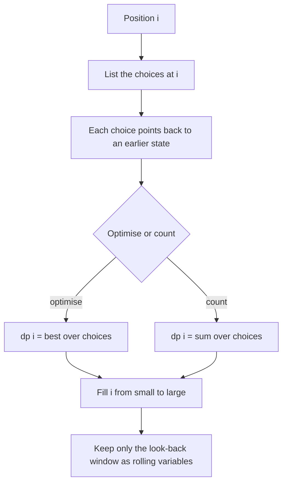

## The hook

A robber walks down a street of houses, each holding some money, and must never rob two neighbours in a row. A message of digits, where 1 means A and 26 means Z, can be read in several ways: how many readings does "2261" have? And with coins of 1, 3 and 4, what is the fewest coins for 6?

These sound like three different puzzles, but they are the same pattern: walk along a line, and at each position make a choice that depends only on the last few positions. That is one-dimensional DP, and it is the most common DP shape in placement interviews. Master it and the bigger DPs become extensions, not new ideas.

## The intuition

:::analogy
Think of planning a month of freelance work where each day you decide to rest or to work, and working two days in a row is not allowed. To decide today, you do not need to remember the whole month. You only need two facts: the best total you could have by yesterday, and the best total by the day before yesterday. If you work today, you add today's pay to the day-before-yesterday total; if you rest, you keep yesterday's. Each day's best plan is built from the last two days' best plans.
:::

That daily decision is a [[1D DP]]. "The best total by day i" is the state, "rest or work" are the choices, and "the last two days" is the [[look-back window]].

## How it works

Every 1D DP follows the same three-step recipe from [Dynamic Programming Is Just Careful Recursion](article:dsa-dp-intro):

1. **State**: say in one sentence what dp[i] means. "dp[i] = the most money from the first i houses."
2. **Transition**: ask "what happens at position i?" and list the choices, each pointing back to an earlier state.
3. **Base cases** and **answer**: which dp values are known directly, and which entry is the final answer.

There are two kinds: an [[optimisation DP]] takes the max or min over choices, and a [[counting DP]] adds the choices up. The only difference in code is `max` versus `+`.

### House Robber (optimisation, look back 2)

- dp[i] = most money from the first i houses.
- Choice for house i: skip it (dp[i − 1]) or rob it (a[i] + dp[i − 2], since house i − 1 must be skipped).
- dp[i] = max(dp[i − 1], dp[i − 2] + a[i]); dp[0] = 0, dp[1] = a[1].

This is the freelance month exactly: robbing a house is working that day, skipping it is resting, and the alarm is the rule against working two days in a row. Today's best plan needs only yesterday's total and the total from the day before yesterday.

### Decode Ways (counting, look back 2)

- dp[i] = number of ways to decode the first i characters.
- Choice for the end of the prefix: the last digit alone (valid if it is not '0') adds dp[i − 1]; the last two digits together (valid if between 10 and 26) adds dp[i − 2].
- dp[0] = 1: the empty prefix has exactly one decoding, the empty one.

### Coin Change (optimisation, look back by each coin)

- dp[x] = fewest coins that sum to exactly x.
- Choice: the last coin used was some coin c ≤ x, so dp[x] = 1 + min over coins of dp[x − c].
- dp[0] = 0; unreachable amounts stay at infinity, reported as −1.

Here the index is an amount, not a position, but the shape is the same: each state looks back a fixed set of distances.

### Dice Combinations (counting, look back 6)

- dp[n] = number of ordered dice sequences summing to n.
- The last throw was 1 to 6, so dp[n] = dp[n − 1] + ... + dp[n − 6], with dp[0] = 1.



### Shrinking memory

When the look-back window has a fixed size w, you only ever need the last w values. Replace the array with w [[rolling variables]]: House Robber needs two (prev2, prev1), Decode Ways two, Dice Combinations six. Coin Change looks back by coin values, so it usually keeps the full array of size amount + 1.

:::insight
In a 1D DP, the question at each position is always "what was the last decision?" Each possible last decision points to one earlier state, and you either take the best of them or add them up. The skill is listing the last decisions without missing or double counting any.
:::

## Walk through an example

**House Robber**, values [5, 1, 2, 9, 4, 3]. Read each value as a day's freelance pay: on every day, decide between resting, which keeps yesterday's total, and working, which adds today's pay to the total from the day before yesterday.

| i | house value | skip: dp[i−1] | rob: dp[i−2] + value | dp[i] |
|---|---|---|---|---|
| 1 | 5 | 0 | 0 + 5 | 5 |
| 2 | 1 | 5 | 0 + 1 | 5 |
| 3 | 2 | 5 | 5 + 2 | 7 |
| 4 | 9 | 7 | 5 + 9 | 14 |
| 5 | 4 | 14 | 7 + 4 | 14 |
| 6 | 3 | 14 | 14 + 3 | 17 |

Answer **17**: houses 1, 4 and 6 (values 5, 9, 3).

**Decode Ways**, "2261":

| i | prefix | last digit alone | last two digits | dp[i] |
|---|---|---|---|---|
| 0 | "" | | | 1 |
| 1 | "2" | '2' ok: +dp[0] = 1 | | 1 |
| 2 | "22" | '2' ok: +dp[1] = 1 | "22" ok: +dp[0] = 1 | 2 |
| 3 | "226" | '6' ok: +dp[2] = 2 | "26" ok: +dp[1] = 1 | 3 |
| 4 | "2261" | '1' ok: +dp[3] = 3 | "61" too big | 3 |

Three decodings: 2-2-6-1, 22-6-1, 2-26-1.

**Coin Change**, coins {1, 3, 4}, amount 6: dp = [0, 1, 2, 1, 1, 2, 2], so **2 coins** (3 + 3).

:::try-this
How many ordered dice sequences sum to 7? Use dp[n] = dp[n−1] + ... + dp[n−6] with dp[0] = 1. (dp = 1, 1, 2, 4, 8, 16, 32, then dp[7] = 1 + 2 + 4 + 8 + 16 + 32 = 63.)
:::

## The code

```pseudo
house_robber(a):
    prev2 = 0; prev1 = 0                    // dp[i-2], dp[i-1]
    for x in a:
        cur = max(prev1, prev2 + x)
        prev2 = prev1; prev1 = cur
    return prev1

coin_change(coins, amount):
    dp = [0] + [INF] * amount
    for x in 1 .. amount:
        for c in coins:
            if c <= x: dp[x] = min(dp[x], dp[x - c] + 1)
    return -1 if dp[amount] == INF else dp[amount]
```

```cpp
#include <bits/stdc++.h>
using namespace std;

long long rob(const vector<int>& a) {
    long long prev2 = 0, prev1 = 0;
    for (int x : a) { long long cur = max(prev1, prev2 + x); prev2 = prev1; prev1 = cur; }
    return prev1;
}

int numDecodings(const string& s) {
    int n = s.size();
    vector<long long> dp(n + 1, 0);
    dp[0] = 1;
    for (int i = 1; i <= n; i++) {
        if (s[i - 1] != '0') dp[i] += dp[i - 1];
        if (i >= 2) {
            int two = (s[i - 2] - '0') * 10 + (s[i - 1] - '0');
            if (two >= 10 && two <= 26) dp[i] += dp[i - 2];
        }
    }
    return dp[n];
}

int coinChange(const vector<int>& coins, int amount) {
    const int INF = INT_MAX / 2;
    vector<int> dp(amount + 1, INF);
    dp[0] = 0;
    for (int x = 1; x <= amount; x++)
        for (int c : coins)
            if (c <= x) dp[x] = min(dp[x], dp[x - c] + 1);
    return dp[amount] >= INF ? -1 : dp[amount];
}

int main() {
    cout << rob({5, 1, 2, 9, 4, 3}) << '\n';                            // 17
    cout << numDecodings("2261") << ' ' << numDecodings("1206") << '\n';   // 3 1
    cout << coinChange({1, 3, 4}, 6) << ' ' << coinChange({2}, 3) << '\n'; // 2 -1
}
```

## Complexity

- **Time:** O(n × k), where k is the number of choices per state: O(n) for House Robber and Decode Ways, O(amount × number of coins) for Coin Change, O(6n) for Dice Combinations.
- **Space:** O(n) for the table, or O(w) with rolling variables when the look-back window w is fixed.

## Common mistakes

:::warning
Common misconception: "Coin Change can be solved by always taking the largest coin that fits." With coins {1, 3, 4} and amount 6, greedy picks 4 + 1 + 1 = 3 coins, but 3 + 3 needs only 2. Greedy works for some coin systems, such as typical currency denominations, but not in general. DP tries every possible last coin and is always correct.
:::

- **Wrong base cases**: dp[0] = 1 in counting problems (one way to do nothing), dp[0] = 0 in minimum-cost problems. Getting this wrong shifts every later value.
- **Zeros in Decode Ways**: '0' can never stand alone, and "06" is not a valid two-digit code.
- **Overflow in counting DPs**: counts grow exponentially; take the modulus the problem asks for, such as 10⁹ + 7 in *Dice Combinations*.
- **Circular streets** (*House Robber II*): the first and last houses are neighbours, so run the line version twice, once without the first house and once without the last, and take the better result.
- **Infinity overflow**: adding 1 to INT_MAX wraps around; use a large but safe sentinel such as INT_MAX / 2.

## Practice problems

*House Robber* is the cleanest two-step optimisation, and *House Robber II* adds the circular twist. *Decode Ways* is a counting DP with validity checks on each choice. *Coin Change* looks back by coin values and shows why greedy fails. *Dice Combinations* (CSES) is a six-step counting DP with a modulus. Solve them in this order and write the state sentence before any code.

## Key takeaways

- A 1D DP defines dp[i] for a prefix or an amount, then builds it from a fixed set of earlier states.
- Find the transition by listing every possible last decision at position i and where each one points back to.
- Optimisation DPs take the max or min over choices, and counting DPs add them, but the structure is identical.
- Base cases matter: dp[0] is 1 for counting the empty way and 0 for zero cost.
- When the transition looks back a fixed number of steps, keep only that many rolling variables for O(1) memory.
