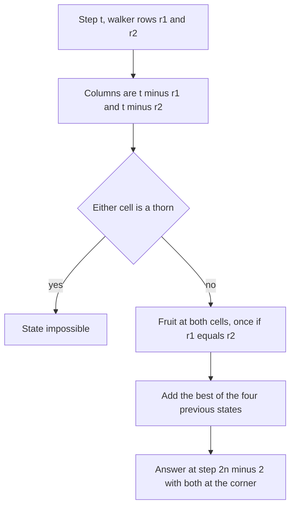

## The hook

Two friends walk through an orchard laid out as a grid, from the top-left gate to the bottom-right gate, each stepping only right or down. They want to pick as much fruit as possible between them. Some trees are walled off. If both pass the same tree, the fruit can be picked only once.

Planning one friend's walk is the familiar grid DP. Planning two walks that share fruit seems to need every pair of paths, an enormous number. The trick is to stop thinking about two paths and start thinking about two walkers stepping at the same time.

## The problem

*Cherry Pickup* gives an n × n grid with 1 (a cherry), 0 (empty) and -1 (a thorn you cannot enter). You walk from (0, 0) to (n - 1, n - 1) moving right or down, then back to (0, 0) moving left or up, picking every cherry you pass. A picked cell becomes empty. Return the most cherries, or 0 if no route exists.

For this grid the answer is 9:

```
0 1 1 1
1 1 1 0
1 0 1 1
1 1 0 0
```

## The obvious approach

Take the best single path, collect its cherries, then take the best path on what is left. On the grid above, one best first path, down, right, right, down, right, down, collects 5 cherries but leaves only 3 for the second trip: 8 in total. A different pair of paths gets 9.

The other obvious approach, trying every pair of paths, is hopeless: each path has C(2n - 2, n - 1) choices, about 20 for n = 4 but over 10⁹ for n = 18.

## The key insight

:::analogy
Have both friends start at the top-left gate and walk forward at the same time, one step each per tick of a clock. The return trip of the original puzzle, reversed, is simply the second friend's forward walk. After t ticks, each friend has taken exactly t steps, so each stands on the diagonal where row + column = t. They can only stand at the same tree at the same tick, and when they do, they pick its fruit once.
:::

That is [[lockstep walkers]]. A walker's [[step index]] t = row + column fixes the column once the row is known, so the state is (t, r1, r2): both walkers' rows at step t. The [[collision rule]] says the cell value is counted once when r1 = r2.

dp[t][r1][r2] = cherries at both walkers' cells (once if they coincide) + the best of the four previous states, where each walker came from above or from the left: (r1 or r1 - 1) × (r2 or r2 - 1).

Any state touching a thorn is impossible. The answer is dp[2n - 2][n - 1][n - 1], or 0 if that is impossible. There are about 2n × n² states with 4 transitions each: O(n³).

### Cherry Pickup II: two robots, row by row

*Cherry Pickup II* starts one robot at the top-left and one at the top-right. Each moves down one row per step, to the column below or a diagonal neighbour. They already move in lockstep, by row, so the state is (row, c1, c2):

dp[r][c1][c2] = grid[r][c1] + (c1 ≠ c2 ? grid[r][c2] : 0) + max over the 9 moves of dp[r + 1][c1 + d1][c2 + d2].

That is O(R × C² × 9).

### Dungeon Game: solve it backwards

*Dungeon Game* asks for the smallest starting health a knight needs to walk from the top-left to the princess at the bottom-right, moving right or down, when each cell adds or removes health and health must stay at least 1. A forward DP fails: the path that keeps the most health so far is not necessarily the one needing the least health at the start.

Use a [[backward DP]]. need[r][c] is the health required on entering (r, c):

need[r][c] = max(1, min(need[r + 1][c], need[r][c + 1]) - dungeon[r][c]).

The goal cell needs max(1, 1 - dungeon[goal]). Each cell knows what the rest of the journey demands, and asks only for enough to meet it.

| Problem | State | Direction | Overlap rule |
|---|---|---|---|
| Cherry Pickup | (step, row 1, row 2) | forward from the start | count a shared cell once |
| Cherry Pickup II | (row, column 1, column 2) | top to bottom | count a shared cell once |
| Dungeon Game | (row, column) | backward from the goal | not applicable |



:::insight
Two paths through a grid can be planned together by moving both walkers one step at a time. Then they can only overlap at the same cell at the same step, so shared cells are easy to count once, and the joint state stays small.
:::

## Walk through an example

### Cherry Pickup

The 4 × 4 grid above holds 11 cherries. The two best paths:

| Walker | Moves | Cells visited (row, column) | Cherries |
|---|---|---|---|
| A | down, down, down, right, right, right | (1,0), (2,0), (3,0), (3,1), then empties | 4 |
| B | right, down, right, down, right, down | (0,1), (1,1), (1,2), (2,2), (2,3) | 5 |

They never share a cell, so the total is 9. The two cherries at (0, 2) and (0, 3) are left behind: reaching them would cost a walker more elsewhere.

The greedy plan instead commits to one best single path first:

| Plan | First path | Second path | Total |
|---|---|---|---|
| Greedy | down, right, right, down, right, down: 5 | best on what remains: 3 | 8 |
| Joint DP | | | **9** |

The greedy first path cut through the middle and left the remaining cherries split between the top row and the left column, which no single right-or-down path can collect together.

### Cherry Pickup II

```
2 0 4
1 6 1
3 2 7
0 5 1
```

| Row | Robot A column | Robot B column | Cherries this row | Running total |
|---|---|---|---|---|
| 0 | 0 | 2 | 2 + 4 | 6 |
| 1 | 1 | 2 | 6 + 1 | 13 |
| 2 | 0 | 2 | 3 + 7 | 23 |
| 3 | 1 | 2 | 5 + 1 | 29 |

The best total is 29. Robot A zigzags to collect the 6, the 3 and the 5, while robot B stays on the right edge for the 4 and the 7.

### Dungeon Game

```
-3  2  4
-6 -8  1
 5 -2 -4
```

| need[r][c] | c = 0 | c = 1 | c = 2 |
|---|---|---|---|
| r = 0 | **4** | 1 | 1 |
| r = 1 | 8 | 12 | 4 |
| r = 2 | 2 | 7 | 5 |

Filling from the bottom-right: the princess's cell, -4, needs 5 on entry. The cell above it, 1, needs max(1, 5 - 1) = 4. The top-right cell, 4, needs max(1, 4 - 4) = 1. Working back to the start gives 4: entering with 4, the knight goes right, right, down, down with health 1, 3, 7, 8, 4, never below 1.

:::try-this
In the Cherry Pickup grid, put a thorn at (1, 1). What is the best total now? (Walker B's route through (1, 1) is blocked. One good pair is A along the left column and bottom row as before, 4 cherries, and B going right, right, down, down, right, down through (0, 1), (0, 2), (1, 2), (2, 2), (2, 3), 5 cherries. The cells do not overlap, so 9 is still possible.)
:::

:::warning
Common misconception: "Run the single-path DP twice, once forward and once on the leftover grid, and the answer is optimal." The two trips compete for the same cherries, so the best first trip can ruin the second. In the example, one best first path leads to 8 in total while the joint DP finds 9. Two paths must be optimised together.
:::

## The code

```pseudo
cherry_pickup(grid):                          # two walkers in lockstep
    dp[0][0][0] = grid[0][0]
    for t in 1 .. 2n-2:
        for r1, r2 in valid rows for step t:
            c1 = t - r1; c2 = t - r2
            if a thorn at either cell: continue
            gain = grid[r1][c1] + (r1 != r2 ? grid[r2][c2] : 0)
            best = max of dp[t-1][p1][p2] for p1 in {r1, r1-1}, p2 in {r2, r2-1}
            dp[t][r1][r2] = best + gain
    return max(0, dp[2n-2][n-1][n-1])

dungeon(d):                                   # backward from the princess
    need[R][C-1] = need[R-1][C] = 1; other borders = infinity
    for r from R-1 down to 0, c from C-1 down to 0:
        need[r][c] = max(1, min(need[r+1][c], need[r][c+1]) - d[r][c])
    return need[0][0]
```

```cpp
#include <bits/stdc++.h>
using namespace std;
const int NEG = INT_MIN / 4;

int cherryPickup(const vector<vector<int>>& g) {
    int n = g.size();
    vector<vector<int>> dp(n, vector<int>(n, NEG)), nxt;       // dp[r1][r2] for the current step
    dp[0][0] = g[0][0];
    for (int t = 1; t <= 2 * n - 2; t++) {
        nxt.assign(n, vector<int>(n, NEG));
        for (int r1 = max(0, t - n + 1); r1 <= min(n - 1, t); r1++)
            for (int r2 = max(0, t - n + 1); r2 <= min(n - 1, t); r2++) {
                int c1 = t - r1, c2 = t - r2;
                if (g[r1][c1] < 0 || g[r2][c2] < 0) continue;
                int best = NEG;
                for (int p1 : {r1, r1 - 1})
                    for (int p2 : {r2, r2 - 1})
                        if (p1 >= 0 && p2 >= 0) best = max(best, dp[p1][p2]);
                if (best == NEG) continue;
                nxt[r1][r2] = best + g[r1][c1] + (r1 != r2 ? g[r2][c2] : 0);   // shared cell once
            }
        dp = nxt;
    }
    return max(0, dp[n - 1][n - 1]);
}

int cherryPickupII(const vector<vector<int>>& g) {
    int R = g.size(), C = g[0].size();
    vector<vector<int>> dp(C, vector<int>(C, NEG));
    dp[0][C - 1] = g[0][0] + g[0][C - 1];
    for (int r = 1; r < R; r++) {
        vector<vector<int>> nxt(C, vector<int>(C, NEG));
        for (int a = 0; a < C; a++)
            for (int b = 0; b < C; b++) {
                int best = NEG;
                for (int da = -1; da <= 1; da++)
                    for (int db = -1; db <= 1; db++) {
                        int pa = a + da, pb = b + db;
                        if (pa >= 0 && pa < C && pb >= 0 && pb < C) best = max(best, dp[pa][pb]);
                    }
                if (best == NEG) continue;
                nxt[a][b] = best + g[r][a] + (a != b ? g[r][b] : 0);
            }
        dp = nxt;
    }
    int ans = 0;
    for (auto& row : dp) for (int v : row) ans = max(ans, v);
    return ans;
}

int dungeon(const vector<vector<int>>& d) {
    int R = d.size(), C = d[0].size();
    vector<vector<int>> need(R + 1, vector<int>(C + 1, INT_MAX));
    need[R][C - 1] = need[R - 1][C] = 1;                       // just past the princess
    for (int r = R - 1; r >= 0; r--)
        for (int c = C - 1; c >= 0; c--)
            need[r][c] = max(1, min(need[r + 1][c], need[r][c + 1]) - d[r][c]);
    return need[0][0];
}

int main() {
    vector<vector<int>> g = {{0, 1, 1, 1}, {1, 1, 1, 0}, {1, 0, 1, 1}, {1, 1, 0, 0}};
    cout << cherryPickup(g) << ' ';
    g[1][1] = -1;
    cout << cherryPickup(g) << '\n';                                            // 9 9
    cout << cherryPickupII({{2, 0, 4}, {1, 6, 1}, {3, 2, 7}, {0, 5, 1}}) << '\n';   // 29
    cout << dungeon({{-3, 2, 4}, {-6, -8, 1}, {5, -2, -4}}) << '\n';            // 4
}
```

## Complexity

- **Cherry Pickup: O(n³) time,** about 2n steps × n² row pairs × 4 transitions, and O(n²) space with one layer per step.
- **Cherry Pickup II: O(R × C² × 9) time,** O(C²) space with rolling rows.
- **Dungeon Game: O(R × C) time and space,** or O(C) with one row.

## Common mistakes

- **Counting a shared cell twice** when both walkers stand on it.
- **Solving the two trips one after the other** instead of jointly.
- **Letting walkers move at different speeds,** which makes overlaps impossible to detect from the state.
- **Forgetting impossible states** around thorns, which must never be extended.
- **Running Dungeon Game forwards,** or forgetting that health must be at least 1 after every cell, including the last.
- **Returning a negative number** for Cherry Pickup when no route exists; the answer is 0.

## Practice problems

*Cherry Pickup* is the lockstep two-walker DP. *Cherry Pickup II* is the same idea with robots that already move row by row. *Dungeon Game* is a single-walker grid DP that only works backwards. The single-walker foundations are in [The Robot That Only Moves Right or Down](article:dsa-grid-dp).

## Key takeaways

- A round trip on a grid is two forward paths, and moving both walkers one step at a time lets the DP see when they share a cell.
- The state (step, row 1, row 2) fixes both columns, because each walker's row plus column equals the step number.
- A cell visited by both walkers at the same step is counted once, which is the only overlap that can happen.
- Optimising the two trips separately can lose, because the best first trip may leave a poor second trip.
- Dungeon Game must be filled backwards from the goal, because the health needed on entering a cell depends on the rest of the journey.
