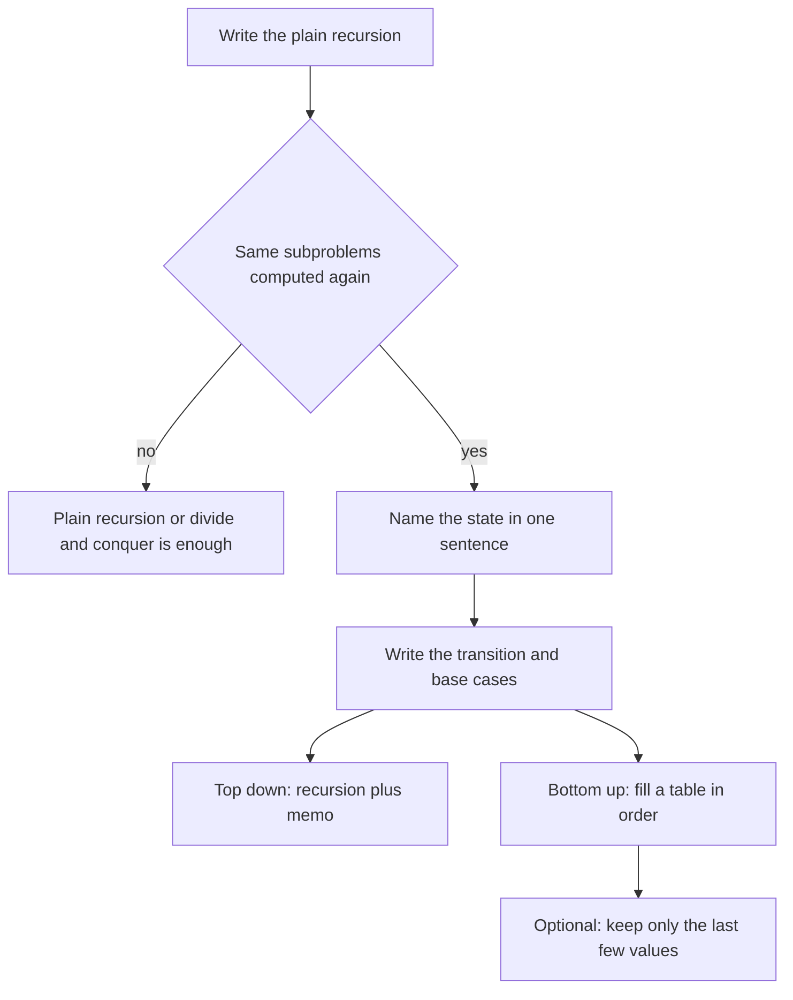

## The hook

Dynamic programming has a fearsome reputation. Students talk about it as if it were a separate kind of magic, where you either "see the formula" or you do not. Interviewers know this, which is why DP questions appear in so many placement rounds.

Here is the secret that takes the fear away: dynamic programming is ordinary recursion with a notebook. You write the obvious recursive solution, notice that it keeps solving the same small problems again and again, and write each answer down the first time so you never compute it twice. That is the whole idea. Everything else, tables, loops, space tricks, is bookkeeping on top.

## The intuition

:::analogy
Imagine a teacher asks a class to compute a long chain of sums, where each answer depends on two earlier ones. A student who works alone recomputes the earlier answers every time they are needed, filling page after page. A smarter class writes every answer on the whiteboard the moment it is found. Before computing anything, a student first glances at the whiteboard: if the answer is already there, they copy it; if not, they compute it once and write it up for everyone. The whiteboard turns hours of repeated work into minutes.
:::

That whiteboard is [[memoisation]]. The repeated work it removes comes from [[overlapping subproblems]]. And the overall approach, building big answers from stored small ones, is [[dynamic programming (DP)]].

## Let's build it up

### Step 1: the plain recursion

Fibonacci is the standard first example: fib(0) = 0, fib(1) = 1, and fib(n) = fib(n − 1) + fib(n − 2). The recursive code is a direct copy of the definition, as in [Trusting the Function You Are Still Writing](article:dsa-recursion-basics):

```pseudo
fib(n):
    if n < 2: return n
    return fib(n - 1) + fib(n - 2)
```

It is correct, but slow. fib(5) calls fib(4) and fib(3); fib(4) calls fib(3) again; each fib(3) calls fib(2), and so on. The call tree roughly doubles at each level, so the running time grows exponentially. Computing fib(40) this way makes over 300 million calls, even though there are only 41 distinct values to find.

### Step 2: top-down with a memo (the whiteboard)

Keep the recursion, but before computing fib(n), check a memo table. If the answer is there, return it. Otherwise compute it, store it, and return it.

```pseudo
memo = empty map
fib(n):
    if n < 2: return n
    if n in memo: return memo[n]
    memo[n] = fib(n - 1) + fib(n - 2)
    return memo[n]
```

Now each value from 0 to n is computed once, so the time drops from exponential to O(n). The memo uses O(n) space, plus the recursion stack.

### Step 3: bottom-up with a table

The recursion asks for small values before large ones anyway, so you can skip the recursion and fill the table in that order with a loop. This is [[tabulation]]:

```pseudo
fib(n):
    dp[0] = 0; dp[1] = 1
    for i in 2 .. n: dp[i] = dp[i - 1] + dp[i - 2]
    return dp[n]
```

No recursion means no risk of stack overflow, and loops are usually faster in practice.

### Step 4: keep only what you need

dp[i] only looks back two places, so two variables are enough: O(1) space. Many 1D DP problems can be shrunk this way once the table version works.

### The three questions behind every DP

Every DP solution, from Fibonacci to hard interview problems, answers three questions:

1. **[[State]]**: what does one subproblem mean? Write it as a sentence: "dp[i] = number of ways to reach step i."
2. **[[Transition]]**: how is a state built from smaller states? "dp[i] = dp[i − 1] + dp[i − 2]."
3. **[[Base case]]**: which states are known directly? "dp[0] = 1, dp[1] = 1."

Then choose top-down (memo) or bottom-up (table). Both compute the same states; top-down is often easier to write first, bottom-up is easier to optimise.

:::insight
DP is not a formula you have to "see". It is a recursion whose subproblems repeat, plus a place to store answers. If you can write the recursion and name the state in one sentence, you can turn it into DP mechanically.
:::



## A tiny example

**Climbing Stairs**: you can climb 1 or 2 steps at a time. How many distinct ways are there to reach step n?

- **State**: ways(i) = number of ways to stand on step i.
- **Transition**: your last move onto step i was either a 1-step from i − 1 or a 2-step from i − 2, and those two groups never overlap, so ways(i) = ways(i − 1) + ways(i − 2).
- **Base cases**: ways(0) = 1 (standing at the bottom, doing nothing, is one way), ways(1) = 1.

| i | 0 | 1 | 2 | 3 | 4 | 5 | 6 | 7 |
|---|---|---|---|---|---|---|---|---|
| ways(i) | 1 | 1 | 2 | 3 | 5 | 8 | 13 | 21 |

Check n = 3 by listing: 1+1+1, 1+2, 2+1. Three ways. ✓ The numbers are Fibonacci shifted by one, which is no coincidence: the transition is the same.

Counting calls for fib(5) shows the whiteboard's value: the plain recursion makes 15 calls, the memoised one makes 9, and the table does 4 additions.

```cpp
#include <bits/stdc++.h>
using namespace std;

long long memo[91];
long long fibMemo(int n) {
    if (n < 2) return n;
    if (memo[n]) return memo[n];
    return memo[n] = fibMemo(n - 1) + fibMemo(n - 2);
}

long long climbStairs(int n) {          // bottom-up with two variables
    long long prev2 = 1, prev1 = 1;     // ways(0), ways(1)
    for (int i = 2; i <= n; i++) { long long cur = prev1 + prev2; prev2 = prev1; prev1 = cur; }
    return prev1;
}

int main() {
    cout << fibMemo(10) << ' ' << fibMemo(90) << '\n';    // 55 2880067194370816120
    cout << climbStairs(3) << ' ' << climbStairs(7) << '\n';  // 3 21
}
```

:::warning
Common misconception: "DP is a magic formula you either know or you don't." Every DP transition comes from asking "what was the last decision?" and splitting the possibilities by it, exactly as the last step of a climb is either a 1-step or a 2-step. If you cannot find a transition, write the brute-force recursion first; the DP is hiding inside it.
:::

:::try-this
Change Climbing Stairs so you may climb 1, 2 or 3 steps at a time. What are the state, transition and base cases, and what is the answer for n = 4? (Same state. ways(i) = ways(i − 1) + ways(i − 2) + ways(i − 3), with ways(0) = 1 and ways of negative steps = 0. Values: 1, 1, 2, 4, 7, so the answer is 7.)
:::

## Where you'll see this again

The same three questions drive every DP in this track:

- 1D problems such as House Robber and Coin Change look back a fixed number of steps;
- knapsack adds a second dimension for capacity;
- grid paths, longest common subsequence and edit distance use two indices into two sequences;
- interval DP, bitmask DP and DP on trees change what a state means, but never the method.

When a problem asks for a count of ways, a minimum cost or a maximum value, and choices at each step affect later ones, reach for this checklist.

## Key takeaways

- Dynamic programming is recursion whose repeated subproblems are solved once and stored.
- Memoisation keeps the recursion and caches results, while tabulation fills a table from the smallest states upward with a loop.
- Every DP needs a state described in one sentence, a transition from smaller states, and base cases.
- Transitions come from asking what the last decision was and adding or comparing the options.
- Once the table version works, you can often keep only the last few values to cut memory to O(1).
