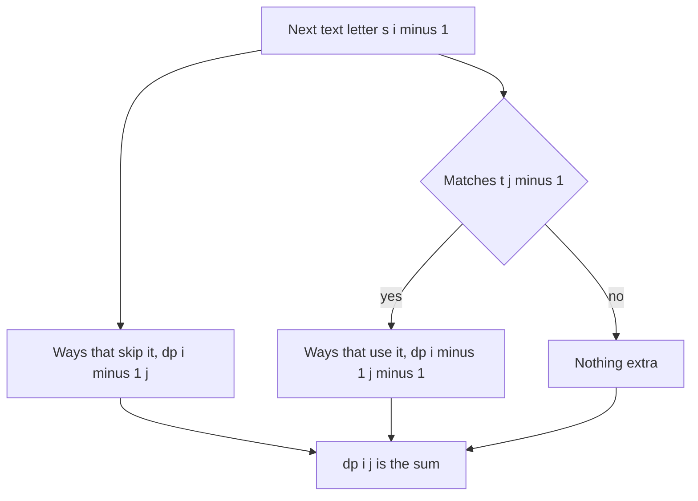

## The hook

A newspaper headline reads "ABCABC". A child with a pencil wants to spell "ABC" by crossing out letters, keeping the rest in order. How many different ways can they do it? And a harder question: if they could cross out any letters at all, how many different words could they end up with?

Both are counting questions over subsequences, and both have a classic trap: counting the same thing twice. The fix in each case is to decide exactly what one DP cell counts, and then make each choice add something new.

## The intuition

:::analogy
Picture the child reading the headline from left to right with the target word beside it. At each letter of the headline, they have two choices: cross it out, or use it for the next letter of the target if it matches. Every way of spelling the target is a sequence of such choices. So the number of ways to have spelled the first j target letters using the first i headline letters is the ways that skipped this headline letter plus, if it matches, the ways that used it.
:::

An [[occurrence as a subsequence]] is a set of positions spelling the pattern. Counting them is the [[use or skip]] DP. Counting [[distinct subsequence]]s of a single string is different, because two position sets that spell the same word must count once, and that needs a different state.

## How it works

### Pattern 1: how many times does t appear in s?

*Distinct Subsequences* (the name is misleading: it counts occurrences of t in s). Let dp[i][j] be the number of ways to spell t[0..j) using s[0..i):

- dp[i][0] = 1 for every i: the empty pattern is spelled by crossing out everything;
- dp[0][j] = 0 for j > 0: an empty text spells nothing;
- dp[i][j] = dp[i-1][j] + (s[i-1] = t[j-1] ? dp[i-1][j-1] : 0).

The two terms never overlap, because one group uses s[i-1] and the other does not, so there is no double counting. With one row and j looping downward, the space drops to O(m).

### Pattern 2: how many distinct subsequences does s have?

*Distinct Subsequences II* counts different strings, not position sets. Keep an [[ending-with count]] end[c] for each letter, and the total of all of them:

- when the next letter is c, the distinct subsequences ending in this c are all distinct subsequences so far with c appended, plus c alone: new = total + 1;
- the old end[c] is entirely contained in that new set, so replace it: total = total - end[c] + new, then end[c] = new.

That replacement is what removes duplicates. Every old subsequence ending in c is rebuilt by the new c, so counting both would count it twice.

### Pattern 3: which words are subsequences of s?

*Number of Matching Subsequences* gives a text s and many words, and asks how many words are subsequences of s. Checking each word separately with two pointers is O(words × |s|). Instead, keep [[waiting list]]s: bucket every word under the next letter it needs. Scan s once; at each letter c, take every word waiting for c, advance it by one letter, and move it to the bucket for its new next letter, or count it as matched if it is finished. Each word letter is advanced once, so the total work is |s| + total word length.

| Question | State | Duplicates handled by |
|---|---|---|
| Occurrences of t in s | dp[i][j] over prefixes | use and skip are disjoint |
| Distinct subsequences of s | end[c] per letter | replacing end[c] |
| Many words in s | words grouped by next needed letter | not a counting problem |



:::insight
To count without double counting, make every DP choice produce a different group of objects. Using or skipping a letter splits occurrences cleanly; for distinct strings, the newest copy of a letter regenerates everything the older copies made, so its count replaces theirs instead of adding.
:::

## Walk through an example

### Occurrences of "abc" in "abcabc"

| s prefix \ t prefix | "" | a | ab | abc |
|---|---|---|---|---|
| "" | 1 | 0 | 0 | 0 |
| a | 1 | 1 | 0 | 0 |
| ab | 1 | 1 | 1 | 0 |
| abc | 1 | 1 | 1 | 1 |
| abca | 1 | 2 | 1 | 1 |
| abcab | 1 | 2 | 3 | 1 |
| abcabc | 1 | 2 | 3 | **4** |

Four occurrences: positions (0, 1, 2), (0, 1, 5), (0, 4, 5) and (3, 4, 5). Look at the cell for "abcab" and "ab": skipping the second b keeps the 1 way from before, and using it adds the 2 ways to spell "a" from "abca", for 3.

### Distinct subsequences of "abab"

| Letter | new = total + 1 | Old end of that letter | total after |
|---|---|---|---|
| a | 1 | 0 | 1 |
| b | 2 | 0 | 3 |
| a | 4 | 1 | 6 |
| b | 7 | 2 | 11 |

Eleven distinct non-empty subsequences: a, b, aa, ab, ba, bb, aab, aba, abb, bab, abab. At the third letter, the new a creates a, aa, ba and aba; the old count for "ending in a" was just {a}, which is already among them, so it is replaced, not added.

### Matching words in "banana"

Words: ban, nab, aaa, bnn, an, b, nna.

| Word | Subsequence of banana? |
|---|---|
| ban | yes: b, a, n |
| nab | no: no b after the first n |
| aaa | yes: the three a's |
| bnn | yes: b, then the two n's |
| an | yes |
| b | yes |
| nna | yes: n, n, then the last a |

Six of the seven match. In the waiting-list scan, "nab" waits under 'n', moves to 'a', then to 'b', and is still waiting there when "banana" ends.

:::try-this
How many times does "aa" appear as a subsequence of "aaaa", and how many distinct subsequences does "aaaa" have? (Any 2 of the 4 positions spell "aa", so C(4, 2) = 6 occurrences. Distinct subsequences are only a, aa, aaa and aaaa, so 4. The end[a] rule gives new = 1, 2, 3, 4 as each a arrives, each replacing the last.)
:::

:::warning
Common misconception: "Distinct Subsequences counts different strings." LeetCode problem 115, *Distinct Subsequences*, counts occurrences: different sets of positions, even if they spell the same word, as in the four ways to find "abc" in "abcabc". *Distinct Subsequences II* is the one that counts different strings. Read which one you are solving before choosing the recurrence.
:::

## The code

```pseudo
count_occurrences(s, t):
    dp = [1] + [0] * m                         # dp[j]: ways to spell t[0..j)
    for ch in s:
        for j in m down to 1:                  # downward, so dp[j-1] is still the old row
            if ch == t[j-1]: dp[j] += dp[j-1]
    return dp[m]

count_distinct(s):
    end = {}; total = 0
    for c in s:
        new = total + 1
        total = total - end.get(c, 0) + new
        end[c] = new
    return total
```

```cpp
#include <bits/stdc++.h>
using namespace std;

unsigned long long countOccurrences(const string& s, const string& t) {
    int m = t.size();
    vector<unsigned long long> dp(m + 1, 0);
    dp[0] = 1;                                                 // empty pattern: one way
    for (char ch : s)
        for (int j = m; j >= 1; j--)                           // downward keeps the previous row
            if (ch == t[j - 1]) dp[j] += dp[j - 1];
    return dp[m];
}

long long countDistinct(const string& s) {
    const long long MOD = 1e9 + 7;
    array<long long, 26> endWith{};
    long long total = 0;
    for (char c : s) {
        long long fresh = (total + 1) % MOD;                   // every subsequence so far + c, and c alone
        total = ((total - endWith[c - 'a'] + fresh) % MOD + MOD) % MOD;
        endWith[c - 'a'] = fresh;                              // replaces the old count, no double counting
    }
    return total;
}

int matchingWords(const string& s, const vector<string>& words) {
    vector<vector<pair<int, int>>> waiting(26);                // (word index, next position)
    for (int w = 0; w < (int)words.size(); w++) waiting[words[w][0] - 'a'].push_back({w, 0});
    int matched = 0;
    for (char c : s) {
        auto bucket = move(waiting[c - 'a']);
        waiting[c - 'a'].clear();
        for (auto [w, pos] : bucket) {
            if (pos + 1 == (int)words[w].size()) matched++;
            else waiting[words[w][pos + 1] - 'a'].push_back({w, pos + 1});
        }
    }
    return matched;
}

int main() {
    cout << countOccurrences("abcabc", "abc") << ' ' << countOccurrences("aaaa", "aa") << '\n';   // 4 6
    cout << countDistinct("abab") << ' ' << countDistinct("aaaa") << '\n';                       // 11 4
    cout << matchingWords("banana", {"ban", "nab", "aaa", "bnn", "an", "b", "nna"}) << '\n';      // 6
}
```

In `matchingWords`, the bucket for the current letter is moved out before processing, so a word whose next letter is the same, like the second a of "aaa", waits for the next occurrence instead of reusing this one.

## Complexity

- **Occurrences of t in s: O(n × m) time, O(m) space.**
- **Distinct subsequences: O(n) time, O(alphabet) space.**
- **Matching words: O(|s| + total word length)** time and space for the buckets.

## Common mistakes

- **Looping j upward** in the one-row occurrence count, which lets one text letter match two pattern letters.
- **Forgetting dp[0] = 1,** the one way to spell the empty pattern.
- **Adding to end[c] instead of replacing it,** which double counts repeated letters.
- **Taking a negative value modulo** after the subtraction; add MOD before the final %.
- **Advancing a word twice on the same text letter** in the waiting-list scan, by pushing it back into the bucket being processed.
- **Overflow in occurrence counts:** intermediate cells can grow far larger than the final answer, even when the problem promises the answer itself is small, so use a wide unsigned type.

## Practice problems

*Distinct Subsequences* counts occurrences of a pattern with use or skip. *Distinct Subsequences II* counts different strings with the ending-with rule. *Number of Matching Subsequences* checks many words at once with waiting lists. The two-string table these build on is in [Lining Up Two DNA Strands](article:dsa-lcs-edit-distance), and the closely related substring and supersequence tables in [Two Strips of Tape Matched End to End](article:dsa-longest-common-substring).

## Key takeaways

- The number of ways t appears in s as a subsequence follows dp[i][j] = dp[i-1][j] plus dp[i-1][j-1] when s[i-1] matches t[j-1].
- Using or skipping a text letter splits occurrences into two disjoint groups, so their counts simply add.
- Counting distinct subsequences keeps, for each letter, how many distinct subsequences end with it, and each new copy of a letter replaces that count.
- The new count for a letter is the current total plus one, because every distinct subsequence so far can be extended by it, and it can stand alone.
- Checking many words against one text is fastest with waiting lists keyed by each word's next needed letter, scanned in one pass.
