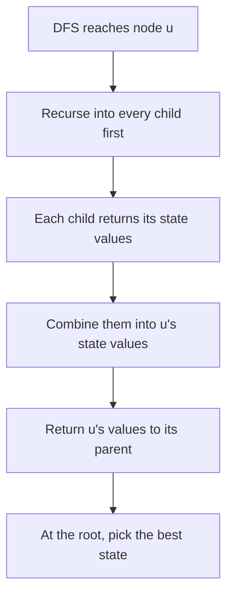

## The hook

A company is planning a party. Every employee has a "fun" score, and the organiser wants the most fun possible. There is one rule: nobody attends if their direct boss attends, because nobody relaxes with their manager in the room. The company chart is a tree, from the chief executive down.

Trying every guest list is 2ⁿ. A tree, though, has a special gift for DP: each subtree is independent of everything outside it except through one node, its root. So every manager can summarise their whole team in two numbers and hand them upwards.

## The intuition

:::analogy
Each manager asks their direct reports for a short report about their teams: "if I come to the party, my team's best fun is X; if I stay home, it is Y". With those reports in hand, the manager can write their own report in a minute. If the manager comes, every direct report must stay home, so the manager's fun plus each report's "stay home" number. If the manager stays home, each report picks whichever of their two numbers is larger. The chief executive's report answers the whole question.
:::

That is [[tree DP]]: a post-order DFS where every node returns a few values, one per [[node state]], computed only from its children's values. The party is a maximum-weight [[independent set]], and the two states are "taken" and "skipped". The same skeleton as [Managers Summarising Their Teams' Reports](article:dsa-tree-recursion), with richer reports.

The design question for every tree DP is: **what does the parent need to know about a child's subtree?** Usually it is one fact about the child itself, such as whether it is taken, matched or covered, together with the best value for each case.

## How it works

### Pattern 1: take or skip (the party, House Robber III)

For each node u with children c:

- take[u] = value[u] + sum of skip[c];
- skip[u] = sum of max(take[c], skip[c]).

Answer: max(take[root], skip[root]). *House Robber III* is exactly this on a binary tree, as covered in [The Thief Who Never Robs Two Neighbours](article:dsa-house-robber-variants).

### Pattern 2: matched or free (Tree Matching)

CSES *Tree Matching* asks for the largest [[matching]]: as many edges as possible with no shared endpoint. States for u: free[u], u not matched to any child, and matched[u], u matched to exactly one child.

- free[u] = sum over children of max(free[c], matched[c]);
- matched[u] = max over one child c of free[u] - max(free[c], matched[c]) + free[c] + 1: swap child c's best for its free value, and add the edge u–c.

Answer: max(free[root], matched[root]).

### Pattern 3: three states (Binary Tree Cameras)

Cameras watch their own node, their parent and their children. Find the fewest cameras that watch every node. A child can be:

| Child state | Meaning | What the parent must do |
|---|---|---|
| HAS_CAMERA | camera on the child | parent is covered for free |
| COVERED | watched by its own child, no camera | nothing |
| NEEDS_COVER | not watched by anyone below | parent must place a camera |

Processing bottom up: if any child needs cover, place a camera here; else if any child has a camera, this node is covered; else this node needs cover. A missing child counts as COVERED. If the root still needs cover at the end, add one camera. This greedy is the DP with the best choice already made: putting cameras as high as possible never hurts.

### Pattern 4: rerooting (answers for every root)

*Sum of Distances in Tree* asks, for every node, the sum of distances to all other nodes. Running a DFS from every node is O(n²). [[Rerooting]] does it in two passes:

- **Pass 1 (down):** root at 0; compute size[u] and down[u], the sum of distances from u to nodes in its subtree: down[u] = sum of down[c] + size[c].
- **Pass 2 (reroot):** ans[0] = down[0]. Moving the root from u to child v brings the size[v] nodes on v's side one step closer and pushes the other n - size[v] nodes one step farther: ans[v] = ans[u] - size[v] + (n - size[v]).

CSES *Tree Distances II* is the same problem. Rerooting works whenever the answer can be updated in O(1) when the root crosses one edge.



:::insight
In a tree, a subtree touches the rest of the tree only through its root. So the parent needs only a few numbers per child, one for each state the child's root can be in, and the whole DP is one post-order pass.
:::

## Walk through an example

### The party

A company of 8 with fun scores: 0 (CEO) 3, 1 4, 2 5, 3 1, 4 2, 5 6, 6 1, 7 1. Reports: 1, 2 and 7 report to 0; 3 and 4 to 1; 5 and 6 to 2.

| Node | Children | take | skip |
|---|---|---|---|
| 3, 4, 5, 6, 7 (leaves) | | own value: 1, 2, 6, 1, 1 | 0 |
| 1 | 3, 4 | 4 + 0 + 0 = 4 | max(1, 0) + max(2, 0) = 3 |
| 2 | 5, 6 | 5 + 0 + 0 = 5 | 6 + 1 = 7 |
| 0 | 1, 2, 7 | 3 + 3 + 7 + 0 = 13 | max(4, 3) + max(5, 7) + max(1, 0) = 12 |

Best fun: 13, by inviting the CEO plus 3, 4, 5 and 6: 3 + 1 + 2 + 6 + 1. Notice that node 2, with fun 5, stays home, because its two reports together bring 7.

### Tree Matching on the same tree

| Node | free | matched |
|---|---|---|
| leaves | 0 | impossible |
| 1 | 0 | 1, with 3 or 4 |
| 2 | 0 | 1, with 5 or 6 |
| 0 | 1 + 1 + 0 = 2 | 2 - 0 + 0 + 1 = 3, matching 0 with 7 |

The largest matching has 3 edges, for example 1–3, 2–5 and 0–7.

### Cameras

A binary tree: 0 has children 1 and 2; 1 has children 3 and 4; 4 has a left child 5.

| Node (post-order) | Children's states | Decision | State |
|---|---|---|---|
| 3 | none | | NEEDS_COVER |
| 5 | none | | NEEDS_COVER |
| 4 | 5 needs cover | camera 1 | HAS_CAMERA |
| 1 | 3 needs cover | camera 2 | HAS_CAMERA |
| 2 | none | | NEEDS_COVER |
| 0 | 2 needs cover | camera 3 | HAS_CAMERA |

Three cameras, at 4, 1 and 0. Three is also a lower bound: leaves 3, 5 and 2 each need a camera on themselves or their parent, and those three pairs share no node.

### Rerooting

Same 8-node tree. Pass 1 from root 0 gives sizes 8, 3, 3, 1, 1, 1, 1, 1 and down[0] = 11. Pass 2:

| Node | Computed from | Sum of distances |
|---|---|---|
| 0 | down[0] | 11 |
| 1 | 11 - 3 + 5 | 13 |
| 2 | 11 - 3 + 5 | 13 |
| 7 | 11 - 1 + 7 | 17 |
| 3, 4 | 13 - 1 + 7 | 19 |
| 5, 6 | 13 - 1 + 7 | 19 |

A BFS from every node gives the same eight numbers, with n BFS runs instead of two passes.

:::try-this
Raise node 7's fun from 1 to 2 in the party example. What changes? (skip[0] becomes 4 + 7 + 2 = 13, and take[0] stays 13, since 7 must stay home if the CEO comes. There are now two different best guest lists worth 13: the CEO with 3, 4, 5, 6, or nodes 1, 5, 6 and 7 without the CEO.)
:::

:::warning
Common misconception: "If a node is skipped, its children must be taken." Skipping a node only removes a restriction; it does not force anything. In the example, when the CEO stays home, node 1 is better taken (4 against 3) but node 2 is better skipped (5 against 7), because its own reports bring more fun. That is why skip[u] uses max(take[c], skip[c]), not take[c].
:::

## The code

```pseudo
party(u):                                     # returns (take, skip)
    take = value[u]; skip = 0
    for c in children(u):
        (tc, sc) = party(c)
        take += sc; skip += max(tc, sc)
    return (take, skip)

reroot(u):                                    # after pass 1 computed size and down
    for c in children(u):
        ans[c] = ans[u] - size[c] + (n - size[c]); reroot(c)
```

```cpp
#include <bits/stdc++.h>
using namespace std;
using ll = long long;

struct TreeDP {
    int n;
    vector<vector<int>> adj;
    vector<ll> val, take, skip, sz, down, ans;
    vector<int> freeM, matched;
    TreeDP(int n, const vector<array<int, 2>>& edges, vector<ll> v)
        : n(n), adj(n), val(v), take(n), skip(n), sz(n), down(n), ans(n), freeM(n), matched(n) {
        for (auto [a, b] : edges) adj[a].push_back(b), adj[b].push_back(a);
        dfs(0, -1);
        ans[0] = down[0];
        reroot(0, -1);
    }
    void dfs(int u, int p) {
        take[u] = val[u], skip[u] = 0, sz[u] = 1, down[u] = 0, freeM[u] = 0, matched[u] = INT_MIN;
        for (int c : adj[u]) {
            if (c == p) continue;
            dfs(c, u);
            take[u] += skip[c], skip[u] += max(take[c], skip[c]);          // party
            freeM[u] += max(freeM[c], matched[c]);                         // matching, u free
            sz[u] += sz[c], down[u] += down[c] + sz[c];                    // distances below u
        }
        for (int c : adj[u])
            if (c != p) matched[u] = max(matched[u], freeM[u] - max(freeM[c], matched[c]) + freeM[c] + 1);
    }
    void reroot(int u, int p) {
        for (int c : adj[u])
            if (c != p) ans[c] = ans[u] - sz[c] + (n - sz[c]), reroot(c, u);
    }
};

struct TreeNode { TreeNode *left = nullptr, *right = nullptr; };
enum { NEEDS_COVER, COVERED, HAS_CAMERA };

int cameras = 0;
int place(TreeNode* t) {
    if (!t) return COVERED;
    int l = place(t->left), r = place(t->right);
    if (l == NEEDS_COVER || r == NEEDS_COVER) { cameras++; return HAS_CAMERA; }
    if (l == HAS_CAMERA || r == HAS_CAMERA) return COVERED;
    return NEEDS_COVER;
}

int main() {
    vector<array<int, 2>> e = {{0, 1}, {0, 2}, {1, 3}, {1, 4}, {2, 5}, {2, 6}, {0, 7}};
    TreeDP t(8, e, {3, 4, 5, 1, 2, 6, 1, 1});
    cout << max(t.take[0], t.skip[0]) << ' ' << max(t.freeM[0], t.matched[0]) << '\n';   // 13 3
    for (ll x : t.ans) cout << x << ' ';
    cout << '\n';                                                                      // 11 13 13 19 19 19 19 17

    vector<TreeNode> nodes(6);
    nodes[0].left = &nodes[1], nodes[0].right = &nodes[2];
    nodes[1].left = &nodes[3], nodes[1].right = &nodes[4];
    nodes[4].left = &nodes[5];
    if (place(&nodes[0]) == NEEDS_COVER) cameras++;                                    // the root itself
    cout << cameras << '\n';                                                           // 3
}
```

## Complexity

- **Every pattern here: O(n) time,** one or two DFS passes with constant work per edge.
- **Space: O(n)** for the adjacency list and the per-node values, plus O(height) recursion depth.
- **Rerooting versus brute force:** O(n) instead of O(n²) for n separate searches.

## Common mistakes

- **Forcing children to be taken when the parent is skipped,** instead of taking each child's better option.
- **Forgetting the parent check** when the tree comes as an undirected edge list, which makes the DFS walk back up.
- **Too few states** in Binary Tree Cameras, merging "covered" with "needs cover".
- **Forgetting the root's final check** in Cameras, when the root itself still needs cover.
- **Deep recursion** on a path-shaped tree of 2 × 10⁵ nodes; use an iterative post-order or a larger stack in contests.
- **Recomputing from scratch for every root** when a rerooting update exists.

## Practice problems

*Tree Matching* is the matched-or-free pattern on an unrooted tree. *Binary Tree Cameras* is the three-state version. *Sum of Distances in Tree* and *Tree Distances II* are the classic rerooting problems. *House Robber III*, the take-or-skip pattern on a binary tree, is covered in [The Thief Who Never Robs Two Neighbours](article:dsa-house-robber-variants), and the DP foundations in [Stairs, Robbers and Secret Codes](article:dsa-dp-1d).

## Key takeaways

- Tree DP computes a few values per node, one per state, from its children's values in a single post-order pass.
- For the best guest list with no node next to its parent, take adds the children's skip values and skip adds each child's better option.
- Tree Matching uses free and matched states, where matching u to one child swaps that child's best for its free value plus one edge.
- Binary Tree Cameras needs three states, because a child that needs cover forces a camera while a covered child does not.
- Rerooting gives every node's answer in two passes by adjusting the answer in O(1) each time the root moves across an edge.
