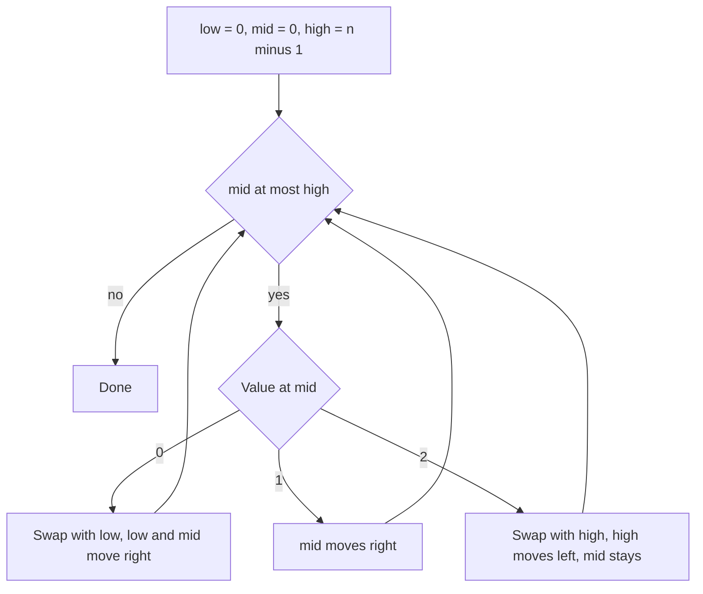

## The hook

An array holds only 0s, 1s and 2s, like red, white and blue balls in a jumbled row. Sort it. You could call `sort` in O(n log n), or count the three colours and rewrite the array in two passes. The interview follow-up is always the same: "Can you do it in one pass, in place?"

Edsger Dijkstra posed this as the Dutch national flag problem, after the flag's three horizontal stripes. The solution is a short loop with three pointers, and its correctness rests on one carefully maintained invariant.

## The problem

Given an array `nums` with n elements, each 0, 1 or 2, rearrange it in place so all 0s come first, then all 1s, then all 2s. Use one pass and O(1) extra space, without a library sort.

Example: `[2, 0, 2, 1, 1, 0]` becomes `[0, 0, 1, 1, 2, 2]`.

## The obvious approach

Count the 0s, 1s and 2s in one pass, then overwrite the array with that many of each in a second pass. O(n) time and O(1) space, and a perfectly good answer to give first. It needs two passes, and it does not generalise to moving actual objects, such as records keyed by colour, because it rewrites values rather than moving elements.

## The key insight

:::analogy
Imagine sorting a row of red, white and blue balls by walking along it once with your hands. You push every red ball you meet back to the left end, toss every blue ball you meet to the far right end, and leave white balls where they are. At every moment the row has four zones: reds on the left, whites behind you, unchecked balls in front of you, and blues on the right.
:::

Keep three pointers and four [[region|regions]]:

- `[0, low)`: all 0s.
- `[low, mid)`: all 1s.
- `[mid, high]`: the [[unclassified zone]], not examined yet.
- `(high, n−1]`: all 2s.

That description is the [[invariant]]. In the ball-sorting picture, your hands are at mid, the left wall of whites is low, and the right wall of blues is high. Each step examines `a[mid]` and shrinks the unclassified zone by one while keeping the invariant true:

- `a[mid] == 0`: swap with `a[low]`; advance both low and mid.
- `a[mid] == 1`: just advance mid.
- `a[mid] == 2`: swap with `a[high]`; decrease high, but do **not** advance mid, because the value that arrived from high is still unexamined.



:::insight
Write down exactly what each region contains, then make sure every branch of the loop keeps that description true. Once the invariant holds at every step and the unclassified zone is empty, the array is sorted. No case analysis by intuition needed.
:::

## Walk through an example

`[2, 0, 2, 1, 1, 0]`, with low = 0, mid = 0, high = 5.

| Step | a[mid] | Action | Array after | low, mid, high |
|---|---|---|---|---|
| 1 | 2 | swap mid↔high | [0, 0, 2, 1, 1, 2] | 0, 0, 4 |
| 2 | 0 | swap mid↔low | [0, 0, 2, 1, 1, 2] | 1, 1, 4 |
| 3 | 0 | swap mid↔low | [0, 0, 2, 1, 1, 2] | 2, 2, 4 |
| 4 | 2 | swap mid↔high | [0, 0, 1, 1, 2, 2] | 2, 2, 3 |
| 5 | 1 | advance mid | [0, 0, 1, 1, 2, 2] | 2, 3, 3 |
| 6 | 1 | advance mid | [0, 0, 1, 1, 2, 2] | 2, 4, 3 |

mid > high, so the unclassified zone is empty and the array is sorted. Notice step 1: the 0 that arrived from the right was examined again in step 2, exactly why mid stayed put.

:::try-this
Trace `[1, 2, 0]`. (Step 1: 1, mid → 1. Step 2: 2, swap with high: [1, 0, 2], high → 1. Step 3: 0, swap with low: [0, 1, 2], low → 1, mid → 2. Now mid > high. Sorted.)
:::

## The code

```pseudo
sort_colors(a):
    low = 0, mid = 0, high = n - 1
    while mid <= high:
        if a[mid] == 0: swap(a[low], a[mid]); low += 1; mid += 1
        else if a[mid] == 1: mid += 1
        else: swap(a[mid], a[high]); high -= 1
```

```cpp
#include <bits/stdc++.h>
using namespace std;

void sortColors(vector<int>& a) {
    int low = 0, mid = 0, high = (int)a.size() - 1;
    while (mid <= high) {
        if (a[mid] == 0) swap(a[low++], a[mid++]);
        else if (a[mid] == 1) mid++;
        else swap(a[mid], a[high--]);
    }
}

int main() {
    vector<int> a = {2, 0, 2, 1, 1, 0};
    sortColors(a);
    for (int x : a) cout << x << ' ';  // 0 0 1 1 2 2
    cout << '\n';
}
```

## Complexity

- **Time:** O(n). Every iteration either advances mid or decreases high, shrinking the unclassified zone by one, so at most n iterations.
- **Space:** O(1): three indices and swaps in place.

## Common mistakes

:::warning
Common misconception: "after swapping a 2 to the end, move mid forward like in the other cases." The value that arrives from high has never been looked at; it could be a 0 that still needs to go left. Advancing mid skips it and leaves the array unsorted.
:::

- **Loop condition `mid < high`** instead of `mid <= high`, which leaves the last unexamined element unchecked.
- **Using unsigned indices** in C++: `high` can become −1 when the array is all 2s; use signed integers.
- **Forgetting that it is not stable**: equal elements may change their relative order, which matters if you are moving records rather than plain numbers.

## Practice problems

*Sort Colors* is the walkthrough. *Move Zeroes* and *Sort Array By Parity* are two-region versions of the same idea. *Partition Array According to Given Pivot* is a three-way partition around a value, the same split that powers three-way quicksort when there are many duplicates.

## Key takeaways

- The Dutch national flag problem sorts an array of three values in one pass with three pointers: low, mid and high.
- The invariant splits the array into 0s, 1s, an unexamined zone and 2s, and every step keeps it true.
- On 0, swap with low and advance both; on 1, advance mid; on 2, swap with high and shrink high without advancing mid.
- Each step shrinks the unexamined zone, so it runs in O(n) time with O(1) extra space.
- The same three-way partition is used in quicksort with many duplicates and in any "group into three kinds" problem.
