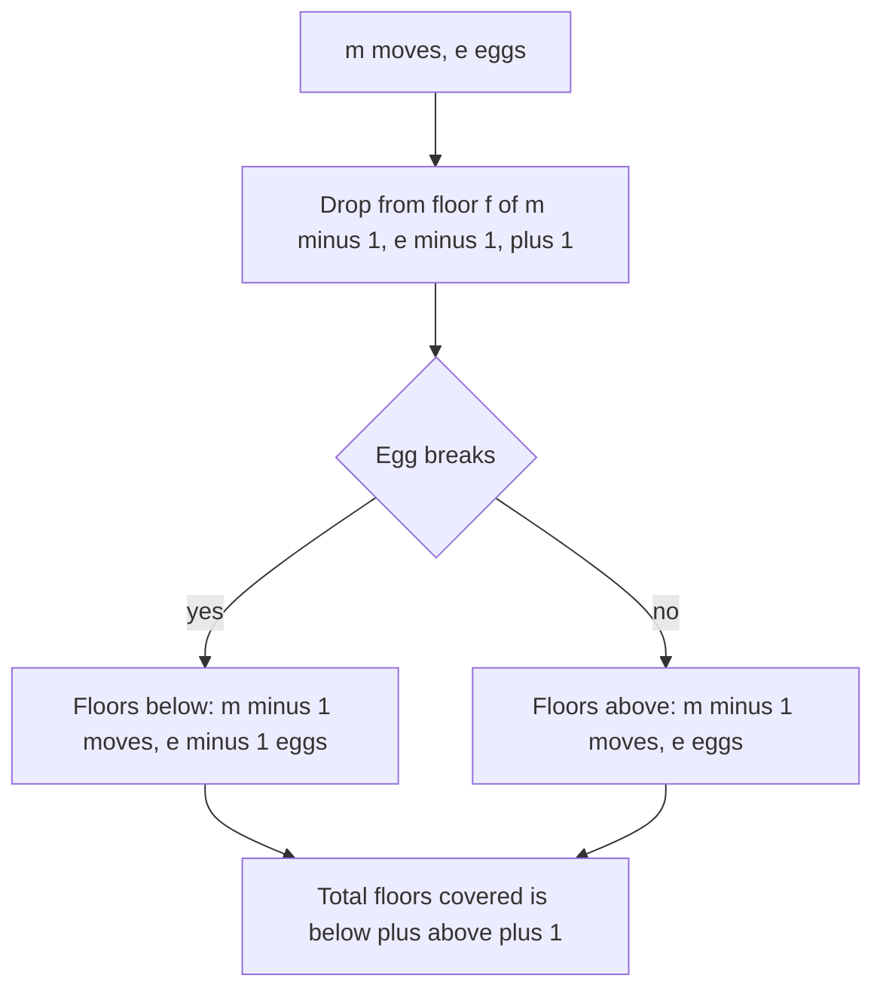

## The hook

A company has designed a new phone case and wants to know the highest floor of its test tower from which a protected phone survives a drop. Phones are expensive, so the lab has only a few. Drop from too high and you lose a phone; drop timidly floor by floor and the test takes all day.

With unlimited phones you would binary search. With one phone you must climb floor by floor. Everything in between is the classic *egg drop* problem, an interview favourite because the obvious DP is correct but slow, and turning the question around makes it fast.

## The problem

You have k identical eggs and a building with floors 1 to n. There is an unknown [[critical floor]] f between 0 and n: an egg dropped from any floor above f breaks, and from f or below it survives and can be reused. Find the fewest drops that guarantee you learn f, whatever it is. This is a [[worst-case cost]]: you must plan for the least lucky outcome.

With 2 eggs and 10 floors, the answer is 4.

## The obvious approach

Let dp[e][n] be the fewest drops that decide n floors with e eggs. Dropping first from floor x has two outcomes, and the worst one counts:

- the egg breaks: floors 1 to x - 1 remain with e - 1 eggs, dp[e - 1][x - 1];
- it survives: floors x + 1 to n remain with e eggs, which is the same as dp[e][n - x].

So dp[e][n] = 1 + min over x of max(dp[e - 1][x - 1], dp[e][n - x]), with dp[1][n] = n and dp[e][0] = 0. That is [[minimax]]: minimise over your choice, maximise over nature's.

It is correct, but O(k × n²). For *Super Egg Drop*, with n up to 10⁴ and k up to 100, that is 10¹⁰ steps. Since the "breaks" term grows with x and the "survives" term shrinks, the best x can be found by binary search, giving O(k × n log n), but there is a far neater idea.

## The key insight

:::analogy
Instead of asking "how few drops do I need for this tower?", ask the lab manager's question: "I can afford m drops and have e phones; how tall a tower can I fully test?". Make the first drop from some floor. If the phone breaks, you have m - 1 drops and e - 1 phones for the floors below. If it survives, you have m - 1 drops and all e phones for the floors above. So the tallest testable tower is the floors below, the floors above, and the one floor you dropped from.
:::

That is the [[inverted DP]]. Let f(m, e) be the most floors that m moves and e eggs can fully decide:

f(m, e) = f(m - 1, e - 1) + f(m - 1, e) + 1, with f(0, e) = f(m, 0) = 0.

The answer is the smallest m with f(m, k) ≥ n. Each move costs O(k) to update, and m is at most n (and much smaller when k ≥ 2), so the whole thing is O(k × answer), with O(k) memory.

It also tells you the strategy: with m moves and e eggs, drop from floor f(m - 1, e - 1) + 1, the highest floor whose "below" part you could still finish if the egg breaks.

### Closed forms worth remembering

| Eggs | f(m, e) | Answer for n floors |
|---|---|---|
| 1 | m | n |
| 2 | m(m + 1) / 2 | smallest m with m(m + 1) / 2 ≥ n |
| e ≥ log₂(n + 1) | 2ᵐ - 1 | ⌈log₂(n + 1)⌉, plain binary search |

With 2 eggs and 100 floors: 13 × 14 / 2 = 91 is too few, and 14 × 15 / 2 = 105 is enough, so 14 drops. The strategy drops the first egg from floors 14, 27, 39, 50, ..., each gap one smaller, so that whichever gap the egg breaks in, the second egg's floor-by-floor scan keeps the total at 14.

### A cousin: Guess Number Higher or Lower II

You guess a hidden number from 1 to n; a wrong guess x costs x and tells you higher or lower. What money guarantees a win? This is an interval minimax DP, as in [Choosing Which Balloon to Pop Last](article:dsa-interval-dp):

dp[l][r] = min over x in [l, r] of x + max(dp[l][x - 1], dp[x + 1][r]), with empty ranges costing 0.

The guess is your choice (min), the higher-or-lower answer is the adversary's (max).



:::insight
"Fewest moves for n floors" needs a search over every first drop. "Most floors for m moves" does not: the first drop simply sits on top of everything the broken branch can handle. Turning the question around replaces an O(k n²) minimax with an O(k × answer) sum.
:::

## Walk through an example

### Inverted DP, 2 eggs and 10 floors

| Moves m | f(m, 1) | f(m, 2) |
|---|---|---|
| 1 | 1 | 1 |
| 2 | 2 | 3 |
| 3 | 3 | 6 |
| 4 | 4 | **10** |

f(4, 2) = f(3, 1) + f(3, 2) + 1 = 3 + 6 + 1 = 10 ≥ 10, so 4 drops suffice, and 3 do not, since f(3, 2) = 6.

The strategy with 4 moves: drop first from floor f(3, 1) + 1 = 4.

| Drop | From floor | If it breaks | If it survives |
|---|---|---|---|
| 1 | 4 | test 1, 2, 3 one by one: 3 more drops | 3 drops left for floors 5 to 10 |
| 2 | 4 + f(2, 1) + 1 = 7 | test 5, 6: 2 more | 2 drops left for 8 to 10 |
| 3 | 7 + f(1, 1) + 1 = 9 | test 8: 1 more | 1 drop left for 10 |
| 4 | 10 | done | done |

Every branch finishes within 4 drops.

### The slow table agrees

dp[2][n] for n = 0 to 10 from the O(n²) recurrence: 0, 1, 2, 2, 3, 3, 3, 4, 4, 4, 4. The values step up exactly where f(m, 2) passes n: at n = 2, 4 and 7, just past the triangular numbers 1, 3 and 6.

### Three eggs

With 3 eggs and 10 floors: f(3, 3) = 7 is not enough and f(4, 3) = 14 is, so the answer is also 4. The third egg only starts to help on taller buildings.

### Guess Number, n = 5

| Range | Best guess | Cost |
|---|---|---|
| [1, 2] | 1 | 1 |
| [1, 3] | 2 | 2 |
| [3, 5] | 4 | 4 |
| [1, 5] | 2 or 4 | 6 |

Guessing 4 first costs 4 plus the worse side: [1, 3] costs 2 and [5, 5] costs 0, so 6. Guessing 2 first costs 2 plus [3, 5] at 4, also 6. So 6 is enough to guarantee a win.

:::try-this
How many drops do 2 eggs need for 36 floors, and from which floor should the first drop be? (f(m, 2) = m(m + 1) / 2: 7 × 8 / 2 = 28 is too small and 8 × 9 / 2 = 36 is exactly enough, so 8 drops. The first drop is from floor f(7, 1) + 1 = 8, then 15, 21, 26, 30, 33, 35, 36.)
:::

:::warning
Common misconception: "With 2 eggs, drop the first one every √n floors." That needs close to 2√n drops: with gaps of 10 on 100 floors, the worst case is 10 first-egg drops plus 9 second-egg drops, 19 in all. Equal gaps waste moves: later gaps should shrink by one each time, because each earlier drop has already used one move. The shrinking gaps 14, 13, 12, ... give 14 drops, the true optimum.
:::

## The code

```pseudo
super_egg_drop(k, n):
    f = [0] * (k + 1); m = 0
    while f[k] < n:
        m += 1
        for e in k down to 1:                # downward so f[e-1] is still last move's value
            f[e] = f[e-1] + f[e] + 1
    return m

guess_cost(n):
    for len in 2 .. n: for l: r = l + len - 1
        dp[l][r] = min over x in l..r of x + max(dp[l][x-1], dp[x+1][r])
    return dp[1][n]
```

```cpp
#include <bits/stdc++.h>
using namespace std;

int superEggDrop(int k, int n) {
    vector<long long> f(k + 1, 0);                        // f[e] = floors decidable with m moves
    int m = 0;
    while (f[k] < n) {
        m++;
        for (int e = k; e >= 1; e--) f[e] = f[e - 1] + f[e] + 1;   // breaks + survives + this floor
    }
    return m;
}

int slowEggDrop(int k, int n) {                           // O(k n^2) check
    vector<vector<int>> dp(k + 1, vector<int>(n + 1, 0));
    for (int x = 1; x <= n; x++) dp[1][x] = x;
    for (int e = 2; e <= k; e++)
        for (int fl = 1; fl <= n; fl++) {
            dp[e][fl] = INT_MAX;
            for (int x = 1; x <= fl; x++)
                dp[e][fl] = min(dp[e][fl], 1 + max(dp[e - 1][x - 1], dp[e][fl - x]));
        }
    return dp[k][n];
}

int guessCost(int n) {
    vector<vector<int>> dp(n + 2, vector<int>(n + 2, 0));
    for (int len = 2; len <= n; len++)
        for (int l = 1; l + len - 1 <= n; l++) {
            int r = l + len - 1;
            dp[l][r] = INT_MAX;
            for (int x = l; x <= r; x++)
                dp[l][r] = min(dp[l][r], x + max(x > l ? dp[l][x - 1] : 0, x < r ? dp[x + 1][r] : 0));
        }
    return dp[1][n];
}

int main() {
    cout << superEggDrop(2, 10) << ' ' << superEggDrop(3, 10) << ' ' << superEggDrop(2, 100) << ' '
         << superEggDrop(2, 36) << '\n';                                       // 4 4 14 8
    cout << slowEggDrop(2, 10) << ' ' << slowEggDrop(2, 100) << '\n';           // 4 14
    cout << superEggDrop(100, 10000) << '\n';                                   // 14
    cout << guessCost(5) << ' ' << guessCost(7) << '\n';                        // 6 10
}
```

`superEggDrop(100, 10000)` returns 14 instantly: with that many eggs, the answer is plain binary search, ⌈log₂ 10001⌉ = 14, and the inverted DP finds it after 14 rounds of 100 updates.

## Complexity

- **Inverted DP: O(k × m) time** for answer m, at most O(k × n), and O(k) space.
- **Classic DP: O(k × n²)** time, or O(k × n log n) with a binary search over the first drop.
- **Guess Number: O(n³)** for the interval minimax, with O(n²) space.

## Common mistakes

- **Using average-case reasoning;** the problem asks for a guarantee, so the worst outcome of each drop counts.
- **Updating f[e] upward** in the inverted DP, which uses this move's f[e - 1] instead of the previous move's.
- **Equal gaps for two eggs,** which waste moves compared with shrinking gaps.
- **Writing the slow DP for Super Egg Drop's limits,** which times out.
- **Forgetting floor 0,** the case where every floor breaks the egg; the critical floor ranges over 0 to n.
- **In Guess Number, summing both sides** instead of taking the worse one; only one side is ever explored.

## Practice problems

*Super Egg Drop* needs the inverted DP. *Egg Drop With 2 Eggs and N Floors* is the triangular-number special case. *Guess Number Higher or Lower II* is the interval minimax. The binary search that the many-egg case reduces to is in [Binary Search Without the Off-by-One Fear](article:dsa-binary-search).

## Key takeaways

- Egg drop minimises the worst-case number of drops, so each drop's cost is the maximum of the break and survive outcomes.
- The direct DP over eggs and floors is correct but O(k × n²), too slow for large inputs.
- Inverting the question gives f(m, e) = f(m - 1, e - 1) + f(m - 1, e) + 1, the most floors that m moves and e eggs can decide.
- The answer is the smallest m with f(m, k) ≥ n, found in O(k × m) time and O(k) space.
- With two eggs, f(m, 2) = m(m + 1) / 2, so 100 floors need 14 drops with gaps that shrink by one each time.
