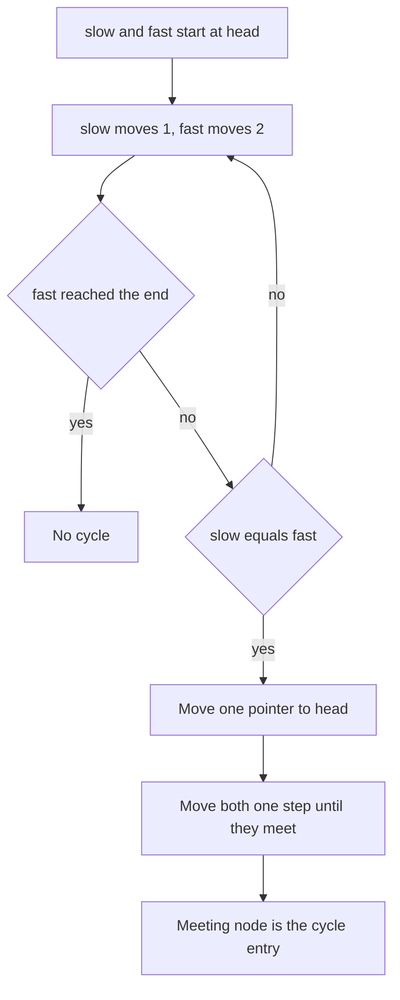

## The hook

A linked list might end, or it might loop back on itself forever. How do you tell, without a hash set of visited nodes? Walk it and you will either reach the end or walk in circles forever, and you cannot know which is happening.

There is a neat answer that uses no extra memory at all: send two runners down the list at different speeds. If there is a loop, the fast one will lap the slow one. The same trick then tells you exactly where the loop begins, and as a bonus, finds the middle of a list in one pass.

## The intuition

:::analogy
Picture two runners on a track. The tortoise jogs one step at a time; the hare runs two. If the track is a straight road with an end, the hare simply reaches the finish first. But if the road bends into a circular lap, the hare enters the loop, keeps going round, and eventually comes up behind the tortoise and catches it. Catching up can only happen on a loop.
:::

The [[slow pointer]] is the tortoise, the [[fast pointer]] is the hare, and a [[cycle]] is the circular lap. This is [[Floyd's algorithm]].

## How it works

### Detecting a cycle

Start both pointers at the head. Each step, slow moves one node and fast moves two.

- If fast reaches null (or fast's next is null), the list ends: no cycle.
- If slow and fast ever point to the same node, there is a cycle.

Why they must meet: once both are inside the loop, consider the distance from slow forward to fast. Each step, fast moves two and slow moves one, so the gap changes by exactly one. A gap that changes by one each step must pass through zero, so fast cannot skip over slow.

### Finding the cycle entry

Let a be the distance from the head to the [[cycle entry]], b the distance from the entry to the meeting point along the loop, and L the loop length. When they meet:

- slow has walked a + b steps,
- fast has walked 2(a + b), which is a + b plus some whole number k of extra laps: 2(a + b) = a + b + kL.

So a + b = kL, which means a = kL − b. In words: walking a steps from the meeting point lands exactly on the entry, because it completes the rest of the lap (L − b) plus whole laps. So reset one pointer to the head and move both one step at a time; they meet at the entry.



### Finding the middle

Without a cycle, when fast reaches the end, slow has gone half as far: it is at the middle. For an even-length list, the exact middle chosen depends on the loop condition, which interview problems specify.

:::insight
Two pointers moving at different speeds turn questions about the shape of a structure, "does it loop?", "where is the middle?", into questions about distance, which you can answer with simple arithmetic and O(1) memory.
:::

### Beyond linked lists

Anything that repeatedly applies a function x → f(x) forms a "list" where the next pointer is f. If values come from a finite set, the sequence must eventually loop. That is how fast and slow pointers solve *Happy Number* (repeatedly summing squares of digits) and *Find the Duplicate Number* (treating each value as a pointer to an index).

## Walk through an example

List: 1 → 2 → 3 → 4 → 5 → 6, and 6 points back to 3. So a = 2 (nodes 1, 2 before the entry 3), and the loop 3 → 4 → 5 → 6 → 3 has L = 4.

| Step | slow | fast |
|---|---|---|
| 0 | 1 | 1 |
| 1 | 2 | 3 |
| 2 | 3 | 5 |
| 3 | 4 | 3 |
| 4 | 5 | 5 |

They meet at node 5. Now move one pointer to the head:

| Step | pointer from head | pointer from meeting |
|---|---|---|
| 0 | 1 | 5 |
| 1 | 2 | 6 |
| 2 | 3 | 3 |

They meet at node 3, the entry. Check the formula: b = 2 (3 → 4 → 5), L = 4, and a = L − b = 2. ✓

:::try-this
For the list 1 → 2 → 3 → 4 → 5 with no cycle, trace slow and fast until fast cannot move two steps. Where is slow? (slow: 1, 2, 3; fast: 1, 3, 5, then fast's next is null. Slow is at 3, the middle.)
:::

## The code

```pseudo
has_cycle(head):
    slow = fast = head
    while fast and fast.next:
        slow = slow.next
        fast = fast.next.next
        if slow == fast: return true
    return false

cycle_entry(head):
    slow = fast = head
    loop until slow == fast (return none if fast reaches the end)
    slow = head
    while slow != fast:
        slow = slow.next; fast = fast.next
    return slow
```

```cpp
#include <bits/stdc++.h>
using namespace std;

struct Node { int val; Node* next = nullptr; Node(int v) : val(v) {} };

Node* cycleEntry(Node* head) {
    Node *slow = head, *fast = head;
    while (fast && fast->next) {
        slow = slow->next;
        fast = fast->next->next;
        if (slow == fast) {
            slow = head;
            while (slow != fast) { slow = slow->next; fast = fast->next; }
            return slow;
        }
    }
    return nullptr;  // no cycle
}

int main() {
    vector<Node*> n;
    for (int i = 1; i <= 6; i++) n.push_back(new Node(i));
    for (int i = 0; i < 5; i++) n[i]->next = n[i + 1];
    n[5]->next = n[2];                       // 6 -> 3
    Node* e = cycleEntry(n[0]);
    cout << (e ? e->val : -1) << '\n';       // 3
}
```

## Complexity

- **Time:** O(n). Before the pointers meet, slow travels at most the straight part plus one lap; finding the entry takes at most another a steps.
- **Space:** O(1), just two pointers, compared with O(n) for a hash set of visited nodes.

## Common mistakes

:::warning
Common misconception: "the meeting point is where the cycle starts." It is just some node inside the loop. The second phase, resetting one pointer to the head and stepping both at the same speed, is what finds the entry.
:::

- **Null checks:** the loop must check `fast && fast->next` before moving fast two steps.
- **Comparing values instead of nodes**: different nodes can hold the same value; compare pointers.
- **Moving both pointers twice in phase two**: in the second phase, both move one step.
- **Find the Duplicate Number**: start both pointers at index 0 and treat `nums[i]` as the next index; the duplicate is the cycle entry.

## Practice problems

*Linked List Cycle* and *Middle of the Linked List* are the basic uses. *Linked List Cycle II* needs the entry-finding phase. *Happy Number* applies the idea to a number sequence. *Find the Duplicate Number* is the classic disguised version: an array of n + 1 values in 1..n, solved in O(1) space by treating values as next pointers.

## Key takeaways

- Moving one pointer one step and another two steps detects a cycle: they meet only if the structure loops.
- Inside a loop the gap between them shrinks by one each step, so the fast pointer can never skip over the slow one.
- To find the cycle entry, reset one pointer to the head and move both one step at a time until they meet.
- Without a cycle, the slow pointer is at the middle when the fast pointer reaches the end.
- Any repeated function on a finite set forms such a sequence, which is how Happy Number and Find the Duplicate Number are solved in O(1) space.
