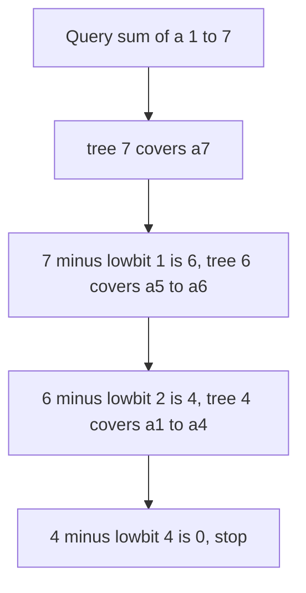

## The hook

A shopkeeper records each day's takings and is constantly asked, "how much did we make from day 1 to day d?". A running total answers that instantly, until an old entry is corrected. Then every running total after it must be rewritten, which for a year of records is hundreds of updates for a single fix.

Plain prefix sums are fast to query and slow to update; a plain array is the reverse. Peter Fenwick published a structure in 1994 that does both in O(log n), using nothing but an array and one bit trick. It is about fifteen lines of code and one of the best value-for-effort tools in interviews and contests.

## The intuition

:::analogy
Instead of one running total per day, the shopkeeper keeps a pyramid of savings jars. Some jars hold a single day's takings, some hold two days, some four, some eight, arranged so that any stretch of days from day 1 can be paid for by emptying a few jars, never more than one jar of each size. When an old day is corrected, only the few jars that contain that day need adjusting: one of each size on the way up the pyramid.
:::

The jars are a [[Fenwick tree]]. Jar i holds the sum of a block ending at day i, and the block's length is the [[lowest set bit]] of i:

| i | binary | i & -i | tree[i] covers |
|---|---|---|---|
| 1 | 0001 | 1 | a[1] |
| 2 | 0010 | 2 | a[1..2] |
| 3 | 0011 | 1 | a[3] |
| 4 | 0100 | 4 | a[1..4] |
| 5 | 0101 | 1 | a[5] |
| 6 | 0110 | 2 | a[5..6] |
| 7 | 0111 | 1 | a[7] |
| 8 | 1000 | 8 | a[1..8] |

That block is the [[responsibility range]] of i: (i - lowbit(i), i]. Odd indices hold one element; multiples of 4 hold four; index 8 holds eight.

## How it works

### Prefix query: strip bits off

To get a[1..i], add tree[i], then jump to i - lowbit(i), whose range ends exactly where tree[i]'s began, and repeat until i is 0. Each jump clears one bit of i, so there are at most log₂ n jumps. That is the [[prefix query]]:

```
sum(i):  s = 0; while i > 0: s += tree[i]; i -= i & -i
```

Any range sum is sum(r) - sum(l - 1), exactly as with plain prefix sums from [Answering a Million Range Questions Instantly](article:dsa-prefix-sums).

### Point update: add bits on

When a[i] changes by d, every jar whose range contains i must change by d. Those are i, then i + lowbit(i), then that plus its lowest set bit, and so on, until past n. Each step moves to a larger power-of-two block, so again at most log₂ n steps. That is the [[point update]]:

```
add(i, d):  while i <= n: tree[i] += d; i += i & -i
```

Why i & -i? In two's complement, -i flips every bit of i and adds 1, which leaves only the lowest 1 bit in common. The bit tricks are in [A Row of Light Switches Inside Every Number](article:dsa-bit-basics).

### Building

Calling add for every element builds the tree in O(n log n). An O(n) build is also easy: copy a into tree, then for each i, add tree[i] into tree[i + lowbit(i)] if that index exists.

### Counting smaller elements to the right

*Count of Smaller Numbers After Self* asks, for each element, how many later elements are smaller. Use a Fenwick tree over values instead of positions:

- compress the values to ranks 1..m;
- scan from right to left; for each value with rank k, the answer is sum(k - 1), the count of smaller values already seen to its right;
- then add(k, 1).

The total of all the answers is the number of inversions, the same quantity merge sort counts in [Merging Two Piles of Exam Papers](article:dsa-merge-sort-inversions).

### Range update, point query

To add d to every element in [l, r] and read single elements, store a difference array in the tree: add(l, d) and add(r + 1, -d). Then a[i] is sum(i).

| Need | Tree stores | Update | Query |
|---|---|---|---|
| Point update, range sum | values | add(i, d) | sum(r) - sum(l - 1) |
| Range update, point value | differences | add(l, d), add(r + 1, -d) | sum(i) |
| Count smaller to the right | counts per value rank | add(rank, 1) | sum(rank - 1) |



:::insight
Every number is a sum of distinct powers of two, so every prefix 1..i splits into at most log n blocks whose lengths are those powers. A Fenwick tree stores exactly those blocks, which is why both queries and updates touch only one block per bit.
:::

## Walk through an example

a = [3, 2, -1, 6, 5, 4, -3, 3], positions 1 to 8.

| i | tree[i] covers | tree[i] |
|---|---|---|
| 1 | a[1] | 3 |
| 2 | a[1..2] | 5 |
| 3 | a[3] | -1 |
| 4 | a[1..4] | 10 |
| 5 | a[5] | 5 |
| 6 | a[5..6] | 9 |
| 7 | a[7] | -3 |
| 8 | a[1..8] | 19 |

### Query sum(7)

| Step | i (binary) | Add | Running sum | Next i |
|---|---|---|---|---|
| 1 | 7 (111) | tree[7] = -3 | -3 | 6 |
| 2 | 6 (110) | tree[6] = 9 | 6 | 4 |
| 3 | 4 (100) | tree[4] = 10 | 16 | 0 |

sum(7) = 16, which matches 3 + 2 - 1 + 6 + 5 + 4 - 3.

### Update: add 4 to a[3]

| Step | i (binary) | tree[i] before → after | Next i |
|---|---|---|---|
| 1 | 3 (011) | -1 → 3 | 4 |
| 2 | 4 (100) | 10 → 14 | 8 |
| 3 | 8 (1000) | 19 → 23 | 16, past n |

Now sum(7) = tree[7] + tree[6] + tree[4] = -3 + 9 + 14 = 20, four more than before. tree[5], tree[6] and tree[7] did not change, because their ranges do not contain position 3.

### Smaller numbers to the right of [5, 2, 6, 1, 3]

Ranks: 1 → 1, 2 → 2, 3 → 3, 5 → 4, 6 → 5. Scanning from the right:

| Value | Rank | Smaller already seen, sum(rank - 1) | Then add |
|---|---|---|---|
| 3 | 3 | 0 | rank 3 |
| 1 | 1 | 0 | rank 1 |
| 6 | 5 | 2 (the 3 and the 1) | rank 5 |
| 2 | 2 | 1 (the 1) | rank 2 |
| 5 | 4 | 3 (3, 1 and 2) | rank 4 |

Answers in original order: [3, 1, 2, 0, 0], and 6 inversions in total.

:::try-this
Which tree entries does sum(13) visit, and which does add(5, d) touch when n = 16? (13 is 1101: visit 13, then 12 (1100), then 8 (1000), then 0. add(5) visits 5 (0101), 6 (0110), 8 (1000), 16 (10000). Both take at most four steps for 16 elements.)
:::

:::warning
Common misconception: "A Fenwick tree can answer range minimum queries the same way it answers sums." Sums work because a range sum is sum(r) - sum(l - 1): subtraction undoes the prefix before l. Minimum has no such undo, so a Fenwick tree only gives prefix minimums, and even those break when values increase. For range minimum with updates, use a segment tree.
:::

## The code

```pseudo
add(i, d):                                    # 1-indexed
    while i <= n: tree[i] += d; i += i & -i

sum(i):
    s = 0
    while i > 0: s += tree[i]; i -= i & -i
    return s

range_sum(l, r): return sum(r) - sum(l - 1)
```

```cpp
#include <bits/stdc++.h>
using namespace std;
using ll = long long;

struct Fenwick {
    int n;
    vector<ll> t;
    explicit Fenwick(int n) : n(n), t(n + 1, 0) {}
    explicit Fenwick(const vector<ll>& a) : n(a.size()), t(a.size() + 1, 0) {    // O(n) build
        for (int i = 1; i <= n; i++) {
            t[i] += a[i - 1];
            int p = i + (i & -i);
            if (p <= n) t[p] += t[i];
        }
    }
    void add(int i, ll d) { for (; i <= n; i += i & -i) t[i] += d; }
    ll sum(int i) const { ll s = 0; for (; i > 0; i -= i & -i) s += t[i]; return s; }
    ll rangeSum(int l, int r) const { return sum(r) - sum(l - 1); }
};

vector<int> countSmaller(const vector<int>& nums) {
    vector<int> vals(nums.begin(), nums.end());
    sort(vals.begin(), vals.end());
    vals.erase(unique(vals.begin(), vals.end()), vals.end());
    Fenwick f(vals.size());
    vector<int> ans(nums.size());
    for (int i = nums.size() - 1; i >= 0; i--) {
        int rank = lower_bound(vals.begin(), vals.end(), nums[i]) - vals.begin() + 1;
        ans[i] = f.sum(rank - 1);                  // smaller values already to the right
        f.add(rank, 1);
    }
    return ans;
}

int main() {
    Fenwick f(vector<ll>{3, 2, -1, 6, 5, 4, -3, 3});
    for (int i = 1; i <= 8; i++) cout << f.t[i] << ' ';
    cout << '\n';                                  // 3 5 -1 10 5 9 -3 19
    cout << f.sum(7) << ' ' << f.rangeSum(3, 6) << ' ';
    f.add(3, 4);
    cout << f.sum(7) << '\n';                      // 16 14 20
    for (int x : countSmaller({5, 2, 6, 1, 3})) cout << x << ' ';
    cout << '\n';                                  // 3 1 2 0 0
}
```

## Complexity

- **Point update and prefix query: O(log n),** one step per bit of the index.
- **Build: O(n)** with the parent-propagation loop, or O(n log n) with n updates.
- **Space: O(n),** a single array of n + 1 values.
- **Count of smaller after self: O(n log n)** including the sort for compression.

## Common mistakes

- **Using index 0,** where i & -i is 0 and the update loop never ends; shift 0-based positions by one.
- **Forgetting that the tree stores block sums,** and reading tree[i] as if it were a[i] or a prefix sum.
- **Using int** when sums of up to 2 × 10⁵ values of 10⁹ overflow; use 64-bit.
- **Setting a value instead of adding:** to set a[i] = v, add v - a[i] and keep a copy of the array.
- **Compressing values wrongly** in counting problems, so equal values get different ranks or smaller values get larger ones.
- **Trying range minimum with a Fenwick tree,** which has no subtraction to undo a prefix.

## Practice problems

*Range Sum Query - Mutable* and the CSES *Dynamic Range Sum Queries* are the basic structure. *Count of Smaller Numbers After Self* is the Fenwick tree over value ranks. For range minimum, range maximum or more general operations, the next tool is the segment tree, and for the contest-depth version with lazy propagation see [A Tournament Bracket for Your Array](article:cp-segment-tree).

## Key takeaways

- A Fenwick tree stores, at index i, the sum of the block of length lowbit(i) ending at i, where lowbit(i) = i & -i.
- A prefix sum adds tree[i] and strips the lowest set bit until i reaches 0, visiting at most log n entries.
- A point update adds to tree[i] and adds the lowest set bit until i passes n, touching every block that contains i.
- Range sums are two prefix queries subtracted, and range updates with point queries store a difference array instead.
- The structure is 1-indexed because zero has no set bits, and it supports sums but not range minimum.
