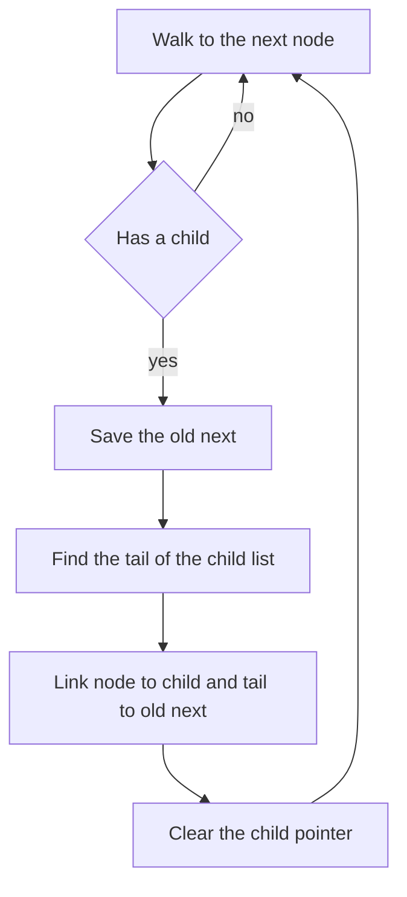

## The hook

A cabinet has a row of drawers. Some drawers contain smaller drawers, and some of those contain smaller ones still. You want to lay everything out on a single long shelf in the order you would meet it if you opened each drawer completely before moving to the next. Done by hand, it is easy. Done with pointers, it is easy to drop a whole row of drawers on the floor.

Flattening shows up in three common forms: a [[multilevel list]] with child pointers, a binary tree turned into a right-leaning chain, and an iterator over nested lists. All three are depth-first walks; the art is in rewiring without losing anything.

## The problem

| Problem | Input | Flattened |
|---|---|---|
| Multilevel doubly linked list | 1 – 2 – 3 – 4, where 2 has child 5 – 6 and 6 has child 7 | 1 2 5 6 7 3 4 |
| Binary tree to linked list | root 1, left subtree 2 with children 3 and 4, right child 5 with right child 6 | 1 2 3 4 5 6 as a chain of right pointers |
| Nested list iterator | [1, [2, [3, 4]], 5] | next() returns 1, 2, 3, 4, 5 |

In each, children come before the next sibling: that is [[depth-first order]].

## The obvious approach

Collect every element into an array with a recursive depth-first walk, then rebuild the structure from the array. It works and is O(n), but it uses O(n) extra memory and, for the lists and trees, it rebuilds instead of rewiring. The follow-ups ask for in-place rewiring or for an iterator that does not flatten everything up front.

## The key insight

:::analogy
Picture taking out a drawer that has a smaller drawer inside it. You pull the smaller drawer's whole row out, lay it on the shelf right after the outer drawer, and push the rest of the outer row along to make room. You never take the small row apart; you just connect its first item to the outer drawer and its last item to whatever came after. Then you carry on along the shelf, and if one of the items you just laid down has its own small drawer, you deal with it when you reach it.
:::

That is a [[splice]]. For a node with a child:

- remember next = node.next;
- find the child list's tail by walking it;
- link node → child (and child.prev = node), and tail → next (and next.prev = tail, if next exists);
- clear node.child and continue from node.next, which is now the child.

Grandchildren are handled naturally: once a child list is spliced in, the main walk reaches its nodes and splices their children in turn.

The binary tree version is the same move on a tree. For a node with a left subtree, find the rightmost node of that left subtree, which is the last node of the left part in [[preorder]], attach the node's right subtree to it, move the left subtree to the right and clear the left pointer. Then move right.

The nested list iterator does it with a stack instead of rewiring: keep a stack of positions inside the lists you are currently in, and in `hasNext`, unpack lists until the top of the stack is an integer. That is [[lazy flattening]].



:::insight
Flattening is a depth-first walk that rewires as it goes. Splicing a whole child chain needs only its first and last nodes, so you can flatten in place in O(n) time, and a stack gives the same order when the structure must not be changed.
:::

## Walk through an example

### The multilevel list 1 – 2 – 3 – 4, with 2 → child 5 – 6 and 6 → child 7

| At node | Child? | Action | List afterwards |
|---|---|---|---|
| 1 | no | move on | 1 2 3 4 |
| 2 | 5 – 6 | tail of the child is 6; link 2 → 5 and 6 → 3 | 1 2 5 6 3 4 |
| 5 | no | move on | 1 2 5 6 3 4 |
| 6 | 7 | tail is 7; link 6 → 7 and 7 → 3 | 1 2 5 6 7 3 4 |
| 7, 3, 4 | no | move on | 1 2 5 6 7 3 4 |

Every splice changed only four pointers plus the child pointer. In the drawer picture, the small drawer 5 – 6 was laid out after 2 as one block, and only later, when the walk reached 6, was its own tiny drawer 7 laid out after it.

### Binary tree to a right chain

The tree has root 1 with left 2 and right 5; 2 has children 3 and 4; 5 has right child 6.

| At node | Left subtree's rightmost node | Rewire | Preorder chain so far |
|---|---|---|---|
| 1 | 4 | 4.right = 5; 1.right = 2; 1.left = null | 1 2 3 4 5 6 |
| 2 | 3 | 3.right = 4; 2.right = 3; 2.left = null | 1 2 3 4 5 6 |
| 3, 4, 5, 6 | no left subtree | move right | 1 2 3 4 5 6 |

The result is a chain 1 → 2 → 3 → 4 → 5 → 6 along right pointers, in preorder, with every left pointer null, using O(1) extra space.

### Nested list iterator on [1, [2, [3, 4]], 5]

| Call | Stack work | Returns |
|---|---|---|
| next | top is 1 | 1 |
| next | top is the list [2, [3, 4]], unpack it; top is 2 | 2 |
| next | top is [3, 4], unpack; top is 3 | 3 |
| next | top is 4 | 4 |
| next | inner lists exhausted and popped; top is 5 | 5 |
| hasNext | everything exhausted | false |

The stack only ever holds the current path through the nesting, never the whole flattened list.

:::try-this
Flatten the multilevel list 1 – 2 where 1 has child 3 – 4 and 3 has child 5. What is the order, and how many splices happen? (At 1, splice 3 – 4 between 1 and 2: 1 3 4 2. At 3, splice 5 between 3 and 4: 1 3 5 4 2. Two splices.)
:::

:::warning
Common misconception: "Point node.next at the child and carry on." That loses the old next node and everything after it, because nothing else points to it. Save node.next before rewiring, and in a doubly linked list also fix the prev pointers at both ends of the splice, or backward traversal breaks.
:::

## The code

```pseudo
flatten_multilevel(head):
    node = head
    while node:
        if node.child:
            next = node.next; tail = node.child
            while tail.next: tail = tail.next
            node.next = node.child; node.child.prev = node
            tail.next = next; if next: next.prev = tail
            node.child = null
        node = node.next

flatten_tree(root):
    node = root
    while node:
        if node.left:
            r = node.left; while r.right: r = r.right
            r.right = node.right; node.right = node.left; node.left = null
        node = node.right
```

```cpp
#include <bits/stdc++.h>
using namespace std;

struct DNode {
    int val;
    DNode *prev = nullptr, *next = nullptr, *child = nullptr;
    DNode(int v) : val(v) {}
};

DNode* chain(const vector<int>& v) {
    DNode *head = nullptr, *tail = nullptr;
    for (int x : v) {
        DNode* n = new DNode(x);
        if (!head) head = n;
        else tail->next = n, n->prev = tail;
        tail = n;
    }
    return head;
}

DNode* flattenMultilevel(DNode* head) {
    for (DNode* node = head; node; node = node->next) {
        if (!node->child) continue;
        DNode* next = node->next;                       // save before rewiring
        DNode* tail = node->child;
        while (tail->next) tail = tail->next;           // one level only
        node->next = node->child, node->child->prev = node;
        tail->next = next;
        if (next) next->prev = tail;
        node->child = nullptr;
    }
    return head;
}

struct TNode {
    int val;
    TNode *left = nullptr, *right = nullptr;
    TNode(int v, TNode* l = nullptr, TNode* r = nullptr) : val(v), left(l), right(r) {}
};

void flattenTree(TNode* root) {                         // preorder chain along right pointers
    for (TNode* node = root; node; node = node->right) {
        if (!node->left) continue;
        TNode* r = node->left;
        while (r->right) r = r->right;                  // last node of the left part in preorder
        r->right = node->right;
        node->right = node->left, node->left = nullptr;
    }
}

struct Nested {                                         // an integer or a list
    bool isInt;
    int value = 0;
    vector<Nested> items;
};
Nested I(int v) { return {true, v, {}}; }
Nested L(vector<Nested> v) { return {false, 0, v}; }

class NestedIterator {
    vector<pair<const vector<Nested>*, size_t>> st;     // (list, position) for each open level
public:
    NestedIterator(const vector<Nested>& top) { st.push_back({&top, 0}); }
    bool hasNext() {                                    // unpack lazily until an integer is on top
        while (!st.empty()) {
            auto& [lst, pos] = st.back();
            if (pos == lst->size()) { st.pop_back(); continue; }
            const Nested& x = (*lst)[pos];
            if (x.isInt) return true;
            pos++;
            st.push_back({&x.items, 0});
        }
        return false;
    }
    int next() {
        hasNext();
        auto& [lst, pos] = st.back();
        return (*lst)[pos++].value;
    }
};

int main() {
    DNode* h = chain({1, 2, 3, 4});
    h->next->child = chain({5, 6});
    h->next->child->next->child = chain({7});
    DNode* last = nullptr;
    for (DNode* p = flattenMultilevel(h); p; p = p->next) cout << p->val << ' ', last = p;
    cout << "| back:";
    for (DNode* p = last; p; p = p->prev) cout << ' ' << p->val;
    cout << '\n';                                       // 1 2 5 6 7 3 4 | back: 4 3 7 6 5 2 1

    TNode* t = new TNode(1, new TNode(2, new TNode(3), new TNode(4)), new TNode(5, nullptr, new TNode(6)));
    flattenTree(t);
    for (TNode* p = t; p; p = p->right) cout << p->val << (p->left ? "!" : "") << ' ';
    cout << '\n';                                       // 1 2 3 4 5 6

    vector<Nested> data = {I(1), L({I(2), L({I(3), I(4)})}), I(5)};
    NestedIterator it(data);
    while (it.hasNext()) cout << it.next() << ' ';
    cout << '\n';                                       // 1 2 3 4 5
}
```

The multilevel test walks the flattened list forwards and then backwards from the last node, which checks that every prev pointer was fixed too. The tree test would print an exclamation mark after any node whose left pointer was not cleared.

## Complexity

- **Multilevel list: O(n) time, O(1) extra space.** Each node is visited once by the main walk and at most once by a tail search for its own level.
- **Binary tree: O(n) time, O(1) extra space.** Each rightmost search walks down a right spine of a left subtree, and those spines do not overlap across the whole run, so the total is linear.
- **Nested iterator: O(1) amortised per call, O(depth) space,** because each list is pushed once and popped once.
- **Recursive or explicit-stack versions** of the first two take O(n) time and O(depth) space, and are fine answers when in-place O(1) is not required.

## Common mistakes

- **Losing node.next** by overwriting it before saving it.
- **Forgetting prev pointers** in the doubly linked list, so the list works forwards but not backwards.
- **Leaving child pointers set,** which the multilevel problem requires to be null after flattening.
- **Leaving left pointers set** in the tree version.
- **Walking the whole remaining list** to find the child's tail, instead of only the child's level, which can make it quadratic.
- **Doing the unpacking in next() only,** so hasNext() returns true for nested empty lists like [[], []] that contain no integers.

## Practice problems

*Flatten a Multilevel Doubly Linked List* is the splice walkthrough. *Flatten Binary Tree to Linked List* is the same move on a tree, with the preorder chain built along right pointers; see [Four Ways to Tour a Family Tree](article:dsa-tree-traversals) for preorder itself. *Flatten Nested List Iterator* is lazy flattening with an explicit stack, the approach from [The Last Plate In Is the First Plate Out](article:dsa-stack-patterns).

## Key takeaways

- Flattening nested structures is a depth-first walk that puts each child's contents right after its parent and before the parent's next sibling.
- To splice a child list into a doubly linked list, save the old next, find the child's tail, and rewire the four pointers at the two ends, then clear the child pointer.
- A binary tree flattens into a preorder chain in place by attaching each node's right subtree to the rightmost node of its left subtree.
- An iterator over nested lists can flatten lazily with a stack of positions, using space proportional to the nesting depth.
- Always save a pointer before overwriting it; losing next is the bug behind almost every broken flatten.
