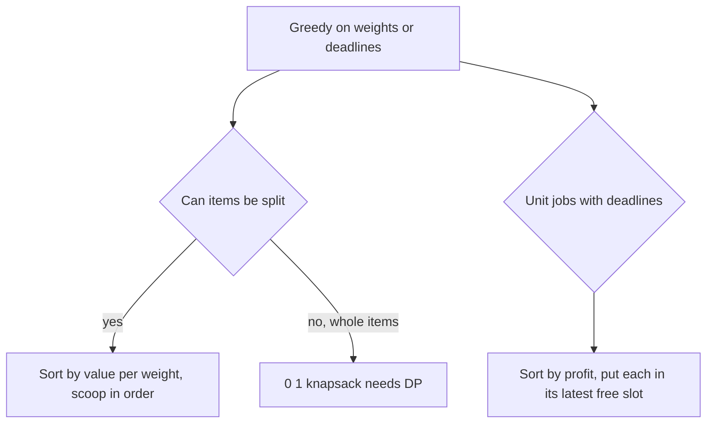

## The hook

A spice trader has a bag that holds 30 grams and a stall full of open sacks: saffron, cardamom, pepper, cumin. Each sack has a price per gram, and the trader can scoop any amount. The best plan is obvious once you see it: fill up on the most valuable spice per gram, then the next, and so on until the bag is full.

Now replace the sacks with sealed jars that must be taken whole. The obvious plan can fail, and that difference between "scoop" and "jar" is one of the most useful lessons about greedy algorithms.

## The problem

Two classic problems share this article.

**Fractional knapsack.** Items have a value and a weight, and a bag has a capacity. You may take any fraction of any item, earning that fraction of its value. Maximise the total value.

**Job sequencing with deadlines.** Each job takes one unit of time and has a deadline and a profit. You earn the profit only if the job finishes by its deadline, and you run one job at a time. Maximise the total profit.

For spices worth 60, 90, 40 and 24 with weights 5, 10, 20 and 15 grams and a 30-gram bag, the best value is 180. For six jobs with deadlines 3, 1, 2, 1, 3, 2 and profits 40, 35, 30, 25, 20, 10, the best profit is 105.

## The obvious approach

For the knapsack, the obvious idea is to take the most valuable item first, or the lightest first. Both fail even when you can scoop:

| Rule on the spice stall, 30 grams | Taken | Value |
|---|---|---|
| Highest total value first | all 10 g of cardamom (90), all 5 g of saffron (60), 15 g of pepper (30) | 180 |
| Lightest first | saffron 5 g, cardamom 10 g, cumin 15 g | 174 |
| Best value per gram first | saffron, cardamom, 15 g of pepper | 180 |

Highest value happens to tie here, but it ignores weight entirely: one heavy, valuable sack with a poor price per gram would fool it.

For jobs, the obvious idea is to run jobs in order of deadline, or to run the most profitable jobs first in the earliest free slots. Earliest deadline ignores profit; earliest free slot wastes slots that tight-deadline jobs need, as the walkthrough shows.

## The key insight

:::analogy
At the spice stall, think about a single gram of space in the bag. Whatever is in that gram, you would swap it for a gram of something more valuable per gram if any were left. So the bag is best when every gram holds the most valuable spice still available: scoop the richest sack until it is empty, then the next richest. Sealed jars break this, because you cannot swap one gram of a jar; you must swap the whole jar, and the space it leaves may not fit anything.
:::

### Fractional knapsack: sort by value density

In [[fractional knapsack]], compute each item's [[value density]], value divided by weight. Sort in decreasing order. Take whole items while they fit, then a fraction of the next one, and stop. The exchange argument from [A Bus Conductor Who Never Reseats Anyone](article:dsa-greedy-exchange) is the gram swap above: if an optimal bag holds any gram of lower density while a higher-density gram is left, swapping them raises the value, so the optimal bag must look like the greedy one.

### Why 0/1 knapsack is different

In [[0/1 knapsack]], the gram swap is not allowed, because a jar cannot be split. Taking the densest jar may leave space that nothing fills. With a 10-gram bag and jars (value 9, weight 6), (5, 5), (5, 5), density first takes the 9 and wastes 4 grams, while the two 5-gram jars give 10. Whole items need the DP in [Packing a Backpack With a Weight Limit](article:dsa-knapsack-01).

*Maximum Units on a Truck* looks like 0/1 knapsack but is really the fractional one: all boxes of one type are identical and each takes one slot, so "taking part of a type" is just taking fewer boxes, and the best units per box first is exact.

### Job sequencing: most profit first, latest free slot

For [[job sequencing]], sort jobs by profit, highest first. Place each job in the [[latest free slot]] at or before its deadline; if every such slot is taken, skip the job.

- **Why highest profit first:** if a profitable job is skipped in some optimal schedule while a cheaper job uses a slot it could have taken, swapping them raises the profit.
- **Why the latest slot:** a slot at time t can serve any job whose deadline is t or later. Early slots serve the most jobs, so you should spend them last.

Finding the latest free slot by scanning backwards is O(deadline) per job. A union-find structure makes it nearly O(1): each slot points to the nearest free slot at or before it, and filling slot t links it to t - 1.

An equivalent view sorts by deadline instead and keeps a min-heap of chosen profits: add each job, and whenever the heap holds more jobs than the current deadline allows, drop the smallest profit. That is the regret heap from Course Schedule III in [A Chef Rotating Dishes So None Burns](article:dsa-task-scheduling).

### A cousin: every task must be done

CSES *Tasks and Deadlines* gives tasks with durations and deadlines. You must do all of them, and each earns its deadline minus its finishing time, which can be negative. The deadlines add up to a fixed number whatever the order, so maximising the reward means minimising the sum of finishing times: shortest task first, by the adjacent swap.



:::insight
Greedy by ratio is exact whenever any leftover space can be filled with a fraction of something. The moment items are indivisible, space can be wasted, the exchange argument breaks, and dynamic programming takes over.
:::

## Walk through an example

### The spice stall, 30 grams

| Spice | Value | Grams | Value per gram | Taken | Running value | Space left |
|---|---|---|---|---|---|---|
| Saffron | 60 | 5 | 12 | 5 g | 60 | 25 |
| Cardamom | 90 | 10 | 9 | 10 g | 150 | 15 |
| Pepper | 40 | 20 | 2 | 15 g, three quarters | 180 | 0 |
| Cumin | 24 | 15 | 1.6 | none | 180 | 0 |

The bag is full at 180. Only one item, pepper, is split.

### Job sequencing

Jobs as (name, deadline, profit): J1 (3, 40), J2 (1, 35), J3 (2, 30), J4 (1, 25), J5 (3, 20), J6 (2, 10). Three slots exist, because the largest deadline is 3.

| Job (by profit) | Deadline | Latest free slot ≤ deadline | Slots 1, 2, 3 after |
|---|---|---|---|
| J1, 40 | 3 | 3 | -, -, J1 |
| J2, 35 | 1 | 1 | J2, -, J1 |
| J3, 30 | 2 | 2 | J2, J3, J1 |
| J4, 25 | 1 | none | full |
| J5, 20 | 3 | none | full |
| J6, 10 | 2 | none | full |

Profit 40 + 35 + 30 = 105, which a brute force over all orders confirms.

Compare the "earliest free slot" rule: J1 would take slot 1, J2 (deadline 1) would then find no slot, and the schedule would lose 35.

### Tasks and Deadlines

Tasks as (duration, deadline): (6, 10), (8, 15), (5, 12).

| Order | Finishing times | Reward: sum of deadline minus finish |
|---|---|---|
| 5, 6, 8 (shortest first) | 5, 11, 19 | 7 - 1 - 4 = 2 |
| 6, 5, 8 | 6, 11, 19 | 4 + 1 - 4 = 1 |
| 8, 6, 5 (longest first) | 8, 14, 19 | 7 - 4 - 7 = -4 |

Shortest first gives the best reward, 2. The deadlines sum to 37 in every order; only the finishing times change.

:::try-this
Add a seventh job, J7 with deadline 3 and profit 38, to the job list. What is the best profit now? (Sorted by profit: J1 40 takes slot 3, J7 38 takes slot 2, J2 35 takes slot 1. J3 now finds slots 1 and 2 full and is skipped. Profit 40 + 38 + 35 = 113.)
:::

:::warning
Common misconception: "Value per weight first is the greedy for knapsack, so it solves knapsack." It solves only the fractional version. For whole items it can be arbitrarily bad: one tiny item with a huge density can block one large item that is worth far more and exactly fills the bag.
:::

## The code

```pseudo
fractional_knapsack(items, capacity):
    sort items by value / weight, descending
    total = 0
    for (v, w) in items:
        take = min(w, capacity)
        total += v * take / w; capacity -= take
        if capacity == 0: break
    return total

job_sequencing(jobs):                        # each job: (deadline, profit), unit time
    sort jobs by profit, descending
    parent[t] = t for t in 0 .. max_deadline  # slot 0 means "no slot"
    for (d, p) in jobs:
        t = find(min(d, max_deadline))       # latest free slot <= d
        if t > 0: profit += p; parent[t] = t - 1
    return profit
```

```cpp
#include <bits/stdc++.h>
using namespace std;

double fractionalKnapsack(vector<pair<int, int>> items, int cap) {   // (value, weight)
    sort(items.begin(), items.end(), [](auto& a, auto& b) {
        return (long long)a.first * b.second > (long long)b.first * a.second;   // compare densities exactly
    });
    double total = 0;
    for (auto& [v, w] : items) {
        if (cap == 0) break;
        int take = min(w, cap);
        total += (double)v * take / w, cap -= take;
    }
    return total;
}

struct Slots {                                       // union-find: latest free slot at or before t
    vector<int> p;
    explicit Slots(int n) : p(n + 1) { iota(p.begin(), p.end(), 0); }
    int find(int t) { return p[t] == t ? t : p[t] = find(p[t]); }
};

long long jobSequencing(vector<pair<int, int>> jobs) {               // (deadline, profit)
    sort(jobs.begin(), jobs.end(), [](auto& a, auto& b) { return a.second > b.second; });
    int maxD = 0;
    for (auto& j : jobs) maxD = max(maxD, j.first);
    maxD = min(maxD, (int)jobs.size());              // n jobs never need more than n slots
    Slots s(maxD);
    long long profit = 0;
    for (auto& [d, p] : jobs) {
        int t = s.find(min(d, maxD));
        if (t > 0) profit += p, s.p[t] = t - 1;      // fill slot t; next search falls to t - 1
    }
    return profit;
}

long long tasksAndDeadlines(vector<pair<int, int>> tasks) {          // (duration, deadline)
    sort(tasks.begin(), tasks.end());                                // shortest first
    long long t = 0, reward = 0;
    for (auto& [a, d] : tasks) t += a, reward += d - t;
    return reward;
}

int main() {
    cout << fractionalKnapsack({{60, 5}, {90, 10}, {40, 20}, {24, 15}}, 30) << '\n';          // 180
    cout << fractionalKnapsack({{9, 6}, {5, 5}, {5, 5}}, 10) << '\n';                         // 13
    vector<pair<int, int>> jobs = {{3, 40}, {1, 35}, {2, 30}, {1, 25}, {3, 20}, {2, 10}};
    cout << jobSequencing(jobs) << ' ';
    jobs.push_back({3, 38});
    cout << jobSequencing(jobs) << '\n';                                                      // 105 113
    cout << tasksAndDeadlines({{6, 10}, {8, 15}, {5, 12}}) << '\n';                           // 2
}
```

The second knapsack call prints 13, not 10: with scooping allowed, the 9-value item plus four fifths of a 5-value item is better than the two whole small ones. That number is the fractional optimum, and it is always at least the 0/1 optimum, which is why fractional knapsack is used as an upper bound when searching 0/1 solutions.

## Complexity

- **Fractional knapsack: O(n log n)** for the sort, O(1) extra space.
- **Job sequencing with union-find: O(n log n + D)** for the sort and D slots, with near-constant time per find; scanning backwards instead costs O(n × D).
- **Tasks and Deadlines: O(n log n).**
- **Space: O(D)** for the slot structure, O(1) otherwise.

## Common mistakes

- **Using density greedy for 0/1 knapsack,** which can waste space and miss the optimum.
- **Comparing densities with floating-point division** when exact cross-multiplication in 64-bit integers avoids rounding ties.
- **Putting jobs in the earliest free slot,** which steals slots from jobs with tight deadlines.
- **Sizing the slot array by a huge deadline** such as 10⁹; n jobs never need more than n slots, so cap it at min(largest deadline, n).
- **In Tasks and Deadlines, sorting by deadline,** which looks natural but is wrong; the deadlines only add a constant.

## Practice problems

*Maximum Units on a Truck* is fractional knapsack in disguise. *Tasks and Deadlines* is shortest job first, with the deadlines a red herring. *Maximum Number of Events That Can Be Attended* is deadline scheduling day by day: each day, attend the open event that ends soonest, using a min-heap. *Course Schedule III* is the regret-heap view of deadline scheduling with durations. For whole items, practise the DP in [Packing a Backpack With a Weight Limit](article:dsa-knapsack-01).

## Key takeaways

- Fractional knapsack is solved exactly by taking items in decreasing value per weight and splitting only the last one.
- The proof swaps a gram of lower-density value for a gram of higher-density value, which is only possible when items can be divided.
- For whole items, density greedy can leave space unused, so 0/1 knapsack needs dynamic programming.
- Job sequencing takes jobs by decreasing profit and puts each in the latest free slot at or before its deadline, which union-find finds quickly.
- When every task must be done and each earns its deadline minus its finish time, the deadlines sum to a constant and shortest job first maximises the reward.
