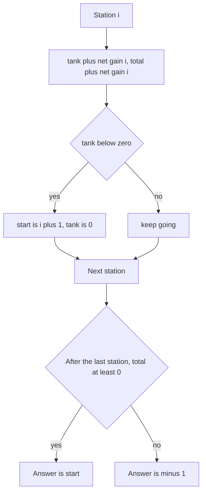

## The hook

You plan a road trip around a ring road with petrol stations along the way. Each station has a fixed amount of fuel you may take, and each stretch of road burns a fixed amount. You start with an empty tank. Where should you start so you can drive the whole loop?

Trying every start and driving the loop is O(n²). The one-pass solution is famous because its proof is short, surprising, and exactly what interviewers ask you to explain.

## The problem

There are n stations in a circle. At station i you can take gas[i] units, and driving from station i to station i + 1 (wrapping around after the last) burns cost[i]. Start at some station with an empty tank and return to it, never letting the tank drop below zero. Return the starting index, or -1 if no start works. The problem guarantees the answer is unique when it exists.

For gas = [3, 1, 4, 2, 5] and cost = [4, 2, 3, 4, 1], the answer is station 4.

## The obvious approach

Try each station as the start and simulate the loop, stopping early if the tank goes negative.

```pseudo
for s in 0 .. n-1:
    tank = 0
    for k in 0 .. n-1:
        i = (s + k) mod n
        tank += gas[i] - cost[i]
        if tank < 0: break
    if tank >= 0 after all n steps: return s
return -1
```

That is O(n²), too slow for 100,000 stations. Worse, it repeats the same failing stretches over and over.

## The key insight

:::analogy
You set off from one station, and somewhere down the road the tank runs dry. It is tempting to go back one station and try again. But think about it: you reached every station on that stretch with some fuel left, or at least zero. Starting at any of them with an empty tank means driving the same stretch with less fuel, so you would run dry at the same place or sooner. Running dry rules out every start on the stretch you just drove.
:::

Replace each station by its [[net gain]], gas[i] - cost[i]. Two facts then give the whole solution.

- **The [[total check]].** Any full loop adds every net gain exactly once. If their sum is negative, no start works. If the sum is zero or more, some start works (shown below).
- **The [[reset rule]].** Walk from a candidate start s, keeping a [[running tank]]. If the tank goes negative right after station j, no start in s..j works, so jump the candidate to j + 1 and reset the tank to zero.

One pass applies the reset rule everywhere. If the total check passes, the last candidate is the answer.

### Why the last candidate really works

The candidate after the final reset drives from itself to the end of the array without running dry. It still has to wrap around and cover stations 0 up to itself. Those stations make up the earlier failed stretches, each of which had a negative sum, while the total of everything is non-negative. So the fuel left at the end of the array is at least the amount those failed stretches lose, and the wrap-around stretch never sees a negative tank.

### The same idea as a prefix-sum picture

Write the running sum of net gains from station 0. The best start is right after the point where that sum is lowest, because from there every later prefix rises above the low point. The reset rule finds that same point without storing the sums. It is close in spirit to Kadane's algorithm, which also throws away a prefix the moment it hurts; see [The Gambler Who Knows When to Walk Away](article:dsa-kadane).



### A harder cousin: Minimum Number of Refueling Stops

Now the road is a straight line to a target, you start with some fuel, and stations along the way have fuel amounts. The tank is unlimited. Find the fewest stops to reach the target, or -1.

The greedy is a [[retroactive refuel]]. Drive as far as your fuel allows, and push the fuel of every station you pass into a max-heap without stopping. Whenever you cannot reach the next station or the target, pretend you stopped at the passed station with the most fuel: pop the heap and add it. If the heap is empty when you run short, the target is unreachable.

The trick works because only the set of stations you stop at matters, not when you decide. When one more stop is forced, the station with the most fuel extends your reach the most, and the stop count is the same whichever you pick. The same "keep the choices, regret the worst" heap appears in Course Schedule III in [A Chef Rotating Dishes So None Burns](article:dsa-task-scheduling).

:::insight
A failed stretch rules out every start inside it, because arriving with fuel is never worse than starting empty. So each station is examined once, and a single non-negative total guarantees the surviving candidate completes the loop.
:::

## Walk through an example

gas = [3, 1, 4, 2, 5], cost = [4, 2, 3, 4, 1], so net gains are -1, -1, 1, -2, 4.

| Station | Net gain | Running tank | Negative? | Candidate start after | Total so far |
|---|---|---|---|---|---|
| 0 | -1 | -1 | yes, reset | 1 | -1 |
| 1 | -1 | -1 | yes, reset | 2 | -2 |
| 2 | 1 | 1 | no | 2 | -1 |
| 3 | -2 | -1 | yes, reset | 4 | -3 |
| 4 | 4 | 4 | no | 4 | 1 |

The total is 1 ≥ 0, so the answer is station 4. Checking by driving from 4:

| Leave station | Tank after filling | Road cost | Tank on arrival |
|---|---|---|---|
| 4 | 5 | 1 | 4 |
| 0 | 7 | 4 | 3 |
| 1 | 4 | 2 | 2 |
| 2 | 6 | 3 | 3 |
| 3 | 5 | 4 | 1 |

The tank never drops below zero, and the trip ends with 1 unit, which is exactly the total net gain.

The prefix-sum view agrees: the running sums from station 0 are -1, -2, -1, -3, 1. The lowest, -3, comes right after station 3, so the start is 4.

### Refueling stops

Target 120, start fuel 30, stations as (position, fuel): (10, 15), (25, 50), (40, 10), (70, 35), (90, 20).

| Event | Max-heap of passed fuel | Reach |
|---|---|---|
| Pass 10 and 25 | 50, 15 | 30 |
| Need 40: pop 50 (stop at 25) | 15 | 80 |
| Pass 40 and 70 | 35, 15, 10 | 80 |
| Need 90: pop 35 (stop at 70) | 15, 10 | 115 |
| Pass 90 | 20, 15, 10 | 115 |
| Need 120: pop 20 (stop at 90) | 15, 10 | 135 |

Three stops, at 25, 70 and 90. A brute force over all 32 subsets of stations also gives 3.

:::try-this
For gas = [2, 3, 4] and cost = [3, 4, 3], is there a valid start? (Net gains are -1, -1, 1, with total -1, so no start works and the answer is -1. Even though station 2 looks good alone, the loop as a whole burns more than it collects.)
:::

:::warning
Common misconception: "After a reset, you must re-check the stations before the new start by wrapping around." You do not. The total check already proves that the fuel gathered from the new start to the end covers the losses of every earlier failed stretch. A second loop is the most common way to turn this O(n) solution back into something slower and more error-prone.
:::

## The code

```pseudo
can_complete_circuit(gas, cost):
    total = 0; tank = 0; start = 0
    for i in 0 .. n-1:
        d = gas[i] - cost[i]
        total += d; tank += d
        if tank < 0: start = i + 1; tank = 0     # every start up to i fails
    return start if total >= 0 else -1

min_refuel_stops(target, fuel, stations):
    heap = max-heap; stops = 0; reach = fuel
    for (pos, f) in stations + [(target, 0)]:
        while reach < pos:
            if heap is empty: return -1
            reach += heap.pop(); stops += 1     # pretend we stopped there
        heap.push(f)
    return stops
```

```cpp
#include <bits/stdc++.h>
using namespace std;

int canCompleteCircuit(const vector<int>& gas, const vector<int>& cost) {
    long long total = 0, tank = 0;
    int start = 0;
    for (int i = 0; i < (int)gas.size(); i++) {
        int d = gas[i] - cost[i];
        total += d, tank += d;
        if (tank < 0) start = i + 1, tank = 0;           // the whole stretch is ruled out
    }
    return total >= 0 ? start : -1;
}

bool works(const vector<int>& gas, const vector<int>& cost, int s) {   // drive the loop from s
    int n = gas.size();
    long long tank = 0;
    for (int k = 0; k < n; k++) {
        int i = (s + k) % n;
        tank += gas[i] - cost[i];
        if (tank < 0) return false;
    }
    return true;
}

int minRefuelStops(int target, long long fuel, vector<array<int, 2>> stations) {
    stations.push_back({target, 0});
    priority_queue<int> passed;
    int stops = 0;
    for (auto& [pos, f] : stations) {
        while (fuel < pos) {
            if (passed.empty()) return -1;
            fuel += passed.top(), passed.pop(), stops++;  // refuel at the best passed station
        }
        passed.push(f);
    }
    return stops;
}

int main() {
    cout << canCompleteCircuit({3, 1, 4, 2, 5}, {4, 2, 3, 4, 1}) << ' '
         << canCompleteCircuit({2, 3, 4}, {3, 4, 3}) << '\n';                         // 4 -1
    mt19937 rng(7);
    int mismatches = 0;
    for (int t = 0; t < 2000; t++) {                                                    // stress test
        int n = rng() % 6 + 1;
        vector<int> g(n), c(n);
        for (int i = 0; i < n; i++) g[i] = rng() % 5, c[i] = rng() % 5;
        int a = canCompleteCircuit(g, c);
        bool any = false;
        for (int st = 0; st < n; st++) any = any || works(g, c, st);
        if (a == -1 ? any : !works(g, c, a)) mismatches++;           // wrong -1, or a start that fails
    }
    cout << mismatches << '\n';                                                         // 0
    cout << minRefuelStops(120, 30, {{10, 15}, {25, 50}, {40, 10}, {70, 35}, {90, 20}}) << ' '
         << minRefuelStops(100, 10, {{20, 30}}) << '\n';                               // 3 -1
}
```

The stress test drives the loop from every station on 2,000 random small inputs. It checks two things: when the one-pass answer is -1, no station works, and otherwise the returned station really completes the loop. Random inputs can have several valid starts, while LeetCode guarantees a unique one, so the test checks validity rather than one exact index.

## Complexity

- **Gas Station: O(n) time, O(1) space.** Each station is added to the tank once.
- **Driving the loop from every start: O(n²),** useful only as a checker.
- **Refueling stops: O(n log n) time, O(n) space** for the heap; each station is pushed and popped at most once.

## Common mistakes

- **Skipping the total check** and returning the last candidate even when no start works.
- **Resetting the start to i instead of i + 1.** Station i is part of the failed stretch.
- **Wrapping around to re-verify** after the pass, which is unnecessary once the total is non-negative.
- **In refueling stops, refuelling greedily at every station** or at the nearest one, instead of deferring and taking the largest passed fuel.
- **Overflow** when summing many large values; keep totals in 64-bit.

## Practice problems

*Gas Station* is the one-pass reset with the total check. *Minimum Number of Refueling Stops* is the retroactive refuel with a max-heap; it also has an O(n²) DP solution, which is worth comparing. *Maximum Subarray* uses the same "drop a prefix the moment it goes negative" reflex. The greedy proof styles are collected in [A Bus Conductor Who Never Reseats Anyone](article:dsa-greedy-exchange).

## Key takeaways

- A valid start for the circular trip exists exactly when the total of gas minus cost over all stations is at least zero.
- If the running tank from a candidate start goes negative at station j, every start from the candidate through j also fails, so the next candidate is j + 1.
- One pass with a running tank, a total and a candidate start solves the problem in O(n) time without re-checking the wrap-around.
- The answer is the station right after the lowest point of the running sum of net gains, which the reset rule finds automatically.
- When refuelling stops must be minimised, push passed stations into a max-heap and refuel retroactively from the largest only when you cannot reach the next point.
