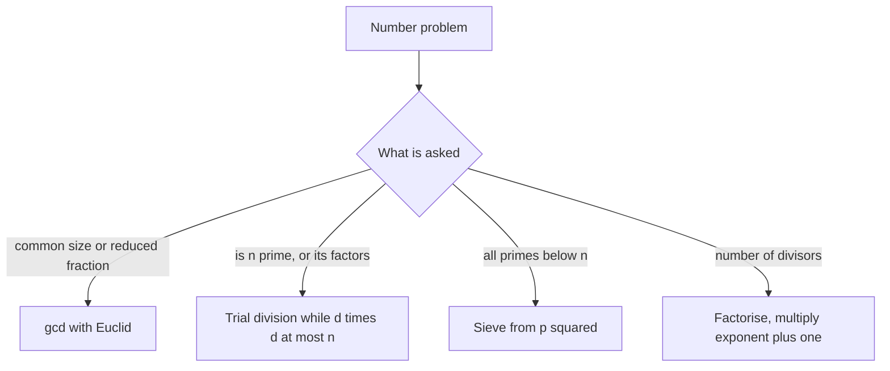

## The hook

A tailor has two ribbons, 48 cm and 18 cm long, and wants to cut both into pieces of the same length with nothing left over. Pieces of 1 cm work, and so do 2 and 3, but she wants the longest possible pieces. The answer, 6 cm, is the greatest common divisor, and the method for finding it fast is about 2,300 years old.

Number theory in interviews is small but sharp: greatest common divisors, primes and divisors turn up in fraction problems, string periodicity, "count the primes below n" and many puzzles that look unrelated. A handful of ideas cover nearly all of it, and each has one trap that catches people.

## The intuition

:::analogy
Lay the two ribbons side by side. Any piece length that cuts both evenly must also cut their difference evenly, because the shorter ribbon fits inside the longer one with the difference left over. So you can cut the shorter length off the longer ribbon again and again, keep only the leftover, and ask the same question about the shorter ribbon and the leftover. When the leftover is zero, the last ribbon length is the answer.
:::

That is [[Euclid's algorithm]], described in Euclid's *Elements* around 300 BC. "Cut the shorter off the longer as many times as fit" is exactly "take the remainder", so:

$$\gcd(a, b) = \gcd(b, a \bmod b), \qquad \gcd(a, 0) = a$$

Here $a \bmod b$ is the remainder of a divided by b, the leftover piece. Each step keeps every common divisor and shrinks the numbers quickly: the remainder is always less than b, and every two steps the larger number at least halves. So gcd takes O(log min(a, b)) steps.

The [[least common multiple]] follows from the [[greatest common divisor]]: lcm(a, b) = a / gcd(a, b) × b. Divide first, then multiply, or a × b can overflow before you divide.

## How it works

### Primes and trial division

A [[prime]] has no divisors other than 1 and itself. To test n, you only need [[trial division]] up to √n. If n = a × b with a ≤ b, then a × a ≤ a × b = n, so a ≤ √n. Any factorisation has a factor at most √n; if none divides n, n is prime. In code, loop while `d * d <= n` instead of computing a square root, which avoids floating-point error.

### Prime factorisation and divisors

The same loop factorises n: divide out each d as many times as it goes, then move on. Whatever is left above 1 at the end is a single prime larger than √n. This gives the [[prime factorisation]], and from it the number of divisors: if n = p₁^e₁ × p₂^e₂ × ..., each divisor chooses an exponent from 0 to eᵢ for each prime, so there are (e₁ + 1)(e₂ + 1)... of them.

To list divisors, note that they come in pairs (d, n / d) with d ≤ √n. Walk d up to √n and record both, taking care not to record √n twice for perfect squares.

### The sieve of Eratosthenes

To find all primes below n, test each number separately and you pay about n √n. The [[sieve of Eratosthenes]] is far faster.

Start with every number marked prime. For each p still marked, cross out p², p² + p, p² + 2p and so on. Start at p², because smaller multiples like 2p and 3p were already crossed out by smaller primes. Stop when p² ≥ n.



:::insight
Two facts do most of the work: any common divisor of a and b also divides a mod b, which makes gcd logarithmic, and any composite n has a factor at most √n, which makes primality and factorisation O(√n).
:::

## Walk through an example

### Euclid on 48 and 18

| a | b | a mod b | Ribbon picture |
|---|---|---|---|
| 48 | 18 | 12 | cut 18 off 48 twice, 12 left over |
| 18 | 12 | 6 | cut 12 off 18 once, 6 left |
| 12 | 6 | 0 | 6 fits exactly twice |

gcd(48, 18) = 6, and lcm(48, 18) = 48 / 6 × 18 = 144.

### Factorising 360 and counting its divisors

| d | 360 divided by d while possible | Remaining |
|---|---|---|
| 2 | three times | 45 |
| 3 | twice | 5 |
| 4 | stop, because 4 × 4 = 16 > 5 | 5 |

The leftover 5 is a prime, so 360 = 2³ × 3² × 5, and it has (3 + 1)(2 + 1)(1 + 1) = 24 divisors.

### Sieving below 30

| Prime p | Crossed out, starting at p² |
|---|---|
| 2 | 4, 6, 8, ..., 28 |
| 3 | 9, 15, 21, 27 (12, 18, 24 already gone) |
| 5 | 25 |
| 7 | stop, because 49 ≥ 30 |

The survivors are 2, 3, 5, 7, 11, 13, 17, 19, 23 and 29: 10 primes below 30, which is the answer *Count Primes* wants for n = 30.

### GCD of strings

*Greatest Common Divisor of Strings* asks for the longest string x such that both s and t are x repeated some number of times.

If such an x exists, then s + t equals t + s, because both are x repeated the same total number of times. And if s + t equals t + s, the answer is the prefix of length gcd(|s|, |t|). For "ABCABC" and "ABC", the concatenations match and gcd(6, 3) = 3, so the answer is "ABC". For "LEET" and "CODE", "LEETCODE" ≠ "CODELEET", so the answer is empty. It is the ribbon idea with strings: the common piece must tile both.

:::try-this
List all simplified fractions between 0 and 1 with denominator at most 4. Which ones do you skip? (Keep a/b when gcd(a, b) = 1: 1/2, 1/3, 2/3, 1/4 and 3/4. You skip 2/4, because gcd(2, 4) = 2 means it equals 1/2.)
:::

:::warning
Common misconception: "To check if n is prime, try every number up to n − 1, or up to n / 2." Stopping at √n is enough, which for n = 10⁹ is about 31,623 checks instead of hundreds of millions. And loop with `d * d <= n` in 64-bit instead of `d <= sqrt(n)`, because a rounded square root can stop one step too early.
:::

## The code

```pseudo
gcd(a, b):
    while b != 0: (a, b) = (b, a mod b)
    return a

is_prime(n):
    if n < 2: return false
    d = 2
    while d * d <= n:
        if n mod d == 0: return false
        d += 1
    return true

count_divisors(n):
    result = 1; d = 2
    while d * d <= n:
        e = 0
        while n mod d == 0: n /= d; e += 1
        result *= e + 1; d += 1
    if n > 1: result *= 2           # one prime above the square root is left
    return result

sieve(n):                           # primes below n
    mark all of 2 .. n-1 as prime
    for p = 2 while p * p < n:
        if p is marked: unmark p*p, p*p + p, ... below n
```

```cpp
#include <bits/stdc++.h>
using namespace std;

long long gcdEuclid(long long a, long long b) {
    while (b) { long long r = a % b; a = b; b = r; }   // cut the shorter ribbon off the longer
    return a;
}

long long lcmOf(long long a, long long b) { return a / gcdEuclid(a, b) * b; }   // divide first

bool isPrime(long long n) {
    if (n < 2) return false;
    for (long long d = 2; d * d <= n; d++)
        if (n % d == 0) return false;
    return true;
}

int countDivisors(long long n) {
    int result = 1;
    for (long long d = 2; d * d <= n; d++) {
        int e = 0;
        while (n % d == 0) n /= d, e++;
        result *= e + 1;
    }
    if (n > 1) result *= 2;                            // a prime factor above the square root
    return result;
}

int countPrimes(int n) {                               // primes strictly below n
    if (n < 3) return 0;
    vector<bool> isP(n, true);
    isP[0] = isP[1] = false;
    for (long long p = 2; p * p < n; p++)
        if (isP[p])
            for (long long q = p * p; q < n; q += p) isP[q] = false;
    return count(isP.begin(), isP.end(), true);
}

string gcdOfStrings(const string& s, const string& t) {
    if (s + t != t + s) return "";                     // no common piece tiles both
    return s.substr(0, gcdEuclid(s.size(), t.size()));
}

bool isUgly(long long n) {                             // only prime factors 2, 3 and 5
    if (n <= 0) return false;
    for (int p : {2, 3, 5}) while (n % p == 0) n /= p;
    return n == 1;
}

int main() {
    cout << gcdEuclid(48, 18) << ' ' << lcmOf(48, 18) << '\n';                 // 6 144
    cout << isPrime(97) << isPrime(91) << ' ' << countDivisors(360) << '\n';    // 10 24
    cout << countPrimes(30) << '\n';                                            // 10
    cout << gcdOfStrings("ABCABC", "ABC") << " [" << gcdOfStrings("LEET", "CODE") << "]\n";   // ABC []
    cout << isUgly(6) << isUgly(14) << '\n';                                    // 10
    for (int b = 2; b <= 4; b++)
        for (int a = 1; a < b; a++)
            if (gcdEuclid(a, b) == 1) cout << a << '/' << b << ' ';
    cout << '\n';                                                               // 1/2 1/3 2/3 1/4 3/4
}
```

C++17 also has `std::gcd` and `std::lcm` in `<numeric>`. Use them in contests, but be ready to write Euclid's loop in an interview. For deeper tools, such as linear sieves, smallest-prime-factor tables and divisor counting for many numbers at once, the competitive programming articles [The Largest Tile That Fits the Floor](article:cp-gcd-lcm) and [Washing Away Every Multiple](article:cp-sieve) go further.

## Complexity

- **gcd: O(log min(a, b)).** Every two steps, the larger number at least halves.
- **Trial division and factorisation: O(√n).** For n = 10¹², that is up to 10⁶ checks, which is fine for one number but too slow for many.
- **Sieve: O(n log log n) time, O(n) space.** The inner loops together cross out about n × (1/2 + 1/3 + 1/5 + ...) entries, and that sum over primes grows like log log n, almost constant in practice.
- **GCD of strings: O(|s| + |t|)** for the concatenation check.

## Common mistakes

- **Trying divisors beyond √n,** which turns O(√n) into O(n).
- **Using `sqrt()` in the loop bound,** where rounding can skip the last divisor of a perfect square; use `d * d <= n` with 64-bit d.
- **Overflow in lcm** from computing a × b before dividing.
- **Starting the sieve's inner loop at 2p,** which is correct but wastes work; start at p².
- **Forgetting the leftover prime** after trial division, which undercounts divisors of numbers like 2 × 97.
- **Off-by-one in Count Primes:** it asks for primes strictly less than n.
- **gcd with negative numbers,** where `%` can return negatives in C++; take absolute values first.

## Practice problems

Start with *Find Greatest Common Divisor of Array*, a one-line gcd of the minimum and maximum. *Ugly Number* is factorisation by three fixed primes. *Greatest Common Divisor of Strings* reuses gcd on lengths after the concatenation check. *Simplified Fractions* lists a/b with gcd(a, b) = 1. *Count Primes* is the sieve, and a good test of the p² starting point and the "strictly less than n" detail.

## Key takeaways

- Euclid's algorithm computes gcd(a, b) by replacing (a, b) with (b, a mod b) until the remainder is zero, in O(log min(a, b)) steps.
- The least common multiple is a / gcd(a, b) × b, dividing before multiplying to avoid overflow.
- Any composite number has a factor at most its square root, so trial division only needs d with d × d ≤ n.
- From the prime factorisation p₁^e₁ × p₂^e₂ × ..., the number of divisors is (e₁ + 1)(e₂ + 1)...
- The sieve of Eratosthenes finds all primes below n in O(n log log n) by crossing out multiples of each prime from its square.
