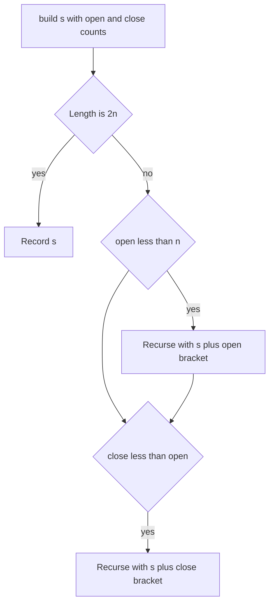

## The hook

List every valid way to arrange three pairs of brackets: ((())), (()()), and so on. One way is to write all 64 strings of six brackets and throw away the ones that do not balance. Five survive. The other way never writes an invalid string at all, and it makes 22 recursive calls in total.

*Generate Parentheses* is a favourite interview question exactly because both answers are easy to write, but only one shows you understand pruning. The same counting idea then cleans up broken bracket strings in *Remove Invalid Parentheses*, a well-known hard problem.

## The problem

Given n, list every [[balanced string]] of n pairs of brackets.

| n | Balanced strings | Count |
|---|---|---|
| 1 | () | 1 |
| 2 | (()), ()() | 2 |
| 3 | ((())), (()()), (())(), ()(()), ()()() | 5 |

The counts 1, 2, 5, 14, 42 are the [[catalan number|Catalan numbers]], the same sequence that counts binary search tree shapes in [Picking the Team, Then the Batting Order](article:dsa-combinatorics-basics).

## The obvious approach

[[Generate and filter]]: build all 2^(2n) strings of '(' and ')' and keep the balanced ones. For n = 3 that is 64 strings for 5 answers; for n = 8, 65,536 strings for 1,430 answers. Most of the work is spent on strings like ")(((((" that were doomed from the first character.

## The key insight

:::analogy
Picture building a hanging mobile out of hooks. Every opening bracket is a hook you hang, and every closing bracket finishes the hook most recently hung. You can hang a new hook as long as you have hooks left in the box. You can finish one only if there is an unfinished hook hanging. A builder who follows those two rules never produces a lopsided mobile, so there is nothing to throw away at the end.
:::

Track two counts as you build: open, the number of '(' used, and close, the number of ')' used.

- **Add '('** if open < n: there are hooks left in the box.
- **Add ')'** if close < open: there is an unfinished hook to close. This is the [[prefix rule]].
- **Record** when the string has 2n characters.

Every branch the recursion takes is a valid prefix, and every valid prefix can be completed, so every leaf is an answer. Nothing is generated and then discarded.



### Cleaning a broken string: Remove Invalid Parentheses

Given a string with brackets and letters, remove the fewest brackets so it becomes valid, and list every distinct result. First compute the [[minimum removals]] with one scan: keep a balance; a ')' when the balance is 0 is unmatched and must go, and whatever balance remains at the end is the number of '(' that must go. Then backtrack over positions, removing exactly that many of each, with the same prefix rule as pruning, and skip removing a bracket identical to the one just before it to avoid duplicate results.

:::insight
Never build what you will throw away. Checking the prefix rule at every step keeps the search inside valid partial answers, so the number of recursive calls tracks the number of answers instead of the number of all possible strings.
:::

## Walk through an example

### n = 2 with open and close counts

| Path so far | open | close | Next options |
|---|---|---|---|
| (empty) | 0 | 0 | '(' only, because close < open is false |
| ( | 1 | 0 | '(' or ')' |
| (( | 2 | 0 | ')' only, no hooks left |
| (() | 2 | 1 | ')' |
| (()) | 2 | 2 | record |
| () | 1 | 1 | '(' only |
| ()( | 2 | 1 | ')' |
| ()() | 2 | 2 | record |

Two answers, and no branch ever went wrong. For n = 3 the same rules make 22 calls and record the 5 answers, while generating all strings would build 64 complete strings, plus every prefix on the way, before filtering.

### Removing invalid brackets from "(a)())"

Scanning: '(' balance 1, 'a', ')' balance 0, '(' balance 1, ')' balance 0, ')' with balance 0 is unmatched. So one ')' must be removed and no '('. Removing each ')' in turn and keeping the valid results gives "(a())" and "(a)()". Removing the third ')' and the second ')' produce the same string, and the duplicate-skipping rule keeps only one copy.

For "()(()", the scan ends with one '(' still open, so one '(' must go; the only distinct valid result is "()()". For ")(", one of each must go, leaving the empty string.

### Letter Case Permutation

The same choose-explore pattern with a different choice: at each letter, branch on lower case or upper case; digits have one option. For "a1b" that gives a1b, a1B, A1b and A1B.

:::try-this
For n = 3, list the next options after the prefix "(()" and after "()(". (After "(()": open = 2 < 3 allows '(', and close = 1 < 2 allows ')'. After "()(": open = 2 allows '(', close = 1 < 2 allows ')'. Both prefixes have two options.)
:::

:::warning
Common misconception: "Checking validity at the end is fine because the output is small anyway." The output is small, but the number of strings you would build is 2^(2n), which grows far faster than the Catalan numbers; for n = 10 that is about a million strings for 16,796 answers. Checking the prefix rule on every step keeps the work proportional to the answers.
:::

## The code

```pseudo
generate(s, open, close):
    if len(s) == 2n: record s; return
    if open < n: generate(s + '(', open + 1, close)
    if close < open: generate(s + ')', open, close + 1)

remove_invalid(s):
    scan once: badClose = unmatched ')', badOpen = '(' left open at the end
    backtrack over positions i:
        to remove a '(' or ')', skip if it equals s[i - 1] at the same level (no duplicates)
        recurse with one fewer removal of that kind
    when no removals remain and the string is valid: record it
```

```cpp
#include <bits/stdc++.h>
using namespace std;

int calls = 0;

void generate(string& s, int open, int close, int n, vector<string>& res) {
    calls++;
    if ((int)s.size() == 2 * n) { res.push_back(s); return; }
    if (open < n) { s.push_back('('); generate(s, open + 1, close, n, res); s.pop_back(); }
    if (close < open) { s.push_back(')'); generate(s, open, close + 1, n, res); s.pop_back(); }   // prefix rule
}

bool valid(const string& s) {
    int bal = 0;
    for (char c : s) {
        if (c == '(') bal++;
        else if (c == ')' && --bal < 0) return false;
    }
    return bal == 0;
}

void removeRec(const string& s, int start, int badOpen, int badClose, set<string>& out) {
    if (badOpen == 0 && badClose == 0) {
        if (valid(s)) out.insert(s);
        return;
    }
    for (int i = start; i < (int)s.size(); i++) {
        if (i > start && s[i] == s[i - 1]) continue;       // same bracket as before: same result
        string t = s.substr(0, i) + s.substr(i + 1);
        if (s[i] == ')' && badClose > 0) removeRec(t, i, badOpen, badClose - 1, out);
        else if (s[i] == '(' && badOpen > 0 && badClose == 0) removeRec(t, i, badOpen - 1, badClose, out);
    }
}

vector<string> removeInvalid(const string& s) {
    int badOpen = 0, badClose = 0;
    for (char c : s) {
        if (c == '(') badOpen++;
        else if (c == ')') { if (badOpen) badOpen--; else badClose++; }   // unmatched ')'
    }
    set<string> out;
    removeRec(s, 0, badOpen, badClose, out);
    return vector<string>(out.begin(), out.end());
}

void caseRec(string& s, int i, vector<string>& res) {
    if (i == (int)s.size()) { res.push_back(s); return; }
    caseRec(s, i + 1, res);
    if (isalpha((unsigned char)s[i])) {
        s[i] ^= 32;                                        // flip the letter's case
        caseRec(s, i + 1, res);
        s[i] ^= 32;                                        // undo
    }
}

int main() {
    vector<string> res;
    string s;
    generate(s, 0, 0, 3, res);
    for (auto& x : res) cout << x << ' ';
    cout << "| calls " << calls << '\n';                   // ((())) (()()) (())() ()(()) ()()() | calls 22
    for (string t : {"(a)())", "()(()", ")("}) {
        cout << '[';
        for (auto& x : removeInvalid(t)) cout << x << ';';
        cout << "] ";
    }
    cout << '\n';                                          // [(a());(a)();] [()();] [;]
    string w = "a1b";
    vector<string> cases;
    caseRec(w, 0, cases);
    sort(cases.begin(), cases.end());
    for (auto& x : cases) cout << x << ' ';
    cout << '\n';                                          // A1B A1b a1B a1b
}
```

`removeRec` removes unmatched ')' before any '(' (the `badClose == 0` condition on the second branch), which keeps each set of removals from being generated in two orders; a randomised comparison against a breadth-first search over all removals, on 400 short strings, gave identical results. The `set` collects distinct results; the duplicate-skipping rule already avoids most repeats.

## Complexity

- **Generate Parentheses: O(n × Catalan(n)).** The tree's nodes are bounded by a small multiple of the number of answers times n, and each answer costs O(n) to copy. Catalan(n) grows like 4ⁿ / (n^1.5 × √π), much slower than the 4ⁿ strings of generate and filter.
- **Remove Invalid Parentheses:** exponential in the number of removals in the worst case, with O(n) per validity check; computing the exact removal counts first keeps the search to the minimum.
- **Letter Case Permutation: O(2^L × n)** for L letters, because every letter doubles the output.

## Common mistakes

- **Allowing ')' when close equals open,** which builds invalid prefixes.
- **Checking validity only at the end,** the generate-and-filter trap.
- **Forgetting to undo** the appended character when the string is shared and passed by reference.
- **Removing more brackets than necessary** in Remove Invalid Parentheses; compute the minimum counts first.
- **Duplicate results** from removing either of two identical adjacent brackets; skip repeats at the same level.
- **Flipping case on digits** in Letter Case Permutation.

## Practice problems

*Letter Case Permutation* is the simplest of the three: two choices per letter, one per digit. *Generate Parentheses* is the walkthrough, and a good one to explain aloud with the mobile picture. *Remove Invalid Parentheses* combines the counting scan with backtracking over removal positions, and is a frequent hard interview question. For validity checks with a stack, see [The Last Plate In Is the First Plate Out](article:dsa-stack-patterns).

## Key takeaways

- Generate balanced bracket strings by adding '(' while fewer than n are used and ')' while fewer closers than openers are used.
- Following the prefix rule at every step means every branch is a valid prefix and every leaf is an answer, so nothing is thrown away.
- The number of balanced strings with n pairs is the n-th Catalan number: 1, 2, 5, 14, 42 for n from 1 to 5.
- The minimum brackets to remove from a string are the unmatched closers found in a left-to-right scan plus the openers still unmatched at the end.
- Building only valid partial answers is the general backtracking lesson: prune with a rule at each step instead of filtering complete candidates.
