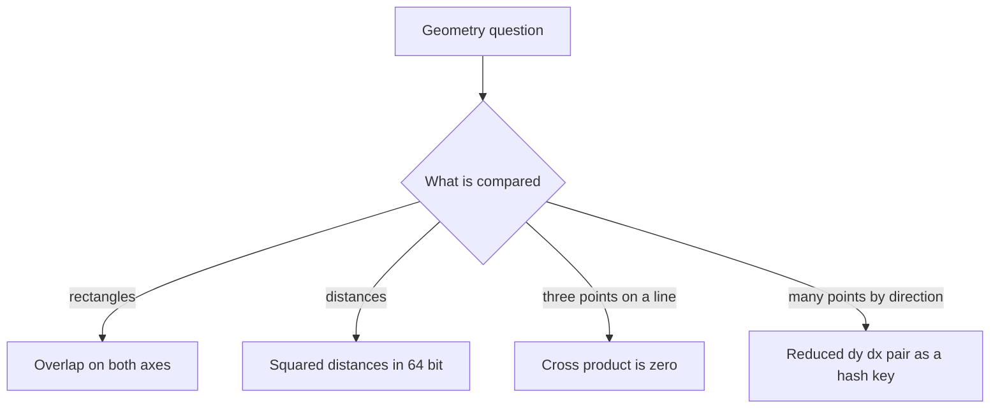

## The hook

An office planner is placing tables on a floor plan and the app must warn when two tables overlap. Each table is a rectangle given by two corners. The first idea is to check whether any corner of one table lies inside the other, and it fails: two tables crossing like a plus sign overlap with no corner inside either.

Interview geometry is like that. The problems are short and the formulas are school maths, but the traps are real: the wrong test for overlap, floating-point slopes that should be equal and are not, a vertical line that divides by zero. A few exact, integer-only tools avoid all of them.

## The intuition

:::analogy
Picture two tables on the floor plan. Shine a light from above and look at their shadows on the wall to the south: each table casts a segment along the x axis. Now look at their shadows on the west wall: segments along the y axis. The tables overlap exactly when their shadows overlap on both walls. If the shadows are apart on either wall, there is a gap you could walk through.
:::

That turns a 2D question into two 1D ones. An [[axis-aligned rectangle]] is just an x interval and a y interval, and two rectangles overlap with positive area exactly when both pairs of intervals do. [[Interval overlap]] is a single comparison: the later start is before the earlier end.

The other tools follow the same spirit of exact, simple tests:

- compare distances with the [[squared distance]], never the square root;
- test whether three points lie on a line with the [[cross product]], never by dividing;
- when you must group points by direction, use a [[normalised slope]], an exact pair of integers, not a double.

## How it works

### Rectangle overlap and area

With rectangles as (x1, y1, x2, y2), bottom-left and top-right:

- **Overlap width:** min(ax2, bx2) − max(ax1, bx1). If it is not positive, the shadows on the south wall do not overlap.
- **Overlap height:** min(ay2, by2) − max(ay1, by1), the west wall.
- **Overlap?** Both positive.
- **Area covered by both rectangles together:** area A + area B − overlap area, where the overlap area is max(0, width) × max(0, height).

### Distances without square roots

To compare distances, or to sort points by distance from the origin, compare dx² + dy². Squaring is monotonic for non-negative values, so the order is unchanged, and integer arithmetic is exact. Use 64-bit integers: coordinates up to 10⁴ give squares up to 2 × 10⁸, which is fine, but coordinates up to 10⁹ need 64 bits.

### The cross product and collinearity

For points P, Q and R, the cross product of (Q − P) and (R − P) is

$$(Q_x - P_x)(R_y - P_y) - (Q_y - P_y)(R_x - P_x)$$

It is zero exactly when the three points are collinear. It is positive when R is to the left of the direction P to Q, and negative when it is to the right. It needs only multiplication and subtraction, so it is exact in integers and has no special case for vertical lines.

### Exact slopes as keys

*Max Points on a Line* asks how many points share one line. Fix an anchor point and group every other point by its direction from the anchor. A direction (dx, dy) is reduced by g = gcd(|dx|, |dy|), and the sign is fixed so that dx > 0, or dx = 0 and dy > 0. Then (2, 4), (1, 2) and (−3, −6) all become (1, 2), and every vertical direction becomes (0, 1). Points with the same key from the same anchor lie on one line through it.



:::insight
Keep geometry exact. Turn rectangles into two interval checks, compare squared distances, test collinearity with a cross product and represent slopes as reduced integer pairs; then no square root, division or rounding can make equal things look different.
:::

## Walk through an example

### Overlap and combined area

A = (0, 0, 4, 3) and B = (2, 1, 6, 5).

| Axis | A's shadow | B's shadow | Overlap length |
|---|---|---|---|
| x | 0 to 4 | 2 to 6 | min(4, 6) − max(0, 2) = 2 |
| y | 0 to 3 | 1 to 5 | min(3, 5) − max(0, 1) = 2 |

Both lengths are positive, so the tables overlap, in a 2 by 2 patch. The combined area is 12 + 16 − 4 = 24. For (0, 0, 1, 1) and (1, 0, 2, 1), the x overlap is min(1, 2) − max(0, 1) = 0: the tables touch along an edge but do not overlap.

### Valid Square

For the points (0, 0), (1, 1), (1, 0) and (0, 1), the six pairwise squared distances, sorted, are 1, 1, 1, 1, 2, 2. A square has four equal sides s, two equal diagonals d and d² = 2s², with s > 0. Here s² = 1 and d² = 2, so it is a square, and the order in which the points were given never mattered.

### Max Points on a Line

Points: (1, 1), (3, 2), (5, 3), (4, 1), (2, 3) and (1, 4).

From anchor (1, 1), write each direction as (dx, dy), reduce it by the gcd and apply the sign rule:

| Point | (dx, dy) from (1, 1) | Reduced key |
|---|---|---|
| (3, 2) | (2, 1) | (2, 1) |
| (5, 3) | (4, 2) | (2, 1) |
| (4, 1) | (3, 0) | (1, 0) |
| (2, 3) | (1, 2) | (1, 2) |
| (1, 4) | (0, 3) | (0, 1) |

The best line through (1, 1) holds 2 + 1 = 3 points. Trying every anchor finds a better line: from (4, 1), the points (3, 2), (2, 3) and (1, 4) all have direction (−1, 1), normalised to (1, −1), so that line holds 4 points, the answer.

:::try-this
Are (1, 2), (2, 3) and (3, 4) collinear? Use the cross product with P = (1, 2). (Q − P = (1, 1) and R − P = (2, 2). The cross product is 1 × 2 − 1 × 2 = 0, so yes, they are collinear.)
:::

:::warning
Common misconception: "Slopes are just dy / dx, store them as doubles." Floating point rounds: 0.1 + 0.2 is not exactly 0.3 in binary, and two different large fractions can round to the same double. Vertical lines divide by zero. The reduced integer pair (dx, dy) with a sign rule is exact, and it handles vertical and horizontal lines with no special cases.
:::

## The code

```pseudo
overlap(a, b):                    # rectangles as x1, y1, x2, y2
    w = min(a.x2, b.x2) - max(a.x1, b.x1)
    h = min(a.y2, b.y2) - max(a.y1, b.y1)
    return w > 0 and h > 0

cross(p, q, r): return (q.x - p.x) * (r.y - p.y) - (q.y - p.y) * (r.x - p.x)

max_points(points):
    best = min(n, 1)
    for each anchor p:
        counts = empty map; same = 0
        for each other point q:
            dx, dy = q - p
            if dx == 0 and dy == 0: same += 1; continue
            g = gcd(|dx|, |dy|); dx /= g; dy /= g
            if dx < 0 or (dx == 0 and dy < 0): dx, dy = -dx, -dy
            counts[(dx, dy)] += 1
        best = max(best, 1 + same + (largest count, or 0))
```

```cpp
#include <bits/stdc++.h>
using namespace std;
using P = pair<long long, long long>;

bool overlap(array<long long, 4> a, array<long long, 4> b) {     // x1, y1, x2, y2
    long long w = min(a[2], b[2]) - max(a[0], b[0]);              // shadow on the x axis
    long long h = min(a[3], b[3]) - max(a[1], b[1]);              // shadow on the y axis
    return w > 0 && h > 0;
}

long long unionArea(array<long long, 4> a, array<long long, 4> b) {
    long long w = max(0LL, min(a[2], b[2]) - max(a[0], b[0]));
    long long h = max(0LL, min(a[3], b[3]) - max(a[1], b[1]));
    return (a[2] - a[0]) * (a[3] - a[1]) + (b[2] - b[0]) * (b[3] - b[1]) - w * h;
}

long long cross(P p, P q, P r) {
    return (q.first - p.first) * (r.second - p.second) - (q.second - p.second) * (r.first - p.first);
}

bool validSquare(vector<P> pts) {
    vector<long long> d;
    for (int i = 0; i < 4; i++)
        for (int j = i + 1; j < 4; j++) {
            long long dx = pts[i].first - pts[j].first, dy = pts[i].second - pts[j].second;
            d.push_back(dx * dx + dy * dy);                         // squared, exact
        }
    sort(d.begin(), d.end());
    return d[0] > 0 && d[0] == d[3] && d[4] == d[5] && d[4] == 2 * d[0];
}

int maxPoints(const vector<P>& pts) {
    int n = pts.size(), best = min(n, 1);
    for (int i = 0; i < n; i++) {
        map<P, int> cnt;
        int same = 0, top = 0;
        for (int j = 0; j < n; j++) {
            if (j == i) continue;
            long long dx = pts[j].first - pts[i].first, dy = pts[j].second - pts[i].second;
            if (dx == 0 && dy == 0) { same++; continue; }          // duplicate of the anchor
            long long g = gcd(llabs(dx), llabs(dy));
            dx /= g, dy /= g;
            if (dx < 0 || (dx == 0 && dy < 0)) dx = -dx, dy = -dy;   // one sign rule for every slope
            top = max(top, ++cnt[{dx, dy}]);
        }
        best = max(best, 1 + same + top);
    }
    return best;
}

int main() {
    cout << overlap({0, 0, 4, 3}, {2, 1, 6, 5}) << overlap({0, 0, 1, 1}, {1, 0, 2, 1}) << ' '
         << unionArea({0, 0, 4, 3}, {2, 1, 6, 5}) << '\n';                    // 10 24
    cout << cross({1, 2}, {2, 3}, {3, 4}) << ' ' << cross({0, 0}, {1, 0}, {0, 1}) << '\n';   // 0 1
    cout << validSquare({{0, 0}, {1, 1}, {1, 0}, {0, 1}}) << validSquare({{0, 0}, {2, 0}, {2, 1}, {0, 1}}) << '\n';  // 10
    cout << maxPoints({{1, 1}, {3, 2}, {5, 3}, {4, 1}, {2, 3}, {1, 4}}) << '\n';   // 4
}
```

The positive cross product in the second test says (0, 1) is to the left of the direction from (0, 0) to (1, 0), as expected. For sorting points by distance, *K Closest Points to Origin* uses squared distances with a heap or with the selection method from [Finding the Median Without Sorting the Crowd](article:dsa-quickselect).

## Complexity

- **Rectangle overlap, union area, cross product, valid square: O(1).**
- **K closest points: O(n log n) by sorting, O(n log k) with a heap, O(n) expected with quickselect,** all on squared distances.
- **Max Points on a Line: O(n²) time** with a hash map per anchor, or O(n² log n) with an ordered map as in the code, and O(n) space for one anchor's map.

## Common mistakes

- **Checking corners for rectangle overlap,** which misses crossing rectangles. Check the two shadows instead.
- **Using ≤ instead of <** when touching edges should not count as overlap, or the reverse when they should. Read the statement.
- **Taking square roots** to compare distances, introducing rounding for nothing.
- **Floating-point slopes,** and division by zero on vertical lines.
- **Forgetting the sign rule** for reduced slopes, so (1, 2) and (−1, −2) count as different directions.
- **Ignoring duplicate points** in Max Points on a Line; they lie on every line through the anchor.
- **Overflow** in cross products or squared distances with large coordinates; use 64-bit.

## Practice problems

*Rectangle Overlap* and *Rectangle Area* are the two-shadow test and the inclusion-exclusion area. *Check If It Is a Straight Line* is the cross product applied to every point. *Valid Square* sorts six squared distances. *K Closest Points to Origin* is a selection problem on squared distances. *Max Points on a Line* combines reduced slopes, a sign rule and duplicate handling, and it is the one most often failed because of floating point.

## Key takeaways

- Two axis-aligned rectangles overlap exactly when their x intervals overlap and their y intervals overlap, each checked as max of starts less than min of ends.
- Compare distances with squared distances in 64-bit integers, which keeps the order and avoids rounding.
- The cross product of Q − P and R − P is zero exactly when P, Q and R are collinear, with no division and no special case for vertical lines.
- Represent slopes as (dx, dy) reduced by their gcd with one sign rule, so equal directions always give equal keys.
- Integer-only geometry avoids the floating-point and division-by-zero bugs that cause most failures in these problems.
