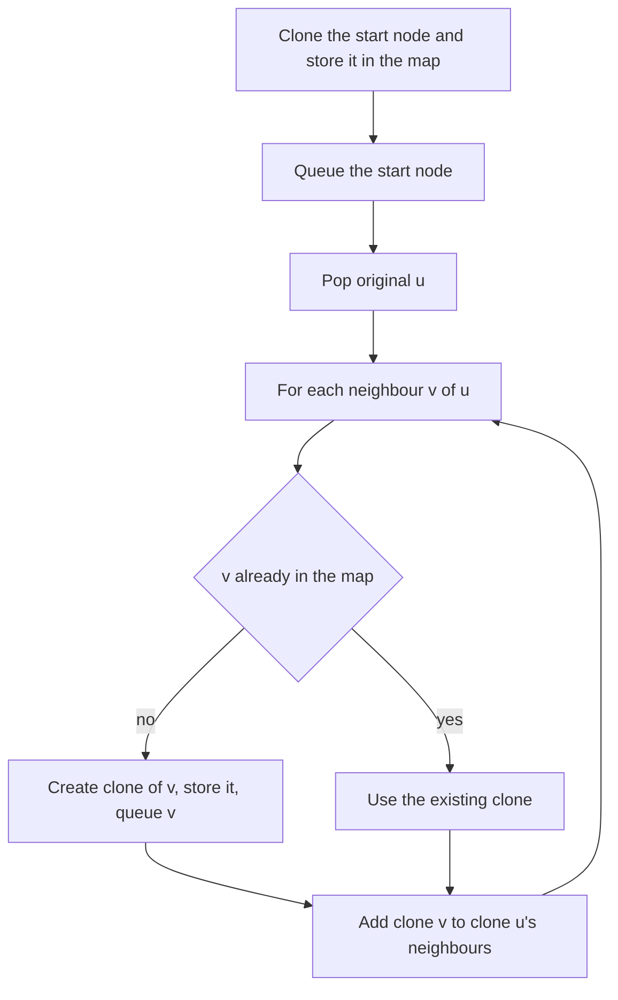

## The hook

You are asked to photocopy a city map, but the map is not on paper. It is a set of cards, one per intersection, each listing the intersections it connects to. You must produce a brand-new set of cards where every card points only to new cards, with exactly the same roads, and you are handed only one card to start from.

Copying looks trivial until the roads form loops, and then a careless copier either makes two copies of the same intersection or never stops. The cure is one hash map, and the same "who maps to whom" thinking solves merging accounts and evaluating chains of ratios.

## The problem

*Clone Graph* gives a reference to one node of a connected undirected graph. Each node has a value and a list of neighbours. Return a [[deep copy]]: a new graph with the same structure, in which no node or neighbour pointer refers to the original.

For the graph with nodes 1, 2, 3, 4 and edges 1–2, 2–3, 3–4, 4–1 and 1–3, the copy must have four new nodes and the same five edges.

## The obvious approach

Recursively copy each node and then copy each of its neighbours.

```pseudo
copy(node):
    c = new Node(node.val)
    for nb in node.neighbours: c.neighbours.add(copy(nb))
    return c
```

On a graph with any cycle, this never terminates: copying 1 copies 2, which copies 1 again, which copies 2 again. Even on a graph without cycles, a node reachable by two paths would be copied twice, so the copy would have more nodes than the original.

## The key insight

:::analogy
Keep a ledger with two columns: "original card" and "its copy". Whenever you come across an original intersection, look it up in the ledger first. If it is there, use the copy already made. If not, make a fresh copy card, write the pair into the ledger, and put the original on your to-do pile so its roads get copied later. Every intersection gets exactly one copy, and loops stop being a problem because the ledger remembers.
:::

The ledger is an [[old-to-new map]]. It does two jobs at once: it maps each original node to its unique clone, and it is the visited set for the BFS or DFS. The order of work:

- create the clone of the start node and put it in the map;
- BFS over originals; for each popped node u and each neighbour v, if v has no clone yet, create it, store it and queue v;
- append clone(v) to clone(u)'s neighbour list.

Each node is cloned once and each edge copied once, so the work is O(V + E).

### Accounts Merge: union-find over emails

*Accounts Merge* gives accounts as a name followed by emails. Two accounts belong to the same person if they share any email; the relation is transitive. Return each person's merged account: the name, then all emails sorted.

Names cannot be trusted, since two different people may share one, but a shared email links accounts for certain. Treat each email as a vertex and, within each account, union every email with the account's first email, using the structure from [Friend Groups That Merge at a Party](article:dsa-union-find). Then do [[grouping by representative]]: collect emails by their root, sort each group, and attach the name recorded for any email in it.

### Evaluate Division: path products

*Evaluate Division* gives equations such as a / b = 2 and asks queries such as a / c. Build a [[ratio graph]]: edge a → b with weight 2 and b → a with weight 1/2. A query x / y is answered by any path from x to y, multiplying weights along the way. If either variable never appeared, or no path exists, the answer is -1. Asking x / x for a known variable gives 1.

Any path gives the same product if the equations are consistent, which the problem guarantees, so DFS or BFS both work. With many queries, a weighted union-find that stores each variable's ratio to its root answers each in near-constant time.

| Problem | Vertices | What the map or structure holds | Answer comes from |
|---|---|---|---|
| Clone Graph | Nodes | original node → clone | the clone of the start node |
| Accounts Merge | Emails | union-find parent, email → name | groups by root, sorted |
| Evaluate Division | Variables | adjacency with ratio weights | product along a path |



:::insight
When a structure can loop back on itself, copying or exploring it safely needs a record of what has already been handled. In Clone Graph, the old-to-new map is that record, so creating each clone at the moment of discovery makes duplicates and infinite loops impossible.
:::

## Walk through an example

### Cloning the five-edge graph

Edges 1–2, 2–3, 3–4, 4–1, 1–3. Neighbour lists: 1: [2, 4, 3], 2: [1, 3], 3: [2, 4, 1], 4: [3, 1]. Start at 1.

| Pop | Neighbours examined | New clones made | Map after |
|---|---|---|---|
| (start) | | 1' | 1 → 1' |
| 1 | 2, 4, 3 | 2', 4', 3' | 1, 2, 3, 4 all mapped |
| 2 | 1, 3 | none | |
| 4 | 3, 1 | none | |
| 3 | 2, 4, 1 | none | |

All four clones were created while processing node 1, and every later neighbour lookup found an existing clone. The clone lists come out as 1': [2', 4', 3'], 2': [1', 3'], 4': [3', 1'], 3': [2', 4', 1']: five edges, each stored in both directions, exactly as in the original.

### Accounts Merge

Accounts:

| Account | Name | Emails |
|---|---|---|
| A | Asha | asha@x.com, asha.k@y.com |
| B | Ravi | ravi@x.com |
| C | Asha | asha.dev@z.com, asha@x.com |
| D | Asha | asha.k@y.com, ak@w.com |
| E | Asha | asha2@x.com |

Account A joins asha@x.com with asha.k@y.com. C joins asha.dev@z.com with asha@x.com, which is already in A's group. D joins asha.k@y.com with ak@w.com, also in that group. E shares nothing.

| Merged | Emails, sorted |
|---|---|
| Asha | ak@w.com, asha.dev@z.com, asha.k@y.com, asha@x.com |
| Asha | asha2@x.com |
| Ravi | ravi@x.com |

Two separate Ashas remain, because nothing links account E to the others. Accounts C and D never share an email directly, yet they merge through A.

### Evaluate Division

Equations a / b = 2, b / c = 3, d / e = 0.5.

| Query | Path | Answer |
|---|---|---|
| a / c | a → b → c, 2 × 3 | 6 |
| c / a | c → b → a, 1/3 × 1/2 | 0.1667 |
| b / a | b → a | 0.5 |
| a / e | no path between the two groups | -1 |
| e / d | e → d | 2 |
| x / x | x never appeared | -1 |
| a / a | known variable | 1 |

:::try-this
In the accounts example, add account F: Asha, asha2@x.com, ak@w.com. How many merged accounts are there now? (ak@w.com is already in the big Asha group, so F joins it, and asha2@x.com brings account E along. The result is two merged accounts: Asha with five emails, ak@w.com, asha.dev@z.com, asha.k@y.com, asha2@x.com and asha@x.com, and Ravi with one.)
:::

:::warning
Common misconception: "Clone Graph is solved by copying node values into a new list." The test checks the pointers: every neighbour of every clone must be another clone, and no clone may point into the original graph. A copy that reuses original neighbour pointers looks correct when printed by value but is a shallow copy and fails.
:::

## The code

```pseudo
clone(start):
    if start is null: return null
    map = {start: new Node(start.val)}; queue = [start]
    while queue:
        u = queue.pop_front()
        for v in u.neighbours:
            if v not in map: map[v] = new Node(v.val); queue.push(v)
            map[u].neighbours.add(map[v])
    return map[start]
```

```cpp
#include <bits/stdc++.h>
using namespace std;

struct Node {
    int val;
    vector<Node*> nb;
    explicit Node(int v) : val(v) {}
};

Node* cloneGraph(Node* start) {
    if (!start) return nullptr;
    unordered_map<Node*, Node*> copyOf;                  // the ledger, and the visited set
    copyOf[start] = new Node(start->val);
    queue<Node*> q;
    q.push(start);
    while (!q.empty()) {
        Node* u = q.front(); q.pop();
        for (Node* v : u->nb) {
            if (!copyOf.count(v)) copyOf[v] = new Node(v->val), q.push(v);   // clone on discovery
            copyOf[u]->nb.push_back(copyOf[v]);
        }
    }
    return copyOf[start];
}

vector<vector<string>> accountsMerge(const vector<vector<string>>& accounts) {
    unordered_map<string, string> parent, owner;
    function<string(const string&)> find = [&](const string& x) -> string {
        return parent[x] == x ? x : parent[x] = find(parent[x]);
    };
    for (auto& a : accounts)
        for (size_t i = 1; i < a.size(); i++) {
            if (!parent.count(a[i])) parent[a[i]] = a[i];
            owner[a[i]] = a[0];
            parent[find(a[i])] = find(a[1]);             // join with the account's first email
        }
    map<string, vector<string>> groups;
    for (auto& [email, _] : parent) groups[find(email)].push_back(email);
    vector<vector<string>> out;
    for (auto& [root, emails] : groups) {
        sort(emails.begin(), emails.end());
        vector<string> row = {owner[root]};
        row.insert(row.end(), emails.begin(), emails.end());
        out.push_back(row);
    }
    sort(out.begin(), out.end());
    return out;
}

vector<double> calcEquation(const vector<array<string, 2>>& eqs, const vector<double>& vals,
                            const vector<array<string, 2>>& queries) {
    unordered_map<string, vector<pair<string, double>>> g;
    for (size_t i = 0; i < eqs.size(); i++) {
        g[eqs[i][0]].push_back({eqs[i][1], vals[i]});
        g[eqs[i][1]].push_back({eqs[i][0], 1.0 / vals[i]});
    }
    vector<double> ans;
    for (auto& [x, y] : queries) {
        double res = -1.0;
        if (g.count(x) && g.count(y)) {
            unordered_set<string> seen = {x};
            vector<pair<string, double>> st = {{x, 1.0}};
            while (!st.empty()) {
                auto [u, prod] = st.back(); st.pop_back();
                if (u == y) { res = prod; break; }
                for (auto& [v, k] : g[u]) if (seen.insert(v).second) st.push_back({v, prod * k});
            }
        }
        ans.push_back(res);
    }
    return ans;
}

int main() {
    vector<Node*> orig;
    for (int i = 1; i <= 4; i++) orig.push_back(new Node(i));
    auto link = [&](int a, int b) { orig[a - 1]->nb.push_back(orig[b - 1]), orig[b - 1]->nb.push_back(orig[a - 1]); };
    link(1, 2), link(2, 3), link(3, 4), link(4, 1), link(1, 3);
    Node* c = cloneGraph(orig[0]);
    set<Node*> originals(orig.begin(), orig.end());
    for (Node* v : c->nb) cout << v->val << (originals.count(v) ? "(old) " : " ");
    cout << (originals.count(c) ? "shallow" : "deep") << '\n';          // 2 4 3 deep

    auto merged = accountsMerge({{"Asha", "asha@x.com", "asha.k@y.com"}, {"Ravi", "ravi@x.com"},
                                 {"Asha", "asha.dev@z.com", "asha@x.com"}, {"Asha", "asha.k@y.com", "ak@w.com"},
                                 {"Asha", "asha2@x.com"}});
    for (auto& row : merged) cout << row[0] << ':' << row.size() - 1 << ' ';
    cout << '\n';                                                       // Asha:4 Asha:1 Ravi:1

    cout << fixed << setprecision(4);
    for (double d : calcEquation({{"a", "b"}, {"b", "c"}, {"d", "e"}}, {2.0, 3.0, 0.5},
                                 {{"a", "c"}, {"c", "a"}, {"a", "e"}, {"e", "d"}, {"x", "x"}}))
        cout << d << ' ';
    cout << '\n';                                                       // 6.0000 0.1667 -1.0000 2.0000 -1.0000
}
```

The first output line checks the pointers, not just the values: none of the clone's neighbours, and not the clone itself, is one of the original nodes.

## Complexity

- **Clone Graph: O(V + E) time,** one map lookup per edge; O(V) space for the map and the queue.
- **Accounts Merge: O(N α(N))** unions for N emails, plus O(N log N) to sort each group; O(N) space.
- **Evaluate Division: O(Q × (V + E))** with a search per query, or close to O(Q) with weighted union-find.

## Common mistakes

- **Creating clones when popping** instead of when discovering, which produces duplicate clones.
- **Returning a shallow copy** that reuses original neighbour pointers.
- **Not handling an empty graph,** where the start node is null.
- **Merging accounts by name,** which joins different people who share a name.
- **Forgetting to sort emails** within each merged account.
- **In Evaluate Division, returning 1 for x / x** when x never appeared in any equation; it must be -1.

## Practice problems

*Clone Graph* is the old-to-new map with BFS or DFS. *Accounts Merge* is union-find over emails followed by grouping. *Evaluate Division* is path products on a ratio graph. The traversal underneath is in [Ripples on a Pond: Breadth-First Search](article:dsa-bfs), and a similar map-based copy for linked lists is in [Photocopying a Treasure Map Full of Cross-References](article:dsa-copy-random-list).

## Key takeaways

- A deep copy of a graph needs a map from each original node to its clone, which also serves as the visited set.
- Creating each clone when its node is first discovered guarantees exactly one clone per node, even when the graph has cycles.
- Accounts Merge unions emails that appear in the same account, then groups emails by their union-find root.
- Evaluate Division stores each equation as two weighted edges and answers a query by multiplying ratios along a path.
- Variables that never appeared, or that lie in different groups, have no defined ratio, so the answer is -1.
