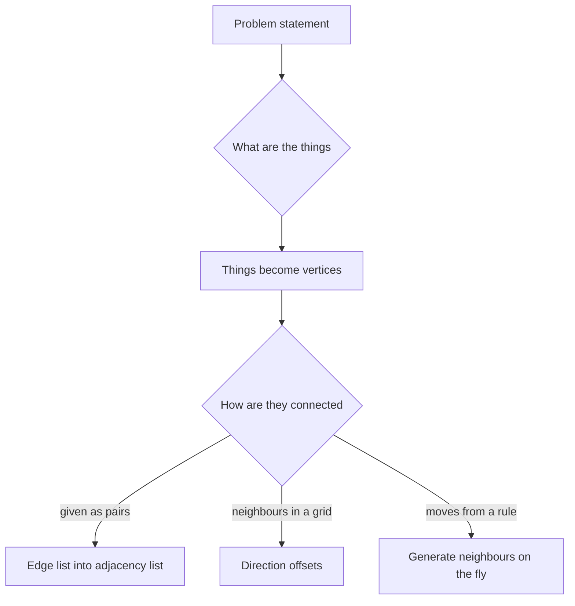
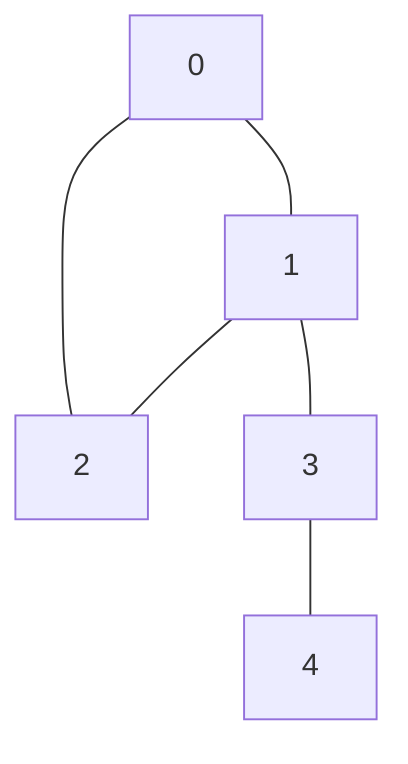

## The hook

A maps app finds a route across a city, a social network suggests "people you may know", a university checks your prerequisites, and a puzzle asks for the fewest moves to open a lock. These look like four unrelated problems.

They are all the same shape: things, and connections between things. Once you see that shape, a whole toolbox of algorithms opens up, but first you must write the connections down in memory, and a bad choice runs out of memory before the program starts. How do you store a graph so that the one question every algorithm asks, "who are my neighbours?", is cheap?

## The intuition

:::analogy
Think of a city map. Intersections are dots, and roads join them. Some roads are one-way. Some have a length or a toll written next to them. There are two ways to write this map down. You could make a giant table with every intersection along the top and down the side, and tick a box for every pair joined by a road. Or you could put a signpost at each intersection listing only the roads that leave it.
:::

The intersections are [[vertex|vertices]] and the roads are [[edge|edges]]. The giant table is an [[adjacency matrix]]. The signposts are an [[adjacency list]]. Almost every graph algorithm stands at an intersection, reads its signpost, and walks the roads it lists. So the signpost version is usually what you want.

## Let's build it up

### The vocabulary you need

- **Undirected** edges are two-way roads: if u connects to v, then v connects to u.
- **Directed** edges are one-way streets: u → v does not give v → u. Prerequisites, follows on a social network and web links are directed.
- **Weighted** edges carry a number: distance, time, cost or capacity.
- The [[degree]] of a vertex is how many roads touch it. In an undirected graph, the degrees add up to exactly 2m, because each of the m edges touches two ends.

Most problems give you n vertices and an **edge list**: m lines, each saying "u v" or "u v w". That is the raw input, not a useful structure yet, because finding u's neighbours in an edge list means scanning all m lines.

### Option 1: the adjacency matrix

An n × n array where mat[u][v] = 1 (or the weight) if there is an edge from u to v.

- Checking "is there an edge u → v?" is O(1).
- Listing u's neighbours means scanning a whole row: O(n), even if u has two roads.
- Memory is O(n²), no matter how few edges exist.

The matrix suits small, dense graphs: a few hundred to a few thousand vertices, or algorithms that naturally work on all pairs, such as all-pairs shortest paths.

### Option 2: the adjacency list

An array of n lists. For each edge u – v, push v into adj[u], and for an undirected edge also push u into adj[v].

- Listing u's neighbours is O(degree of u), the best you could hope for.
- Memory is O(n + m).
- Checking one specific edge costs O(degree of u), unless you store neighbours in a set.

| Question | Matrix | List |
|---|---|---|
| Memory | n² | n + m (2m entries if undirected) |
| Neighbours of u | O(n) | O(deg u) |
| Is u – v an edge? | O(1) | O(deg u) |
| Good for | small, dense graphs | almost everything else |

Most interview and contest graphs are a [[sparse graph]]: m is close to n, not close to n². For n = 100,000 and m = 200,000, a matrix needs 10¹⁰ cells, about 10 GB even as single bytes. The list stores 400,000 neighbour entries. That gap is why the default is the list.

:::insight
Graph algorithms spend their time asking "who are my neighbours?", so store the graph in the shape that answers that question directly. For sparse graphs, that shape is the adjacency list, built once from the edge list in O(n + m).
:::

### Weighted and directed lists

For weights, store pairs: adj[u] holds (v, w). For directed edges, push only one way. If an algorithm needs to walk roads backwards, build a second, reversed list as well.

### Grids are graphs

A grid of R rows and C columns is a graph in disguise. Each cell is a vertex, and its edges go to the cells directly up, down, left and right (sometimes diagonals too). Do not build an adjacency list for it. Generate neighbours with two small offset arrays, dr = {−1, 1, 0, 0} and dc = {0, 0, −1, 1}, and check that each neighbour is inside the grid and not a wall. If you need a single number per cell, use r × C + c.

### Implicit graphs

Sometimes the graph is never written down at all. In a combination-lock puzzle, each 4-digit setting is a vertex, and turning one wheel one notch is an edge. That is 10,000 vertices, each with 8 neighbours, and you generate them with a rule when you need them. This is an [[implicit graph]]. The cue in a problem statement is "minimum number of moves" or "can you reach state X from state Y": the states are the vertices and the moves are the edges.



## A tiny example

Five intersections, numbered 0 to 4, and five two-way roads given in this order: 0–1, 0–2, 1–2, 1–3, 3–4.



Building the signposts, one edge at a time:

| Edge read | Push | adj[0] | adj[1] | adj[2] | adj[3] | adj[4] |
|---|---|---|---|---|---|---|
| 0–1 | 1 to adj[0], 0 to adj[1] | 1 | 0 | | | |
| 0–2 | 2 to adj[0], 0 to adj[2] | 1, 2 | 0 | 0 | | |
| 1–2 | 2 to adj[1], 1 to adj[2] | 1, 2 | 0, 2 | 0, 1 | | |
| 1–3 | 3 to adj[1], 1 to adj[3] | 1, 2 | 0, 2, 3 | 0, 1 | 1 | |
| 3–4 | 4 to adj[3], 3 to adj[4] | 1, 2 | 0, 2, 3 | 0, 1 | 1, 4 | 3 |

The degrees are 2, 3, 2, 2 and 1. They add up to 10, which is 2 × 5 edges, as the handshake rule promised. The same graph as a matrix would hold 25 cells, of which only 10 are ticked. With five vertices that waste does not matter. With a hundred thousand it decides whether your program runs at all.

Now a directed, weighted example: flights 0 → 1 costing 4, 0 → 2 costing 1, 2 → 1 costing 2, and 1 → 3 costing 5. The signposts become adj[0] = (1, 4), (2, 1); adj[1] = (3, 5); adj[2] = (1, 2); adj[3] = empty. Vertex 3 has no outgoing flights, so its list is empty even though flights arrive there.

:::try-this
Add the one-way edge 4 → 0 with weight 7 to a directed version of the five-intersection graph. Which list changes? (Only adj[4] gains (0, 7). adj[0] is unchanged, because a one-way road appears only on the signpost where it starts.)
:::

```pseudo
build_undirected(n, edges):
    adj = n empty lists
    for (u, v) in edges:
        adj[u].append(v)
        adj[v].append(u)             // the road back
    return adj

grid_neighbours(r, c, R, C):
    for (dr, dc) in [(-1,0), (1,0), (0,-1), (0,1)]:
        nr = r + dr; nc = c + dc
        if 0 <= nr < R and 0 <= nc < C: yield (nr, nc)
```

```cpp
#include <bits/stdc++.h>
using namespace std;

int main() {
    int n = 5;
    vector<pair<int,int>> edges = {{0,1}, {0,2}, {1,2}, {1,3}, {3,4}};
    vector<vector<int>> adj(n);
    for (auto [u, v] : edges) { adj[u].push_back(v); adj[v].push_back(u); }
    for (int u = 0; u < n; u++) {
        cout << u << ":";
        for (int v : adj[u]) cout << ' ' << v;
        cout << '\n';                        // 0: 1 2 / 1: 0 2 3 / 2: 0 1 / 3: 1 4 / 4: 3
    }

    vector<vector<pair<int,int>>> flights(4);   // directed, weighted: (to, cost)
    for (auto [u, v, w] : vector<array<int,3>>{{0,1,4}, {0,2,1}, {2,1,2}, {1,3,5}})
        flights[u].push_back({v, w});
    cout << flights[0].size() << ' ' << flights[3].size() << '\n';   // 2 0

    int R = 3, C = 4, r = 0, c = 2, count = 0;   // top-row cell in a 3 x 4 grid
    int dr[] = {-1, 1, 0, 0}, dc[] = {0, 0, -1, 1};
    for (int k = 0; k < 4; k++) {
        int nr = r + dr[k], nc = c + dc[k];
        if (nr >= 0 && nr < R && nc >= 0 && nc < C) count++;
    }
    cout << count << '\n';                                         // 3
}
```

:::warning
Common misconception: "an adjacency matrix is simpler, so use it by default." It is simpler to write, but it costs n² memory and O(n) to list neighbours, so a traversal over the whole graph takes O(n²) time even when there are only n edges. Use a matrix only when n is small, a few thousand at most, or the graph really is dense.
:::

Two more input details catch people. Many judges number vertices from 1, so either allocate n + 1 lists or subtract 1 while reading. And some inputs repeat an edge or include a self-loop (u – u); decide whether your algorithm cares before assuming the graph is "simple".

## Where you'll see this again

Every graph article builds on this one:

- [Going Deep With a Ball of String](article:dsa-dfs) walks the signposts as deep as it can before backing up;
- [When the Rumour Comes Back to You](article:dsa-cycle-detection) uses the same lists to find loops;
- [Friend Groups That Merge at a Party](article:dsa-union-find) works directly from the edge list and answers "are these two connected?" without ever building signposts;
- breadth-first search, shortest paths and minimum spanning trees follow in this track.

Trees are graphs too: a tree with n vertices has exactly n − 1 edges and no loops, which is why [Four Ways to Tour a Family Tree](article:dsa-tree-traversals) feels like a special case of what comes next.

## Key takeaways

- A graph is a set of vertices joined by edges, which may be directed or undirected and may carry weights.
- An adjacency list stores each vertex's neighbours in O(n + m) memory and lists them in time proportional to the degree, so it is the default for sparse graphs.
- An adjacency matrix answers "is there an edge?" in O(1) but costs n² memory, so it only suits small or dense graphs.
- For an undirected edge, push both directions; for a directed edge, push only from the start vertex.
- Grids and puzzle states are graphs whose neighbours you generate on the fly, with direction offsets or move rules, instead of storing them.
