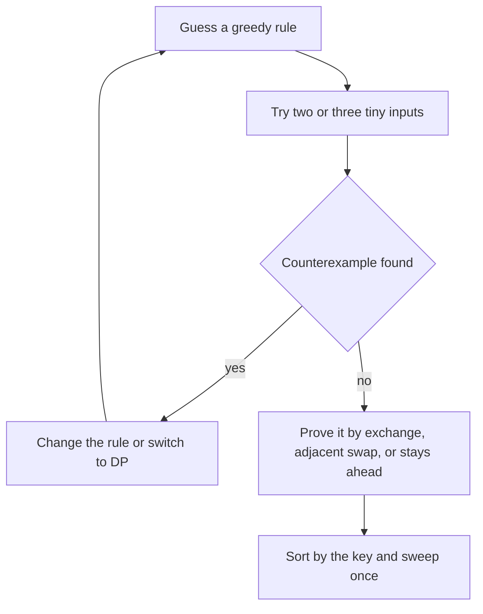

## The hook

A bus pulls into a crowded stop with thirty seconds to spare, so the conductor seats each passenger by one simple rule, never asking anyone to move again. Sometimes that rule fills the bus as well as any genius planner could. Sometimes it leaves an empty seat that a cleverer plan would have filled.

Greedy algorithms are that conductor. The skill interviewers test is not writing the loop, which is usually five lines. It is knowing whether the rule is safe, and being able to say why.

## The intuition

:::analogy
The conductor fills seats one at a time with a fixed rule and never reseats anyone. Later, an inspector arrives holding the best possible seating chart for that crowd. The inspector walks down the aisle comparing the two buses. At the first seat where they differ, the inspector swaps the chart's passenger for the conductor's choice and checks that the chart is still legal and still just as full. If that swap always works, then step by step the perfect chart turns into the conductor's bus without getting worse, so the conductor's bus was perfect all along.
:::

That walk down the aisle is the [[exchange argument]], the main way to prove a greedy algorithm correct. Each step of the algorithm makes a [[greedy choice]]: one decision by a local rule, never revisited. The inspector's job is to show that some optimal answer agrees with that choice.

There are two ingredients:

- **A safe first choice.** Some optimal solution starts with the greedy choice. This is what the swap proves.
- **A smaller problem of the same shape.** After the first choice, what remains is the same kind of problem, so the same argument applies to the next seat, and the next.

When either ingredient is missing, the conductor can be fooled, and the inspector's swap makes the chart worse. Then you need dynamic programming, which tries every option at each step instead of trusting one.

## How it works

### Step 1: guess a rule, usually a sort order

Most greedy solutions are "sort by some key, then sweep once". The hard part is picking the key. Write down two or three candidates: smallest first, largest first, earliest deadline, earliest finish, best ratio. The sorting habit itself is covered in [Sort First, Ask Questions Later](article:dsa-sorting-as-tool).

### Step 2: try to break it with a tiny input

Before proving anything, spend two minutes hunting for a [[counterexample]] with two or three items. Most wrong greedy rules die here. A rule that survives a few honest attempts is worth proving.

### Step 3: prove it with one of three arguments

| Proof style | What the inspector shows | Classic use |
|---|---|---|
| Exchange argument | Swap the optimal solution's first differing choice for the greedy one; it stays valid and no worse | Earliest finishing movie, assigning cookies |
| [[Adjacent swap]] | For two neighbours A then B, compare the cost against B then A; the better order gives the sort key | Shortest job first, Largest Number |
| Greedy [[stays ahead]] | After every step, greedy's partial answer is at least as good as any other partial answer | Jump Game's farthest reach |

All three are the same inspector in different clothes: compare greedy with an optimal answer and show the gap can never open in the optimal answer's favour.

### The exchange argument on movies

Take *Movie Festival*: given start and end times, watch as many complete movies as possible, never two at once. The rule is "pick the movie that ends earliest among those you can still start".

Suppose an optimal schedule starts with movie O, and greedy starts with movie G, the earliest-ending movie of all. The inspector's swap goes like this:

- G ends no later than O, by the choice of G.
- Every other movie in the optimal schedule starts at or after O's end, so it also starts at or after G's end.
- Swap O out and G in: the schedule is still legal and has the same count.

Repeat on the rest of the day, and the optimal schedule becomes greedy's without losing a movie.

### The adjacent swap on job order

Jobs with durations run one after another, and you want to minimise the sum of their finishing times. Look at any two neighbours A and B, with total time T already spent before them.

- A then B: A finishes at T + a, B at T + a + b. Sum 2T + 2a + b.
- B then A: sum 2T + 2b + a.

A first is better exactly when a < b. Every other job is unaffected by this swap. So any order with a longer job directly before a shorter one can be improved, and the only order with no such pair is shortest first.

The same trick finds strange sort keys. In *Largest Number*, two numbers as strings x and y should be ordered x first when x + y, as a string, beats y + x. For 3 and 30, "330" beats "303", so 3 goes first even though 3 is smaller.



### When greedy fails

:::warning
Common misconception: "Greedy works whenever the choice looks obviously best." Coins 1, 3 and 4 with amount 6 break "take the biggest coin": greedy pays 4 + 1 + 1, three coins, while 3 + 3 uses two. Taking the 4 felt safe, but swapping it out is exactly what the optimum needs, so the inspector's swap fails. For arbitrary coin sets, use the dynamic programming in [Making Change at the Counter](article:dsa-coin-change).
:::

The same failure happens in 0/1 knapsack: taking the item with the best value per kilo can block a better pair of items, which is why [Packing a Backpack With a Weight Limit](article:dsa-knapsack-01) uses DP. If you are allowed to take fractions of items, the ratio rule becomes safe again, because no space is ever wasted.

:::insight
A greedy algorithm is correct exactly when the inspector can always swap the optimal answer's choice for the conductor's without making it worse. If you cannot describe that swap, you do not yet know that greedy works, however natural the rule feels.
:::

## Walk through an example

### Assign Cookies

Children have greed factors 1, 2, 2, 3; cookies have sizes 1, 1, 3, 2. A child is content if they get one cookie at least as big as their greed. Maximise content children.

Rule: sort both. Walk through cookies from smallest, and give each cookie to the least greedy child still waiting if it is big enough; otherwise the cookie is useless for everyone and is skipped.

Sorted greed: 1, 2, 2, 3. Sorted cookies: 1, 1, 2, 3.

| Cookie | Least greedy child waiting | Big enough? | Children content |
|---|---|---|---|
| 1 | 1 | yes | 1 |
| 1 | 2 | no, skip the cookie | 1 |
| 2 | 2 | yes | 2 |
| 3 | 2 | yes | 3 |

Answer 3. The child with greed 3 goes hungry, and no assignment can do better: only two cookies are of size 2 or more, so at most two of the three children with greed 2 or 3 can ever be content. The exchange: if an optimal plan feeds the least greedy child with a bigger cookie, swap in the smallest adequate one, which leaves a bigger cookie free for everyone else.

### Movie Festival

Movies as (start, end): (3, 5), (4, 9), (5, 8), (1, 3), (6, 7). Sort by end time, keep the end of the last movie watched, and take a movie whenever it starts at or after that end.

| Movie (sorted by end) | Last end | Starts at or after it? | Count |
|---|---|---|---|
| (1, 3) | 0 | yes | 1 |
| (3, 5) | 3 | yes | 2 |
| (6, 7) | 5 | yes | 3 |
| (5, 8) | 7 | no | 3 |
| (4, 9) | 7 | no | 3 |

Answer 3. Notice that (5, 8) would have fitted after (3, 5), but greedy chose (6, 7) because it ends sooner and leaves the evening freer.

### Shortest job first

Durations 3, 1, 2, all six orders:

| Order | Finishing times | Sum |
|---|---|---|
| 3, 1, 2 | 3, 4, 6 | 13 |
| 3, 2, 1 | 3, 5, 6 | 14 |
| 1, 3, 2 | 1, 4, 6 | 11 |
| 1, 2, 3 | 1, 3, 6 | **10** |
| 2, 3, 1 | 2, 5, 6 | 13 |
| 2, 1, 3 | 2, 3, 6 | 11 |

Shortest first wins, as the adjacent swap promised. The worst order, 3, 2, 1, is longest first.

:::try-this
For coins 1, 3, 4, find the smallest amount where "biggest coin first" fails, and the next one after it. (Checking amounts 1 to 10 against the true minimum: 6 is the first failure, greedy 3 coins against 3 + 3; the next is 10, greedy 4 + 4 + 1 + 1 against 3 + 3 + 4.)
:::

## The code

```pseudo
assign_cookies(greed, cookies):
    sort greed; sort cookies
    child = 0
    for c in cookies:
        if child < len(greed) and c >= greed[child]: child += 1
    return child

movie_festival(movies):
    sort movies by end
    last_end = -infinity; count = 0
    for (s, e) in movies:
        if s >= last_end: count += 1; last_end = e
    return count

check_greedy(rule, brute_force):              # the habit that catches wrong rules
    for many small random inputs:
        if rule(input) != brute_force(input): report input
```

```cpp
#include <bits/stdc++.h>
using namespace std;

int assignCookies(vector<int> g, vector<int> s) {
    sort(g.begin(), g.end()), sort(s.begin(), s.end());
    size_t child = 0;
    for (int c : s)
        if (child < g.size() && c >= g[child]) child++;     // smallest cookie that works
    return (int)child;
}

int movieFestival(vector<pair<int, int>> m) {                // (start, end)
    sort(m.begin(), m.end(), [](auto& a, auto& b) { return a.second < b.second; });
    int lastEnd = INT_MIN, count = 0;
    for (auto& [s, e] : m)
        if (s >= lastEnd) count++, lastEnd = e;              // earliest finisher that fits
    return count;
}

long long minTotalCompletion(vector<int> d) {
    sort(d.begin(), d.end());                                // shortest job first
    long long t = 0, sum = 0;
    for (int x : d) t += x, sum += t;
    return sum;
}

string largestNumber(const vector<int>& nums) {
    vector<string> s;
    for (int x : nums) s.push_back(to_string(x));
    sort(s.begin(), s.end(), [](const string& a, const string& b) { return a + b > b + a; });
    if (s[0] == "0") return "0";
    string out;
    for (auto& x : s) out += x;
    return out;
}

int greedyCoins(vector<int> c, int amount) {
    sort(c.rbegin(), c.rend());
    int n = 0;
    for (int x : c) n += amount / x, amount %= x;            // biggest coin first
    return n;
}

int dpCoins(const vector<int>& c, int amount) {
    vector<int> f(amount + 1, INT_MAX / 2);
    f[0] = 0;
    for (int v = 1; v <= amount; v++)
        for (int x : c) if (x <= v) f[v] = min(f[v], f[v - x] + 1);
    return f[amount];
}

int main() {
    cout << assignCookies({1, 2, 2, 3}, {1, 1, 3, 2}) << '\n';                      // 3
    cout << movieFestival({{3, 5}, {4, 9}, {5, 8}, {1, 3}, {6, 7}}) << '\n';       // 3
    cout << minTotalCompletion({3, 1, 2}) << '\n';                                  // 10
    cout << largestNumber({3, 30, 34, 5, 9}) << '\n';                               // 9534330
    vector<int> coins = {1, 3, 4};
    for (int a = 1; a <= 12; a++)                                                   // stress test
        if (greedyCoins(coins, a) != dpCoins(coins, a))
            cout << a << ": greedy " << greedyCoins(coins, a) << ", best " << dpCoins(coins, a) << '\n';
    // 6: greedy 3, best 2
    // 10: greedy 4, best 3
}
```

The last loop in `main` is the most useful habit of all. When you are unsure about a greedy rule, write a slow brute force or DP, compare them on many small inputs, and let the computer act as the inspector.

## Complexity

- **Sort-then-sweep greedy: O(n log n) time** for the sort plus O(n) for the sweep. Assign Cookies is O(n log n + m log m) for n children and m cookies.
- **Largest Number:** O(n log n) comparisons, each costing up to the combined length of two numbers as strings.
- **Space:** O(1) beyond the input for most sweeps, O(n) when you copy into strings or pairs.
- **The stress test** costs whatever the brute force costs, but it runs on tiny inputs, so it finishes in a blink.

## Common mistakes

- **Trusting a rule because it feels obvious.** "Biggest coin first" and "best value per kilo" both feel obvious and both fail on small inputs.
- **Sorting by the wrong key.** In movie scheduling, sorting by start time or by length both fail; only end time survives the exchange argument.
- **Breaking ties carelessly.** A rule can be right for distinct keys and wrong when keys are equal, so include ties in your tiny test inputs.
- **Getting touching intervals wrong.** Movie Festival allows a movie to start exactly when the previous one ends, so the test is `start >= lastEnd`, not `>`.
- **Writing a comparator that is not a strict ordering.** A comparator that returns true for equal elements, such as using `>=`, breaks `sort` in C++ and can crash it.
- **Using greedy where DP is needed,** most often in 0/1 knapsack and arbitrary coin systems.

## Practice problems

*Assign Cookies* and *Movie Festival* are the cleanest exchange arguments: sort, sweep, and explain the swap aloud. *Largest Number* is the adjacent swap turned into a comparator. *Jump Game* is a stays-ahead argument on the farthest reachable index, and *Gas Station* is a one-pass greedy whose proof is the whole difficulty. For a greedy that keeps the best options in a heap, see [The Triage Nurse Who Always Knows Who Is Next](article:dsa-heap-basics), and for the sweep that counts overlaps instead of avoiding them, see [A Receptionist Watching the Door](article:dsa-intervals-sweep).

## Key takeaways

- A greedy algorithm makes one locally best choice per step and never revisits it, so it is fast but only correct when that choice is provably safe.
- The exchange argument proves safety by swapping an optimal solution's choice for the greedy one and showing the result is still valid and no worse.
- Comparing two neighbours in both orders, the adjacent swap, is how you discover sort keys such as shortest job first or the string comparator in Largest Number.
- One tiny counterexample, such as coins 1, 3, 4 with amount 6, is enough to reject a greedy rule and move to dynamic programming.
- When unsure, stress test the greedy rule against a brute force on many small inputs before trusting it.
