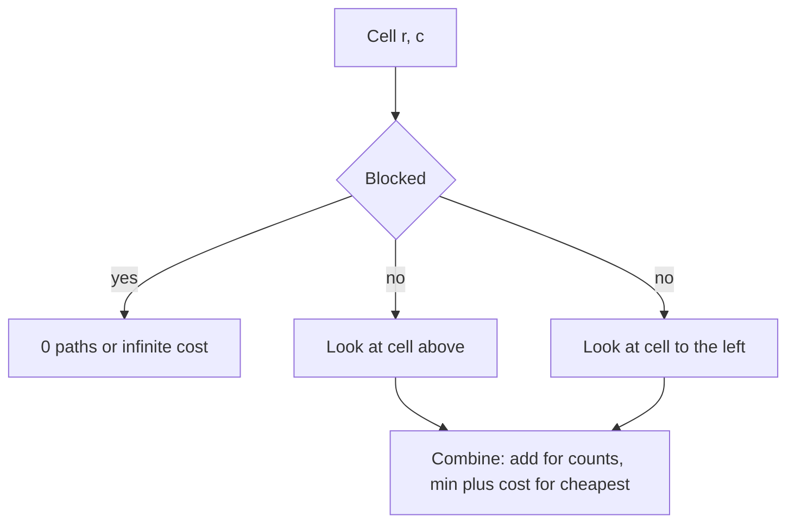

## The hook

A warehouse robot starts in the top-left corner of a floor laid out as a grid and must reach the bottom-right corner. It can only move right or down. How many different routes are there? Which route picks up the least dust? What if some cells are blocked by shelves?

Grid problems like these are among the most common first DP questions in interviews, because the table *is* the grid. Once you see that each cell's answer comes from the cell above it and the cell to its left, a dozen problems become the same five lines of code with a different combining rule.

## The intuition

:::analogy
Imagine you are the delivery robot, standing on some cell. You did not teleport there: your last move was either down from the cell above or right from the cell to your left. So the number of ways to reach you is the ways to reach the cell above plus the ways to reach the cell on your left. The cheapest way to reach you is your own cost plus the cheaper of those two arrivals. The robot never needs to remember the whole route, only how good the two "doorways" into its cell were.
:::

That is [[grid DP]]. Because the robot follows a [[monotone path]], the cells above and to the left are always finished before you need them, so filling the grid row by row, left to right, just works. This is the same "trust the smaller subproblem" idea as in [Dynamic Programming Is Just Careful Recursion](article:dsa-dp-intro), laid out on a grid.

## How it works

### Counting paths

| Part | Definition |
|---|---|
| State | dp[r][c] = number of paths from (0, 0) to (r, c) |
| Transition | dp[r][c] = dp[r−1][c] + dp[r][c−1], using 0 for neighbours outside the grid |
| Base case | dp[0][0] = 1; an [[obstacle]] cell has dp = 0 |
| Answer | dp[R−1][C−1] |

Without obstacles there is also a formula: every path makes R − 1 down moves and C − 1 right moves, so the count is C(R + C − 2, R − 1). With obstacles, only the DP works.

### Cheapest path

| Part | Definition |
|---|---|
| State | dp[r][c] = minimum total cost of a path from (0, 0) to (r, c), including both ends |
| Transition | dp[r][c] = cost[r][c] + min(dp[r−1][c], dp[r][c−1]) |
| Base case | dp[0][0] = cost[0][0]; the [[boundary row and column]] have only one neighbour |
| Answer | dp[R−1][C−1] |

To rebuild the route, start at the bottom-right and step to whichever neighbour, up or left, has the smaller dp value.

### Largest square of ones

A different combining rule on the same grid. Let dp[r][c] be the side of the largest all-ones square whose bottom-right corner is (r, c). If the cell is 1:

dp[r][c] = 1 + min(dp[r−1][c], dp[r][c−1], dp[r−1][c−1])

The square at (r, c) is limited by whichever of the three neighbouring squares is smallest.



:::insight
Every grid DP asks "from which neighbours could I have arrived?" and then combines their answers: add them for counting, take the minimum or maximum for optimising. The allowed moves decide the neighbours, and the neighbours decide the fill order.
:::

### Saving space

Each row needs only the row above and the cell to its left, so a single [[rolling row]] array works: when you update dp[c], the old dp[c] is "above" and the new dp[c − 1] is "left". Memory drops from O(R × C) to O(C). Keep the full table if you must rebuild the path.

### Variants

- **Moves in other directions** (down, right and diagonal): add the diagonal neighbour.
- **Dungeon Game**: the required health depends on what comes *later*, so fill from the bottom-right towards the top-left.
- **Two robots at once** (cherry-pickup style): the state becomes both robots' positions after the same number of steps, a 3D DP.
- **Moves in all four directions**: paths can loop, so this is no longer a DP over a fixed order; it becomes a graph shortest-path problem (BFS or Dijkstra).

## Walk through an example

**Counting with an obstacle.** A 3 × 4 grid with a shelf at (1, 1):

| | c0 | c1 | c2 | c3 |
|---|---|---|---|---|
| r0 | 1 | 1 | 1 | 1 |
| r1 | 1 | **0** | 1 | 2 |
| r2 | 1 | 1 | 2 | **4** |

4 paths. Without the shelf the answer would be C(5, 2) = 10.

**Cheapest path.** Costs and the resulting DP table:

| cost | c0 | c1 | c2 | c3 |
|---|---|---|---|---|
| r0 | 1 | 4 | 2 | 1 |
| r1 | 3 | 2 | 6 | 2 |
| r2 | 5 | 1 | 1 | 3 |

| dp | c0 | c1 | c2 | c3 |
|---|---|---|---|---|
| r0 | 1 | 5 | 7 | 8 |
| r1 | 4 | 6 | 12 | 10 |
| r2 | 9 | 7 | 8 | **11** |

Minimum cost **11**. Walking back from (2, 3): left to (2, 2), left to (2, 1), up to (1, 1), left to (1, 0), up to (0, 0). The route is 1 → 3 → 2 → 1 → 1 → 3. Notice the greedy choice at the start, going down to 3 instead of right to 4, happens to be right here, but greedy is not safe in general: the DP compares complete routes.

:::try-this
For the 0/1 matrix with rows 1011, 1111, 1111, 0110, what is the side of the largest square of ones? (Filling the dp table gives a 2 at (1, 3), (2, 1), (2, 2), (2, 3) and (3, 2), and nothing larger, so the answer is a 2 × 2 square.)
:::

## The code

```pseudo
count_paths(grid):                         // grid[r][c] == 1 means blocked
    dp = [0] * C
    for r in 0..R-1:
        for c in 0..C-1:
            if grid[r][c] blocked: dp[c] = 0
            else if r == 0 and c == 0: dp[c] = 1
            else if c > 0: dp[c] = dp[c] + dp[c-1]   // above + left
    return dp[C-1]

min_path(cost):
    dp = R x C
    for r, c in row-major order:
        best = min of dp[r-1][c], dp[r][c-1] that exist, or 0 at the start
        dp[r][c] = cost[r][c] + best
    return dp[R-1][C-1]
```

```cpp
#include <bits/stdc++.h>
using namespace std;

long long countPaths(const vector<vector<int>>& blocked) {
    int R = blocked.size(), C = blocked[0].size();
    vector<long long> dp(C, 0);
    for (int r = 0; r < R; r++)
        for (int c = 0; c < C; c++) {
            if (blocked[r][c]) dp[c] = 0;
            else if (r == 0 && c == 0) dp[c] = 1;
            else if (c > 0) dp[c] += dp[c - 1];          // dp[c] already holds "above"
        }
    return dp[C - 1];
}

int minPathSum(const vector<vector<int>>& g) {
    int R = g.size(), C = g[0].size();
    vector<int> dp(C, INT_MAX);
    for (int r = 0; r < R; r++)
        for (int c = 0; c < C; c++) {
            if (r == 0 && c == 0) { dp[c] = g[0][0]; continue; }
            int best = dp[c];                            // from above (INT_MAX on row 0)
            if (c > 0) best = min(best, dp[c - 1]);      // from the left
            dp[c] = g[r][c] + best;
        }
    return dp[C - 1];
}

int main() {
    cout << countPaths({{0, 0, 0, 0}, {0, 1, 0, 0}, {0, 0, 0, 0}}) << '\n';      // 4
    cout << minPathSum({{1, 4, 2, 1}, {3, 2, 6, 2}, {5, 1, 1, 3}}) << '\n';      // 11
}
```

## Complexity

- **Time:** O(R × C): every cell is computed once from at most three neighbours.
- **Space:** O(R × C) for the full table, needed to rebuild the path; O(C) with a rolling row otherwise.

## Common mistakes

:::warning
Common misconception: "the first row and first column are always 1 path each." That is only true without obstacles. One blocked cell in the first row cuts off every cell to its right, because the only way in is along that row. Let the general rule handle boundaries, treating outside neighbours as 0, instead of hard-coding them.
:::

- **Using 0 instead of infinity** for missing neighbours in min-cost problems: an outside neighbour must never look like a free path.
- **Overflow** when counting paths in large grids: use 64-bit integers or the modulus the problem asks for.
- **Filling in the wrong order** for problems like Dungeon Game, where the answer depends on cells below and to the right.
- **Using DP when moves go in all four directions**, where paths can loop and a graph algorithm is needed.

### Interview follow-ups

**"What if you can also move left and up?"** Then the dependencies form cycles, so a single DP pass no longer works. Minimum cost becomes a shortest-path problem: Dijkstra for non-negative costs, or BFS for unit costs.

**"Count paths in a 100 × 100 grid: what goes wrong?"** The count is a binomial coefficient, C(198, 99) without obstacles, far beyond 64-bit integers. Problems ask for it modulo a prime, or you use big integers.

**"Two people collect cherries at once (Cherry Pickup). How does the state change?"** Move both together step by step, so the state is (step, row1, row2) and each column follows from step minus row. That turns a hard two-path problem into an O(n³) DP.

## Practice problems

*Unique Paths* and *Unique Paths II* are the counting templates, with and without obstacles. *Grid Paths* (CSES) is the obstacle version with a modulus. *Minimum Path Sum* is the cheapest-path template. *Maximal Square* uses the three-neighbour minimum rule. *Dungeon Game* fills the table backwards from the bottom-right.

## Key takeaways

- In grid DP, each cell's answer is built from the cells you could have arrived from, usually the one above and the one to the left.
- Adding the neighbours counts paths, and taking the cheaper neighbour plus the cell's cost finds the cheapest path.
- Obstacles get 0 paths or infinite cost, and outside neighbours must be handled so boundaries need no special cases.
- One rolling row reduces memory to O(C), while the full table lets you walk back from the corner to rebuild the path.
- Change the neighbours or the fill direction for variants, and switch to graph algorithms when moves can go in all directions.
