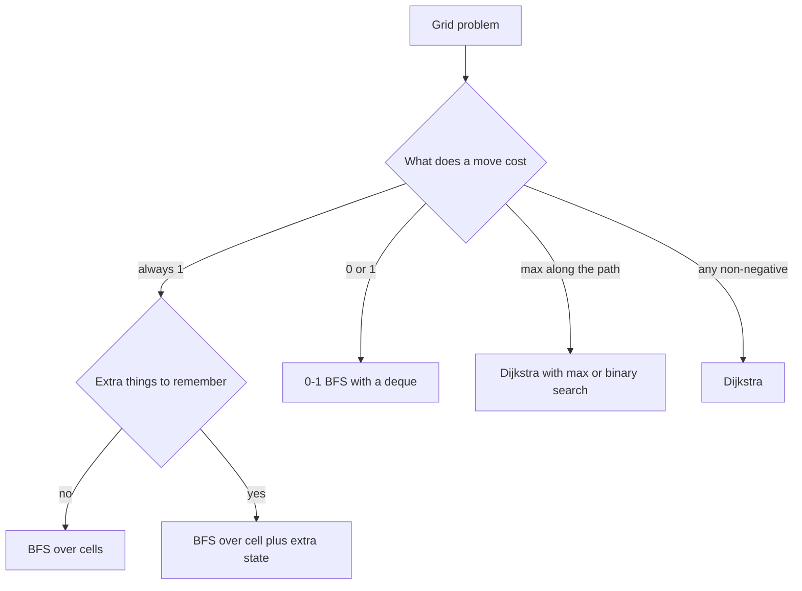

## The hook

A robot vacuum is switched on in a strange room. It knows only its own square of floor and can bump into walls. It moves one square at a time, up, down, left or right, and slowly builds a map. Nobody hands it a list of edges; the floor plan itself is the graph.

Grid problems are the most common graph questions in interviews precisely because the graph is hidden in plain sight. Recognising that, and knowing four or five tricks for the harder variants, turns a page of special cases into the same few loops every time.

## The intuition

:::analogy
The vacuum treats each floor tile as a place and each move to an adjacent open tile as a road. It does not need the whole map in advance: standing on a tile, it can always work out its four possible next tiles and check whether each is inside the room and not a wall. If the vacuum also carries something that changes its options, such as a battery that allows two bumps through flimsy boxes, then "where I am" is no longer enough. The vacuum's situation is the tile plus whatever it is carrying.
:::

That is the whole pattern:

- **Vertices are cells**, and edges go to the up to four neighbours that are in bounds and open. A [[direction array]] generates them in one loop.
- **The right search depends on edge costs**: BFS when every move costs 1, [[0-1 BFS]] when moves cost 0 or 1, Dijkstra for anything else.
- **When the vacuum carries something**, a vertex is a [[state]]: (row, column, extra information). The search is the same; only the visited array grows a dimension.

## How it works

### Trick 1: direction arrays and bounds

```cpp partial
int dr[] = {-1, 1, 0, 0}, dc[] = {0, 0, -1, 1};
for (int k = 0; k < 4; k++) {
    int nr = r + dr[k], nc = c + dc[k];
    if (nr < 0 || nc < 0 || nr >= R || nc >= C || grid[nr][nc] == '#') continue;
    // (nr, nc) is a neighbour
}
```

Add four more offsets for diagonal moves, or knight offsets for a chessboard. To store a cell in a single integer, use r × C + c.

### Trick 2: rebuilding the path

*Labyrinth* asks for the path itself, as a string of moves. During BFS, store for each cell the direction you arrived from. At the end, walk back from the target, reading each stored direction and stepping the opposite way, then reverse the collected letters. Storing a direction index costs one byte per cell, less than storing the parent cell.

### Trick 3: 0-1 BFS

In *Minimum Cost to Make at Least One Valid Path in a Grid*, each cell has an arrow; following it is free, and moving any other way costs 1 (you change the arrow). Plain BFS breaks, because a long free path can beat a short paid one. Dijkstra works, but a deque is simpler and faster:

- pop the front cell;
- for a 0-cost move that improves a neighbour, push it to the **front**;
- for a 1-cost move that improves a neighbour, push it to the **back**.

The deque always holds cells at distance d near the front and d + 1 near the back, so cells come out in distance order, exactly as Dijkstra would deliver them, in O(V + E).

### Trick 4: BFS over states

In *Shortest Path in a Grid with Obstacles Elimination*, you may walk through up to k walls. The state is (row, column, eliminations left). Stepping onto a wall uses one elimination. BFS over states gives the fewest steps, and visited must be three-dimensional: reaching a cell with 2 eliminations left is better than reaching it with 1, and must not be blocked by it.

The cost of a state dimension is [[state explosion]]: R × C × (k + 1) states. Two standard defences:

- **Prune with a bound.** Any path needs at least (R - 1) + (C - 1) steps and crosses at most that many cells, so if k is at least R + C - 3, you can walk straight and the answer is R + C - 2.
- **Keep only the best.** Store, for each cell, the most eliminations left on any arrival so far, and skip arrivals that are no better. This keeps the work closer to R × C in practice.

Keys and doors (*Shortest Path to Get All Keys*) use the same idea with a bitmask of keys collected as the extra dimension.

### Trick 5: minimax paths

*Swim in Rising Water* has a height in every cell. At time t you can swim through any cell of height at most t. Find the earliest time to cross from the top-left to the bottom-right. The cost of a path is its highest cell, a [[minimax path]]. Two methods:

- Dijkstra with "new cost = max(cost so far, height of the next cell)" instead of a sum.
- Binary search on t, checking each guess with a BFS restricted to cells of height at most t, which is the idea from [Guessing the Answer, Then Checking It](article:dsa-binary-search-answer).

| Grid question | Edge costs | Tool |
|---|---|---|
| Fewest steps through open cells | all 1 | BFS |
| Free moves and paid moves | 0 or 1 | 0-1 BFS with a deque |
| Steps with a budget of wall breaks or keys | all 1, larger state | BFS over (cell, extra) |
| Lowest possible maximum on the path | max, not sum | Dijkstra with max, or binary search plus BFS |
| Different cost per cell | any non-negative | Dijkstra |



:::insight
A grid is a graph whose edges you generate on the fly. Decide what a move costs and what the walker must remember; that choice picks BFS, 0-1 BFS or Dijkstra, and it sets the size of the visited array.
:::

## Walk through an example

### Labyrinth with path reconstruction

```
A . # . . .
. # # . # .
. . . # B .
. # . . . #
```

BFS distances from A, with # for walls:

| | c0 | c1 | c2 | c3 | c4 | c5 |
|---|---|---|---|---|---|---|
| r0 | 0 | 1 | # | 13 | 12 | 11 |
| r1 | 1 | # | # | 14 | # | 10 |
| r2 | 2 | 3 | 4 | # | **8** | 9 |
| r3 | 3 | # | 5 | 6 | 7 | # |

B at (2, 4) is 8 steps away. Walking back through the stored directions gives the path D D R R D R R U: down to (2, 0), right to (2, 2), down to (3, 2), right to (3, 4), up to B. The cells at the top right are reached last, because the only way there goes past B.

### Obstacle elimination: one break saves six steps

```
0 1 0 0 0
0 1 0 1 0
0 1 0 1 0
0 0 0 1 0
1 1 1 1 0
```

| Eliminations allowed | Fewest steps | Route |
|---|---|---|
| 0 | 14 | down the left column, across, up the middle, across the top, down the right |
| 1 | 8 | break (0, 1) and walk the top row, then the right column |
| 2 or more | 8 | already the shortest possible, (5 - 1) + (5 - 1) |

### 0-1 BFS on arrows

Arrows: 1 right, 2 left, 3 down, 4 up.

```
1 1 1
2 2 2
1 1 1
```

From (0, 0), the free moves follow the top row to (0, 2). Reaching row 1 costs one change, after which the left arrows move freely along row 1; reaching row 2 costs one more. The cost to the bottom-right corner is 2.

### Swim in Rising Water

```
0 2 5
7 1 4
3 8 6
```

Dijkstra with max gives 6 for the bottom-right corner, along 0 → 2 → 1 → 4 → 6. The route through the left column must pass the 7, and through the bottom row the 8, so the middle route wins.

:::try-this
In the obstacle grid above, with k = 0, how many cells does BFS visit at most, and how many states would it visit with k = 3? (With k = 0, at most the 15 open cells. With k = 3, each of the 25 cells can appear with up to 4 different elimination counts, so up to 100 states. The pruning bound says k ≥ 5 + 5 - 3 = 7 would let you answer 8 immediately, but k = 3 still needs the search.)
:::

:::warning
Common misconception: "Mark a cell visited the first time it is reached, whatever else is true." That is right for plain BFS, but wrong once the state has extra dimensions. In obstacle elimination, reaching a cell early with no eliminations left can block a slightly later arrival that still has one, and that later arrival might be the only way through. Visited must cover the whole state.
:::

## The code

```pseudo
grid_bfs(grid, start, target):
    dist[start] = 0; queue = [start]
    while queue:
        (r, c) = queue.pop_front()
        for each direction (dr, dc):
            if (r + dr, c + dc) is inside, open, unvisited:
                dist = dist[(r, c)] + 1; from_dir = this direction; push

zero_one_bfs(start):
    dist[start] = 0; deque = [start]
    while deque:
        u = deque.pop_front()
        for (v, w) with w in {0, 1}:
            if dist[u] + w < dist[v]:
                dist[v] = dist[u] + w
                if w == 0: deque.push_front(v) else: deque.push_back(v)

state_bfs(grid, k):                          # state = (r, c, eliminations left)
    seen[0][0][k] = true; queue = [(0, 0, k, 0)]
    while queue: pop (r, c, e, d); if target: return d
        for neighbours (nr, nc): ne = e - wall(nr, nc)
            if ne >= 0 and not seen[nr][nc][ne]: mark; push (nr, nc, ne, d + 1)
```

```cpp
#include <bits/stdc++.h>
using namespace std;
const int DR[] = {-1, 1, 0, 0}, DC[] = {0, 0, -1, 1};
const char DIR[] = {'U', 'D', 'L', 'R'};

string labyrinth(const vector<string>& g) {
    int R = g.size(), C = g[0].size(), sr = 0, sc = 0, tr = 0, tc = 0;
    for (int r = 0; r < R; r++)
        for (int c = 0; c < C; c++) {
            if (g[r][c] == 'A') sr = r, sc = c;
            if (g[r][c] == 'B') tr = r, tc = c;
        }
    vector<vector<int>> from(R, vector<int>(C, -1));   // direction used to arrive
    vector<vector<bool>> seen(R, vector<bool>(C, false));
    queue<pair<int, int>> q;
    q.push({sr, sc}), seen[sr][sc] = true;
    while (!q.empty()) {
        auto [r, c] = q.front(); q.pop();
        for (int k = 0; k < 4; k++) {
            int nr = r + DR[k], nc = c + DC[k];
            if (nr < 0 || nc < 0 || nr >= R || nc >= C || g[nr][nc] == '#' || seen[nr][nc]) continue;
            seen[nr][nc] = true, from[nr][nc] = k, q.push({nr, nc});
        }
    }
    if (!seen[tr][tc]) return "NO";
    string path;
    for (int r = tr, c = tc; r != sr || c != sc;) {
        int k = from[r][c];
        path += DIR[k];
        r -= DR[k], c -= DC[k];                          // step back the opposite way
    }
    reverse(path.begin(), path.end());
    return path;
}

int arrowsCost(const vector<vector<int>>& a) {          // 1 right, 2 left, 3 down, 4 up
    int R = a.size(), C = a[0].size();
    int mr[] = {0, 0, 0, 1, -1}, mc[] = {0, 1, -1, 0, 0};
    vector<vector<int>> dist(R, vector<int>(C, INT_MAX));
    deque<pair<int, int>> dq;
    dist[0][0] = 0, dq.push_back({0, 0});
    while (!dq.empty()) {
        auto [r, c] = dq.front(); dq.pop_front();
        for (int k = 1; k <= 4; k++) {
            int nr = r + mr[k], nc = c + mc[k], w = (a[r][c] == k) ? 0 : 1;
            if (nr < 0 || nc < 0 || nr >= R || nc >= C || dist[r][c] + w >= dist[nr][nc]) continue;
            dist[nr][nc] = dist[r][c] + w;
            if (w == 0) dq.push_front({nr, nc}); else dq.push_back({nr, nc});
        }
    }
    return dist[R - 1][C - 1];
}

int obstacleElimination(const vector<vector<int>>& g, int k) {
    int R = g.size(), C = g[0].size();
    if (k >= R + C - 3) return R + C - 2;                // enough breaks to walk straight
    vector<vector<int>> bestLeft(R, vector<int>(C, -1));  // most eliminations left on arrival
    queue<array<int, 4>> q;                               // r, c, left, steps
    q.push({0, 0, k, 0}), bestLeft[0][0] = k;
    while (!q.empty()) {
        auto [r, c, e, d] = q.front(); q.pop();
        if (r == R - 1 && c == C - 1) return d;
        for (int dir = 0; dir < 4; dir++) {
            int nr = r + DR[dir], nc = c + DC[dir];
            if (nr < 0 || nc < 0 || nr >= R || nc >= C) continue;
            int ne = e - g[nr][nc];
            if (ne < 0 || ne <= bestLeft[nr][nc]) continue;   // not a better state
            bestLeft[nr][nc] = ne, q.push({nr, nc, ne, d + 1});
        }
    }
    return -1;
}

int swim(const vector<vector<int>>& h) {
    int n = h.size();
    vector<vector<int>> best(n, vector<int>(n, INT_MAX));
    priority_queue<array<int, 3>, vector<array<int, 3>>, greater<>> pq;
    best[0][0] = h[0][0], pq.push({h[0][0], 0, 0});
    while (!pq.empty()) {
        auto [t, r, c] = pq.top(); pq.pop();
        if (t > best[r][c]) continue;
        for (int k = 0; k < 4; k++) {
            int nr = r + DR[k], nc = c + DC[k];
            if (nr < 0 || nc < 0 || nr >= n || nc >= n) continue;
            int nt = max(t, h[nr][nc]);                   // minimax, not a sum
            if (nt < best[nr][nc]) best[nr][nc] = nt, pq.push({nt, nr, nc});
        }
    }
    return best[n - 1][n - 1];
}

int main() {
    cout << labyrinth({"A.#...", ".##.#.", "...#B.", ".#...#"}) << '\n';       // DDRRDRRU
    cout << arrowsCost({{1, 1, 1}, {2, 2, 2}, {1, 1, 1}}) << '\n';              // 2
    vector<vector<int>> g = {{0, 1, 0, 0, 0}, {0, 1, 0, 1, 0}, {0, 1, 0, 1, 0}, {0, 0, 0, 1, 0}, {1, 1, 1, 1, 0}};
    cout << obstacleElimination(g, 0) << ' ' << obstacleElimination(g, 1) << '\n';   // 14 8
    cout << swim({{0, 2, 5}, {7, 1, 4}, {3, 8, 6}}) << '\n';                    // 6
}
```

`obstacleElimination` uses the "keep only the best" defence: a cell is re-entered only by an arrival with strictly more eliminations left. Because BFS pops states in order of steps, a later arrival is never shorter, so the only reason to revisit is a larger budget.

## Complexity

- **Plain grid BFS: O(R × C)** time and space; each cell has at most four edges.
- **0-1 BFS: O(R × C),** the same as BFS, compared with O(R × C × log(R × C)) for Dijkstra.
- **State BFS: O(R × C × (k + 1))** in the worst case; the bound check and best-left pruning usually cut this sharply.
- **Swim in Rising Water: O(n² log n)** with Dijkstra, or O(n² log H) with binary search over heights up to H.

## Common mistakes

- **Swapping rows and columns** in bounds checks on non-square grids.
- **Using plain BFS when some moves are free,** which returns the fewest moves rather than the lowest cost.
- **Marking visited by cell only** when the state includes extra information such as eliminations or keys.
- **Ignoring state explosion,** for example a bitmask of 10 keys on a 30 × 30 grid is 900 × 1,024 states, fine, but adding another dimension on top may not be.
- **Recursing with DFS for shortest paths** on grids; DFS does not find shortest paths and can overflow the stack on large grids.
- **In 0-1 BFS, skipping the improvement check,** which pushes cells many times and loses the linear time.

## Practice problems

*Labyrinth* is grid BFS with path reconstruction. *Shortest Path in a Grid with Obstacles Elimination* is BFS over (cell, breaks left). *Minimum Cost to Make at Least One Valid Path in a Grid* is the textbook 0-1 BFS. *Swim in Rising Water* is the minimax path, solvable by Dijkstra or by binary search with BFS. The plain BFS loop is in [Ripples on a Pond: Breadth-First Search](article:dsa-bfs), and the weighted version in [Water Racing Through a Network of Pipes](article:dsa-dijkstra).

## Key takeaways

- A grid is a graph whose vertices are cells and whose edges are generated from a direction array with bounds and wall checks.
- Storing the arrival direction for each cell lets you rebuild the path by walking back from the target and reversing.
- When moves cost 0 or 1, a deque with free moves at the front and paid moves at the back finds shortest paths in linear time.
- When the walker carries extra information such as remaining wall breaks or keys, the vertex is the full state and visited must cover every dimension.
- When a path's cost is its largest value rather than its sum, Dijkstra with max or binary search with a BFS check finds the best path.
