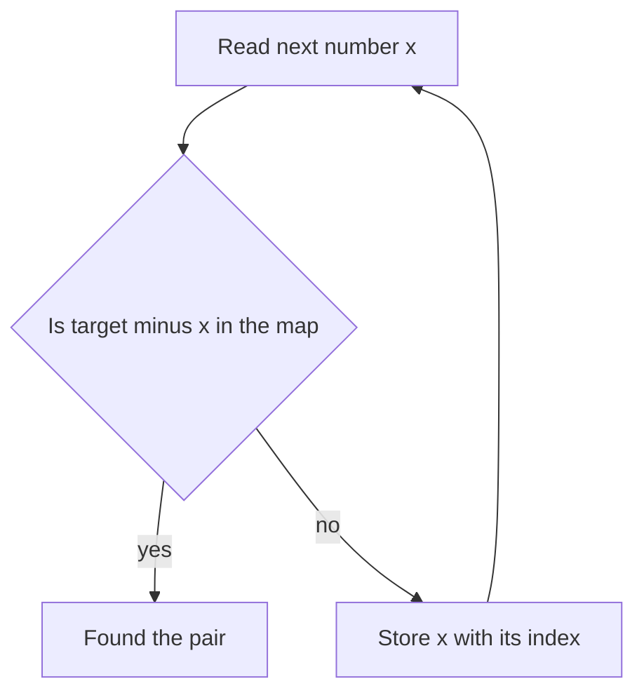

## The hook

Two Sum is probably the most famous interview question in the world. Given a list of numbers, find two that add up to a target. Most people's first answer checks every pair, and with 100,000 numbers that is about five billion checks.

The fix is so small it feels like cheating: keep a notebook of the numbers you have already seen. One pass, and you are done. That notebook is a hash map, and it quietly solves a huge share of interview problems.

## The intuition

:::analogy
Picture a coat check at a theatre. When you hand over a coat, the attendant does not search the whole room later. They give you a numbered ticket, and the number tells them exactly which hook to walk to. A [[hash map]] works the same way: it turns a key into a hook number, so finding it later takes one walk, not a search.
:::

Most brute-force solutions are slow because they search. "Is there an earlier number that pairs with this one?" means scanning everything before it. A hash map turns that search into a single lookup, which is O(1) on average.

That gives three patterns you will use constantly:

1. **Seen before?** Store items as you go and ask whether the partner you need is already there.
2. **How many?** Count occurrences with a [[frequency map]].
3. **Which group?** Map each item to a [[canonical key]] and bucket items that share it.

## How it works

### Pattern 1: remember what you have seen

For each number `x`, the partner you need is its [[complement]], `target - x`. Ask the map whether you have seen it. If not, record `x` and move on.



### Pattern 2: count things

A frequency map answers "how many times?" in one pass: `count[x]++` for every item. Valid Anagram, majority element, "first unique character" and many more are frequency questions in disguise.

### Pattern 3: group by a key

Two items belong in the same group exactly when they share some standard form. For anagrams, the standard form is the sorted letters: "eat", "tea" and "ate" all become "aet". Use that as the map key, and append each word to its key's list.

### When not to reach for a hash map

A hash map costs O(n) extra memory and gives up order. If the array is already sorted, two pointers find a pair in O(n) time with O(1) memory. If you need "the next bigger key" or keys in order, use an ordered `map` instead. And if the keys are small integers, say values from 0 to 1,000, a plain array of counts is faster and simpler than any hash map. Use the notebook when you need fast lookups by arbitrary keys and order does not matter.

:::insight
The whole skill is choosing what to store as the key. Ask: "what fact about earlier items would let me answer instantly for the current one?" Store that fact as the key.
:::

## Walk through an example

Two Sum with `nums = [3, 8, 4, 5]` and `target = 9`. The map stores value → index.

| Step | x | Complement 9 − x | In map? | Map after step |
|---|---|---|---|---|
| 0 | 3 | 6 | no | {3: 0} |
| 1 | 8 | 1 | no | {3: 0, 8: 1} |
| 2 | 4 | 5 | no | {3: 0, 8: 1, 4: 2} |
| 3 | 5 | 4 | **yes, at index 2** | done |

Answer: indices 2 and 3. Notice that we check before we insert. With target 8 and `nums = [4, 1]`, inserting first would let 4 pair with itself.

:::try-this
Group these words by anagram: "listen", "stone", "silent", "notes", "enlist", "tones". Write the sorted-letters key for each by hand. You should get two groups: key "eilnst" for listen, silent, enlist, and key "enost" for stone, notes, tones.
:::

## The code

The idea first:

```pseudo
two_sum(nums, target):
    seen = empty map from value to index
    for i, x in nums:
        if (target - x) in seen:
            return [seen[target - x], i]
        seen[x] = i
    return none

group_anagrams(words):
    groups = empty map from key to list
    for w in words:
        groups[sorted letters of w].append(w)
    return all lists in groups
```

Compact C++:

```cpp
#include <bits/stdc++.h>
using namespace std;

vector<int> twoSum(const vector<int>& nums, int target) {
    unordered_map<int, int> seen;  // value -> index
    for (int i = 0; i < (int)nums.size(); i++) {
        auto it = seen.find(target - nums[i]);
        if (it != seen.end()) return {it->second, i};
        seen[nums[i]] = i;
    }
    return {};
}

vector<vector<string>> groupAnagrams(const vector<string>& words) {
    unordered_map<string, vector<string>> groups;
    for (const string& w : words) {
        string key = w;
        sort(key.begin(), key.end());
        groups[key].push_back(w);
    }
    vector<vector<string>> out;
    for (auto& [key, list] : groups) out.push_back(list);
    return out;
}

int main() {
    auto r = twoSum({3, 8, 4, 5}, 9);
    cout << r[0] << ' ' << r[1] << '\n';  // 2 3
    cout << groupAnagrams({"eat", "tea", "tan", "ate", "nat", "bat"}).size() << '\n';  // 3
}
```

## Complexity

- **Two Sum:** O(n) time on average, one lookup and one insert per element; O(n) space for the map.
- **Group Anagrams:** sorting each word of length k costs O(k log k), so O(n · k log k) in total, plus O(n · k) space for the stored words. With only lowercase letters, a 26-count key gives O(n · k).

These are average costs. A single hash lookup can be O(n) in the worst case when many keys cause a [[collision]], which is why contest problems sometimes include tests designed to slow down `unordered_map`.

## Common mistakes

:::warning
Common misconception: "hash maps are always O(1)." They are O(1) on average. In interviews that is the accepted answer, but in contests with adversarial tests, a `map` (O(log n)) or a custom hash function is safer.
:::

- **Inserting before checking** in Two Sum, which pairs an element with itself.
- **Using `map[key]` just to check existence.** In C++, `m[key]` inserts a default value when the key is missing. Use `find` or `count` to look without inserting.
- **Iterating an `unordered_map` and expecting order.** It has none. If you need sorted output, use `map` or sort afterwards.
- **Choosing a key that is too weak.** Length or letter sums group words that are not anagrams. A key must be equal exactly when the items belong together.

## Practice problems

Start with *Two Sum* and *Contains Duplicate* to get the "seen before" reflex. *Group Anagrams* practises choosing a canonical key. *Longest Consecutive Sequence* uses a set cleverly: only start counting from numbers whose predecessor is missing. *Subarray Sum Equals K* combines this pattern with [prefix sums](article:dsa-prefix-sums): store how many times each prefix sum has appeared, and look up `prefix - k`.

## Key takeaways

- A hash map turns "search everything before me" into one average O(1) lookup, which often drops a solution from O(n²) to O(n).
- Three patterns cover most uses: remember what you have seen, count with a frequency map, and group by a canonical key.
- The core skill is choosing the key, the fact about earlier items that answers the current question instantly.
- In Two Sum, check for the complement before inserting the current number so an element never pairs with itself.
- Hash lookups are O(1) on average but O(n) in the worst case, so use an ordered map or custom hash when inputs may be adversarial.
