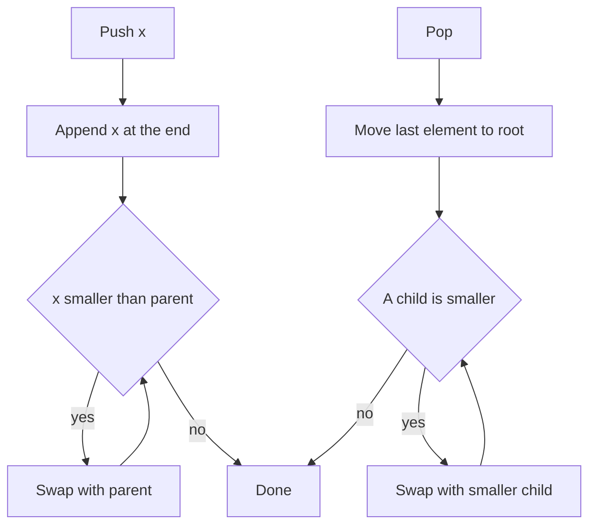

## The hook

A hospital emergency room on a busy night takes patients in any order: a sprained ankle, a chest pain, a cut finger, a child with a high fever. Nobody is seen in arrival order. The triage nurse always knows who is most urgent right now, and when that patient goes in, knows who is next within seconds.

Re-sorting the whole room after every arrival would be far too slow, so the nurse keeps just enough order to answer one question fast: who is most urgent? That partial order is a heap, and it powers Dijkstra's shortest paths, merging sorted lists, task schedulers and every "top k" interview question. How do you keep "just enough" order in an array, and why is it cheap?

## The intuition

:::analogy
Picture the triage board as a family tree of patients. The rule is simple: every patient on the board is at least as urgent as the two patients listed directly below them. Nobody cares how the cousins compare. A new arrival is written at the bottom and moves up past anyone less urgent above them. When the top patient goes in, the last name on the board is moved to the top and slides down until the rule holds again.
:::

That rule, parent beats children, is the whole idea of a [[heap]]. It does not make the board sorted. It only guarantees that the most urgent patient sits at the very top, and that fixing the board after a change touches only one path from top to bottom.

A min-heap keeps the *smallest* value on top, and it is the version we trace here: in triage terms, a smaller number means more urgent. A max-heap is the mirror image, with the largest value on top.

## How it works

### The array layout

The board is always a [[complete binary tree]]: filled level by level, left to right, with no gaps. Because there are no gaps, you never need pointers. Store the levels one after another in an array:

| Relation | Index (0-based) |
|---|---|
| parent of i | (i − 1) / 2, rounded down |
| left child of i | 2i + 1 |
| right child of i | 2i + 2 |
| last non-leaf | n / 2 − 1 |

A tree with n nodes has height about log₂ n. For a million items that is only 20 levels, which is why every repair is fast.

### Push: sift up

To add a value, append it at the end of the array (the next free slot in the bottom level). It may now beat its parent, which breaks the rule. [[Sift up]]: while the new value is smaller than its parent, swap them. It stops at the root or when the parent is smaller. At most one swap per level, so O(log n).

### Pop: sift down

The smallest value is at index 0, so `top` is O(1). To remove it, move the last element into index 0 and shrink the array. That element is probably too large for the top, just like a mild case suddenly written at the head of the triage board. [[Sift down]]: compare it with its two children, swap with the **smaller** child if that child is smaller, and repeat. Again at most one swap per level.



:::insight
A heap is not sorted, and that is the point. It keeps only the order needed to find the best item, so every change repairs a single root-to-leaf path of length log n instead of reordering everything.
:::

### Heapify in linear time

Given an unsorted array, you could push items one at a time for O(n log n). [[Heapify]] does better. Every leaf is already a valid one-item heap, so start at the last non-leaf, index n / 2 − 1, and sift down each index back to 0.

Why O(n)? Think of the triage board again:

- half the patients are on the bottom row and never move;
- a quarter are one row up and slide down at most one step;
- an eighth slide at most two steps, and so on.

The total is n/4 × 1 + n/8 × 2 + n/16 × 3 + ..., which adds up to less than n. For a full heap of 1,023 nodes, heapify does at most 1,013 swaps, while pushing the same 1,023 items one by one can take up to 8,194.

### priority_queue in C++

C++ gives you a heap as `priority_queue`, a [[priority queue]] adapter over a vector, first met in [The Toolbox Every Fast Solution Is Built From](article:dsa-cpp-stl-toolkit):

- `priority_queue<int> pq;` is a **max-heap**: `top()` is the largest.
- `priority_queue<int, vector<int>, greater<int>> pq;` is a **min-heap**.
- With `pair<int,int>` the heap compares `first`, then `second`, which is handy for (distance, node) or (frequency, value).
- Building from a range, `priority_queue<int> pq(v.begin(), v.end());`, uses linear-time heapify.

### The top-k pattern

To keep the k **largest** items from a stream, keep a **min-heap** of size k. Its root is the smallest of your current best k, the weakest member of the club. For each new item, push it, and if the size exceeds k, pop the root. At any moment the root is the k-th largest so far. This is the [[top-k pattern]], and it costs O(n log k) time and O(k) space instead of sorting everything.

Cues that should make you reach for a heap: "k-th largest", "k closest", "k most frequent", "repeatedly take the smallest or largest", "merge k sorted", or any simulation where the best remaining choice changes after each step.

## Walk through an example

**Push 5, 3, 8, 1, 9, 2** into an empty min-heap:

| Push | Swaps while sifting up | Array after |
|---|---|---|
| 5 | none | [5] |
| 3 | 3 with parent 5 | [3, 5] |
| 8 | none (parent 3 is smaller) | [3, 5, 8] |
| 1 | 1 with 5 (index 1), then 1 with 3 (index 0) | [1, 3, 8, 5] |
| 9 | none | [1, 3, 8, 5, 9] |
| 2 | 2 with parent 8 (index 2) | [1, 3, 2, 5, 9, 8] |

Notice the final array is not sorted: 3 sits before 2. The rule only compares parents with children.

**Pop twice:**

| Pop | Last moved to root | Swaps while sifting down | Array after |
|---|---|---|---|
| returns 1 | 8 → [8, 3, 2, 5, 9] | 8 with smaller child 2 | [2, 3, 8, 5, 9] |
| returns 2 | 9 → [9, 3, 8, 5] | 9 with 3, then 9 with 5 | [3, 5, 8, 9] |

**Heapify [9, 4, 7, 1, 8, 2, 6, 3]** (n = 8, so start at index 3):

| Index | Value | Swaps | Array after |
|---|---|---|---|
| 3 | 1 | none (child 3 is larger) | [9, 4, 7, 1, 8, 2, 6, 3] |
| 2 | 7 | 7 with 2 | [9, 4, 2, 1, 8, 7, 6, 3] |
| 1 | 4 | 4 with 1, then 4 with 3 | [9, 1, 2, 3, 8, 7, 6, 4] |
| 0 | 9 | 9 with 1, 9 with 3, 9 with 4 | [1, 3, 2, 4, 8, 7, 6, 9] |

**Top-k with k = 3** on the stream 4, 1, 7, 3, 8, 5, 2, 9 (heap shown sorted for readability):

| Arrives | Evicted root | Heap holds | 3rd largest so far |
|---|---|---|---|
| 4 | none | {4} | not yet |
| 1 | none | {1, 4} | not yet |
| 7 | none | {1, 4, 7} | 1 |
| 3 | 1 | {3, 4, 7} | 3 |
| 8 | 3 | {4, 7, 8} | 4 |
| 5 | 4 | {5, 7, 8} | 5 |
| 2 | 2 | {5, 7, 8} | 5 |
| 9 | 5 | {7, 8, 9} | 7 |

When 2 arrives it is pushed and immediately popped, because it is weaker than everyone already in the club.

:::try-this
Push 6 into the min-heap [2, 4, 3, 7, 5]. Where does it end up, and how many swaps happen? (It goes to index 5, whose parent is index 2 holding 3. Since 6 > 3, no swaps happen: the array becomes [2, 4, 3, 7, 5, 6].)
:::

## The code

```pseudo
push(h, x):
    append x to h; i = last index
    while i > 0 and h[parent(i)] > h[i]:
        swap h[i], h[parent(i)]; i = parent(i)

pop(h):
    best = h[0]; h[0] = last element; remove last
    sift_down(h, 0)
    return best

sift_down(h, i):
    loop:
        s = whichever of i, left(i), right(i) holds the smallest value
        if s == i: stop
        swap h[i], h[s]; i = s

heapify(a):
    for i from n/2 - 1 down to 0: sift_down(a, i)

kth_largest_stream(stream, k):
    heap = empty min-heap
    for x in stream:
        push x; if size > k: pop
        if size == k: report heap.top
```

```cpp
#include <bits/stdc++.h>
using namespace std;

struct MinHeap {
    vector<int> h;
    void siftUp(int i) {
        while (i > 0 && h[(i - 1) / 2] > h[i]) { swap(h[i], h[(i - 1) / 2]); i = (i - 1) / 2; }
    }
    void siftDown(int i) {
        int n = h.size();
        while (true) {
            int s = i, l = 2 * i + 1, r = 2 * i + 2;
            if (l < n && h[l] < h[s]) s = l;
            if (r < n && h[r] < h[s]) s = r;
            if (s == i) return;
            swap(h[i], h[s]); i = s;
        }
    }
    void push(int x) { h.push_back(x); siftUp(h.size() - 1); }
    int pop() { int best = h[0]; h[0] = h.back(); h.pop_back(); if (!h.empty()) siftDown(0); return best; }
    void heapify(vector<int> a) { h = a; for (int i = (int)h.size() / 2 - 1; i >= 0; i--) siftDown(i); }
};

void print(const vector<int>& v) { for (int x : v) cout << x << ' '; cout << '\n'; }

int main() {
    MinHeap m;
    for (int x : {5, 3, 8, 1, 9, 2}) m.push(x);
    print(m.h);                                  // 1 3 2 5 9 8
    int a = m.pop(), b = m.pop();
    cout << a << ' ' << b << '\n';               // 1 2
    print(m.h);                                  // 3 5 8 9

    MinHeap built;
    built.heapify({9, 4, 7, 1, 8, 2, 6, 3});
    print(built.h);                              // 1 3 2 4 8 7 6 9

    priority_queue<int, vector<int>, greater<int>> club;   // min-heap of the best k
    int k = 3;
    for (int x : {4, 1, 7, 3, 8, 5, 2, 9}) {
        club.push(x);
        if ((int)club.size() > k) club.pop();
        if ((int)club.size() == k) cout << club.top() << ' ';
    }
    cout << '\n';                                // 1 3 4 5 5 7
}
```

## Complexity

- **push and pop:** O(log n), because each does at most one swap per level and a complete tree has about log₂ n levels.
- **top:** O(1), because the best item is always at index 0.
- **heapify:** O(n), because most nodes sit near the bottom and can sift down only a few levels.
- **Top-k over n items:** O(n log k) time and O(k) space, because the heap never grows beyond k + 1.
- **Space:** O(n) for the array itself, with no pointers.

## Common mistakes

:::warning
Common misconception: "`priority_queue<int>` gives me the smallest element." It is a max-heap by default, so `top()` is the largest. For a min-heap write `priority_queue<int, vector<int>, greater<int>>`. With a custom lambda comparator the logic also feels backwards: `cmp(a, b)` returning true means a has *lower* priority, so `a > b` builds a min-heap.
:::

- **Picking the wrong heap for top-k.** For the k largest, keep a *min*-heap of size k; for the k smallest, a *max*-heap of size k. The root must be the item you would throw out.
- **Sifting down to the wrong child.** In a min-heap, swap with the *smaller* child. Swapping with the left child by habit breaks the rule for the right subtree.
- **Index formulas for 1-based arrays.** With the root at index 1, children are 2i and 2i + 1 and the parent is i / 2. Mixing the two layouts causes silent bugs.
- **Calling `top()` or `pop()` on an empty heap.** It is undefined behaviour in C++. Check `empty()` first.
- **Expecting decrease-key or delete-by-value.** `priority_queue` cannot change or remove an item in the middle. The standard trick is lazy deletion: push the new version and, when popping, skip entries that are out of date.
- **Assuming the array is sorted.** Only the root is guaranteed. Iterating a heap's array does not give sorted order; popping n times does, which is heap sort.

## Practice problems

Start with *Last Stone Weight*, a pure max-heap simulation: pop two, push the difference. *Kth Largest Element in a Stream* is the top-k pattern exactly as traced above, and *Kth Largest Element in an Array* is the same idea on a fixed array (also solvable with quickselect). *Sort Characters By Frequency* and *Top K Frequent Elements* count first with a hash map, then push (count, value) pairs into a heap. *K Closest Points to Origin* is top-k with a custom key: keep a max-heap of size k on squared distance, so you never need a square root.

## Key takeaways

- A heap keeps every parent at least as good as its children, which puts the best item at the root without sorting the rest.
- Because a heap is a complete binary tree, it lives in a plain array where the children of i are 2i + 1 and 2i + 2.
- Push sifts the new item up and pop sifts the moved last item down, so both cost O(log n) while top is O(1).
- Bottom-up heapify builds a heap from an array in O(n), because most nodes are near the bottom and barely move.
- For the k largest items keep a min-heap of size k, remembering that C++'s default priority_queue is a max-heap and needs greater for a min-heap.
