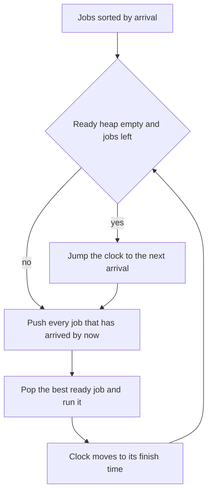

## The hook

An airport has one gate and a stream of planes. Planes land at different times, and each needs a different amount of time at the gate. When the gate is free, the controller calls the plane that has landed and has the shortest turnaround. If no plane has landed yet, the gate simply waits for the next one.

That single picture, "sort by when things become available, keep a heap of what is ready", solves a whole family of scheduling questions, from CPU queues to server farms. Getting the clock right is most of the difficulty.

## The problem

The main problem here is *Single-Threaded CPU*. Tasks are given as (enqueue time, processing time) and are numbered by position. The rules:

- a single CPU runs one task at a time and never stops a task halfway;
- whenever the CPU is free and at least one task has arrived, it picks the arrived task with the shortest processing time, breaking ties by smaller index;
- if no task has arrived, it waits.

Return the order in which tasks run.

For tasks (0, 3), (1, 9), (2, 6), (3, 2), (10, 1), (25, 4), the order is 0, 3, 2, 4, 1, 5.

## The obvious approach

Every time the CPU is free, scan all tasks, filter those that have arrived and not yet run, and pick the best. That is O(n) per pick and O(n²) overall.

Another tempting idea is to advance a clock one unit at a time and check what has arrived. With timestamps up to 10⁹, that loop alone is far too slow, even if each step is cheap.

## The key insight

:::analogy
The controller keeps two lists. The first is the landing schedule, sorted by landing time, with a finger on the next plane that has not landed yet. The second is the apron of planes that have landed and are waiting, arranged so the shortest turnaround is always at the front. Each time the gate frees up, the controller moves every plane that has landed by now from the schedule to the apron, then calls the front of the apron. If the apron is empty, the controller does not stare at the clock; they skip ahead to the next landing.
:::

This is an [[event simulation]], and it has three parts:

- **An [[arrival pointer]]** into the jobs sorted by arrival time. Moving it forward costs O(1) per job in total.
- **A [[ready heap]]** of arrived jobs, keyed by whatever rule picks the next job. Here the key is (processing time, index).
- **An [[idle jump]].** When the ready heap is empty, set the clock to the next arrival time.

The clock only ever moves to a moment when something happens: an arrival or a finish. Each job is pushed and popped once, so the whole simulation is O(n log n).

### Two heaps: Process Tasks Using Servers

In *Process Tasks Using Servers*, servers have weights, and task j arrives at time j with some duration. A task goes to the free server with the smallest weight, then the smallest index. If no server is free, the task waits until one is, and waiting tasks are served in arrival order. Return which server handles each task.

Now there are two kinds of waiting things, so there are two heaps:

| Heap | Key | Role |
|---|---|---|
| Free servers | (weight, index) | Pick the next server for a task |
| Busy servers | (free time, weight, index) | Release servers in the order they finish |

For each task in order, set the clock to at least the task's arrival time. Release every busy server whose free time has passed. If no server is free, jump the clock to the earliest free time and release from there. Then assign the lightest free server and push it into the busy heap.

### A threshold sweep: Maximum Performance of a Team

*Maximum Performance of a Team* is not about time, but it has the same shape. Engineers have a speed and an efficiency; a team of at most k engineers has performance equal to the sum of speeds times the minimum efficiency. Find the maximum, modulo 10⁹ + 7.

The trick is a [[threshold sweep]]. Sort engineers by efficiency, highest first. When you reach engineer i, every engineer seen so far has efficiency at least theirs, so if i is on the team, the minimum efficiency is exactly theirs. The best team with that minimum takes the k largest speeds among those seen, which a min-heap of size k maintains, as in [A Talent Show That Keeps Only the Best K](article:dsa-top-k-pattern). "Becoming available" here means "efficiency high enough", but the sorted-pointer-plus-heap structure is the same.

*IPO*, which you met in [Two Teams Kept Level on a Seesaw](article:dsa-two-heaps), is one more member of the family: projects become available as capital grows, and a max-heap picks the most profitable one.



:::insight
Scheduling simulations need two orderings at once: when things become available and which available thing is best. Sorting handles the first with a moving pointer, a heap handles the second, and jumping the clock over idle stretches keeps the work proportional to the number of jobs instead of the length of time.
:::

## Walk through an example

### Single-Threaded CPU

Tasks, numbered 0 to 5, as (enqueue, processing): (0, 3), (1, 9), (2, 6), (3, 2), (10, 1), (25, 4).

| Clock | Pushed into the ready heap | Ready heap (processing, index) | Runs | Finishes |
|---|---|---|---|---|
| 0 | task 0 | (3, 0) | 0 | 3 |
| 3 | tasks 1, 2, 3 | (2, 3), (6, 2), (9, 1) | 3 | 5 |
| 5 | | (6, 2), (9, 1) | 2 | 11 |
| 11 | task 4 | (1, 4), (9, 1) | 4 | 12 |
| 12 | | (9, 1) | 1 | 21 |
| 21 → 25 | heap empty, jump; task 5 | (4, 5) | 5 | 29 |

Order: 0, 3, 2, 4, 1, 5. Task 1 arrived at time 1 but ran fifth, because shorter tasks kept arriving before the CPU was free. At time 21, nothing was ready, so the clock jumped to 25.

### Process Tasks Using Servers

Servers with weights [2, 1], so server 1 is lighter. Tasks arrive at times 0 to 4 with durations [5, 5, 1, 1, 3].

| Task | Arrives | Clock | Released before assigning | Server | Busy until |
|---|---|---|---|---|---|
| 0 | 0 | 0 | | 1, the lightest | 5 |
| 1 | 1 | 1 | | 0 | 6 |
| 2 | 2 | 2 → 5 | none free, wait; server 1 at 5 | 1 | 6 |
| 3 | 3 | 5 → 6 | none free, wait; both at 6 | 1, the lighter | 7 |
| 4 | 4 | 6 | | 0 | 9 |

Answer [1, 0, 1, 1, 0]. Task 4 arrived at 4 but the clock was already at 6, because the queue was backed up. The clock never goes backwards.

### Maximum Performance of a Team, k = 2

Speeds [4, 9, 3, 6, 5], efficiencies [6, 2, 7, 4, 5]. Sorted by efficiency, highest first:

| Engineer (efficiency, speed) | Speeds kept, best 2 | Speed sum | Performance = sum × efficiency |
|---|---|---|---|
| (7, 3) | 3 | 3 | 21 |
| (6, 4) | 3, 4 | 7 | 42 |
| (5, 5) | 4, 5 | 9 | **45** |
| (4, 6) | 5, 6 | 11 | 44 |
| (2, 9) | 6, 9 | 15 | 30 |

Best 45: the engineers with speeds 4 and 5, whose minimum efficiency is 5. A brute force over every team of size 1 or 2 also gives 45. The fastest engineer, speed 9, never helps, because their efficiency 2 drags any team down.

:::try-this
Add a seventh CPU task, (11, 1), to the first example. When does task 1 run now? (At time 11, tasks 4 and 6 are both ready with processing time 1; task 4 runs first by smaller index, until 12, then task 6 until 13. Task 1 runs from 13 to 22. Task 5 arrives at 25, so the clock jumps from 22 to 25. The order is 0, 3, 2, 4, 6, 1, 5.)
:::

:::warning
Common misconception: "Process the jobs in arrival order and use the heap only to break ties." The heap is the whole point: a job that arrived later can run sooner if it is better by the rule, as task 3 did in the CPU example. Arrival order only decides when a job is allowed into the heap, never the order it leaves.
:::

## The code

```pseudo
single_threaded_cpu(tasks):
    order = task indices sorted by enqueue time
    ready = min-heap of (processing, index); t = 0; i = 0
    while result has fewer than n tasks:
        if ready is empty and t < enqueue[order[i]]: t = enqueue[order[i]]   # idle jump
        while i < n and enqueue[order[i]] <= t: ready.push((processing, index)); i += 1
        (p, j) = ready.pop(); result.append(j); t += p
    return result

assign_servers(weights, tasks):
    free = min-heap of (weight, index); busy = min-heap of (free_time, weight, index); t = 0
    for j, d in tasks:
        t = max(t, j)
        if free is empty: t = max(t, busy.top.free_time)
        while busy and busy.top.free_time <= t: free.push(busy.pop() without the time)
        (w, s) = free.pop(); answer[j] = s; busy.push((t + d, w, s))
```

```cpp
#include <bits/stdc++.h>
using namespace std;

vector<int> getOrder(const vector<array<int, 2>>& tasks) {         // (enqueue, processing)
    int n = tasks.size();
    vector<int> order(n), result;
    iota(order.begin(), order.end(), 0);
    sort(order.begin(), order.end(), [&](int a, int b) { return tasks[a][0] < tasks[b][0]; });
    using P = pair<long long, int>;                                // (processing, index)
    priority_queue<P, vector<P>, greater<P>> ready;
    long long t = 0;
    int i = 0;
    while ((int)result.size() < n) {
        if (ready.empty() && t < tasks[order[i]][0]) t = tasks[order[i]][0];   // idle jump
        while (i < n && tasks[order[i]][0] <= t) ready.push({tasks[order[i]][1], order[i]}), i++;
        auto [p, j] = ready.top();
        ready.pop();
        result.push_back(j);
        t += p;
    }
    return result;
}

vector<int> assignTasks(const vector<int>& w, const vector<int>& tasks) {
    using F = pair<int, int>;                                      // (weight, index)
    using B = tuple<long long, int, int>;                          // (free time, weight, index)
    priority_queue<F, vector<F>, greater<F>> freeS;
    priority_queue<B, vector<B>, greater<B>> busy;
    for (int s = 0; s < (int)w.size(); s++) freeS.push({w[s], s});
    vector<int> ans;
    long long t = 0;
    for (int j = 0; j < (int)tasks.size(); j++) {
        t = max(t, (long long)j);
        if (freeS.empty()) t = max(t, get<0>(busy.top()));         // wait for the first server to finish
        while (!busy.empty() && get<0>(busy.top()) <= t) {
            auto [ft, wt, s] = busy.top();
            busy.pop();
            freeS.push({wt, s});
        }
        auto [wt, s] = freeS.top();
        freeS.pop();
        ans.push_back(s);
        busy.push({t + tasks[j], wt, s});
    }
    return ans;
}

long long maxPerformance(const vector<int>& speed, const vector<int>& eff, int k) {
    int n = speed.size();
    vector<pair<int, int>> e(n);
    for (int i = 0; i < n; i++) e[i] = {eff[i], speed[i]};
    sort(e.rbegin(), e.rend());                                    // highest efficiency first
    priority_queue<int, vector<int>, greater<int>> kept;           // the k best speeds so far
    long long sum = 0, best = 0;
    for (auto& [ef, sp] : e) {
        kept.push(sp), sum += sp;
        if ((int)kept.size() > k) sum -= kept.top(), kept.pop();
        best = max(best, sum * ef);                                // ef is the team minimum
    }
    return best % 1000000007;
}

int main() {
    vector<array<int, 2>> tasks = {{0, 3}, {1, 9}, {2, 6}, {3, 2}, {10, 1}, {25, 4}};
    for (int x : getOrder(tasks)) cout << x << ' ';
    cout << '\n';                                                  // 0 3 2 4 1 5
    tasks.push_back({11, 1});
    for (int x : getOrder(tasks)) cout << x << ' ';
    cout << '\n';                                                  // 0 3 2 4 6 1 5
    for (int x : assignTasks({2, 1}, {5, 5, 1, 1, 3})) cout << x << ' ';
    cout << '\n';                                                  // 1 0 1 1 0
    cout << maxPerformance({4, 9, 3, 6, 5}, {6, 2, 7, 4, 5}, 2) << '\n';   // 45
}
```

In `maxPerformance`, the maximum is compared before taking the modulus. Taking the modulus inside the loop would make the comparison meaningless, which is a classic way to fail this problem.

## Complexity

- **Single-Threaded CPU: O(n log n)** for the sort and the heap, O(n) space.
- **Process Tasks Using Servers: O((s + m) log s)** for s servers and m tasks, since each task causes one pop and one push in each heap at most, plus releases that are paid for by earlier pushes; O(s) space.
- **Maximum Performance of a Team: O(n log n)** for the sort, O(n log k) for the heap, O(k) heap space.

## Common mistakes

- **Advancing the clock one unit at a time,** which is as slow as the largest timestamp.
- **Forgetting the idle jump,** which leaves the ready heap empty and pops from nothing.
- **Letting the clock move backwards** in Process Tasks Using Servers, when a task's arrival time is earlier than the current clock.
- **Missing tie-breakers,** such as smaller index for equal processing times or equal weights, which LeetCode checks exactly.
- **Using 32-bit time,** since finish times add up many durations; keep the clock in 64-bit.
- **Taking the modulus before comparing** in Maximum Performance of a Team.

## Practice problems

*Single-Threaded CPU* is the pattern in its plainest form. *Process Tasks Using Servers* adds a second heap for busy machines. *IPO* replaces time with capital, and *Maximum Performance of a Team* replaces it with an efficiency threshold. The heap basics are in [The Triage Nurse Who Always Knows Who Is Next](article:dsa-heap-basics), and the counting version of "how many rooms" is in [A Hotel Manager Freeing Rooms at Checkout](article:dsa-meeting-rooms).

## Key takeaways

- Scheduling simulations sort jobs by availability and keep a heap of available jobs ordered by the rule for what runs next.
- A pointer into the sorted list moves each job into the heap exactly once, so the whole simulation is O(n log n).
- When nothing is ready, jump the clock to the next arrival or the next finish instead of stepping through idle time.
- Machines that become free at different times need their own heap keyed by free time, separate from the heap that picks among free machines.
- Sorting by one attribute in decreasing order fixes it as the minimum at each step, which turns problems like Maximum Performance of a Team into a heap of the best k values seen so far.
