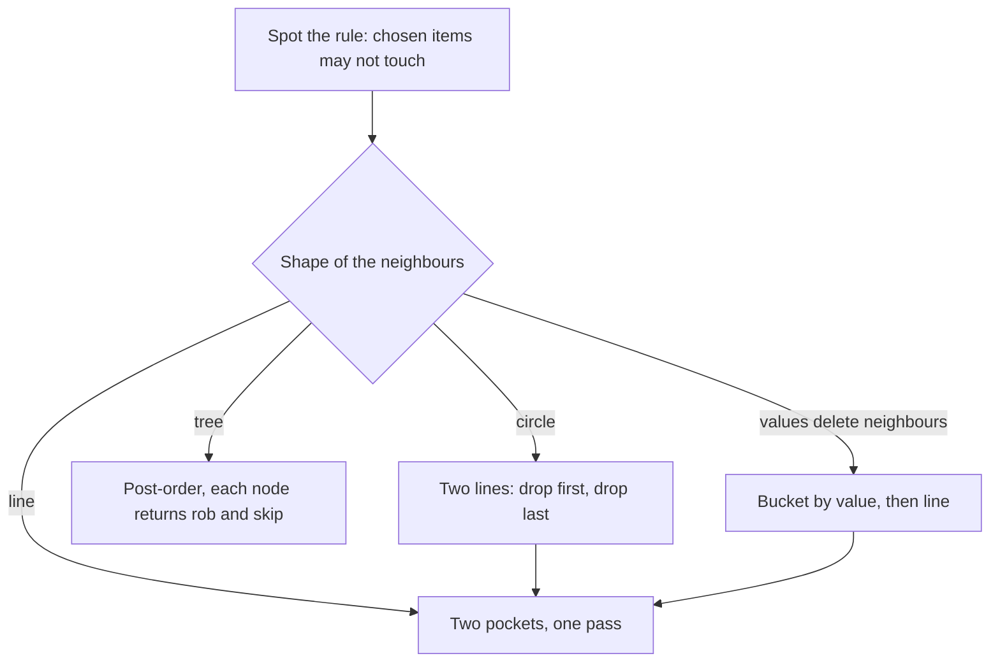
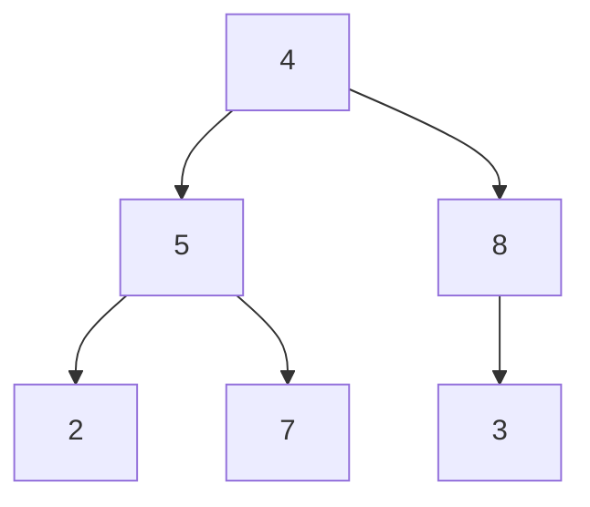

## The hook

A thief walks down a street at night. Every house holds some cash, and the houses share alarm wiring: rob two neighbours on the same night and the alarm goes off. Grab every big pile you see and you soon find that the big piles sit next to each other.

Interviewers love this problem because it comes in four costumes: a line, a circle, a tree, or an array of numbers that "delete their neighbours". See the one choice underneath and every costume is quick. Memorise four solutions and the fifth costume beats you. Which single idea makes all four the same problem?

## The problem

You get an array of non-negative amounts, one per house.

1. **Line (House Robber):** pick houses so that no two picked houses are adjacent, maximising the total.
2. **Circle (House Robber II):** the same, but the first and last house are also neighbours.
3. **Tree (House Robber III):** houses form a binary tree, and a parent and its child count as neighbours.
4. **Delete and Earn:** taking a number v earns v points and deletes every v − 1 and v + 1 in the array. Maximise points.

All four share one [[adjacency constraint]]: chosen items may not touch.

## The obvious approach

Greedy fails fast. On [6, 2, 3, 8, 5, 4], "take the largest pile first" takes 8, which blocks 3 and 5, then 6, then 4: that happens to be 18, but on [5, 6, 5] the largest pile, 6, blocks both 5s and scores 6 when 10 was possible. Alternating "every other house" fails on [9, 1, 1, 9], where the best plan, 9 + 9, skips two in a row.

Trying every subset is correct but costs O(2ⁿ). The recursion "best from house i onward" calls itself on i + 1 and i + 2 again and again, like Fibonacci, so the same subproblems repeat. That repetition is the signal for DP, as in [Stairs, Robbers and Secret Codes](article:dsa-dp-1d).

## The key insight

:::analogy
Picture the thief carrying two pockets down the street. The left pocket holds the best haul so far *if the thief robbed the house just passed*. The right pocket holds the best haul so far *if the thief skipped it*. At the next house, robbing is only allowed from the right pocket, because the last house was skipped. Skipping is allowed from either pocket, so the thief keeps whichever is fuller. Two pockets, updated at every door, and nothing else to remember.
:::

That is the [[take or skip]] choice. Write it as a table:

| Part | Definition |
|---|---|
| State | take[i] = best total from houses 0..i with house i robbed; skip[i] = best with house i not robbed |
| Transition | take[i] = skip[i − 1] + a[i]; skip[i] = max(take[i − 1], skip[i − 1]) |
| Base case | before any house: take = 0, skip = 0 |
| Answer | max(take[n − 1], skip[n − 1]) |

This is the same recurrence as dp[i] = max(dp[i − 1], dp[i − 2] + a[i]), just split into the two pockets so that the tree version later feels natural.

:::insight
Every variant asks the same question at each item: "was my neighbour taken?" Carry the answer for both cases, taken and not taken, and the adjacency constraint becomes a simple rule about which pocket you may add to.
:::

### The circle

On a circle, house 0 and house n − 1 touch. The [[circular case]] is solved by splitting it into two lines: one that drops the last house and one that drops the first house. Any legal circular plan leaves out at least one of those two, so it is a legal plan in at least one of the lines. The answer is the larger of the two line answers. With a single house, return that house.

### The tree

On a tree, a node's neighbours are its parent and its children. Process children before the parent, in [[post-order]], and let each node hand both pockets up:

- rob(node) = node.val + skip(left) + skip(right)
- skip(node) = max(rob(left), skip(left)) + max(rob(right), skip(right))
- An empty child returns (0, 0).

### Delete and Earn

Taking value v deletes v − 1 and v + 1, so values behave like houses on a street numbered by value. Build a [[value bucket]] for each value, points[v] = v × count(v), then run the line version over v = 0, 1, 2, ... up to the maximum value. Taking one copy of v and deleting the neighbours lets you then take every other copy of v, which is why the bucket holds the full v × count.



## Walk through an example

**Line**, houses [6, 2, 3, 8, 5, 4]:

| i | a[i] | take = skip before + a[i] | skip = max of both before | best so far |
|---|---|---|---|---|
| start | | 0 | 0 | 0 |
| 0 | 6 | 0 + 6 = 6 | 0 | 6 |
| 1 | 2 | 0 + 2 = 2 | max(6, 0) = 6 | 6 |
| 2 | 3 | 6 + 3 = 9 | max(2, 6) = 6 | 9 |
| 3 | 8 | 6 + 8 = 14 | max(9, 6) = 9 | 14 |
| 4 | 5 | 9 + 5 = 14 | max(14, 9) = 14 | 14 |
| 5 | 4 | 14 + 4 = 18 | max(14, 14) = 14 | 18 |

Answer **18**: houses 0, 3 and 5 (6 + 8 + 4).

**Space optimisation.** Each row reads only the row above, so two variables are enough. The same trace in the classic prev2, prev1 form, where cur = max(prev1, prev2 + a[i]):

| a[i] | prev2 | prev1 | cur |
|---|---|---|---|
| 6 | 0 | 0 | 6 |
| 2 | 0 | 6 | 6 |
| 3 | 6 | 6 | 9 |
| 8 | 6 | 9 | 14 |
| 5 | 9 | 14 | 14 |
| 4 | 14 | 14 | 18 |

The two pockets and the two rolling variables carry the same information: prev1 is max(take, skip), and prev2 is the old skip.

**Circle**, houses [5, 3, 1, 6, 2, 7]. The line answer is 18 (5 + 6 + 7), but houses 0 and 5 are neighbours, so that plan is illegal.

| Run | Houses | Best | Plan |
|---|---|---|---|
| drop last | [5, 3, 1, 6, 2] | 11 | 5 + 6 |
| drop first | [3, 1, 6, 2, 7] | 16 | 3 + 6 + 7 |

Answer **16**.

**Tree.** Root 4 with children 5 and 8; 5 has children 2 and 7; 8 has a right child 3.



| Node | rob | skip | returned |
|---|---|---|---|
| 2, 7, 3 (leaves) | own value | 0 | (2, 0), (7, 0), (3, 0) |
| 5 | 5 + 0 + 0 = 5 | max(2, 0) + max(7, 0) = 9 | (5, 9) |
| 8 | 8 + 0 = 8 | max(3, 0) = 3 | (8, 3) |
| 4 (root) | 4 + 9 + 3 = 16 | max(5, 9) + max(8, 3) = 17 | (16, 17) |

Answer **17**: rob 2, 7 and 8. Notice that this plan mixes levels: two nodes from the bottom on the left, one from the middle on the right.

**Delete and Earn**, nums [3, 4, 2, 4, 5, 3, 3]. Buckets: points[2] = 2, points[3] = 9, points[4] = 8, points[5] = 5. Running the two pockets over values 2 to 5 gives (take, skip) = (2, 0), (9, 2), (10, 9), (14, 10). Answer **14**: take all three 3s and the 5.

:::try-this
Circle [2, 9, 3, 9, 2]. What is the answer, and which run finds it? (The line answer is 18 from 9 + 9, which uses houses 1 and 3, not the ends. Both runs find 18: drop last gives [2, 9, 3, 9] with 9 + 9, drop first gives [9, 3, 9, 2] with 9 + 9. Answer 18.)
:::

## The code

```pseudo
rob_line(a, lo, hi):                      // houses lo..hi inclusive
    take = 0; skip = 0
    for i in lo .. hi:
        take, skip = skip + a[i], max(take, skip)
    return max(take, skip)

rob_circle(a):
    if n == 1: return a[0]
    return max(rob_line(a, 0, n-2), rob_line(a, 1, n-1))

rob_tree(node):                            // returns (rob, skip)
    if node is empty: return (0, 0)
    (lr, ls) = rob_tree(node.left); (rr, rs) = rob_tree(node.right)
    return (node.val + ls + rs, max(lr, ls) + max(rr, rs))

delete_and_earn(nums):
    points[v] += v for every v in nums
    return rob_line(points, 0, max(nums))
```

```cpp
#include <bits/stdc++.h>
using namespace std;

long long robLine(const vector<int>& a, int lo, int hi) {
    long long take = 0, skip = 0;
    for (int i = lo; i <= hi; i++) {
        long long t = skip + a[i];
        skip = max(take, skip);
        take = t;
    }
    return max(take, skip);
}

long long robCircle(const vector<int>& a) {
    int n = a.size();
    if (n == 1) return a[0];
    return max(robLine(a, 0, n - 2), robLine(a, 1, n - 1));
}

struct Node { int val; Node *left = nullptr, *right = nullptr; };

pair<long long, long long> robTree(Node* u) {            // {rob, skip}
    if (!u) return {0, 0};
    auto [lr, ls] = robTree(u->left);
    auto [rr, rs] = robTree(u->right);
    return {u->val + ls + rs, max(lr, ls) + max(rr, rs)};
}

long long deleteAndEarn(const vector<int>& nums) {
    int mx = *max_element(nums.begin(), nums.end());
    vector<int> points(mx + 1, 0);
    for (int v : nums) points[v] += v;
    return robLine(points, 0, mx);
}

int main() {
    cout << robLine({6, 2, 3, 8, 5, 4}, 0, 5) << '\n';        // 18
    cout << robCircle({5, 3, 1, 6, 2, 7}) << '\n';           // 16
    Node n2{2}, n7{7}, n3{3}, n5{5, &n2, &n7}, n8{8, nullptr, &n3}, root{4, &n5, &n8};
    auto [r, s] = robTree(&root);
    cout << max(r, s) << '\n';                               // 17
    cout << deleteAndEarn({3, 4, 2, 4, 5, 3, 3}) << '\n';    // 14
}
```

## Complexity

- **Line and circle:** O(n) time, since each house is visited once per run and the circle does two runs. O(1) extra space with the two pockets.
- **Tree:** O(n) time, since each node is visited once. O(h) space for the recursion stack, where h is the tree height, which is O(n) for a tree shaped like a chain.
- **Delete and Earn:** O(n + V) time and O(V) space, where V is the largest value. If values are huge and sparse, sort the distinct values instead and treat two values as neighbours only when they differ by exactly 1, for O(n log n).

## Common mistakes

:::warning
Common misconception: "for the circle, rob houses 1 to n − 2 and then decide about the two ends." Handling the ends by hand leads to double counting, where both ends sneak into the total, or to missing plans that use one end. Run the clean line solution twice, once without the first house and once without the last, and take the maximum. Every legal plan lives in at least one of the two runs.
:::

- **Single house on a circle:** both runs are empty ranges and return 0. Return a[0] directly when n is 1.
- **One number per tree node:** returning only "best of my subtree" loses whether the node itself was robbed, so the parent cannot apply the rule. Return the pair.
- **Alternating tree levels:** taking every other level is a tempting shortcut and is wrong. In the example above the level sums are 4, 13 and 12, so the level trick gives 16, but the true answer is 17.
- **Delete and Earn with gaps:** a missing value has bucket 0, which the line DP handles naturally.
- **Overflow:** use 64-bit totals when n and the amounts are large.

## Practice problems

Start with *House Robber* and write the two-pocket version from memory. *House Robber II* tests the two-runs split. *Delete and Earn* checks that you can spot the street hidden inside the values. *House Robber III* moves the pockets onto a tree and is a gentle introduction to tree DP. *House Robber IV* is a different flavour: it asks for the smallest possible maximum single haul, which is solved by [Guessing the Answer, Then Checking It](article:dsa-binary-search-answer) with a greedy check, a useful reminder that the name alone does not pick the technique.

## Key takeaways

- Every House Robber variant reduces to one take-or-skip choice per item under the rule that chosen neighbours may not touch.
- Keeping two values per position, best if taken and best if skipped, makes the transition obvious and the memory O(1).
- A circle becomes two lines, one without the first house and one without the last, and the answer is the better of the two.
- On a tree, each node returns its rob and skip totals to its parent in post-order, which is the first step into tree DP.
- Delete and Earn is House Robber over sorted values, where each house holds the value times its count.
