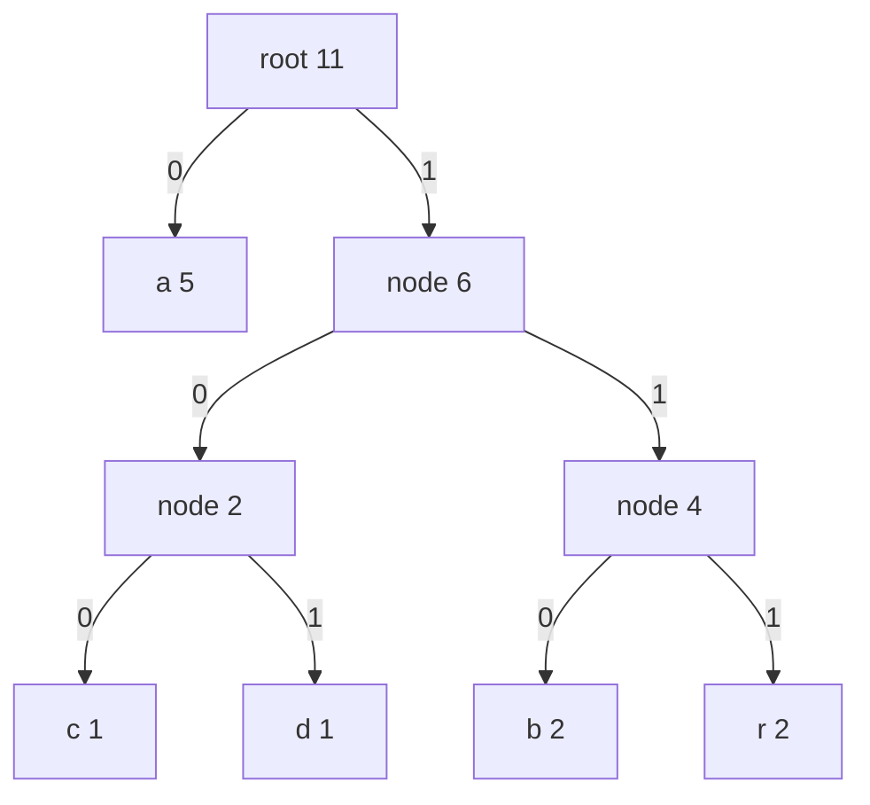

## The hook

Telegraph operators sent the letter E as a single dot, while rarer letters took longer runs of dots and dashes. Common letters cost little, rare ones cost more, and the whole message got shorter. Morse code was tuned by hand for English in general.

What if you could tune a code to one specific text, and prove that no other code of its kind is shorter? That is what David Huffman did in 1952, and the algorithm fits in a dozen lines with a min-heap.

## The intuition

:::analogy
Think of Morse code tuned to your own text: the symbols you use most get the shortest signals, the rare ones get the long signals. Huffman's way to build it starts from the rarest end. Take the two rarest symbols and tie them together into one bundle; to the rest of the text, that bundle now behaves like a single symbol whose count is their sum. Keep tying the two rarest bundles until only one is left.
:::

Every bundle is a node in a [[code tree]]. Its two children are the bundles tied together, and the final bundle is the root. Reading the tree from the root, 0 for left and 1 for right, spells a codeword for every leaf. Rare symbols were tied first, so they sit deepest and get the longest signals; common symbols were tied last, so they sit near the root.

Two properties make the code useful:

- **It is a [[prefix-free code]].** Symbols live only at leaves, so no codeword is the start of another. The decoder walks down the tree bit by bit and emits a symbol whenever it reaches a leaf, with no separators needed.
- **It is optimal.** Among all prefix-free codes that encode one symbol at a time, none uses fewer total bits.

## How it works

### The algorithm

- Count each symbol's frequency.
- Push one leaf per symbol into a min-heap keyed by frequency.
- While the heap holds more than one node, pop the two smallest, create a parent whose weight is their sum, and push the parent.
- The last node is the root. Walk it to read off the codes.

### Why the total bits equal the merge costs

Each merge creates a parent whose weight is the sum of its children: its [[merge cost]]. Every symbol under that parent gets one more bit in its codeword. So adding up all merge costs counts, for every symbol, frequency times depth, which is the [[weighted path length]], the exact number of bits in the encoded text. Huffman's greedy is the same "always combine the two cheapest" rule that minimises the total cost of joining ropes, where joining two pieces costs their combined length.

### Why the greedy is optimal

The proof is an exchange argument in two steps, the style from [A Bus Conductor Who Never Reseats Anyone](article:dsa-greedy-exchange):

- **The rarest two can be deepest siblings.** In any optimal tree, take the two deepest sibling leaves. If they are not the two rarest symbols, swap the rarest symbols into those positions. A rare symbol moving deeper and a more common one moving up never increases the total bits, so the tree stays optimal.
- **Merging shrinks the problem.** Replace those two siblings with one leaf whose weight is their sum. Every code tree for the smaller problem corresponds to one for the original, with total bits exactly the merged weight higher. So an optimal tree for the smaller problem gives an optimal tree for the original, and the same argument repeats.

### How close to the limit is it?

Information theory gives a floor called [[entropy]]: no prefix-free code can average fewer bits per symbol than the entropy of the frequencies. Huffman's average is always less than one bit per symbol above it. The gap is largest when one symbol dominates, because even the most common symbol must cost at least one whole bit.



:::insight
The rarest symbols deserve the longest codes, so they should be the deepest pair in the tree. Merging them first and treating the pair as one symbol turns that observation into a full algorithm: one decision per heap pop, and every decision is safe.
:::

## Walk through an example

Text: "abracadabra", 11 characters. Frequencies: a 5, b 2, r 2, c 1, d 1.

| Step | Heap before (weight) | Pop two smallest | New node | Merge cost |
|---|---|---|---|---|
| 1 | a 5, b 2, r 2, c 1, d 1 | c 1, d 1 | cd 2 | 2 |
| 2 | a 5, b 2, r 2, cd 2 | b 2, r 2 | br 4 | 4 |
| 3 | a 5, cd 2, br 4 | cd 2, br 4 | cdbr 6 | 6 |
| 4 | a 5, cdbr 6 | a 5, cdbr 6 | root 11 | 11 |

Total bits: 2 + 4 + 6 + 11 = 23. Reading the tree in the diagram:

| Symbol | Frequency | Code | Bits used |
|---|---|---|---|
| a | 5 | 0 | 5 |
| c | 1 | 100 | 3 |
| d | 1 | 101 | 3 |
| b | 2 | 110 | 6 |
| r | 2 | 111 | 6 |
| **Total** | 11 | | **23** |

A fixed-length code needs 3 bits for 5 symbols, so 33 bits. Huffman uses 23, about 2.09 bits per character, against an entropy of about 2.04 bits per character for these frequencies.

The encoded text is `01101110100010101101110`. Decoding walks the tree: `0` reaches a leaf, a; `110` reaches b; `111` reaches r; and so on, with no separators.

At step 2, three nodes had weight 2: b, r and cd. Merging b with cd instead of b with r builds a different tree with different codes, but the total is still 23. Ties change the code, never the cost.

:::try-this
Build the Huffman code for frequencies 1, 1, 1, 1 (four symbols). What are the code lengths and the total bits? (Merge 1 + 1 = 2, then 1 + 1 = 2, then 2 + 2 = 4. Every symbol is at depth 2, so every code has 2 bits and the total is 2 + 2 + 4 = 8. With equal frequencies, Huffman gives a fixed-length code, which is already the best.)
:::

:::warning
Common misconception: "Huffman coding is how zip files compress." Huffman codes single symbols and ignores repetition: "abcabcabc" gains nothing from noticing "abc" repeats. LZ methods replace repeated substrings with references to earlier copies. The DEFLATE format behind zip and gzip uses both, LZ77 to remove repeats and then Huffman coding for what remains.
:::

## The code

```pseudo
huffman(freq):
    heap = min-heap of leaves (weight, symbol)
    while size(heap) > 1:
        x = heap.pop(); y = heap.pop()
        heap.push(node(weight = x.weight + y.weight, left = x, right = y))
    return heap.pop()                         # the root

assign(node, prefix):
    if node is a leaf: code[node.symbol] = prefix or "0"   # a one-symbol text still needs one bit
    else: assign(node.left, prefix + "0"); assign(node.right, prefix + "1")

decode(bits, root):
    node = root
    for b in bits:
        node = node.left if b == 0 else node.right
        if node is a leaf: output node.symbol; node = root
```

```cpp
#include <bits/stdc++.h>
using namespace std;

struct Node { long long w; char sym; int left, right; };        // left = right = -1 for leaves

struct Huffman {
    vector<Node> nodes;
    int root = -1;
    long long totalBits = 0;
    map<char, string> code;

    explicit Huffman(const string& text) {
        map<char, long long> freq;
        for (char c : text) freq[c]++;
        using P = pair<long long, int>;                            // (weight, node index)
        priority_queue<P, vector<P>, greater<P>> pq;
        for (auto& [c, f] : freq) nodes.push_back({f, c, -1, -1}), pq.push({f, (int)nodes.size() - 1});
        while (pq.size() > 1) {
            auto [wx, x] = pq.top(); pq.pop();
            auto [wy, y] = pq.top(); pq.pop();
            nodes.push_back({wx + wy, 0, x, y});
            totalBits += wx + wy;                                  // each merge adds one bit per symbol below
            pq.push({wx + wy, (int)nodes.size() - 1});
        }
        root = pq.top().second;
        if (nodes[root].left == -1) totalBits = nodes[root].w;     // only one distinct symbol
        assign(root, "");
    }
    void assign(int v, const string& prefix) {
        if (nodes[v].left == -1) { code[nodes[v].sym] = prefix.empty() ? "0" : prefix; return; }
        assign(nodes[v].left, prefix + "0");
        assign(nodes[v].right, prefix + "1");
    }
    string encode(const string& text) {
        string bits;
        for (char c : text) bits += code[c];
        return bits;
    }
    string decode(const string& bits) {
        string out;
        int v = root;
        for (char b : bits) {
            if (nodes[v].left != -1) v = (b == '0') ? nodes[v].left : nodes[v].right;
            if (nodes[v].left == -1) out += nodes[v].sym, v = root;
        }
        return out;
    }
};

int main() {
    string text = "abracadabra";
    Huffman h(text);
    for (auto& [c, s] : h.code) cout << c << '=' << s << ' ';
    cout << '\n';                                                  // a=0 b=110 c=100 d=101 r=111
    string bits = h.encode(text);
    cout << bits << ' ' << bits.size() << ' ' << h.totalBits << '\n';   // 01101110100010101101110 23 23
    cout << h.decode(bits) << '\n';                                // abracadabra
    cout << Huffman("aaaa").encode("aaaa") << '\n';                // 0000
}
```

Leaves are created in sorted symbol order, and the heap breaks equal weights by node index, so this program produces exactly the tree in the walkthrough. The last line checks the edge case of a single distinct symbol, which still needs one bit per character.

## Complexity

- **Building the tree: O(k log k)** for k distinct symbols, with k - 1 merges of two pops and one push each.
- **Counting and encoding: O(n)** over the text, plus the code lengths written out.
- **Decoding: O(total bits)**, one tree step per bit.
- **Space: O(k)** for the tree and the code table. Real formats also store the code itself, often as just the code lengths, so the decoder can rebuild it.

## Common mistakes

- **Using a max-heap.** The rule merges the two rarest nodes; C++'s default `priority_queue` returns the largest.
- **Forgetting the single-symbol case,** where the root is a leaf and the code would be the empty string.
- **Assuming the code is unique.** Ties produce different codes with the same total; tests should compare total bits, not exact codewords.
- **Expecting Huffman to exploit repeated substrings.** It codes symbols independently, which is why practical compressors pair it with an LZ stage.
- **Overflow in weights** for huge inputs; keep frequencies and the total in 64-bit integers.

## Practice problems

*Minimum Cost to Connect Sticks* on LeetCode is exactly Huffman's merge-cost sum, but it is a premium problem; the free practice here builds the same muscle. *Last Stone Weight* repeatedly pops two extremes from a heap and pushes back one result, the same loop shape with a different combine rule. *Minimum Operations to Halve Array Sum* repeatedly takes the largest value from a heap, the greedy-with-a-heap habit Huffman relies on. *Minimum Cost to Merge Stones* is the instructive contrast: merges are only allowed between neighbouring piles, so the two smallest may not be mergeable and the greedy breaks; it needs interval dynamic programming instead. For the most direct practice, implement the class above and check that encode followed by decode returns your input. The heap operations are explained in [The Triage Nurse Who Always Knows Who Is Next](article:dsa-heap-basics).

## Key takeaways

- Huffman coding builds a prefix-free code by repeatedly merging the two lowest-weight nodes from a min-heap until one tree remains.
- Symbols sit only at leaves, so no codeword is a prefix of another and a bit stream decodes left to right without separators.
- The total encoded bits equal the sum of all merge weights, because each merge adds one bit to every symbol beneath it.
- The greedy is optimal by an exchange argument: the two rarest symbols can always be the deepest siblings, and merging them leaves a smaller problem of the same kind.
- Huffman codes one symbol at a time, so compressors such as DEFLATE combine it with LZ-style removal of repeated substrings.
