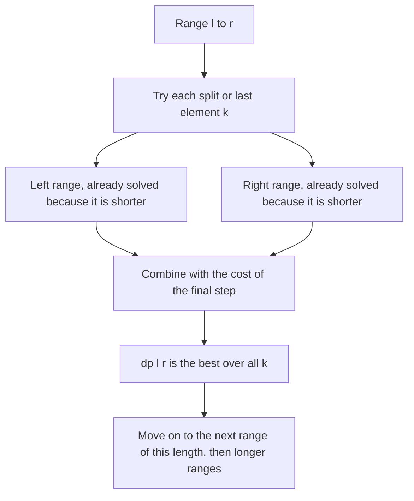

## The hook

A row of balloons floats in front of you, each with a number. Popping a balloon earns the product of its number and its two current neighbours, and then the gap closes. Pop them all, in any order, for the highest total. Try the obvious greedy, popping the smallest first or the largest last, and you will find inputs that beat it.

The trick that cracks it, deciding which balloon goes **last**, is the heart of a whole family of problems where the answer for a range depends on the answers for the ranges inside it.

## The intuition

:::analogy
Think of the row of balloons between two fixed walls. Ask: which balloon in between will be the very last one popped? Whichever it is, at the moment it pops its only neighbours are the two walls, so its reward is known exactly. And until then, it acts as a wall itself, splitting the row into a left part and a right part that never touch each other. Each part is the same puzzle again, just shorter, between its own two walls.
:::

That is [[interval DP]]. The state is a contiguous range, dp[l][r], and each range is solved from strictly shorter ranges inside it. Many problems try every [[split point]] k in the range and combine the two sides. The choice of what the split means is the creative step; for balloons, the [[last-action trick]] makes the sides independent.

Because every transition looks at shorter ranges, the [[fill order]] is by increasing length: all ranges of length 1, then length 2, and so on, up to the whole array.

## How it works

### The template

```
for len in 1 .. n:
    for l in 0 .. n - len:
        r = l + len - 1
        dp[l][r] = best over choices that use only shorter ranges inside [l, r]
answer = dp[0][n-1]
```

There are three common shapes, from simplest to hardest:

| Shape | Transition | Example | Time |
|---|---|---|---|
| Shrink from the ends | dp[l][r] from dp[l+1][r-1], dp[l+1][r], dp[l][r-1] | Palindromic Substrings, Removal Game | O(n²) |
| Split into two parts | min or max over k of dp[l][k] + dp[k+1][r] + cost | Minimum Cost Tree From Leaf Values, matrix chain | O(n³) |
| Last element in an open range | max over k of dp[l][k] + dp[k][r] + gain(l, k, r) | Burst Balloons | O(n³) |

### Shape 1: palindromes

s[l..r] is a palindrome when s[l] = s[r] and the inside s[l+1..r-1] is a palindrome, with ranges of length 1 or 2 as base cases. Counting the true cells answers *Palindromic Substrings*. The longest palindromic subsequence uses the same shape with a max instead of a yes or no.

### Shape 1 again: a two-player game

In CSES *Removal Game*, two players take turns removing a number from either end of a list, and both play perfectly. What is the first player's total? Let dp[l][r] be the [[score difference]] for whoever is to move on a[l..r]: their total minus the opponent's from here. Taking the left end gains a[l], after which the opponent has a difference of dp[l+1][r] over you, so the net is a[l] - dp[l+1][r]. Hence

dp[l][r] = max(a[l] - dp[l+1][r], a[r] - dp[l][r-1]), with dp[i][i] = a[i].

The first player's total is (sum + dp[0][n-1]) / 2, since the two totals add up to the sum and differ by dp[0][n-1].

### Shape 2: split into two parts

*Minimum Cost Tree From Leaf Values* builds a binary tree over leaves in order; each internal node costs the product of the largest leaf on its left and on its right. Choose k as the end of the left subtree:

dp[i][j] = min over k in [i, j) of dp[i][k] + dp[k+1][j] + max(a[i..k]) × max(a[k+1..j]).

This is the matrix-chain template: try every place to cut, combine the two optimal halves, add the cost of the final join.

### Shape 3: Burst Balloons with the last-action trick

Pad the array with a 1 at each end, so v[0] = v[n+1] = 1. Let dp[l][r] be the best total for bursting every balloon strictly between l and r, with l and r still standing. If k is the last balloon burst in that open range, its neighbours at that moment are l and r:

dp[l][r] = max over l < k < r of dp[l][k] + dp[k][r] + v[l] × v[k] × v[r].

The answer is dp[0][n+1]. Trying "k is burst first" instead fails, because after k pops, its two sides become neighbours and their costs depend on each other.



:::insight
Interval DP works whenever the best answer for a range can be built from the best answers for shorter ranges inside it. The hard part is choosing a split that makes the pieces independent, and for Burst Balloons that means asking which element is handled last.
:::

## Walk through an example

### Burst Balloons on [2, 4, 3, 5]

Padded: v = [1, 2, 4, 3, 5, 1], indices 0 to 5.

| Range (open) | Best | Last balloon and why |
|---|---|---|
| (0, 2) | 8 | only 2: 1 × 2 × 4 = 8 |
| (1, 3) | 24 | only 4: 2 × 4 × 3 = 24 |
| (2, 4) | 60 | only 3: 4 × 3 × 5 = 60 |
| (3, 5) | 15 | only 5: 3 × 5 × 1 = 15 |
| (0, 3) | 30 | last 2: 0 + 24 + 1 × 2 × 3 = 30 |
| (1, 4) | 100 | last 4: 0 + 60 + 2 × 4 × 5 = 100 |
| (2, 5) | 80 | last 5: 60 + 0 + 4 × 5 × 1 = 80 |
| (0, 4) | 110 | last 2: 0 + 100 + 1 × 2 × 5 = 110 |
| (1, 5) | 110 | last 5: 100 + 0 + 2 × 5 × 1 = 110 |
| (0, 5) | **115** | last 5: 110 + 0 + 1 × 5 × 1 = 115 |

The same values as a table, row l and column r:

| dp[l][r] | r = 2 | r = 3 | r = 4 | r = 5 |
|---|---|---|---|---|
| l = 0 | 8 | 30 | 110 | 115 |
| l = 1 | | 24 | 100 | 110 |
| l = 2 | | | 60 | 80 |
| l = 3 | | | | 15 |

The best order, read off the choices: pop 3 first (4 × 3 × 5 = 60), then 4 (2 × 4 × 5 = 40), then 2 (1 × 2 × 5 = 10), then 5 (1 × 5 × 1 = 5), for 115. A brute force over all 24 orders agrees.

### Removal Game on [3, 9, 1, 2]

| dp[l][r] | r = 0 | r = 1 | r = 2 | r = 3 |
|---|---|---|---|---|
| l = 0 | 3 | 6 | -5 | 7 |
| l = 1 | | 9 | 8 | 8 |
| l = 2 | | | 1 | 1 |
| l = 3 | | | | 2 |

dp[0][3] = max(3 - dp[1][3], 2 - dp[0][2]) = max(3 - 8, 2 + 5) = 7. So the first player should take the 2 from the right end, even though the 3 on the left is bigger, because taking the 3 exposes the 9. The first player's total is (15 + 7) / 2 = 11.

### Palindromic Substrings in "abaab"

The true cells are the five single letters, "aba", "aa" and "baab": 8 palindromic substrings. For example, "baab" at [1, 4] is a palindrome because s[1] = s[4] = b and the inside "aa" at [2, 3] is one.

:::try-this
Fill the Minimum Cost Tree From Leaf Values table for [3, 5, 2, 4]. What is the answer, and which top-level split gives it? (Length 2: [3, 5] = 15, [5, 2] = 10, [2, 4] = 8. Length 3: [3, 5, 2] = min(0 + 10 + 3 × 5, 15 + 0 + 5 × 2) = 25, [5, 2, 4] = min(0 + 8 + 5 × 4, 10 + 0 + 5 × 4) = 28. Length 4: split after 3 gives 0 + 28 + 3 × 5 = 43; after 5 gives 15 + 8 + 5 × 4 = 43; after 2 gives 25 + 0 + 5 × 4 = 45. The answer is 43.)
:::

:::warning
Common misconception: "Loop l from 0 to n - 1 and r from l to n - 1, and the table fills correctly." With l increasing, dp[l][r] needs dp[l+1][r], which belongs to a later l and has not been computed yet. Fill by increasing length, or loop l downward from n - 1 to 0 with r upward from l; both guarantee shorter ranges come first.
:::

## The code

```pseudo
burst_balloons(a):
    v = [1] + a + [1]; m = len(v)
    dp = m x m zeros
    for len in 2 .. m-1:                      # distance between the two walls
        for l in 0 .. m-1-len:
            r = l + len
            for k in l+1 .. r-1:              # k is burst last
                dp[l][r] = max(dp[l][r], dp[l][k] + dp[k][r] + v[l]*v[k]*v[r])
    return dp[0][m-1]

removal_game(a):
    dp[i][i] = a[i]
    for len in 2 .. n: for l: r = l + len - 1
        dp[l][r] = max(a[l] - dp[l+1][r], a[r] - dp[l][r-1])
    return (sum(a) + dp[0][n-1]) / 2
```

```cpp
#include <bits/stdc++.h>
using namespace std;
using ll = long long;

ll burstBalloons(const vector<int>& a) {
    vector<ll> v = {1};
    v.insert(v.end(), a.begin(), a.end());
    v.push_back(1);
    int m = v.size();
    vector<vector<ll>> dp(m, vector<ll>(m, 0));
    for (int len = 2; len < m; len++)                          // walls l and r, len apart
        for (int l = 0; l + len < m; l++) {
            int r = l + len;
            for (int k = l + 1; k < r; k++)                    // k is the last balloon in (l, r)
                dp[l][r] = max(dp[l][r], dp[l][k] + dp[k][r] + v[l] * v[k] * v[r]);
        }
    return dp[0][m - 1];
}

ll removalGame(const vector<ll>& a) {
    int n = a.size();
    vector<vector<ll>> dp(n, vector<ll>(n, 0));
    for (int i = 0; i < n; i++) dp[i][i] = a[i];
    for (int len = 2; len <= n; len++)
        for (int l = 0; l + len - 1 < n; l++) {
            int r = l + len - 1;
            dp[l][r] = max(a[l] - dp[l + 1][r], a[r] - dp[l][r - 1]);   // score difference
        }
    ll sum = accumulate(a.begin(), a.end(), 0LL);
    return (sum + dp[0][n - 1]) / 2;
}

int countPalindromes(const string& s) {
    int n = s.size(), count = 0;
    vector<vector<bool>> pal(n, vector<bool>(n, false));
    for (int len = 1; len <= n; len++)
        for (int l = 0; l + len - 1 < n; l++) {
            int r = l + len - 1;
            pal[l][r] = s[l] == s[r] && (len <= 2 || pal[l + 1][r - 1]);
            count += pal[l][r];
        }
    return count;
}

int mctFromLeaves(const vector<int>& a) {
    int n = a.size();
    vector<vector<int>> dp(n, vector<int>(n, 0)), mx(n, vector<int>(n, 0));
    for (int i = 0; i < n; i++) {
        mx[i][i] = a[i];
        for (int j = i + 1; j < n; j++) mx[i][j] = max(mx[i][j - 1], a[j]);
    }
    for (int len = 2; len <= n; len++)
        for (int i = 0; i + len - 1 < n; i++) {
            int j = i + len - 1;
            dp[i][j] = INT_MAX;
            for (int k = i; k < j; k++)                        // left subtree ends at k
                dp[i][j] = min(dp[i][j], dp[i][k] + dp[k + 1][j] + mx[i][k] * mx[k + 1][j]);
        }
    return dp[0][n - 1];
}

int main() {
    cout << burstBalloons({2, 4, 3, 5}) << '\n';               // 115
    cout << removalGame({3, 9, 1, 2}) << '\n';                 // 11
    cout << countPalindromes("abaab") << '\n';                 // 8
    cout << mctFromLeaves({3, 5, 2, 4}) << '\n';               // 43
}
```

Precomputing `mx[i][j]` keeps the split loop O(1) per k, so the whole of `mctFromLeaves` is O(n³) rather than O(n⁴).

## Complexity

- **Shrink-from-the-ends shapes: O(n²) time and space,** one constant-time transition per range.
- **Split shapes: O(n³) time, O(n²) space,** since each of the n²/2 ranges tries up to n split points. With n up to about 500, that is fine in C++.
- **Space saving:** the Removal Game can use one array of length n by filling diagonals carefully, but the 2D table is clearer and usually fits.

## Common mistakes

- **Filling in the wrong order,** reading dp[l+1][r] before it is computed.
- **Choosing "first" instead of "last"** in Burst Balloons, which leaves the sides dependent.
- **Forgetting the padding 1s** at both ends of Burst Balloons, or using closed instead of open ranges inconsistently.
- **Off-by-one in split loops:** for dp[l][k] + dp[k+1][r], k runs from l to r - 1; for open ranges, k runs from l + 1 to r - 1.
- **Integer overflow** in the Removal Game, where values reach 10⁹ and n reaches 5,000; use 64-bit.
- **Recomputing range maxima inside the split loop,** which adds a factor of n.

## Practice problems

*Palindromic Substrings* is the shrink-from-the-ends shape with booleans. *Removal Game* is the same shape for a two-player game. *Minimum Cost Tree From Leaf Values* is the split-into-two template; it also has a clever O(n) stack solution, a good follow-up. *Burst Balloons* is the last-action trick. String DP over two sequences, the prerequisite, is in [Lining Up Two DNA Strands](article:dsa-lcs-edit-distance).

## Key takeaways

- Interval DP stores an answer for every contiguous range and builds each one from strictly shorter ranges inside it.
- The table must be filled by increasing range length, or with l decreasing and r increasing, so every subrange is ready.
- Split-point problems try every k in the range and combine the two optimal halves with the cost of joining them, in O(n³).
- In Burst Balloons, choosing the balloon burst last keeps the two sides independent, because its neighbours at that moment are the fixed walls.
- Two-player end-removal games use dp[l][r] as the mover's best score difference, which turns optimal play into a simple max.
