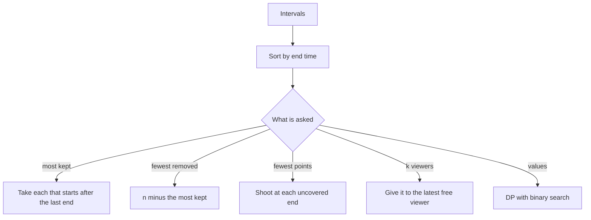

## The hook

You arrive at a conference with a printed schedule. Talks run in parallel rooms all day, and you want to sit through as many complete talks as you can. The keynote starts first and sounds important, but it runs for three hours. Two short talks fit in that same slot.

Which rule picks the most talks: earliest start, shortest talk, or something else? Only one simple order is always right, and seeing why is a lesson you will reuse for balloons, meeting rooms and job deadlines.

## The intuition

:::analogy
You are the attendee with a printed schedule, and you can be in only one room at a time. The smart habit is to ask, at every moment you are free, "which talk that I can still reach finishes first?" and walk into that room. Finishing early hands your afternoon back to you soonest, and a freer afternoon can only hold more talks, never fewer.
:::

This is [[interval scheduling]], and the attendee's habit is the [[earliest finish rule]]. It is exactly the movie argument from [A Bus Conductor Who Never Reseats Anyone](article:dsa-greedy-exchange), now taken all the way, with the variants interviews like to add.

The test of the rule is the exchange argument. Take any best possible schedule. Its first talk ends at some time; the earliest finisher ends no later. Swap it in, and every later talk in that schedule still fits, because each one started after a talk that ended no earlier than yours. The count stays the same, so your schedule is just as good.

## How it works

### The core loop

- Sort the talks by end time.
- Remember the end time of the last talk you attended.
- For each talk in order, attend it if it starts after that end time, and update the end.

Whether "after" means `>` or `>=` depends on [[touching intervals]]. Movie Festival and Non-overlapping Intervals let you leave one room and enter the next at the same instant, so the test is `start >= lastEnd`. Balloons that only touch at a point can be burst by one arrow at that point, so they count as overlapping.

### Why every other order fails

One tiny counterexample kills each rival rule:

| Rule | Talks | Rule picks | Best |
|---|---|---|---|
| Earliest start | [1, 10], [2, 3], [4, 5] | [1, 10] only, 1 talk | [2, 3], [4, 5], 2 talks |
| Shortest first | [1, 5], [4, 7], [6, 10] | [4, 7] only, 1 talk | [1, 5], [6, 10], 2 talks |
| **Earliest end** | both inputs above | 2 talks each time | 2 talks |

The shortest talk, [4, 7], looks harmless but sits across the boundary between two longer talks and blocks both. End time is the only key that measures what you actually care about: how soon you are free again.

### Variant 1: fewest removals

*Non-overlapping Intervals* asks for the fewest intervals to delete so the rest do not overlap. Deleting a set leaves a non-overlapping set, so the answer is n minus the maximum you can keep. Run the core loop and subtract.

### Variant 2: minimum arrows

*Minimum Number of Arrows to Burst Balloons* flips the question. Each balloon spans an interval, and an arrow shot at point x bursts every balloon containing x. Find the fewest arrows.

Back at the conference: an organiser walks the halls and, at each chosen moment, glances into every room to check every talk running then. One glance is a [[stabbing point]]. Sort by end time. The talk that ends first must be checked at some moment no later than its end, so glance at exactly its end: that moment is inside every talk that has already started and not yet ended, which is the most any moment in that talk can cover. Every talk that starts at or before that moment is covered; the first talk that starts after it needs a new glance at its own end.

The two problems are mirror images. The maximum number of non-overlapping talks equals the minimum number of glances, as long as both use the same rule for touching. Each attended talk needs its own glance, and the greedy glances land exactly at the ends of the talks the attendee would choose.

### Variant 3: k friends at the festival

*Movie Festival II* gives k club members who can each watch one movie at a time. Maximise the total movies watched by the whole club.

Sort by end time again. For each movie, among the members who are free by its start, give it to the one who became free **latest**. Members who became free earlier are kept for movies that start earlier. If nobody is free, skip the movie. A multiset of members' end times finds "largest end at most this start" in O(log k), the same tool as in [A Sliding Window That Stays Sorted](article:dsa-ordered-set-windows).

### When weights appear, greedy stops

In [[weighted interval scheduling]], each talk has a value and you want the most total value. Now one long, precious talk can beat several short ones, and the earliest finish rule is wrong. The fix is dynamic programming over talks sorted by end: for each talk, either skip it, or take it plus the best value among talks that end by its start, found by binary search. This is *Maximum Profit in Job Scheduling*.



:::insight
Sorting by end time is right because the end of your last choice is the only thing that limits your future. Earliest end leaves the most room; any other key can trade a free afternoon for something that does not matter.
:::

## Walk through an example

### Most talks, then fewest removals

Talks: [1, 4], [2, 3], [3, 6], [5, 7], [6, 8], [8, 9]; touching is allowed.

| Talk (sorted by end) | Last end | Start at or after it? | Attended |
|---|---|---|---|
| [2, 3] | none | yes | [2, 3] |
| [1, 4] | 3 | no | |
| [3, 6] | 3 | yes | [3, 6] |
| [5, 7] | 6 | no | |
| [6, 8] | 6 | yes | [6, 8] |
| [8, 9] | 8 | yes | [8, 9] |

Four talks attended, so the fewest removals is 6 - 4 = 2.

### Arrows

Balloons: [1, 6], [2, 8], [7, 12], [10, 16], [15, 18]. Touching counts as overlapping.

| Balloon (sorted by end) | Current arrow | Burst already? | Arrows |
|---|---|---|---|
| [1, 6] | none | no, shoot at 6 | 1 |
| [2, 8] | 6 | yes, 2 ≤ 6 | 1 |
| [7, 12] | 6 | no, shoot at 12 | 2 |
| [10, 16] | 12 | yes | 2 |
| [15, 18] | 12 | no, shoot at 18 | 3 |

Three arrows. As a check, [1, 6], [7, 12] and [15, 18] are pairwise disjoint, so no two of them share an arrow, and at least three are needed.

### Two friends at the festival

Movies: [1, 5], [2, 4], [3, 8], [5, 7], [6, 9], [8, 10]; k = 2; both members are free from time 0.

| Movie (sorted by end) | Members free at (before) | Given to the one free at | Members free at (after) | Watched |
|---|---|---|---|---|
| [2, 4] | 0, 0 | 0 | 0, 4 | 1 |
| [1, 5] | 0, 4 | 0 | 4, 5 | 2 |
| [5, 7] | 4, 5 | 5, the latest that fits | 4, 7 | 3 |
| [3, 8] | 4, 7 | nobody is free by 3 | 4, 7 | 3 |
| [6, 9] | 4, 7 | 4 | 7, 9 | 4 |
| [8, 10] | 7, 9 | 7 | 9, 10 | 5 |

Five movies. Six is impossible: at time 3.5, the movies [1, 5], [2, 4] and [3, 8] are all running, and two people cannot watch three at once.

At [5, 7], both members were free, and the rule chose the one free since 5, not since 4. The member free since 4 stayed available, and that is who later took [6, 9].

### Weights break greedy

Jobs as [start, end, value]: [1, 3, 20], [2, 5, 20], [4, 6, 30], [6, 9, 25], [3, 10, 60].

| Job (sorted by end) | Skip it | Take it: value + best ending by its start | Best so far |
|---|---|---|---|
| [1, 3, 20] | 0 | 20 + 0 | 20 |
| [2, 5, 20] | 20 | 20 + 0 | 20 |
| [4, 6, 30] | 20 | 30 + 20, after [1, 3] | 50 |
| [6, 9, 25] | 50 | 25 + 50, after [4, 6] | 75 |
| [3, 10, 60] | 75 | 60 + 20, after [1, 3] | 80 |

The best is 80, from [1, 3] and [3, 10]. The earliest finish rule takes [1, 3], [4, 6], [6, 9] for 75, because it counts talks and ignores how much each is worth.

:::try-this
Change the touching rule for the first example: suppose a talk must start strictly after the previous one ends. How many talks can you attend now? (Sorted by end: take [2, 3]; [3, 6] now fails because 3 is not after 3; [5, 7] starts after 3, so take it; [6, 8] fails; [8, 9] starts after 7, so take it. Three talks: [2, 3], [5, 7], [8, 9].)
:::

:::warning
Common misconception: "Sorting by start time works too, if you are careful." The careful version, which keeps whichever of two clashing intervals ends earlier, works only because it secretly applies the earliest finish rule. Sorting by end says that directly, has no special cases, and is the version whose proof fits in one sentence.
:::

## The code

```pseudo
max_kept(intervals):
    sort by end; last = -infinity; kept = 0
    for [s, e]: if s >= last: kept += 1; last = e
    return kept

min_arrows(balloons):
    sort by end; arrow = -infinity; arrows = 0
    for [s, e]: if s > arrow: arrows += 1; arrow = e     # touching is already burst
    return arrows

festival_k(movies, k):
    sort by end; free = multiset of k zeros; watched = 0
    for [s, e]:
        f = largest value in free that is <= s
        if f exists: remove f; insert e; watched += 1
    return watched

weighted(jobs):
    sort by end; best[0] = 0
    for i, [s, e, v]: j = number of jobs with end <= s
        best[i+1] = max(best[i], best[j] + v)
    return best[n]
```

```cpp
#include <bits/stdc++.h>
using namespace std;
using I = array<int, 2>;

static bool byEnd(const I& a, const I& b) { return a[1] < b[1]; }

int maxKept(vector<I> v) {
    sort(v.begin(), v.end(), byEnd);
    long long last = LLONG_MIN; int kept = 0;
    for (auto& [s, e] : v) if (s >= last) kept++, last = e;    // touching allowed
    return kept;
}

int minArrows(vector<I> v) {
    sort(v.begin(), v.end(), byEnd);
    long long arrow = LLONG_MIN; int arrows = 0;
    for (auto& [s, e] : v) if (s > arrow) arrows++, arrow = e; // shoot at this end
    return arrows;
}

int festivalK(vector<I> v, int k) {
    sort(v.begin(), v.end(), byEnd);
    multiset<int> freeAt;
    for (int i = 0; i < k; i++) freeAt.insert(0);
    int watched = 0;
    for (auto& [s, e] : v) {
        auto it = freeAt.upper_bound(s);                       // first member free after s
        if (it == freeAt.begin()) continue;                    // nobody free in time
        freeAt.erase(prev(it));                                // latest member free by s
        freeAt.insert(e);
        watched++;
    }
    return watched;
}

long long weighted(vector<array<int, 3>> jobs) {               // {start, end, value}
    sort(jobs.begin(), jobs.end(), [](auto& a, auto& b) { return a[1] < b[1]; });
    int n = jobs.size();
    vector<int> ends(n);
    for (int i = 0; i < n; i++) ends[i] = jobs[i][1];
    vector<long long> best(n + 1, 0);
    for (int i = 0; i < n; i++) {
        int j = upper_bound(ends.begin(), ends.begin() + i, jobs[i][0]) - ends.begin();
        best[i + 1] = max(best[i], best[j] + jobs[i][2]);      // skip, or take after job j
    }
    return best[n];
}

int main() {
    vector<I> talks = {{1, 4}, {2, 3}, {3, 6}, {5, 7}, {6, 8}, {8, 9}};
    int kept = maxKept(talks);
    cout << kept << ' ' << talks.size() - kept << '\n';                       // 4 2
    cout << minArrows({{1, 6}, {2, 8}, {7, 12}, {10, 16}, {15, 18}}) << '\n';  // 3
    cout << festivalK({{1, 5}, {2, 4}, {3, 8}, {5, 7}, {6, 9}, {8, 10}}, 2) << '\n';   // 5
    cout << weighted({{1, 3, 20}, {2, 5, 20}, {4, 6, 30}, {6, 9, 25}, {3, 10, 60}}) << '\n';  // 80
    cout << maxKept({{1, 10}, {2, 3}, {4, 5}}) << ' ' << maxKept({{1, 5}, {4, 7}, {6, 10}}) << '\n';  // 2 2
}
```

Two details deserve a second look. `LLONG_MIN` as the starting "last end" is safe because interval endpoints are stored as `int`, so even a start of `INT_MIN` is larger; LeetCode's balloon coordinates reach the 32-bit limits, which is why the comparisons avoid computing `end + 1`. In `festivalK`, `upper_bound(s)` finds the first member free strictly after s, and the one just before it is the latest member free in time.

## Complexity

- **Most kept, fewest removals, arrows: O(n log n)** for the sort and O(n) for the sweep, O(1) extra space.
- **k viewers: O(n log n + n log k)**, with O(k) space for the multiset.
- **Weighted: O(n log n)**: one sort plus one binary search per job, O(n) space.

## Common mistakes

- **Sorting by start or by length** for the unweighted problem; both have three-interval counterexamples.
- **Getting touching wrong.** Read the statement: Non-overlapping Intervals treats [1, 2] and [2, 3] as compatible, while balloons [1, 2] and [2, 3] share an arrow at 2.
- **Overflow in comparisons** such as `end + 1` when coordinates can reach the 32-bit limits; compare with `>` or `>=` instead.
- **In Movie Festival II, giving the movie to any free member** rather than the latest free one, which wastes members who could take earlier-starting movies.
- **Using the earliest finish rule with weights,** where one valuable long interval beats several short ones.

## Practice problems

*Movie Festival* is the core loop with touching allowed, and *Non-overlapping Intervals* is the same loop reported as removals. *Minimum Number of Arrows to Burst Balloons* is the stabbing view with touching counted as overlap. *Movie Festival II* adds k viewers and a multiset. *Maximum Profit in Job Scheduling* is the weighted version, solved with sorting, DP and binary search; the DP mindset is in [Dynamic Programming Is Just Careful Recursion](article:dsa-dp-intro), and the counting sweep for overlaps is in [A Receptionist Watching the Door](article:dsa-intervals-sweep).

## Key takeaways

- To keep the most non-overlapping intervals, sort by end time and take each interval that starts after the last one taken ended.
- The exchange argument works because the earliest finisher ends no later than the first interval of any optimal answer, so swapping it in never blocks anything.
- Fewest removals is n minus the most kept, and the fewest stabbing points come from shooting at the end of each interval not yet covered.
- With k parallel viewers, give each interval to the viewer who became free latest but still in time, found with a multiset.
- Once intervals carry values, greedy fails and the answer is dynamic programming over intervals sorted by end, with binary search for the last compatible one.
