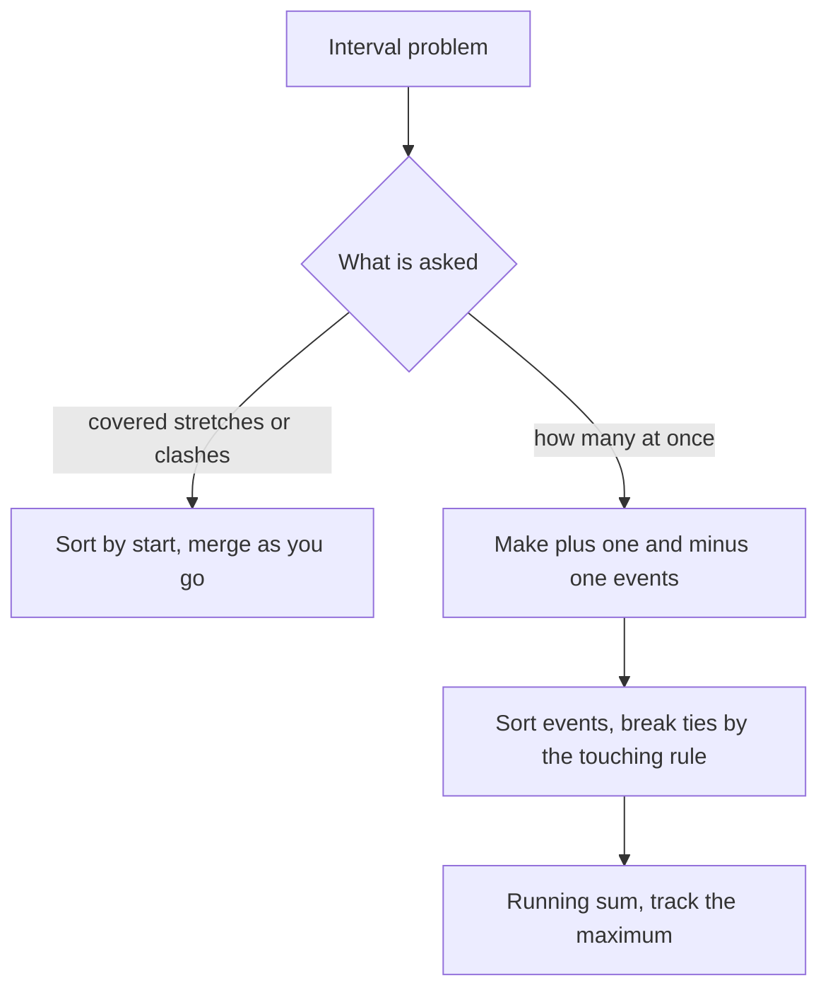

## The hook

A calendar app must show your busy blocks, merging back-to-back and overlapping meetings into single stretches. A restaurant wants to know the most customers it ever had at once. A booking system must check whether a new reservation clashes with existing ones.

These sound like different problems. They are all interval problems, and almost every interval problem yields to one of two moves: sort by start and walk forward, or turn starts and ends into events and sweep across them.

## The intuition

:::analogy
Picture a receptionist at a restaurant door with a clicker counter. Every time a guest walks in, they click up; every time a guest leaves, they click down. They never need to know who is sitting where. Glancing at the counter at any moment tells them how many guests are inside, and the highest number they ever saw is the peak occupancy.
:::

Each guest is an [[interval]]: an arrival time and a departure time. The receptionist's clicks are [[event]]s. Reading the counter as time moves forward is a [[sweep line]]. And when you only care which stretches of time are busy, you [[merge]] overlapping visits into continuous blocks.

## How it works

### Move 1: sort by start, then merge

Sort intervals by start time. Walk through them, keeping the last merged block:

- If the next interval starts at or before the block's end, they [[overlap]]: extend the block's end to the larger of the two ends.
- Otherwise the block is finished; start a new block.

Sorting guarantees that once an interval starts after the current block ends, nothing later can touch that block, because everything later starts even later. In receptionist terms: once the room has been empty for a moment, the next guest starts a brand-new busy stretch, and nothing earlier can ever join it.

### Move 2: sweep events

Turn each interval [s, e] into two events: (+1 at s) and (−1 at e). Sort all events by time, breaking ties carefully, then walk through them keeping a running sum. The running sum is the number of intervals covering that moment; its maximum is the peak overlap.



### Move 3: sort by end, then keep greedily

"Remove the fewest intervals so the rest do not overlap" or "fit in as many meetings as possible" calls for sorting by **end** time. Always keep the interval that finishes first, then skip everything that clashes with it. Finishing early leaves the most room for whatever comes next, so this greedy choice is never worse than any other. The full proof is the exchange argument in the greedy articles; the intuition is the receptionist who prefers the guest who will leave soonest.

### Move 4: two pointers across two sorted lists

When two lists are each sorted and internally non-overlapping, such as two people's free slots, walk them together. The overlap of the current pair is `[max(starts), min(ends)]` if that is non-empty. Then advance whichever interval ends first, since it cannot overlap anything later in the other list.

| Question | Sort by | Then |
|---|---|---|
| Merge overlaps, or insert one interval | start | extend the last block while overlapping |
| Most at the same moment, rooms needed | event time | running sum of +1 and −1 |
| Fewest removals, most kept, fewest arrows | end | keep the earliest finisher, skip clashes |
| Common free time of two sorted lists | already sorted | two pointers, advance the earlier end |

:::insight
Intervals are hard to compare all at once and easy to process in time order. Sorting by start turns "does anything overlap?" into "does the next one overlap the last one?", and events turn "how many at once?" into a running counter.
:::

## Walk through an example

**Merge** `[[1,3], [8,10], [2,6], [15,18], [9,11]]`.

Sorted by start: [1,3], [2,6], [8,10], [9,11], [15,18].

| Next interval | Last merged block | Overlap? | Blocks after |
|---|---|---|---|
| [1,3] | — | — | [1,3] |
| [2,6] | [1,3] | 2 ≤ 3, yes | [1,6] |
| [8,10] | [1,6] | 8 > 6, no | [1,6], [8,10] |
| [9,11] | [8,10] | 9 ≤ 10, yes | [1,6], [8,11] |
| [15,18] | [8,11] | 15 > 11, no | [1,6], [8,11], [15,18] |

**Peak overlap** for guests [1,4], [2,5], [3,6] (leaving at time t means gone at t):

Events: +1@1, +1@2, +1@3, −1@4, −1@5, −1@6. Running sum: 1, 2, 3, 2, 1, 0. Peak: **3**, between times 3 and 4.

**Insert** [4, 8] into the sorted, non-overlapping list [1,2], [3,5], [6,7], [8,10], [12,16]. Three phases: copy everything that ends before 4, absorb everything that starts at or before the growing block's end, then copy the rest.

| Phase | Intervals | Block after |
|---|---|---|
| ends before 4, copy | [1,2] | [4,8] |
| starts at or before the block's end, absorb | [3,5], [6,7], [8,10] | [3,10] |
| the rest, copy | [12,16] | |

Result: [1,2], [3,10], [12,16]. No sort is needed, because the input was already sorted, so insertion is O(n).

**Fewest removals** to make [1,2], [2,3], [3,4], [1,3] non-overlapping, where touching is allowed.

Sorted by end: [1,2], [2,3], [1,3], [3,4]. | Interval | Starts at or after the last kept end? | Decision |
|---|---|---|
| [1,2] | nothing kept yet | keep, end 2 |
| [2,3] | 2 ≥ 2 | keep, end 3 |
| [1,3] | 1 < 3 | drop |
| [3,4] | 3 ≥ 3 | keep, end 4 |

One removal.

**Intersections** of A = [0,2], [5,10], [13,23], [24,25] and B = [1,5], [8,12], [15,24], [25,26]:

| A | B | Overlap | Advance |
|---|---|---|---|
| [0,2] | [1,5] | [1,2] | A, it ends first |
| [5,10] | [1,5] | [5,5] | B |
| [5,10] | [8,12] | [8,10] | A |
| [13,23] | [8,12] | none | B |
| [13,23] | [15,24] | [15,23] | A |
| [24,25] | [15,24] | [24,24] | B |
| [24,25] | [25,26] | [25,25] | A, list finished |

Six intersections, found in one pass over both lists.

:::try-this
Find the peak for [1,3], [3,5], [5,7], where a guest leaving at 3 and one arriving at 3 do not overlap. Which tie rule do you need? (Process departures before arrivals at the same time. Events: +1@1, −1@3, +1@3, −1@5, +1@5, −1@7. Running sum never exceeds 1, so the peak is 1.)
:::

## The code

```pseudo
merge(intervals):
    sort intervals by start
    result = []
    for (s, e) in intervals:
        if result is not empty and s <= result.last.end:
            result.last.end = max(result.last.end, e)
        else:
            append (s, e) to result
    return result

peak_overlap(intervals):
    events = [(s, +1) and (e, -1) for each interval]
    sort events by time, with -1 before +1 at equal times
    cur = 0, best = 0
    for (t, d) in events:
        cur += d
        best = max(best, cur)
    return best
```

```cpp
#include <bits/stdc++.h>
using namespace std;
using Iv = array<int, 2>;

vector<Iv> mergeIntervals(vector<Iv> v) {
    sort(v.begin(), v.end());
    vector<Iv> out;
    for (auto& [s, e] : v) {
        if (!out.empty() && s <= out.back()[1]) out.back()[1] = max(out.back()[1], e);
        else out.push_back({s, e});
    }
    return out;
}

int peakOverlap(const vector<Iv>& v) {
    vector<pair<int, int>> ev;  // (time, delta); -1 sorts before +1 at the same time
    for (auto& [s, e] : v) { ev.push_back({s, +1}); ev.push_back({e, -1}); }
    sort(ev.begin(), ev.end());
    int cur = 0, best = 0;
    for (auto& [t, d] : ev) best = max(best, cur += d);
    return best;
}

vector<Iv> insertInterval(const vector<Iv>& v, Iv nw) {   // v sorted and disjoint
    vector<Iv> out;
    size_t i = 0;
    while (i < v.size() && v[i][1] < nw[0]) out.push_back(v[i++]);          // entirely before
    while (i < v.size() && v[i][0] <= nw[1])                                // overlapping: absorb
        nw = {min(nw[0], v[i][0]), max(nw[1], v[i][1])}, i++;
    out.push_back(nw);
    while (i < v.size()) out.push_back(v[i++]);                             // entirely after
    return out;
}

int minRemovals(vector<Iv> v) {                           // touching is allowed
    sort(v.begin(), v.end(), [](const Iv& a, const Iv& b) { return a[1] < b[1]; });
    int kept = 0, end = INT_MIN;
    for (auto& [s, e] : v)
        if (s >= end) kept++, end = e;                     // earliest finisher that fits
    return v.size() - kept;
}

vector<Iv> intersect(const vector<Iv>& A, const vector<Iv>& B) {
    vector<Iv> out;
    for (size_t i = 0, j = 0; i < A.size() && j < B.size();) {
        int lo = max(A[i][0], B[j][0]), hi = min(A[i][1], B[j][1]);
        if (lo <= hi) out.push_back({lo, hi});
        if (A[i][1] < B[j][1]) i++;                       // the one that ends first is done
        else j++;
    }
    return out;
}

void print(const vector<Iv>& v) {
    for (auto& [s, e] : v) cout << '[' << s << ',' << e << "] ";
    cout << '\n';
}

int main() {
    print(mergeIntervals({{1, 3}, {8, 10}, {2, 6}, {15, 18}, {9, 11}}));   // [1,6] [8,11] [15,18]
    cout << peakOverlap({{1, 4}, {2, 5}, {3, 6}}) << ' '
         << peakOverlap({{1, 3}, {3, 5}, {5, 7}}) << '\n';                 // 3 1
    print(insertInterval({{1, 2}, {3, 5}, {6, 7}, {8, 10}, {12, 16}}, {4, 8}));  // [1,2] [3,10] [12,16]
    cout << minRemovals({{1, 2}, {2, 3}, {3, 4}, {1, 3}}) << '\n';         // 1
    print(intersect({{0, 2}, {5, 10}, {13, 23}, {24, 25}}, {{1, 5}, {8, 12}, {15, 24}, {25, 26}}));
    // [1,2] [5,5] [8,10] [15,23] [24,24] [25,25]
}
```

Sorting pairs `(time, delta)` puts −1 before +1 at equal times automatically, which implements the "departures first" rule.

## Complexity

- **Time:** O(n log n) for sorting; the merge walk and the sweep are O(n).
- **Space:** O(n) for the output or the 2n events.

When times are small integers, a difference array, adding +1 at s and −1 at e and taking prefix sums as in [prefix sums](article:dsa-prefix-sums), gives the same counts in O(n + T) without sorting.

## Common mistakes

:::warning
Common misconception: "touching intervals always overlap." It depends on the problem. A meeting ending at 10:00 and one starting at 10:00 usually do not clash, but closed integer ranges [1,3] and [3,5] share the point 3. Decide the rule from the statement, then encode it in your comparison (`<` vs `<=`) and in the event tie-break.
:::

- **Forgetting to sort** before merging, which misses overlaps between non-adjacent intervals in the input.
- **Setting the merged end to the new interval's end** instead of the maximum, which breaks when one interval contains another, like [1,10] and [2,3].
- **Wrong tie-break** in the sweep, which over- or under-counts at shared endpoints.
- **Sorting by start for the "fewest removals" question.** Keeping the earliest starter can keep a very long interval that blocks many short ones; sort by end instead.
- **Advancing the wrong pointer** in intersections. Advance the interval that ends first, because it cannot meet anything later in the other list.
- **Overflow in long time ranges,** for example sums of passenger counts or times near the 32-bit limit; use 64-bit values when in doubt.

## Practice problems

*Merge Intervals* and *Insert Interval* practise Move 1. *Restaurant Customers* (CSES) and *Car Pooling* are pure sweeps: the second adds passenger counts instead of +1. *Interval List Intersections* combines sorted order with two pointers across two lists. *Non-overlapping Intervals* is Move 3: sort by end and keep the earliest finisher.

## Key takeaways

- Most interval problems become easy once intervals are processed in time order.
- To merge, sort by start and extend the last block while the next interval starts before the block ends.
- To count simultaneous intervals, turn each into a +1 and a -1 event, sort events and track a running sum.
- To keep as many non-overlapping intervals as possible, sort by end and always keep the one that finishes first.
- Decide whether touching endpoints overlap and encode that rule in comparisons and tie-breaks; with small integer times, a difference array gives the same counts without sorting.
