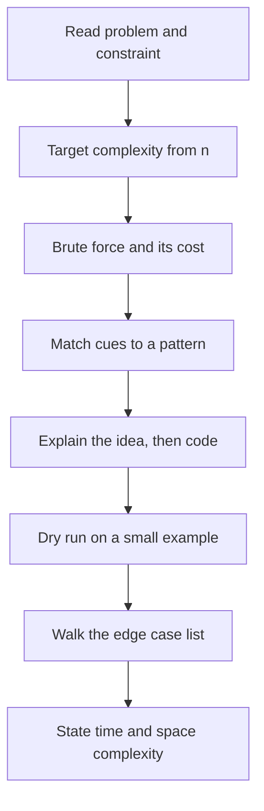

## The hook

It is the night before your interview. You have solved hundreds of problems over months, and right now they blur together. Was it the sliding window that needed positive numbers, or the prefix sums? Does the heap pop in log n or in n? What was that edge case that broke your code last week?

This sheet is meant for exactly that night. It teaches nothing new. It compresses what you already know into three tables: the [[pattern cue]]s that tell you which technique a problem wants, the costs of the tools you will reach for, and the [[edge case]]s that catch strong candidates. Read it slowly once, then close it and sleep.

## The intuition

:::analogy
Airline pilots, even with thousands of flying hours, run through a printed pre-flight checklist before every take-off. It is not because they forgot how to fly. It is because experts under pressure skip obvious steps, and the checklist makes sure nothing important is missed. They do not learn new manoeuvres on the runway; they confirm the ones they know.
:::

Treat this page as your pre-flight checklist. On interview day, the routine from [What to Do When You Have Never Seen the Problem](article:dsa-problem-solving-framework) is how you fly: understand, brute force, find the bottleneck, match a pattern, verify. The tables below are the instruments you check along the way.

## Let's build it up

### 1. Read the constraint first

The [[constraint]] tells you the target complexity before you think of any idea, as covered in [Reading Constraints Like a Pro](article:dsa-big-o). Budget about 10⁸ simple operations per second.

| Largest n | Target | Typical technique |
|---|---|---|
| 10 to 12 | O(n!) | permutations, backtracking |
| 20 to 25 | O(2ⁿ) | subsets, bitmasks |
| about 500 | O(n³) | triple loops, interval DP |
| about 5,000 | O(n²) | 2D DP, all pairs |
| 10⁵ to 10⁶ | O(n log n) or O(n) | sorting, heaps, two pointers, hashing, binary search |
| 10⁹ and above | O(log n) or O(1) | binary search on the answer, maths |

### 2. Match the cue to the pattern

| If the problem says... | Think of |
|---|---|
| sorted array, find a pair or triple | two pointers, binary search |
| contiguous subarray or substring, longest or shortest with a condition | sliding window |
| subarray sum equals k, or range sums | prefix sums with a hash map |
| "have I seen this before?", count frequencies, pair with a complement | hash map or hash set |
| maximum subarray sum | Kadane's algorithm |
| minimise the maximum or maximise the minimum | binary search on the answer |
| next greater or smaller element, histogram | monotonic stack |
| matching brackets, undo, nested structure | stack |
| cycle in a linked list, middle of a list | fast and slow pointers |
| k largest, k smallest, merge k sorted lists, running median | heap |
| intervals, meetings, overlaps | sort by start or end, then sweep |
| prefixes, autocomplete, many words searched at once | trie |
| tree depth, subtree sums, validate a BST | DFS: postorder or inorder |
| level by level, shortest path in unweighted graph or grid | BFS |
| connected components, "are these linked?" with merges | DFS or union-find |
| ordering with dependencies | topological sort |
| shortest path with non-negative weights | Dijkstra |
| all combinations, permutations, place items with constraints | backtracking |
| count ways, minimum cost, maximum value with choices that affect later steps | dynamic programming |
| take or leave items under a limit | 0/1 knapsack |
| locally best choice provably never hurts | greedy, after an exchange argument |
| single number among pairs, subsets of small sets | bit manipulation |

### 3. Know what your tools cost

| Operation | Cost |
|---|---|
| sort | O(n log n) |
| hash map insert, lookup | O(1) average, O(n) worst case |
| ordered map or set (balanced tree) insert, lookup, lower_bound | O(log n) |
| heap push, pop | O(log n); top is O(1); building from n items is O(n) |
| binary search | O(log n) |
| stack and queue push, pop | O(1) |
| vector push_back | O(1) [[amortised cost]] |
| linked list insert or delete at a known node | O(1) |
| BFS or DFS on a graph | O(V + E) |
| Dijkstra with a binary heap | O((V + E) log V) |
| union-find with path compression and union by rank | nearly O(1) per operation, amortised |
| trie insert or lookup | O(length of the word) |
| DP | number of states × work per transition |

### 4. Edge cases to try every time

- Empty input, and a single element.
- All elements equal; already sorted; sorted in reverse.
- Negative numbers and zeros, especially for products, sums and sliding windows.
- Duplicates: do you need strict or non-strict comparisons?
- Very large values: does the sum or product overflow 32 bits? Use `long long`.
- Off-by-one at array ends, and the first or last window.
- Graphs: disconnected components, self-loops, cycles, a single node.
- Trees: an empty tree, one node, a tree that is a long chain (recursion depth).
- Strings: empty string, one character, all the same character, uppercase versus lowercase.

:::insight
Most interview failures on familiar problems are not about the idea. They come from picking a pattern too late, or from one missed edge case. The cue table speeds up the first, and a deliberate pass over the edge-case list fixes the second.
:::

## A tiny example

Practise the checklist on one prompt: "Given an array of up to 10⁵ positive integers and a number S, find the length of the shortest contiguous subarray whose sum is at least S."

1. **Constraint**: n ≤ 10⁵ rules out O(n²) pairs; aim for O(n) or O(n log n).
2. **Cues**: "contiguous subarray", "shortest", and all numbers positive point straight to a sliding window, as in [The Caterpillar That Reads Arrays in One Pass](article:dsa-sliding-window). Positivity guarantees that growing the window increases the sum and shrinking it decreases the sum.
3. **Cost**: each element enters and leaves the window once, so O(n) time and O(1) space.
4. **Edge cases**: no subarray reaches S (return 0), a single element already at least S (answer 1), the sum of all elements overflowing 32 bits.
5. **[[Dry run]]**: [2, 3, 1, 2, 4, 3] with S = 7. The window grows to [2, 3, 1, 2] (sum 8, length 4) and then shrinks and slides, finally reaching [4, 3] (sum 7, length 2). Answer 2.

If the numbers could be negative, the window's sum would no longer move in one direction. The cue table then points to prefix sums with a sorted structure or a monotonic deque instead. Spotting that one word, "positive", is the whole difference.

:::warning
Common misconception: "the night before, I should cover the topics I have not studied yet." Topics crammed in a few hours rarely hold up under interview pressure, and they crowd out the patterns you actually know. Revise, rehearse explaining a solution out loud once, and sleep. A rested mind recognises patterns faster than a tired one with one extra topic.
:::

:::try-this
Cover the second table, then say which pattern fits each prompt: (a) "the k most frequent words", (b) "can you finish all courses given their prerequisites?", (c) "the number of ways to make change for an amount". (Answers: (a) hash map counts plus a heap of size k; (b) topological sort to detect a cycle; (c) a counting DP over amounts.)
:::

## Where you'll see this again

Every article in this subject feeds a row of these tables. When an interview problem feels unfamiliar, come back to the cue table: most "new" problems are a known pattern with a twist in the wording. Over the coming weeks, add your own rows, especially for mistakes you personally keep making. A revision sheet you have edited yourself is worth far more than one you only read.

## Key takeaways

- Read the constraint first, because the size of n tells you which complexity, and so which family of techniques, will pass.
- Words in the problem statement such as sorted, contiguous, k largest, dependencies or count the ways are cues that point to specific patterns.
- Knowing the cost of each data structure operation lets you state and defend your solution's complexity quickly.
- Walking a fixed list of edge cases before submitting catches the bugs that most often sink correct ideas.
- The night before, revise known patterns and rest, instead of learning new topics under pressure.
