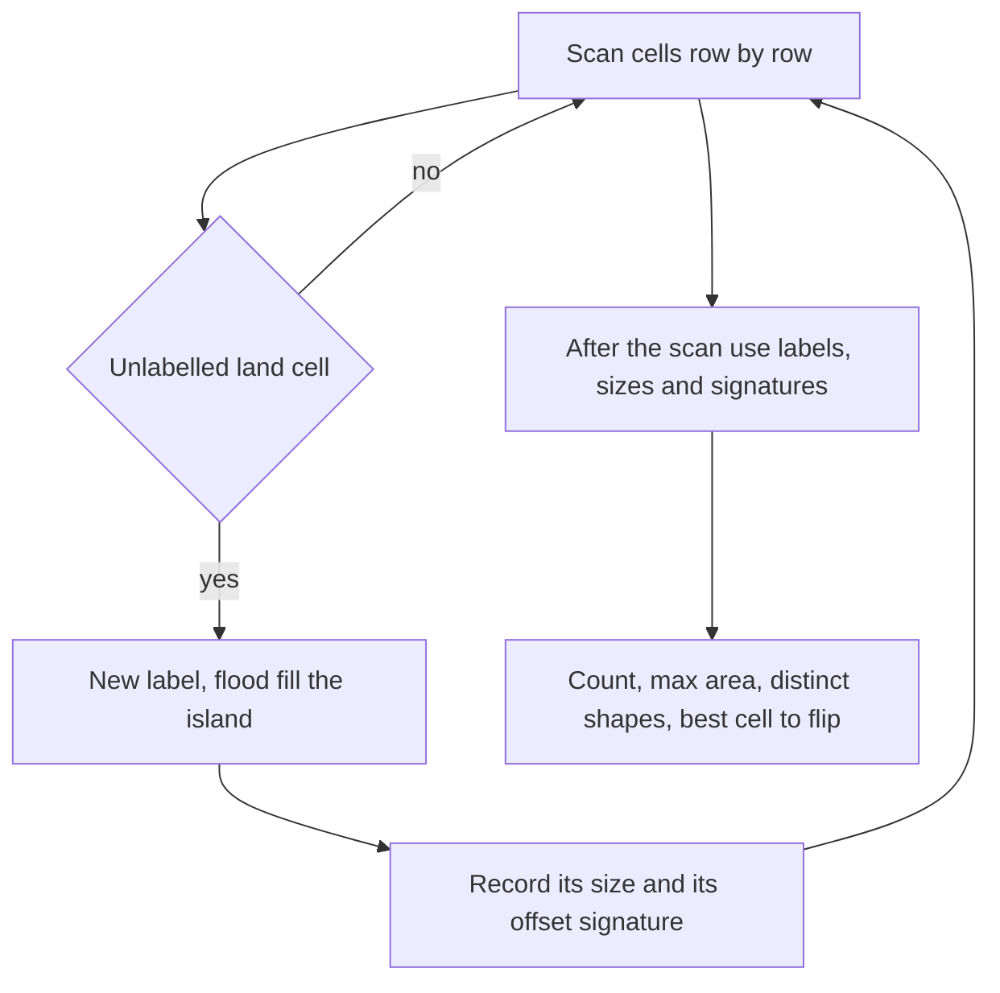

## The hook

A cartographer is handed a satellite photo made of tiny squares, land or water, and asked how many islands are in the picture. Squares touching side by side belong to the same island. Diagonal contact does not count.

That question is *Number of Islands*, one of the most asked problems in interviews. Its real value is that a dozen follow-ups sit on top of it: biggest island, distinct shapes, islands not touching the edge, the best single cell to reclaim from the sea, and islands appearing one square at a time. Each is a small change to the same flood fill.

## The problem

You are given a grid of '1' (land) and '0' (water). An island is a group of land cells connected up, down, left or right. Count the islands.

For this grid, the answer is 4:

```
1 1 0 0 0
1 1 0 1 1
0 0 0 1 0
0 0 0 0 0
1 1 0 1 1
```

## The obvious approach

Treat every land cell as a vertex, connect neighbouring land cells, build an adjacency list, and count connected components. It works, but building the list is pointless work: each cell's neighbours are already known from its position. The other common false start is to count land cells with no land to their left or above, which breaks on shapes like a U, whose two arms both look like new islands.

## The key insight

:::analogy
The cartographer takes a pot of paint. Scanning the photo row by row, whenever they meet an unpainted land square, they start a new colour and paint that square and every land square connected to it, spreading out until the colour stops at water. Then they continue the scan. The number of colours used is the number of islands, and every square now says which island it belongs to.
:::

The paint is [[flood fill]]: a BFS or DFS from one land cell over land neighbours. The scan starts one fill per island, because a fill marks its whole island and no cell of it can start another. Each cell is painted once, so the whole count is O(R × C).

The colour is an [[island label]]. Writing labels, rather than just "visited", is what makes the harder variants easy.

### Variant by variant

| Variant | Change to the fill | Extra idea |
|---|---|---|
| Max Area of Island | Count cells painted per fill | Keep the largest count |
| Distinct islands (premium) | Record cell offsets from the fill's start | Put each offset list in a set |
| Number of Closed Islands | First flood fill everything touching the border | Then count the rest |
| Count Sub Islands | Fill islands of grid 2 | An island counts if every cell is also land in grid 1 |
| Making A Large Island | Label islands and store each label's size | For each water cell, add sizes of distinct neighbouring labels, plus 1 |
| Islands appearing over time (premium) | No fills at all | Union-find: each new land cell adds one island, each successful union removes one |

### Distinct shapes

LeetCode's *Number of Distinct Islands* is a premium problem, but the technique is worth knowing.

During each fill, record every cell as (row - start row, column - start column). Because the scan always reaches an island first at the same cell of its shape, its top-left-most cell in row order, two copies of the same shape produce the same set of offsets. Sort the offsets, or use a fixed visiting order, and insert the list into a set.

The set's size is the number of distinct shapes. That list is a [[canonical signature]].

### Closed islands and sub islands

A [[closed island]] touches no border. Flood fill from every land cell on the border first and erase or mark those islands; whatever islands remain are closed. *Number of Enclaves* is the same idea counting cells instead of islands.

*Count Sub Islands* gives two grids. An island of grid 2 is a sub island if every one of its cells is land in grid 1 as well. Flood fill each island of grid 2 completely, even after finding a bad cell, so the whole island is marked, and count it only if no bad cell appeared.

### Making a large island

You may flip at most one '0' to '1'. Label every island and record each label's size. Then for each water cell, gather the labels of its up to four neighbours into a set, so that one island touching the cell from two sides is counted once, and the candidate size is 1 plus the sum of those islands' sizes. The answer is the best candidate, or the whole grid's size if it has no water.

### When land appears over time

In *Number of Islands II*, also premium, the grid starts as all water and cells turn to land one at a time; after each addition, report the number of islands. Re-running flood fill each time is far too slow.

Instead keep a union-find structure, the one from [Friend Groups That Merge at a Party](article:dsa-union-find). A new land cell is a new island, so add one. Then union it with each neighbouring land cell, and subtract one for every union that actually merges two different islands. That is [[online connectivity]] in near-constant time per addition.



:::insight
Write an island id into every cell during flood fill. Counting, sizes, shapes and "which islands touch this water cell" all become simple lookups on that labelled grid, so almost every islands variant is one fill plus one extra pass.
:::

## Walk through an example

The grid from the problem statement, labelled by the scan:

```
1 1 0 0 0
1 1 0 2 2
0 0 0 2 0
0 0 0 0 0
3 3 0 4 4
```

| Island | Size | Offsets from its first cell | Shape |
|---|---|---|---|
| 1 | 4 | (0,0) (0,1) (1,0) (1,1) | 2 × 2 square |
| 2 | 3 | (0,0) (0,1) (1,0) | L shape |
| 3 | 2 | (0,0) (0,1) | horizontal pair |
| 4 | 2 | (0,0) (0,1) | horizontal pair |

Four islands; the largest has area 4. Islands 3 and 4 have identical signatures, so there are 3 distinct shapes.

Closed islands: islands 1, 3 and 4 touch the border, and so does island 2, whose cell (1, 4) is on the right edge. None is closed.

### Best water cell to flip

| Water cell | Neighbouring labels | Candidate size |
|---|---|---|
| (1, 2) | 1, 2 | 1 + 4 + 3 = 8 |
| (3, 3) | 2, 4 | 1 + 3 + 2 = 6 |
| (4, 2) | 3, 4 | 1 + 2 + 2 = 5 |
| (2, 0) | 1 | 1 + 4 = 5 |

Flipping (1, 2) joins the square and the L into one island of 8 cells.

### Land appearing over time

A 3 × 3 grid of water; land is added at (0, 0), (0, 1), (1, 2), (2, 1), then (1, 1).

| Added | New island | Unions that merge | Islands |
|---|---|---|---|
| (0, 0) | +1 | | 1 |
| (0, 1) | +1 | with (0, 0): -1 | 1 |
| (1, 2) | +1 | | 2 |
| (2, 1) | +1 | | 3 |
| (1, 1) | +1 | with (0, 1), (1, 2), (2, 1): -3 | 1 |

The last cell touches three different islands and joins them all.

:::try-this
If diagonal contact also counted, how many islands would the example grid have? (Use eight directions. Island 1's cell (1, 1) and island 2's cell (2, 3) are not diagonal neighbours, nor is anything else adjacent diagonally across water, so the count stays 4. Diagonal rules change the answer only when two land cells touch at a corner.)
:::

:::warning
Common misconception: "Overwriting the grid with '0' during flood fill is always fine." It is the usual trick to save a visited array, but some interviewers say the input must not change, and variants such as Making A Large Island need the original land and water afterwards. When in doubt, write labels into a separate array, or restore the grid at the end.
:::

## The code

```pseudo
label_islands(grid):
    label = 0-filled grid; sizes = [0]; next = 1
    for each cell (r, c) in row order:
        if grid[r][c] is land and label[r][c] == 0:
            stack = [(r, c)]; label[r][c] = next; cells = []
            while stack:
                (x, y) = stack.pop(); cells.append((x - r, y - c))
                for each neighbour (a, b) that is land and unlabelled:
                    label[a][b] = next; stack.push((a, b))
            sizes.append(len(cells)); shapes.add(sorted(cells)); next += 1
```

```cpp
#include <bits/stdc++.h>
using namespace std;
const int DR[] = {-1, 1, 0, 0}, DC[] = {0, 0, -1, 1};

struct Islands {
    int R, C;
    vector<vector<int>> label;                       // 0 = water or unlabelled
    vector<int> sizes{0};                            // sizes[id]
    set<vector<pair<int, int>>> shapes;
    explicit Islands(const vector<string>& g) : R(g.size()), C(g[0].size()), label(R, vector<int>(C, 0)) {
        for (int r = 0; r < R; r++)
            for (int c = 0; c < C; c++)
                if (g[r][c] == '1' && !label[r][c]) fill(g, r, c, sizes.size());
    }
    void fill(const vector<string>& g, int r, int c, int id) {
        vector<pair<int, int>> stack = {{r, c}}, cells;
        label[r][c] = id;
        while (!stack.empty()) {                     // iterative, so big grids cannot overflow
            auto [x, y] = stack.back(); stack.pop_back();
            cells.push_back({x - r, y - c});         // offset from the island's first cell
            for (int k = 0; k < 4; k++) {
                int a = x + DR[k], b = y + DC[k];
                if (a < 0 || b < 0 || a >= R || b >= C || g[a][b] != '1' || label[a][b]) continue;
                label[a][b] = id, stack.push_back({a, b});
            }
        }
        sizes.push_back(cells.size());
        sort(cells.begin(), cells.end());
        shapes.insert(cells);
    }
    int count() const { return sizes.size() - 1; }
    int maxArea() const { return *max_element(sizes.begin(), sizes.end()); }
    int largestAfterFlip() const {
        int best = maxArea();
        for (int r = 0; r < R; r++)
            for (int c = 0; c < C; c++) {
                if (label[r][c]) continue;
                set<int> near;                       // distinct islands touching this water cell
                for (int k = 0; k < 4; k++) {
                    int a = r + DR[k], b = c + DC[k];
                    if (a >= 0 && b >= 0 && a < R && b < C && label[a][b]) near.insert(label[a][b]);
                }
                int s = 1;
                for (int id : near) s += sizes[id];
                best = max(best, s);
            }
        return best;
    }
};

vector<int> islandsOnline(int R, int C, const vector<pair<int, int>>& adds) {
    vector<int> p(R * C, -1), out;                   // -1 = water
    function<int(int)> find = [&](int x) { return p[x] == x ? x : p[x] = find(p[x]); };
    int islands = 0;
    for (auto [r, c] : adds) {
        int id = r * C + c;
        if (p[id] != -1) { out.push_back(islands); continue; }   // already land
        p[id] = id, islands++;                       // a new island
        for (int k = 0; k < 4; k++) {
            int a = r + DR[k], b = c + DC[k];
            if (a < 0 || b < 0 || a >= R || b >= C || p[a * C + b] == -1) continue;
            int x = find(id), y = find(a * C + b);
            if (x != y) p[x] = y, islands--;         // two islands become one
        }
        out.push_back(islands);
    }
    return out;
}

int main() {
    Islands is({"11000", "11011", "00010", "00000", "11011"});
    cout << is.count() << ' ' << is.maxArea() << ' ' << is.shapes.size() << ' '
         << is.largestAfterFlip() << '\n';                              // 4 4 3 8
    for (int x : islandsOnline(3, 3, {{0, 0}, {0, 1}, {1, 2}, {2, 1}, {1, 1}})) cout << x << ' ';
    cout << '\n';                                                       // 1 1 2 3 1
}
```

The fill is iterative on purpose: a recursive DFS on a 1,000 × 1,000 grid of land can reach a million nested calls, far past the default stack.

## Complexity

- **Counting, areas and labels: O(R × C) time,** since each cell is pushed once and checks four neighbours; O(R × C) space for labels and the stack.
- **Distinct shapes: O(R × C log(R × C))** in the worst case for sorting the offsets and inserting them into a set.
- **Making A Large Island: O(R × C)** for the labelling plus O(1) work per water cell.
- **Online additions: O(k × α(R × C))** for k additions, effectively constant time each.

## Common mistakes

- **Counting diagonal neighbours** when the problem says only up, down, left and right, or the reverse.
- **Recursing deeply** on large grids instead of using an explicit stack or BFS.
- **Mutating the input** when the problem or a later step needs the original grid.
- **Counting an island twice** in Making A Large Island when it touches a water cell on two sides.
- **Stopping a fill early** in Count Sub Islands when a bad cell is found, which leaves the rest of that island unmarked and counted later as a separate island.
- **Forgetting the all-land case** in Making A Large Island, where no flip is possible and the answer is R × C.

## Practice problems

- *Number of Islands* is the base count, and *Max Area of Island* adds sizes.
- *Number of Closed Islands* clears the border first, and *Count Sub Islands* checks every cell of each fill against a second grid.
- *Making A Large Island* combines labels, sizes and a pass over water cells.
- *Number of Distinct Islands* and *Number of Islands II* are premium on LeetCode, but the signature and union-find techniques above are what they test.

The basic fill is in [Going Deep With a Ball of String](article:dsa-dfs), and grid tricks in [A Robot Vacuum Mapping the Room](article:dsa-grid-graph-tricks).

## Key takeaways

- Each flood fill from an unvisited land cell marks one whole island, so the number of fills is the number of islands.
- Writing an island id into every cell lets later steps look up an island's size or identity in constant time.
- Distinct shapes are counted by recording each island's cells as offsets from its first cell and putting the sorted lists in a set.
- Making A Large Island labels islands with sizes, then scores each water cell as one plus the sizes of its distinct neighbouring islands.
- When land appears over time, union-find counts islands online: each new cell adds one and each merging union removes one.
