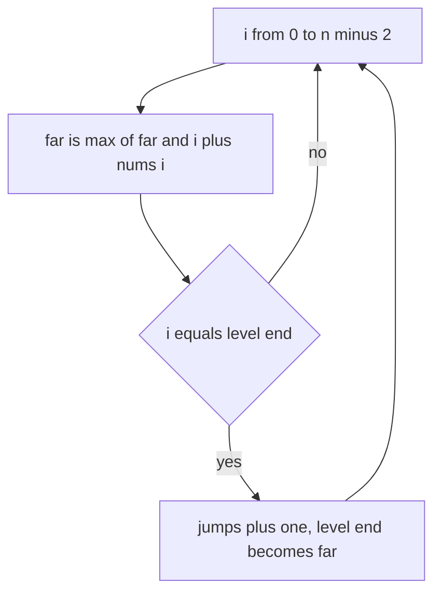

## The hook

A river is crossed by a line of stepping stones. Each stone has a number painted on it: the longest hop you can make from there. Some stones are slippery and say 0. Can you reach the far bank, and if so, in how few hops?

The tempting first answer is to explore every path, which explodes. The real answer is a single walk from left to right that remembers one number. It is a favourite interview question because the code is four lines and the reasoning is everything.

## The problem

You are given an array nums where nums[i] is the longest jump allowed from index i; any shorter jump is also allowed. You start at index 0. *Jump Game* asks whether you can reach the last index. *Jump Game II* guarantees that you can, and asks for the fewest jumps.

For nums = [2, 1, 3, 1, 0, 2, 1], you can reach the end, and the fewest jumps is 3.

## The obvious approach

Dynamic programming: index i is reachable if some reachable j before it has j + nums[j] ≥ i. Fill a boolean array from left to right.

```pseudo
reach[0] = true
for i in 1 .. n-1:
    reach[i] = any(reach[j] and j + nums[j] >= i for j in 0 .. i-1)
```

This is correct but O(n²). For Jump Game II, the same DP stores the fewest jumps to each index and is also O(n²). With 10,000 or more stones, it is far slower than needed.

## The key insight

:::analogy
Stand on the bank and look across the stones. As you walk along the ones you can reach, keep a single mark in your mind: the farthest stone any of them lets you hop to. If you ever arrive at a stone beyond that mark, you could never have stood there, so you are stuck in the river. If the mark passes the last stone, you are across.
:::

The mark is the [[farthest reach]]. One number is enough because of the [[reachable prefix]] property: if you can hop to stone r, you can also hop to every stone before it, since a hop of up to nums[i] may stop short. So the reachable stones are always the block from 0 to the farthest reach, with no gaps.

This is a "greedy stays ahead" argument from [A Bus Conductor Who Never Reseats Anyone](article:dsa-greedy-exchange): after looking at stones 0 to i, no strategy can reach farther than the mark, and the mark already includes every hop those stones allow.

### Fewest hops: levels without a queue

Group the stones by how many hops they need. Stone 0 needs 0 hops. Every stone you can hop to from stone 0 needs 1 hop, every new stone reachable from those needs 2, and so on. Each group is a [[jump level]], exactly like the layers of a breadth-first search, and because of the reachable prefix property each level is a contiguous block.

Walk once from left to right:

- keep `end`, the [[level boundary]] of the current level, and `far`, the farthest reach found so far;
- at each index, update `far`;
- when you reach `end`, the current level is used up, so add one hop and set `end = far`.

Only walk up to the second-to-last index: once you stand on the last stone, no more hops are needed.

### Video Stitching is the same river

*Video Stitching* gives clips [start, end] of a video of length T and asks for the fewest clips that cover [0, T]. For each start time s, record the farthest end of any clip beginning at s. That array is a river: from second s you can reach up to that end, and anything in between is already covered. Run the Jump Game II loop over it, and if a level ends without moving `far` forward, there is a gap and the answer is -1. *Minimum Number of Taps to Open to Water a Garden* turns each tap into such a clip.



:::insight
Reachable positions in a jump array always form one block from the start, so a single number describes all of them. Fewest jumps is that same block grown level by level, which is breadth-first search done with two numbers instead of a queue.
:::

## Walk through an example

### Can we cross? nums = [2, 1, 3, 1, 0, 2, 1]

| i | nums[i] | i ≤ farthest? | Farthest reach after |
|---|---|---|---|
| 0 | 2 | yes | 2 |
| 1 | 1 | yes | 2 |
| 2 | 3 | yes | 5 |
| 3 | 1 | yes | 5 |
| 4 | 0 | yes | 5 |
| 5 | 2 | yes | 7 |
| 6 | 1 | yes | 7 |

The farthest reach passes the last index, 6, so the answer is yes. The slippery 0 at index 4 did not matter, because stone 2 already let you hop over it.

### Stuck: nums = [1, 2, 0, 1, 0, 3]

| i | nums[i] | i ≤ farthest? | Farthest reach after |
|---|---|---|---|
| 0 | 1 | yes | 1 |
| 1 | 2 | yes | 3 |
| 2 | 0 | yes | 3 |
| 3 | 1 | yes | 4 |
| 4 | 0 | yes | 4 |
| 5 | 3 | **no, 5 > 4** | stuck |

Every path ends on the 0 at index 4.

### Fewest hops on [2, 1, 3, 1, 0, 2, 1]

| i | nums[i] | far after | i = level end? | Jumps | New level end |
|---|---|---|---|---|---|
| 0 | 2 | 2 | yes, end was 0 | 1 | 2 |
| 1 | 1 | 2 | | 1 | |
| 2 | 3 | 5 | yes | 2 | 5 |
| 3 | 1 | 5 | | 2 | |
| 4 | 0 | 5 | | 2 | |
| 5 | 2 | 7 | yes | 3 | 7 |

Three hops, for example 0 → 2 → 5 → 6. The levels were {0}, {1, 2}, {3, 4, 5} and {6}.

### Video Stitching

Clips [0, 2], [1, 5], [4, 6], [2, 3], [5, 9], [6, 8], [3, 4], and T = 8. The farthest end for each start second, 0 to 8, is 2, 5, 3, 4, 6, 9, 8, 0, 0. Running the loop: at second 0 take the clip reaching 2; at second 2 the best reach inside the level is 5, from [1, 5]; at second 5 the best reach is 9, from [5, 9]. Three clips: [0, 2], [1, 5], [5, 9].

:::try-this
For nums = [3, 1, 1, 1, 4, 1, 1, 1], find the fewest jumps. (The levels are {0}, then {1, 2, 3}, then {4}, because from 1, 2 and 3 the farthest reach is 4. From index 4 you reach 8, past the last index 7. That is 3 jumps: 0 → 3 → 4 → 7.)
:::

:::warning
Common misconception: "In Jump Game II, add a jump whenever the farthest reach improves." Improvements happen at many stones inside one level, but they all describe the same next hop. Counting each improvement overcounts; on [2, 1, 3, 1, 0, 2, 1] the reach improves at indices 0, 2 and 5 and that happens to be 3, but on [3, 1, 2, 1] it improves at 0 and 2 while one hop is enough. Add a jump only when you pass the level boundary.
:::

## The code

```pseudo
can_jump(nums):
    far = 0
    for i in 0 .. n-1:
        if i > far: return false
        far = max(far, i + nums[i])
    return true

min_jumps(nums):
    jumps = 0; end = 0; far = 0
    for i in 0 .. n-2:                       # never jump from the last index
        far = max(far, i + nums[i])
        if i == end: jumps += 1; end = far
    return jumps

video_stitching(clips, T):
    reach[s] = max end of clips starting at s, for s <= T
    run min_jumps over reach with i from 0 to T-1;
    if a level ends with far <= i: return -1
```

```cpp
#include <bits/stdc++.h>
using namespace std;

bool canJump(const vector<int>& a) {
    long long far = 0;
    for (int i = 0; i < (int)a.size(); i++) {
        if (i > far) return false;                         // this stone was never reachable
        far = max(far, (long long)i + a[i]);
    }
    return true;
}

int minJumps(const vector<int>& a) {
    int jumps = 0;
    long long end = 0, far = 0;
    for (int i = 0; i + 1 < (int)a.size(); i++) {
        far = max(far, (long long)i + a[i]);
        if (i == end) jumps++, end = far;                  // current level used up
    }
    return jumps;
}

int videoStitching(const vector<array<int, 2>>& clips, int T) {
    vector<int> reach(T + 1, 0);
    for (auto& [s, e] : clips) if (s <= T) reach[s] = max(reach[s], e);
    int count = 0, end = 0, far = 0;
    for (int i = 0; i < T; i++) {
        far = max(far, reach[i]);
        if (i == end) {
            if (far <= i) return -1;                       // a gap nobody covers
            count++, end = far;
        }
    }
    return count;
}

int main() {
    cout << canJump({2, 1, 3, 1, 0, 2, 1}) << ' ' << canJump({1, 2, 0, 1, 0, 3}) << '\n';   // 1 0
    cout << minJumps({2, 1, 3, 1, 0, 2, 1}) << ' ' << minJumps({3, 1, 1, 1, 4, 1, 1, 1})
         << ' ' << minJumps({3, 1, 2, 1}) << ' ' << minJumps({0}) << '\n';                 // 3 3 1 0
    cout << videoStitching({{0, 2}, {1, 5}, {4, 6}, {2, 3}, {5, 9}, {6, 8}, {3, 4}}, 8)
         << ' ' << videoStitching({{0, 1}, {2, 4}}, 4) << '\n';                            // 3 -1
}
```

The `minJumps({0})` case returns 0: a single stone means you are already on the far bank, which is why the loop stops before the last index.

## Complexity

- **Jump Game: O(n) time, O(1) space,** one pass with one number.
- **Jump Game II: O(n) time, O(1) space,** compared with O(n²) for the DP.
- **Video Stitching: O(c + T)** for c clips and length T, with O(T) space for the reach array.

## Common mistakes

- **Adding a jump whenever the reach improves** instead of when the level boundary is passed.
- **Looping to the last index in Jump Game II,** which adds an extra jump when the last level ends exactly on the last index.
- **Forgetting the stuck check** in Video Stitching and similar problems, which turns a gap into an infinite or wrong count.
- **Using recursion or BFS with a queue** over all jump lengths, which is O(n²) in the worst case when values are large.
- **Overflow in i + nums[i]** when values are near the integer limit; use 64-bit for the reach.

## Practice problems

*Jump Game* is the farthest reach on its own, and *Jump Game II* adds levels. *Video Stitching* and *Minimum Number of Taps to Open to Water a Garden* first convert intervals into a reach array, then run the same loop. Choosing intervals for a different goal, the most that do not overlap, is in [Choosing Talks at a Busy Conference](article:dsa-interval-scheduling).

## Key takeaways

- The indices reachable in a jump array always form one block from the start, so tracking the farthest reach is enough to decide whether the end is reachable.
- If the loop ever stands on an index beyond the farthest reach, that index and everything after it are unreachable.
- The fewest jumps come from breadth-first levels, each a contiguous block, tracked with only the current level's end and the farthest reach.
- A jump is added only when the walk passes the current level's end, and the walk stops before the last index.
- Covering problems such as Video Stitching become Jump Game II after recording, for each start, the farthest end of an interval beginning there.
