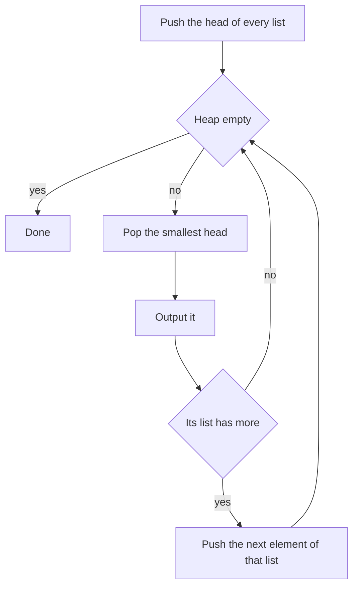

## The hook

At closing time, five cashiers each hold a stack of receipts already sorted by time. The manager wants one list of every sale in time order. She does not shuffle all the receipts together and sort them. She looks at the top receipt of each stack, takes the earliest, and repeats. With five stacks, each choice is a comparison among five.

That is a [[k-way merge]], the structure behind merging k sorted linked lists, searching a sorted matrix, and sorting data too big for memory. With a min-heap holding the current top of each stack, every step costs O(log k), however many receipts there are.

## The intuition

:::analogy
Picture the cashiers' stacks side by side. Only the top receipt of each stack is a candidate for the next earliest sale; everything underneath is later than its own top. So the manager keeps a small tray holding exactly one receipt from each stack, the current top, sorted so the earliest is always in front. She takes the front receipt, writes it down, and replaces it in the tray with the next receipt from the same stack.
:::

The tray is a [[heap of heads]]: a min-heap containing the [[head]] of every non-empty list, each tagged with the list it came from. The loop is:

- pop the smallest head and output it;
- if its list has another element, push that element as the list's new head;
- stop when the heap is empty.

The heap never holds more than k elements, one per list, so each push and pop is O(log k), and N elements in total cost O(N log k).

## How it works

### Why not simpler methods?

| Method | Time | Memory |
|---|---|---|
| collect everything and sort | O(N log N) | O(N) |
| merge lists one by one into a growing result | O(N k) | O(N) |
| merge in pairs, like rounds of merge sort | O(N log k) | O(N) |
| heap of heads | O(N log k) | O(k) beyond the output |

Pairwise merging matches the heap's time but needs more temporary memory, and it cannot run on lists that arrive as streams. The heap version also never needs the lists' total length in advance.

### External sorting

When data is too large for memory, [[external sorting]] sorts chunks that fit in memory, writes each chunk to disk as a sorted run, and then k-way merges the runs, reading each one sequentially. Only one block of each run, and a heap of k heads, needs to be in memory at once.

### A matrix with sorted rows and columns

*Kth Smallest Element in a Sorted Matrix* has every row and column sorted. Treat each row as a sorted list and k-way merge: start with the first element of each row in the heap, pop k − 1 times, pushing the next element of the popped row, and the heap's root is the k-th smallest. That is O(k log n) for an n by n matrix. Binary search on the value, counting elements below it with a staircase walk, is the other classic answer; see [Guessing the Answer, Then Checking It](article:dsa-binary-search-answer).

### Smallest range covering every list

*Smallest Range Covering Elements from K Lists* asks for the narrowest [[covering range]], an interval containing at least one element from every list. Keep one head per list in a min-heap, and track the largest head in a variable. The current heads always cover every list, with range [heap minimum, tracked maximum]. Record it, then advance the list whose head is the minimum, because that is the only way the range can shrink from below; update the maximum if the new head is larger. Stop when some list runs out, since then no range can cover every list.



:::insight
When several sequences are each sorted, the next element overall must be one of their current heads. Keeping only the heads in a min-heap turns a merge of N elements from k lists into N heap operations of cost O(log k).
:::

## Walk through an example

Merge three sorted lists: [1, 4, 7], [2, 5, 8] and [3, 6, 9].

| Step | Heap of heads (value, list) | Pop | Push |
|---|---|---|---|
| 1 | (1, A), (2, B), (3, C) | 1 | 4 from A |
| 2 | (2, B), (3, C), (4, A) | 2 | 5 from B |
| 3 | (3, C), (4, A), (5, B) | 3 | 6 from C |
| 4 | (4, A), (5, B), (6, C) | 4 | 7 from A |
| 5 | (5, B), (6, C), (7, A) | 5 | 8 from B |

and so on until all nine are output: 1, 2, 3, ..., 9. The tray never held more than three receipts. The same matrix read as rows [1, 4, 7], [2, 5, 8], [3, 6, 9] gives its 5th smallest element, 5, as the root after four pops.

### Smallest range for [1, 7, 12], [3, 8, 20] and [6, 9, 25]

| Heads | Minimum | Maximum | Range | Best so far | Advance |
|---|---|---|---|---|---|
| 1, 3, 6 | 1 | 6 | [1, 6] | [1, 6] | list 1 to 7 |
| 7, 3, 6 | 3 | 7 | [3, 7] | [3, 7] | list 2 to 8 |
| 7, 8, 6 | 6 | 8 | [6, 8] | [6, 8] | list 3 to 9 |
| 7, 8, 9 | 7 | 9 | [7, 9] | [6, 8], same width, earlier start | list 1 to 12 |
| 12, 8, 9 | 8 | 12 | [8, 12] | [6, 8] | list 2 to 20 |
| 12, 20, 9 | 9 | 20 | wider | [6, 8] | list 3 to 25 |
| 12, 20, 25 | 12 | 25 | wider | [6, 8] | list 1 is exhausted, stop |

The answer is [6, 8], which contains 7, 8 and 6, one from each list. On the cashiers' tray, the range is simply "earliest receipt to latest receipt currently on the tray".

:::try-this
Merge [2, 9] and [1, 3, 4] with a heap of heads. In what order are elements popped, and when does the first list's 9 enter the heap? (Pops: 1, 2, 3, 4, 9. The 9 is pushed when 2 is popped, at the second step, and waits in the heap until 3 and 4 have gone.)
:::

:::warning
Common misconception: "Merge the lists one at a time into an accumulating result; each merge is linear." Each merge is linear in the size of the growing result, so merging k lists of length L costs L(2 + 3 + ... + k), which is O(L k²) = O(N k). The heap of heads, or merging in pairs, brings it down to O(N log k).
:::

## The code

```pseudo
merge_k(lists):
    heap = (head value, list index) for every non-empty list
    while heap not empty:
        (v, i) = pop; output v
        if list i has another element: push (next of list i, i)

smallest_range(lists):
    heap = (first element, list, index 0) for each list; maxHead = largest first element
    best = (heap.min, maxHead)
    loop:
        (v, i, j) = pop
        if maxHead - v < width of best: best = (v, maxHead)
        if j + 1 == length of list i: stop
        push (lists[i][j + 1], i, j + 1); maxHead = max(maxHead, lists[i][j + 1])
```

```cpp
#include <bits/stdc++.h>
using namespace std;

using T = tuple<int, int, int>;                          // (value, list, index in list)

vector<int> mergeK(const vector<vector<int>>& lists) {
    priority_queue<T, vector<T>, greater<T>> heap;        // the tray of heads
    for (int i = 0; i < (int)lists.size(); i++)
        if (!lists[i].empty()) heap.push({lists[i][0], i, 0});   // never push from an empty list
    vector<int> out;
    while (!heap.empty()) {
        auto [v, i, j] = heap.top(); heap.pop();
        out.push_back(v);
        if (j + 1 < (int)lists[i].size()) heap.push({lists[i][j + 1], i, j + 1});
    }
    return out;
}

int kthSmallestMatrix(const vector<vector<int>>& m, int k) {
    priority_queue<T, vector<T>, greater<T>> heap;
    for (int r = 0; r < (int)m.size(); r++) heap.push({m[r][0], r, 0});
    while (--k) {                                         // pop k - 1 times
        auto [v, r, c] = heap.top(); heap.pop();
        if (c + 1 < (int)m[r].size()) heap.push({m[r][c + 1], r, c + 1});
    }
    return get<0>(heap.top());
}

pair<int, int> smallestRange(const vector<vector<int>>& lists) {
    priority_queue<T, vector<T>, greater<T>> heap;
    int maxHead = INT_MIN;
    for (int i = 0; i < (int)lists.size(); i++) heap.push({lists[i][0], i, 0}), maxHead = max(maxHead, lists[i][0]);
    pair<int, int> best = {get<0>(heap.top()), maxHead};
    while (true) {
        auto [v, i, j] = heap.top(); heap.pop();
        if ((long long)maxHead - v < (long long)best.second - best.first) best = {v, maxHead};
        if (j + 1 == (int)lists[i].size()) break;         // this list is exhausted
        int nv = lists[i][j + 1];
        heap.push({nv, i, j + 1});
        maxHead = max(maxHead, nv);
    }
    return best;
}

int main() {
    for (int x : mergeK({{1, 4, 7}, {2, 5, 8}, {3, 6, 9}, {}})) cout << x << ' ';
    cout << '\n';                                         // 1 2 3 4 5 6 7 8 9
    cout << kthSmallestMatrix({{1, 4, 7}, {2, 5, 8}, {3, 6, 9}}, 5) << '\n';   // 5
    auto [lo, hi] = smallestRange({{1, 7, 12}, {3, 8, 20}, {6, 9, 25}});
    cout << lo << ' ' << hi << '\n';                      // 6 8
    for (int x : mergeK({{2, 9}, {1, 3, 4}})) cout << x << ' ';
    cout << '\n';                                         // 1 2 3 4 9
}
```

The first test includes an empty list, which is skipped when building the heap; pushing a head from an empty list is a classic crash. For linked lists, the same loop pushes node pointers instead of indices, as in [Splitting a Deck in Half and Merging the Piles](article:dsa-sort-linked-list).

## Complexity

- **Merging k lists: O(N log k) time,** each of the N elements pushed and popped once on a heap of at most k; O(k) extra space.
- **K-th smallest in an n by n sorted matrix: O(k log n),** or O(n log(range)) with binary search on the value.
- **Smallest range: O(N log k)** for N elements across k lists, O(k) space.

## Common mistakes

- **Pushing heads from empty lists,** or null list nodes, which crashes on the first pop.
- **Forgetting which list an element came from,** so the next element cannot be pushed.
- **Merging lists sequentially** into one result, which is O(N k).
- **Not tracking the maximum** in Smallest Range; a min-heap does not give it.
- **Continuing Smallest Range after a list runs out;** no later range can cover that list.
- **Using a max-heap by mistake** in C++, where priority_queue defaults to max; pass greater<>.

## Practice problems

*Merge k Sorted Lists* is the heap of heads on linked lists. *Kth Smallest Element in a Sorted Matrix* treats rows as lists and stops after k pops. *Smallest Range Covering Elements from K Lists* adds a tracked maximum so the heap's contents describe a covering range at every step. The single-list version of merging is the merge step in [Merging Two Piles of Exam Papers](article:dsa-merge-sort-inversions).

## Key takeaways

- A k-way merge combines k sorted sequences by repeatedly taking the smallest of their current heads.
- Keeping one head per list in a min-heap makes each step O(log k), so N elements merge in O(N log k) with O(k) extra memory.
- Each heap entry must record which list it came from, so the next element of that list can replace it.
- The same heap of heads finds the k-th smallest element of a matrix with sorted rows by stopping after k pops.
- Tracking the largest head alongside the min-heap gives the smallest range covering every list, advancing the list with the minimum each time.
