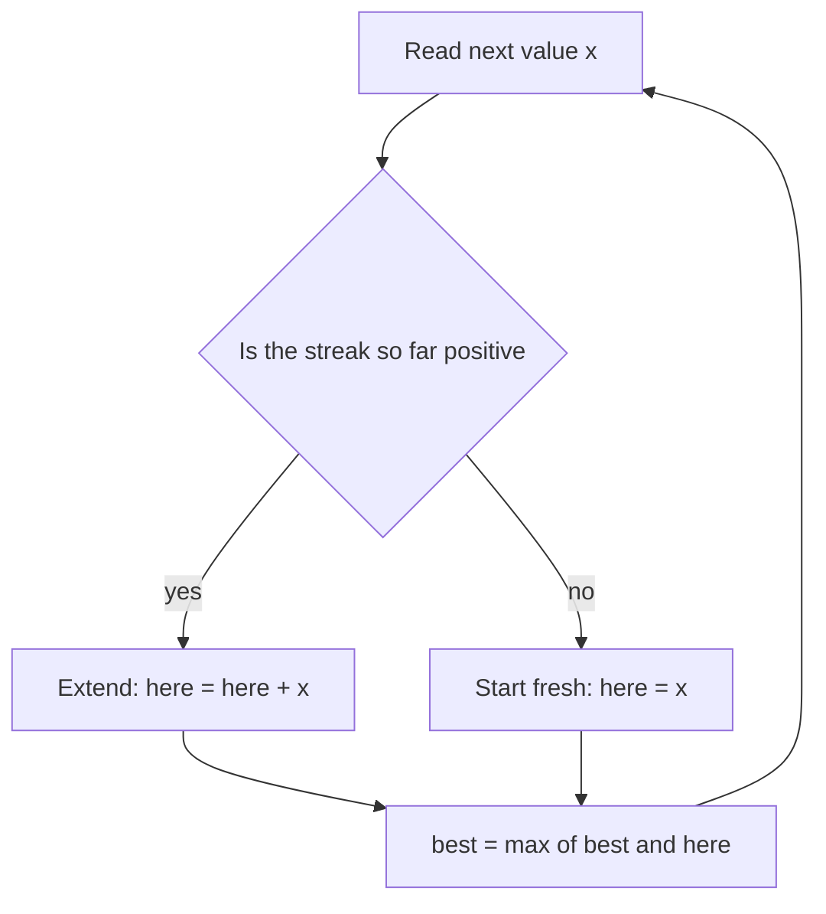

## The hook

A trader looks back at a year of daily profits and losses: up 3, down 7, up 4, up 2, down 1, up 5. What stretch of consecutive days would have made the most money? Checking every start and end day is easy to write and slow to run: about n² stretches.

Jon Bentley tells the story of this problem in his *Programming Pearls* column: researchers improved it from cubic time to quadratic to n log n, and then statistician Jay Kadane reportedly found a linear-time solution almost on the spot. It fits in five lines and asks a single question at every step.

## The intuition

:::analogy
Picture a gambler walking along a row of tables, collecting the winnings or losses at each one. At every table they ask one question: "Is my streak so far helping me, or dragging me down?" If the running total is negative, carrying it forward only hurts, so they walk away from it and start a fresh streak at this table. Otherwise they keep going.
:::

That is the whole algorithm. A negative running total can never help any future [[subarray]], because adding a negative number to whatever comes next only makes it smaller. So the gambler drops it.

## How it works

Keep two numbers as you scan left to right:

- [[Best ending here]]: the best sum of a subarray that ends exactly at the current index.
- The [[running maximum]]: the best answer seen anywhere so far.

At each index i:

$$\text{here}_i = \max(a_i,\; \text{here}_{i-1} + a_i)$$

- $a_i$ alone means "start fresh at this table".
- $\text{here}_{i-1} + a_i$ means "extend yesterday's streak".
- Then $\text{best} = \max(\text{best}, \text{here}_i)$.



This is [[dynamic programming]] in its smallest form: the answer for position i is built from the answer for position i − 1, and only the previous value is ever needed.

### The same idea seen through prefix sums

There is a second way to see why one pass is enough. The sum of a subarray ending at j is $P[j+1] - P[i]$ for some earlier prefix $P[i]$, where $P$ are the running totals from [Answering a Million Range Questions Instantly](article:dsa-prefix-sums). To make it as large as possible, subtract the smallest earlier prefix. So the best subarray ending at j is "current running total minus the [[prefix minimum]]", the lowest running total so far, and Kadane's "start fresh when the streak is negative" is exactly the moment a new lowest prefix appears.

That view also solves *Best Time to Buy and Sell Stock*: the best profit selling on day j is the price on day j minus the lowest price before it. For prices 7, 1, 5, 3, 6, 4, the lowest price before day 4 is 1, so the best profit is 6 − 1 = 5. It is the gambler again: the lowest price so far is the point where an old losing streak ended.

:::insight
Every subarray ends somewhere. If you know the best subarray ending at each position, the overall best is just the maximum of those. Kadane's trick is that each "best ending here" depends only on the one before it.
:::

## Walk through an example

The trader's year: `[3, -7, 4, 2, -1, 5]`.

| i | value | extend (here + value) | start fresh | here | best |
|---|---|---|---|---|---|
| 0 | 3 | — | 3 | 3 | 3 |
| 1 | -7 | 3 − 7 = −4 | −7 | −4 | 3 |
| 2 | 4 | −4 + 4 = 0 | 4 | **4** (fresh) | 4 |
| 3 | 2 | 4 + 2 = 6 | 2 | 6 | 6 |
| 4 | -1 | 6 − 1 = 5 | −1 | 5 | 6 |
| 5 | 5 | 5 + 5 = 10 | 5 | 10 | **10** |

Answer: 10, from the stretch `[4, 2, -1, 5]`. At index 2 the gambler walked away from a −4 streak; at index 4 they kept a small loss because the streak was still positive overall.

To recover *which* days, remember the index where the current streak started each time you "start fresh", and save it whenever `best` improves.

:::try-this
Run the table yourself on `[-2, 1, -3, 4, -1, 2, 1, -5, 4]`. You should find the best sum is 6, from `[4, -1, 2, 1]`, and that the streak restarts at the values 1 and 4.
:::

## The code

```pseudo
max_subarray(a):
    here = a[0]
    best = a[0]
    for i from 1 to n - 1:
        here = max(a[i], here + a[i])
        best = max(best, here)
    return best
```

```cpp
#include <bits/stdc++.h>
using namespace std;

long long maxSubarray(const vector<long long>& a) {
    long long here = a[0], best = a[0];
    for (size_t i = 1; i < a.size(); i++) {
        here = max(a[i], here + a[i]);
        best = max(best, here);
    }
    return best;
}

long long minSubarray(const vector<long long>& a) {      // the mirror image
    long long here = a[0], best = a[0];
    for (size_t i = 1; i < a.size(); i++) {
        here = min(a[i], here + a[i]);
        best = min(best, here);
    }
    return best;
}

// Best subarray and where it lies: remember where the current streak started.
tuple<long long, int, int> maxSubarrayRange(const vector<long long>& a) {
    long long here = a[0], best = a[0];
    int start = 0, bl = 0, br = 0;
    for (int i = 1; i < (int)a.size(); i++) {
        if (here < 0) here = a[i], start = i;            // walk away from a losing streak
        else here += a[i];
        if (here > best) best = here, bl = start, br = i;
    }
    return {best, bl, br};
}

long long maxProduct(const vector<long long>& a) {
    long long mx = a[0], mn = a[0], best = a[0];
    for (size_t i = 1; i < a.size(); i++) {
        if (a[i] < 0) swap(mx, mn);                      // a negative flips best and worst
        mx = max(a[i], mx * a[i]);
        mn = min(a[i], mn * a[i]);
        best = max(best, mx);
    }
    return best;
}

long long maxCircular(const vector<long long>& a) {
    long long total = accumulate(a.begin(), a.end(), 0LL);
    long long plain = maxSubarray(a);
    if (plain < 0) return plain;                         // all negative: wrapping would mean empty
    return max(plain, total - minSubarray(a));
}

int main() {
    cout << maxSubarray({3, -7, 4, 2, -1, 5}) << '\n';                 // 10
    cout << maxSubarray({-3, -1, -2}) << '\n';                        // -1
    auto [s, l, r] = maxSubarrayRange({-2, 1, -3, 4, -1, 2, 1, -5, 4});
    cout << s << ' ' << l << ' ' << r << '\n';                         // 6 3 6
    cout << maxProduct({2, 3, -2, 4, -1}) << '\n';                    // 48
    cout << maxCircular({5, -3, 5}) << ' ' << maxCircular({1, -2, 3, -2}) << ' '
         << maxCircular({-3, -2, -3}) << '\n';                         // 10 3 -2
    vector<long long> b = {2, -5, 1, -4, 3, -2};
    cout << max(maxSubarray(b), -minSubarray(b)) << '\n';             // 8
}
```

### Variants interviewers love

**Maximum product subarray.** A negative times a negative is positive, so the smallest product can suddenly become the largest. Keep both a max and a min product ending here, and swap them when the value is negative. A zero resets both, because `max(x, ...)` picks the fresh start.

For `[2, 3, −2, 4, −1]`:

| i | x | Swap first? | max ending here | min ending here | best |
|---|---|---|---|---|---|
| 0 | 2 | | 2 | 2 | 2 |
| 1 | 3 | no | 6 | 3 | 6 |
| 2 | −2 | yes | −2 | −12 | 6 |
| 3 | 4 | no | 4 | −48 | 6 |
| 4 | −1 | yes | 48 | −4 | 48 |

The −48 that looked terrible at index 3 becomes the winner at index 4, which is exactly why the minimum must be tracked. The answer is 48, the product of the whole array.

**Circular array.** A wrap-around subarray takes from both ends and skips a block in the middle. To make it as large as possible, skip the block with the *smallest* sum. So the best wrapping answer is `total − min_subarray`, and the overall answer is the larger of that and plain Kadane.

| Array | Plain Kadane | total − min subarray | Answer |
|---|---|---|---|
| [5, −3, 5] | 7 | 7 − (−3) = 10 | 10, wrapping 5 and 5 |
| [1, −2, 3, −2] | 3 | 0 − (−2) = 2 | 3 |
| [−3, −2, −3] | −2 | −8 − (−8) = 0 | −2, because 0 would mean the empty subarray |

The last row is the trap: when every value is negative, the "minimum subarray" is the whole array and `total − min` describes taking nothing. Use plain Kadane in that case.

**Maximum absolute sum.** The answer is the larger of the best maximum subarray and the negated best minimum subarray: run Kadane twice, once with max and once with min. For `[2, −5, 1, −4, 3, −2]`, the minimum subarray is −5 + 1 − 4 = −8, so the answer is 8.

**Maximum sum rectangle in a grid.** Fix a pair of rows, add up each column between them to get one array, and run Kadane on it. With R rows and C columns that is O(R² · C), a classic follow-up.

## Complexity

- **Time:** O(n), one pass with constant work per element.
- **Space:** O(1), just two numbers.
- **Variants:** products, circular arrays and absolute sums are still O(n) time and O(1) space, because each only adds a second running value or a second pass.

Compare with the alternatives: trying every subarray is O(n²) even with [prefix sums](article:dsa-prefix-sums), and the divide-and-conquer approach is O(n log n).

## Common mistakes

:::warning
Common misconception: "start `best` at 0, because an empty subarray sums to 0." Most problems require a non-empty subarray. With all negative values, the correct answer is the largest single element, not 0. Initialise both numbers to `a[0]`.
:::

- **Overflow** when sums of many large values exceed 32 bits. Use `long long`.
- **Resetting to 0 instead of to `a[i]`** when starting fresh, which gives the wrong answer for all-negative input.
- **Forgetting the all-negative case** in the circular variant, where `total − min_subarray` would wrongly describe an empty subarray.
- **Using one running value for products**, which misses sign flips.
- **Tracking the subarray's start too late.** Record the start index at the moment you "start fresh", and copy both start and end only when `best` improves; updating the start whenever `here` changes gives the wrong range.

## Practice problems

*Maximum Subarray* and the CSES version are the pure algorithm. *Maximum Product Subarray* tests whether you understand why one running value is enough for sums but not for products. *Maximum Sum Circular Subarray* combines Kadane with the "total minus the worst middle" trick.

*Best Time to Buy and Sell Stock* is the prefix-minimum view in disguise, and *Maximum Absolute Sum of Any Subarray* runs Kadane in both directions.

## Key takeaways

- Kadane's algorithm keeps the best sum of a subarray ending at the current index and the best answer seen so far.
- At every index the choice is to extend the previous streak or start fresh, because a negative running total can never help later.
- It runs in O(n) time and O(1) space, beating the O(n squared) brute force.
- Initialise with the first element, not zero, so arrays of all negative numbers return the right answer.
- Products need both a running maximum and minimum, and circular arrays use total sum minus the minimum subarray, except when every value is negative.
